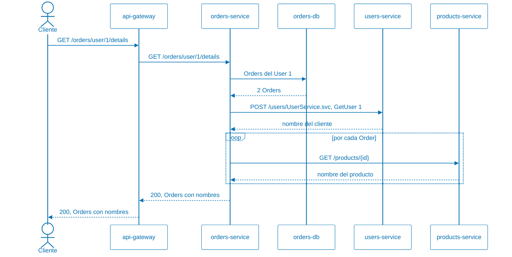
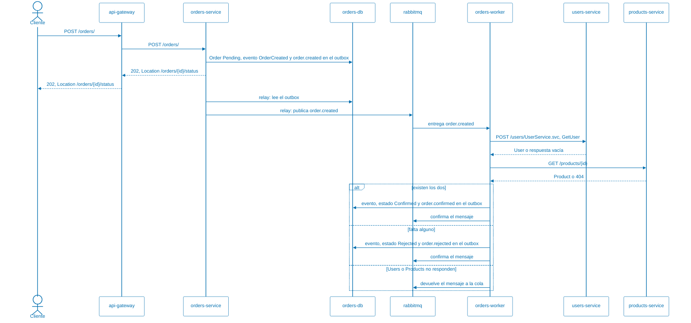
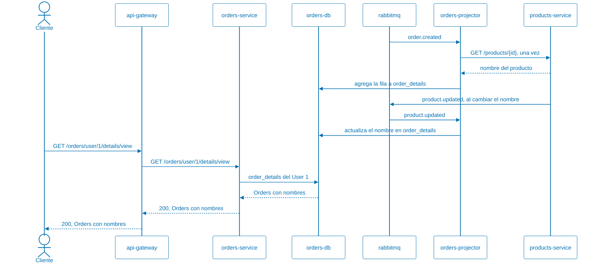

# Arquitectura de la aplicación

Este documento describe la aplicación como arquitectura de microservicios, para
analizarla: qué datos tiene cada servicio, cómo se comunican, qué tan disponible
es cada operación, cómo se mantienen consistentes los datos y qué decisiones
tienen costos. Cada sección termina con preguntas para el análisis.

Cómo ejecutar la aplicación está en el [README.md](README.md), y los patrones
que implementa están en [PATTERNS.md](PATTERNS.md).

## Servicios y datos

Cada servicio es dueño de sus datos: tiene su propia base, y ningún otro
servicio la lee ni la escribe. Si `Orders` necesita el nombre de un `User`, se
lo pide a `Users` por HTTP, o guarda una copia que se actualiza con los eventos
que publica `Users`. Además, cada servicio usa la tecnología de base de datos
que mejor le sirve.

| Servicio | Es dueño de | Base | Lo llaman | Llama a |
| -------- | ----------- | ---- | --------- | ------- |
| `users-service` | [`Users`](UsersService/Models/Users.cs): nombre y correo | PostgreSQL, relacional | gateway, `orders-service`, `orders-worker`, `orders-projector` | RabbitMQ, para publicar `user.updated` |
| `products-service` | [`Products`](ProductsService/Models/Product.cs): nombre y precio | MongoDB, documentos; Redis como caché | gateway, `orders-service`, `orders-worker`, `orders-projector` | RabbitMQ, para publicar `product.updated` |
| `orders-service` | [`Orders`](OrdersService/Models/Order.cs), sus [eventos](OrdersService/Models/OrderEvent.cs), el [*outbox*](OrdersService/Models/OutboxMessage.cs) y la [vista del detalle](OrdersService/Models/OrderDetails.cs) | MySQL, relacional | gateway | `users-service`, `products-service`, RabbitMQ |
| `orders-worker` | Comparte la base de `orders-service` | MySQL | RabbitMQ le entrega mensajes | `users-service`, `products-service` |
| `orders-projector` | Comparte la base de `orders-service`; es el único que escribe la vista del detalle | MySQL | RabbitMQ le entrega mensajes | `users-service`, `products-service` |
| `api-gateway` | Nada: solo enruta | — | clientes | los tres servicios |

Una `Order` guarda el identificador del `User` y el del `Product`, pero no hay
clave foránea que los relacione, porque están en bases distintas. El
identificador del `User` es un entero de PostgreSQL; el del `Product`, un
`ObjectId` de MongoDB que `Orders` guarda como texto. Nada impide crear una
`Order` con un identificador que no existe; eso se detecta más tarde, como se
ve en la sección de consistencia.

`orders-service`, `orders-worker` y `orders-projector` son la misma imagen de
Docker, con el *relay* del *outbox*, el *worker* o el proyector habilitados por
configuración, y comparten la base de `Orders`.

**Para analizar:**

- ¿Qué se gana y qué se pierde al tener tres bases de tres tecnologías
  distintas, en lugar de una sola base compartida?
- ¿Por qué no hay clave foránea entre una `Order` y su `User`? ¿Qué garantías
  perdemos sin ella y quién se hace cargo de esas garantías?
- `orders-service`, `orders-worker` y `orders-projector` comparten código y
  base. ¿Son un servicio o tres? ¿Qué criterio usarían para decidirlo?

## Comunicación entre servicios

La aplicación usa los dos estilos de comunicación entre servicios: síncrono,
con HTTP, y asíncrono, con eventos en RabbitMQ. Los eventos se publican en el
exchange `andis.events`, y cada suscriptor recibe los que le interesan en su
propia cola.

### Consulta de detalle: síncrona

`GET /orders/user/{userId}/details` devuelve las `Orders` de un `User` con el
nombre del cliente y el nombre de cada producto. `Orders` no tiene esos datos,
así que los pide en el momento y el cliente espera hasta que llegan todos.

Cada consulta hace 1 llamada a `Users` y 1 a `Products` por cada `Order`. Si
`Users` o `Products` no responden, `Orders` devuelve igual las `Orders`, con
"no disponible" en lugar del nombre: es la degradación que muestran las demos de
Retry, Circuit Breaker y Bulkhead.

### Creación de una Order: asíncrona

`POST /orders/` guarda la `Order` como `Pending` junto con el evento
`order.created` en el *outbox*, y responde `202 Accepted` de inmediato, sin
consultar a `Users` ni a `Products`. El *relay* del *outbox* publica el evento
en RabbitMQ un momento después. Una de las réplicas de `orders-worker` lo
recibe por la cola `orders.process`, verifica que el `User` y el `Product`
existan, y confirma o rechaza la `Order`.

El cliente sabe que la `Order` fue aceptada, pero no si fue confirmada: para
eso consulta `GET /orders/{id}/status` cada tanto, como indica `Retry-After`,
hasta que la respuesta lo redirige a la `Order` con su resultado.

### Consulta de detalle desde la vista: eventos

`GET /orders/user/{userId}/details/view` devuelve lo mismo que la consulta
síncrona, pero no llama a nadie: lee la tabla `order_details`, que ya tiene el
nombre del cliente y el de cada producto. `orders-projector` la mantiene al día
con los eventos de `Orders`, `Users` y `Products`, y es el único que llama a
`Users` y a `Products`: una vez por `Order`, al recibir `order.created`.

La consulta no depende de que `Users` y `Products` respondan, pero puede estar
atrasada: una `Order` recién creada tarda un momento en aparecer, y un nombre
recién cambiado, en actualizarse.

### Comparación

| | Consulta de detalle | Consulta desde la vista | Creación de una `Order` |
| - | ------------------- | ----------------------- | ----------------------- |
| Estilo | Síncrono, HTTP | Asíncrono, eventos que actualizan una copia | Asíncrono, eventos |
| El cliente espera a `Users` y `Products` | Sí | No | No |
| Si `Users` no responde | La respuesta llega sin el nombre del cliente | La respuesta llega con el nombre copiado; las `Orders` nuevas aparecen cuando `Users` vuelve | La `Order` queda `Pending` y se procesa cuando `Users` vuelve |
| Si llegan muchas solicitudes juntas | Cada una llama a `Users` y `Products` en el momento | Cada una es una consulta a MySQL | Se acumulan en la cola y los *workers* las procesan a su ritmo |
| Cuándo se sabe el resultado | En la respuesta | En la respuesta, con datos que pueden estar atrasados | Después, consultando el estado |

**Para analizar:**

- ¿Por qué la consulta de detalle es síncrona y la creación asíncrona? ¿Podría
  ser al revés? ¿Qué cambiaría para el cliente?
- ¿Qué servicios tienen que estar funcionando para que un cliente pueda crear una
  `Order`? ¿Y para que la `Order` quede confirmada?
- La consulta de detalle hace una llamada a `Products` por cada `Order`. ¿Qué
  pasa con un `User` que tiene 100 `Orders`? La vista lo resuelve: ¿qué se
  paga a cambio?
- La aplicación tiene las dos consultas de detalle. Si tuvieran que dejar una
  sola, ¿cuál dejarían? ¿Depende de quién la usa?

## Disponibilidad compuesta

Cuando una operación necesita varios componentes a la vez, su disponibilidad es
el producto de las disponibilidades de esos componentes. Si cada componente está
disponible el 99,9 % del tiempo, unos 43 minutos sin servicio por mes:

| Operación | Componentes que necesita | Disponibilidad | Sin servicio por mes |
| --------- | ------------------------ | -------------- | -------------------- |
| Consultar un `User` | gateway, `users-service`, `users-db` | 99,9 % ^ 3 ≈ 99,7 % | unas 2 horas |
| Consulta de detalle completa | gateway, `orders-service`, `orders-db`, `users-service`, `users-db`, `products-service`, `products-db` | 99,9 % ^ 7 ≈ 99,3 % | unas 5 horas |
| Consulta de detalle desde la vista | gateway, `orders-service`, `orders-db` | 99,9 % ^ 3 ≈ 99,7 % | unas 2 horas |
| Aceptar una `Order` | gateway, `orders-service`, `orders-db` | 99,9 % ^ 3 ≈ 99,7 % | unas 2 horas |

Cada servicio que se agrega a una cadena síncrona baja la disponibilidad de la
operación, aunque cada servicio por separado sea muy confiable. Hay dos formas de
romper la cadena, y la aplicación usa las tres:

- **Degradar la respuesta:** la consulta de detalle responde aunque falten
  `Users` o `Products`, con "no disponible" en lugar del nombre. La respuesta
  completa sigue en 99,3 %, pero una respuesta útil depende solo de gateway,
  `orders-service` y `orders-db`.
- **Comunicarse de forma asíncrona:** aceptar una `Order` no depende de `Users`
  ni de `Products`; si no están, la `Order` se confirma más tarde. Gracias al
  *outbox*, tampoco depende de RabbitMQ: si no está, el evento se publica
  cuando vuelve.
- **Leer una copia:** la consulta desde la vista no depende de `Users` ni de
  `Products`, porque los nombres ya están copiados. Del mismo modo, una lectura
  de `Products` que sale de Redis no depende de MongoDB, mientras el dato esté
  en la caché.

**Para analizar:**

- Hoy hay una sola instancia de cada componente, salvo `orders-worker`. ¿Cuáles
  son puntos únicos de falla? ¿Cuál sacarían primero de esa lista?
- ¿Una respuesta con "no disponible" en lugar del nombre del producto cuenta
  como disponible? ¿De qué depende?
- ¿Qué cambia en la tabla si se agregan tres réplicas de `products-service`?

## Consistencia de los datos

No hay transacciones que abarquen más de un servicio. Cada servicio confirma sus
propios cambios, y la aplicación acepta que, por un tiempo, los datos de
distintos servicios no coincidan.

- **Una `Order` puede existir con un `User` que no existe.** `POST /orders/` no
  lo verifica: lo hace el *worker* después. Mientras tanto, la `Order` está
  `Pending`; si el `User` no existe, termina `Rejected`. Es consistencia
  eventual: el sistema llega a un estado correcto, pero no de inmediato.
- **Guardar y publicar es atómico en `Orders`, pero no en `Users` ni en
  `Products`.** `Orders` guarda el evento en el *outbox* en la misma
  transacción que el cambio, y el *relay* lo publica después: ver
  Transactional Outbox en [PATTERNS.md](PATTERNS.md#transactional-outbox).
  `Users` y `Products` guardan el cambio y después publican: si RabbitMQ no
  está, el evento se pierde.
- **Cada evento llega al menos una vez.** El *relay* puede publicar dos veces
  el mismo evento, si se cae entre publicar y marcarlo. Los suscriptores son
  idempotentes: aplicar el mismo evento dos veces deja el mismo resultado.
- **Los nombres se piden o se copian.** La consulta síncrona los pide cada vez:
  siempre están al día, pero dependen de que `Users` y `Products` respondan. La
  vista los copia una vez y los actualiza con los eventos: no depende de nadie,
  pero puede estar atrasada, y si se pierde un `product.updated`, queda con el
  nombre anterior hasta que el `Product` vuelva a cambiar.
- **La caché de `Products` se invalida al escribir.** Un cambio borra la clave
  de Redis; si Redis no está en ese momento, el dato viejo puede volver a
  leerse hasta que venza, a los 60 segundos.
- **El precio no se guarda en la `Order`.** Si cambia el precio de un `Product`,
  no queda registro de cuánto valía cuando se creó la `Order`.
- **Los eventos son la fuente de verdad de `Orders`.** Cada cambio de una `Order`
  se guarda como un evento, y la tabla de `Orders` se puede reconstruir a partir
  de ellos: ver Event Sourcing en [PATTERNS.md](PATTERNS.md#event-sourcing).

**Para analizar:**

- Si se pierde un `product.updated`, ¿cómo se repararía la vista? `POST
  /orders/projections/rebuild` reconstruye `orders`, pero no `order_details`.
  ¿Qué haría falta para reconstruirla?
- La vista copia el nombre del cliente y lo actualiza cuando cambia. ¿Debería
  hacer lo mismo con el precio del producto, o el precio de una `Order` es el
  que tenía cuando se creó?
- Si se agregara un endpoint para borrar un `Product`, ¿qué debería pasar con
  las `Orders` que lo referencian? ¿Quién se entera del borrado y cómo?

## Acoplamiento

Los microservicios buscan que cada servicio se pueda cambiar y desplegar sin
coordinar con los demás. Hay varios lugares donde esta aplicación se acopla:

- **La biblioteca [Common](Common/).** Los tres servicios la referencian. Tiene
  código transversal -inyección de fallas, métricas, la respuesta de salud- y
  también los contratos que `Orders` usa para leer las respuestas de `Users` y
  `Products`: los registros `UserDto`, en [Common/UserDto.cs](Common/UserDto.cs),
  y `ProductDto`, en [Common/ProductDto.cs](Common/ProductDto.cs).
  `Products` no usa `ProductDto`: tiene su propio modelo. También tiene la
  conexión con RabbitMQ, en la clase `RabbitMq`, y los contratos de los
  eventos, en la clase `Events` y sus registros, en
  [Common/Events.cs](Common/Events.cs). Un cambio en `Common` obliga a recompilar y
  redesplegar los tres servicios.
- **Los contratos de los eventos.** El proyector espera que `product.updated`
  traiga el identificador y el nombre del `Product`. Publisher/Subscriber
  desacopla en el tiempo y en el conocimiento: `Products` no sabe quién recibe
  sus eventos, ni necesita que esté funcionando. Pero no desacopla del
  contrato: si `Products` cambia la forma del evento, el proyector deja de
  entenderlo, y `Products` no se entera.
- **Los contratos HTTP.** `Orders` espera que `GET /products/{id}` devuelva un
  JSON con el nombre. Si `Products` lo renombra, `Orders` deja de mostrar el
  nombre del producto, y nada lo detecta hasta que se ejecuta. No hay versiones
  en las rutas.
- **El contrato SOAP de `Users`.** `Users` no es REST: expone SOAP y publica su
  contrato como WSDL en `/users/UserService.svc?wsdl`. `Orders` arma a mano el
  sobre de `GetUser` y lee el XML de la respuesta -ver el método `GetUserAsync`
  de la clase `Dependencies`, en
  [OrdersService/Dependencies.cs](OrdersService/Dependencies.cs)-, así que depende del
  namespace, del nombre de la operación y de los nombres de los elementos. El
  WSDL documenta el contrato, pero `Orders` no lo usa para generar el cliente:
  un cliente WCF generado tendría su propio canal HTTP y dejaría afuera el
  pipeline de resiliencia. Un detalle de SOAP 1.1 afecta a los patrones: todo
  SOAP Fault viaja como HTTP 500, que el Retry y el Circuit Breaker tratan como
  falla transitoria. Por eso `GetUser` responde sin resultado, y no con un
  Fault, cuando el `User` no existe.
- **El orden de arranque.** En [docker-compose.yaml](docker-compose.yaml),
  `orders-service` no arranca hasta que `users-service` y `products-service`
  están sanos, aunque puede funcionar sin ellos. `users-service` y
  `products-service` esperan a que arranque RabbitMQ, pero no a que esté sano:
  pueden atender sin él.
- **La ubicación de cada servicio.** Las URL de `Users` y `Products` se pasan a
  `Orders` por variables de entorno, y nginx encuentra cada servicio por su nombre
  en el DNS de Docker. No hay un registro de servicios.

**Para analizar:**

- ¿Qué debería estar en `Common` y qué no? ¿Dónde pondrían `ProductDto`?
- ¿Cómo detectarían, antes de desplegar, que un cambio en `Products` rompe a
  `Orders`? Busquen *consumer-driven contracts*.
- ¿Hace falta que `orders-service` espere a `Users` y `Products` para arrancar?
  ¿Qué pasaría si se quita esa dependencia?

## Decisiones abiertas a discusión

Algunas decisiones simplifican la demo y no son las que se tomarían en
producción. Varias se resuelven en las demos siguientes, descritas en
[PATTERNS.md](PATTERNS.md).

| Decisión | Qué se gana | Qué cuesta | Dónde se aborda |
| -------- | ----------- | ---------- | --------------- |
| Sin autenticación ni TLS | Simplicidad | Cualquiera puede crear `Orders` o `Users` | [Demos de seguridad](PATTERNS.md#demos-de-seguridad): Gatekeeper, Federated Identity, Gateway Offloading |
| Los endpoints de inyección de fallas son accesibles a través del gateway | Las demos se controlan desde afuera | Cualquiera puede hacer fallar un servicio | [Demos de seguridad](PATTERNS.md#demos-de-seguridad) |
| Conviven la consulta de detalle síncrona y la que lee la vista | Se comparan los dos enfoques con los mismos datos | Dos implementaciones de la misma consulta, que pueden responder distinto | — |
| `Users` y `Products` publican sus eventos sin *outbox* | Simplicidad; MongoDB sin réplicas no tiene transacciones | Si RabbitMQ no está, el evento se pierde y la vista queda con el nombre anterior | — |
| El proyector tiene una sola réplica | Los eventos de cada `Order` se aplican en orden | Si se cae, la vista se atrasa hasta que vuelva | — |
| El cliente consulta el estado de la `Order` cada tanto | No necesita exponer un endpoint propio | Consultas que no traen novedades | — |
| Configuración en variables de entorno y constantes en el código | No hace falta otro componente | Cambiar un límite exige redesplegar | [Demos de facilidad de modificación](PATTERNS.md#demos-de-facilidad-de-modificación): External Configuration Store |
| Contraseñas en texto plano en `docker-compose.yaml` | Se levanta con un solo comando | Las credenciales quedan en el repositorio | [Demos de seguridad](PATTERNS.md#demos-de-seguridad) |
| Una sola instancia de RabbitMQ y de cada base | Menos recursos | Puntos únicos de falla | — |
| Métricas y logs de Docker, sin trazas distribuidas | Menos infraestructura | Es difícil seguir una solicitud a través de varios servicios | — |

**Para analizar:**

- Elijan una decisión de la tabla y escriban un registro de decisión de
  arquitectura -ADR-: contexto, decisión, alternativas consideradas y
  consecuencias.
- ¿Qué decisión de la tabla cambiarían primero si la aplicación fuera a
  producción? ¿Por qué?
- Para las dos filas sin demo, ¿qué patrones o herramientas usarían?
