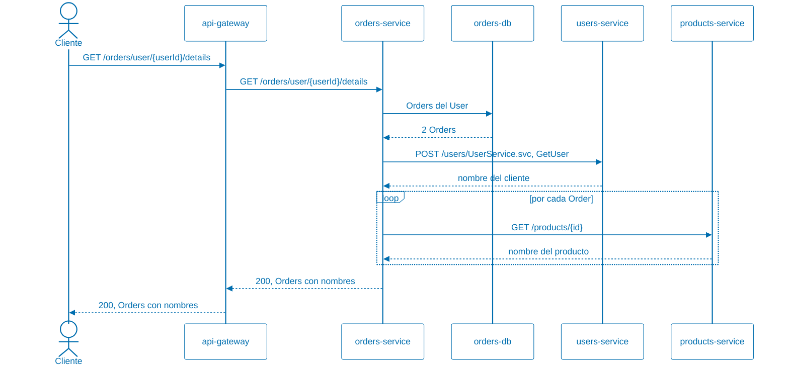
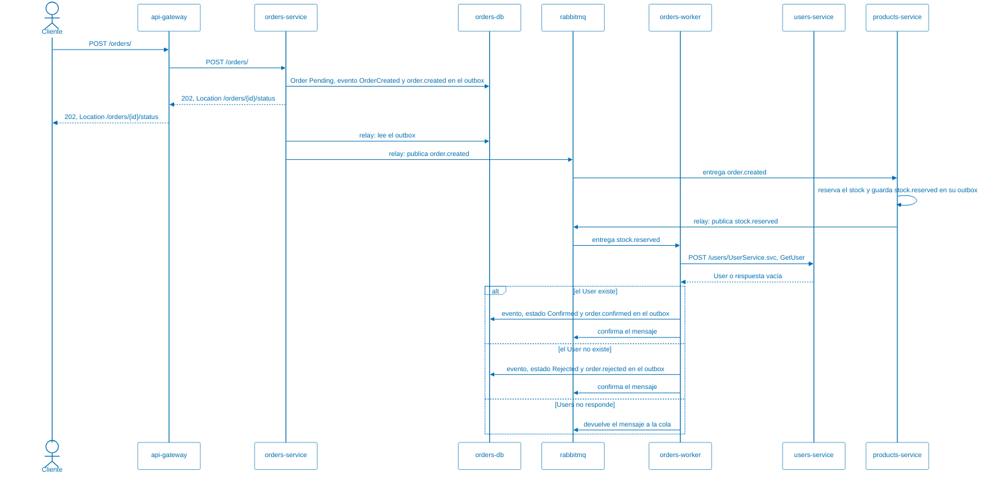
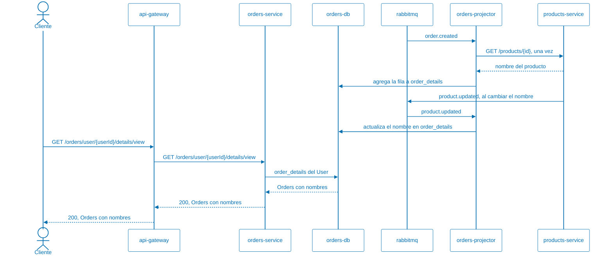
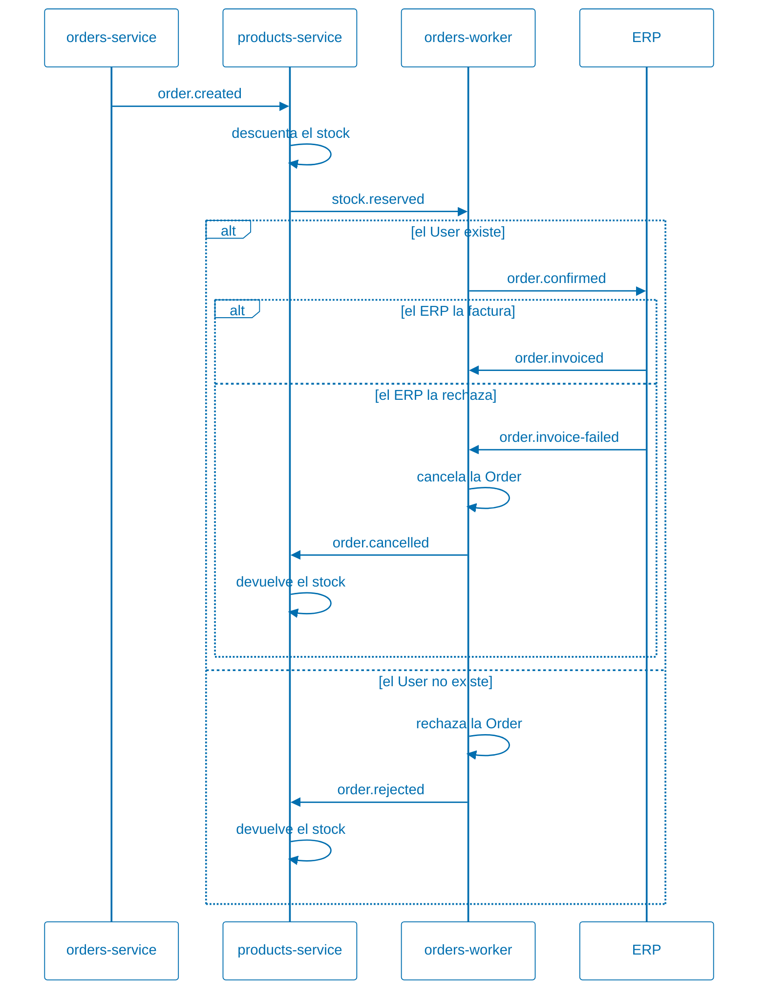

# Arquitectura de la aplicación

Este documento describe la aplicación como arquitectura de microservicios, para
analizarla: qué datos tiene cada servicio, cómo se comunican, qué tan disponible
es cada operación, cómo se mantienen consistentes los datos y qué decisiones
tienen costos. Cada sección termina con preguntas para el análisis.

Cómo ejecutar la aplicación está en el [README.md](README.md), y los patrones
que implementa están en [PATTERNS.md](PATTERNS.md).

* [Servicios y datos](#servicios-y-datos)
* [Comunicación entre servicios](#comunicación-entre-servicios)
  * [Consulta de detalle: síncrona](#consulta-de-detalle-síncrona)
  * [Creación de una Order: asíncrona](#creación-de-una-order-asíncrona)
  * [Consulta de detalle desde la vista: eventos](#consulta-de-detalle-desde-la-vista-eventos)
  * [Comparación](#comparación)
* [Disponibilidad compuesta](#disponibilidad-compuesta)
* [Consistencia de los datos](#consistencia-de-los-datos)
* [Idempotencia](#idempotencia)
* [Stateless y estado por réplica](#stateless-y-estado-por-réplica)
* [Acoplamiento](#acoplamiento)
* [Seguridad](#seguridad)
* [Facilidad de modificación](#facilidad-de-modificación)
* [Facilidad de despliegue](#facilidad-de-despliegue)
* [Decisiones abiertas a discusión](#decisiones-abiertas-a-discusión)

## Servicios y datos

Cada servicio es dueño de sus datos: tiene su propia base y ningún otro servicio
la lee ni la escribe. Si `Orders` necesita el nombre de un `User`, se lo pide a
`Users` por [HTTP](https://datatracker.ietf.org/doc/html/rfc9110) o guarda una
copia que se actualiza con los eventos que publica `Users`. Además, cada
servicio usa la tecnología de base de datos que mejor le sirve.

| Servicio | Es dueño de | Base | Lo llaman | Llama a |
| -------- | ----------- | ---- | --------- | ------- |
| `users-service` | [`Users`](src/UsersService/Models/Users.cs): nombre y correo | [MongoDB](https://www.mongodb.com/), documentos | gateway, `orders-service`, `orders-worker`, `orders-projector` | [RabbitMQ](https://www.rabbitmq.com/), para publicar `user.updated` |
| `products-service` | [`Products`](src/ProductsService/Models/Product.cs): nombre, precio y stock; las [reservas de stock](src/ProductsService/Models/StockReservation.cs) y su [*outbox*](src/Common/OutboxMessage.cs); sus imágenes | [PostgreSQL](https://www.postgresql.org/), relacional; [Redis](https://redis.io/) como caché; [Azurite](https://github.com/Azure/Azurite) para las imágenes | gateway, directamente o a través del *sidecar*, `orders-service`, `orders-projector`; RabbitMQ le entrega mensajes | RabbitMQ, para publicar `product.updated` y los eventos de la [Saga](PATTERNS.md#saga); Azurite, para las imágenes |
| `orders-service` | [`Orders`](src/OrdersService/Models/Order.cs), sus [eventos](src/OrdersService/Models/OrderEvent.cs), el [*outbox*](src/Common/OutboxMessage.cs) y la [vista del detalle](src/OrdersService/Models/OrderDetails.cs) | [MySQL](https://www.mysql.com/), relacional | gateway | `users-service`, `products-service`, RabbitMQ |
| `orders-worker` | Comparte la base de `orders-service` | MySQL | RabbitMQ le entrega mensajes | `users-service` |
| `orders-projector` | Comparte la base de `orders-service`; es el único que escribe la vista del detalle | MySQL | RabbitMQ le entrega mensajes | `users-service`, `products-service` |
| `api-gateway` | Nada: enruta y, en la entrada HTTPS, controla cada solicitud | — | clientes | los tres servicios, el *sidecar* de `Products` y [Keycloak](https://www.keycloak.org/) |
| `products-sidecar` | Nada: autoriza las solicitudes a `products-service` | — | gateway, por HTTPS, y cualquier contenedor de la red | `products-service`; Keycloak, para obtener sus claves públicas |
| `keycloak` | Las identidades: usuarios, contraseñas y roles | Su propia base, en memoria en modo desarrollo | clientes, para iniciar sesión; gateway, para validar tokens | — |
<!--TODO: ¿pueden faltar servicios luego de implementar las demás demos?-->

Una `Order` guarda el identificador del `User` y el del `Product`, pero no hay
clave foránea que los relacione, porque están en bases distintas. El
identificador del `User` es un `ObjectId` de MongoDB, que `Orders` guarda
como texto; el del `Product`, un entero de PostgreSQL. Nada impide crear una
`Order` con un identificador que no existe; eso se detecta más tarde, como se
ve en la sección de consistencia.<!--TODO: agregar link a la sección de consistencia-->

`orders-service`, `orders-worker` y `orders-projector` son la misma imagen de
[Docker](https://www.docker.com/), con el *relay* del *outbox*, el *worker* o el proyector habilitados por
configuración, y comparten la base de `Orders`.<!--TODO: ver si "relay" está
explicado en algún lado; lo mismo para "outbox" y "worker"; si está, agregar
link; si no está, explicarlo.-->

**Para analizar:**

* ¿Qué se gana y qué se pierde al tener tres bases de tres tecnologías
  distintas, en lugar de una sola base compartida?
  <!-- → Se gana que cada servicio usa el modelo que le conviene -relacional con
  transacciones para Orders, documentos para el catálogo-, que una base caída no
  tira a los demás servicios, y que ningún servicio depende del esquema de otro,
  así que cada uno cambia su base sin coordinar. Se pierden las transacciones y
  los joins entre servicios: los datos que cruzan servicios se piden por HTTP o
  se copian, como en `order_details`, y quedan eventualmente consistentes.
  Además hay tres tecnologías que operar, respaldar y monitorear. -->
* ¿Por qué no hay clave foránea entre una `Order` y su `User`? ¿Qué garantías
  perdemos sin ella y quién se hace cargo de esas garantías?
  <!-- → Porque están en bases distintas, y una clave foránea no puede cruzar
  bases. Se pierde la integridad referencial: puede existir una Order de un User
  que no existe, o borrarse un User que tiene Orders. Se hace cargo la
  aplicación: el worker verifica que el User exista y, si no, rechaza la Order.
  Para un borrado haría falta un evento, como user.deleted, al que Orders
  reaccione. -->
* `orders-service`, `orders-worker` y `orders-projector` comparten código y
  base. ¿Son un servicio o tres? ¿Qué criterio usarían para decidirlo? <!--TODO:
  confirmar que esto esté explicado en algún lado.-->
  <!-- → Son un servicio con tres procesos. El criterio es la propiedad de los
  datos y el despliegue independiente: comparten la base y la imagen, y un
  cambio en el modelo de Orders obliga a desplegar los tres juntos. Que escalen
  distinto -una réplica de orders-service, tres workers y tres proyectores- no
  los vuelve servicios distintos. Serían tres si cada uno tuviera sus propios
  datos y se pudiera cambiar y desplegar por separado. -->

## Comunicación entre servicios

La aplicación usa los dos estilos de comunicación entre servicios: síncrono, con
[HTTP](https://datatracker.ietf.org/doc/html/rfc9110), y asíncrono, con eventos
en [RabbitMQ](https://www.rabbitmq.com/). Los eventos se publican en el exchange
<!--TODO: ver si la diferencia entre "exchange" y "queue" está explicada en algún lado, y vincular a esa explicación; si no está explicado, explicarlo.-->
`andis.events`, y cada suscriptor recibe los que le interesan en su propia cola.

### Consulta de detalle: síncrona

`GET /orders/user/{userId}/details` devuelve las `Orders` de un `User` con el
nombre del cliente y el nombre de cada producto. `Orders` no tiene esos datos,
así que los pide en el momento y el cliente espera hasta que llegan todos.

Cada consulta hace 1 llamada a `Users` y 1 a `Products` por cada `Order`. Si
`Users` o `Products` no responden, `Orders` devuelve igual las `Orders`, con "no
disponible" en lugar del nombre: es la degradación que muestran las demos de
Retry, Circuit Breaker y Bulkhead.

### Creación de una Order: asíncrona

`POST /orders/` guarda la `Order` como `Pending` junto con el evento
`order.created` en el *outbox*, y responde `202 Accepted` de inmediato, sin
consultar a `Users` ni a `Products`. El *relay* del *outbox* publica el evento
en [RabbitMQ](https://www.rabbitmq.com/) un momento después. `Products` lo
recibe por la cola `products.stock`, reserva el stock y publica
`stock.reserved`, o `stock.rejected` si falta stock o el `Product` no existe.
Una de las réplicas de `orders-worker` recibe la respuesta por la cola
`orders.process`, verifica que el `User` exista, y confirma o rechaza la
`Order`. Si la rechaza después de la reserva, `Products` devuelve el stock: es
una [Saga](PATTERNS.md#saga), con los pasos y las compensaciones en
[Consistencia de los datos](#consistencia-de-los-datos).<!--TODO: ídem
anterior sobre relay y outbox-->

El cliente sabe que la `Order` fue aceptada, pero no si fue confirmada: para eso
consulta `GET /orders/{id}/status` cada tanto, como indica `Retry-After`, hasta
que la respuesta lo redirige a la `Order` con su resultado. Si no recibe el
`202` y reintenta, puede mandar el encabezado `Idempotency-Key` con la misma
clave en cada intento: `Orders` guarda la clave junto con la `Order` y, si la
vuelve a recibir, responde con la `Order` que ya creó en lugar de crear otra.
Ver [Asynchronous
Request-Reply](PATTERNS.md#asynchronous-request-reply) en PATTERNS.md.

### Consulta de detalle desde la vista: eventos

`GET /orders/user/{userId}/details/view` devuelve lo mismo que la consulta
síncrona, pero no llama a nadie: lee la tabla `order_details`, que ya tiene el
nombre del cliente y el de cada producto. `orders-projector` la mantiene al día
con los eventos de `Orders`, `Users` y `Products`, y es el único que llama a
`Users` y a `Products`: una vez por `Order`, al recibir `order.created`.

La consulta no depende de que `Users` y `Products` respondan, pero puede estar
atrasada: una `Order` recién creada tarda un momento en aparecer, y un nombre
recién cambiado, tarda en actualizarse.

### Comparación

| | Consulta de detalle | Consulta desde la vista | Creación de una `Order` |
| - | ------------------- | ----------------------- | ----------------------- |
| Estilo | Síncrono, [HTTP](https://datatracker.ietf.org/doc/html/rfc9110) | Asíncrono, eventos que actualizan una copia | Asíncrono, eventos |
| El cliente espera a `Users` y `Products` | Sí | No | No |
| Si `Users` no responde | La respuesta llega sin el nombre del cliente | La respuesta llega con el nombre copiado; las `Orders` nuevas aparecen cuando `Users` vuelve | La `Order` queda `Pending` y se procesa cuando `Users` vuelve |
| Si llegan muchas solicitudes juntas | Cada una llama a `Users` y `Products` en el momento | Cada una es una consulta a [MySQL](https://www.mysql.com/) | Se acumulan en la cola y los *workers* las procesan a su ritmo |
| Cuándo se sabe el resultado | En la respuesta | En la respuesta, con datos que pueden estar atrasados | Después, consultando el estado |

**Para analizar:**

* ¿Por qué la consulta de detalle es síncrona y la creación asíncrona? ¿Podría
  ser al revés? ¿Qué cambiaría para el cliente?
  <!-- → La consulta es una lectura sin efectos, y el cliente necesita el
  resultado en ese momento. La creación implica verificar el User y el Product
  en otros servicios, que pueden demorar o fallar: aceptarla y procesarla
  después hace que crear una Order no dependa de ellos. Al revés, una creación
  síncrona le diría al cliente en la misma respuesta si la Order se confirmó,
  pero lo haría esperar y fallaría si Users o Products no responden. Una
  consulta asíncrona tiene sentido si es muy cara, como un informe: el cliente
  lo pide y vuelve a buscarlo, con Asynchronous Request-Reply. -->
* ¿Qué servicios tienen que estar funcionando para que un cliente pueda crear
  una `Order`? ¿Y para que la `Order` quede confirmada?
  <!-- → Para crearla: el gateway, orders-service y orders-db; RabbitMQ no,
  gracias al outbox, y por la entrada HTTPS, también Keycloak. Para que quede
  confirmada, además: RabbitMQ, products-service con products-db, para reservar
  el stock, al menos una réplica de orders-worker, y users-service con
  users-db. -->
* La consulta de detalle hace una llamada a `Products` por cada `Order`. ¿Qué
  pasa con un `User` que tiene 100 `Orders`? La vista lo resuelve: ¿qué se
  paga a cambio?
  <!-- → Con 100 Orders hace 100 llamadas a Products, una después de otra: la
  latencia se suma, las llamadas llenan el compartimento del Bulkhead y es más
  probable que alguna falle. Se podría pedir cada Product distinto una sola vez,
  o todos juntos con un endpoint que acepte varios ids. La vista lo resuelve con
  una sola consulta a MySQL, y a cambio se paga consistencia eventual, datos
  duplicados, proyectores que mantener y la necesidad de repararla si se pierde
  un evento. -->
* La aplicación tiene las dos consultas de detalle. Si tuvieran que dejar una
  sola, ¿cuál dejarían? ¿Depende de quién la usa?
  <!-- → Depende de quién la usa. Para un cliente que mira su historial, la
  vista: es rápida, no depende de Users ni de Products, y unos segundos de
  atraso no le importan. Para quien necesita el dato al instante, como un
  operador que acaba de corregir un nombre, la síncrona. Una opción común es
  dejar la vista y, justo después de crear una Order, mostrar la que devolvió la
  creación. -->

## Disponibilidad compuesta

Cuando una operación necesita varios componentes a la vez, su disponibilidad es
el producto de las disponibilidades de esos componentes. Si cada componente está
disponible el 99,9% del tiempo, unos 43 minutos sin servicio por mes:

| Operación | Componentes que necesita | Disponibilidad | Sin servicio por mes |
| --------- | ------------------------ | -------------- | -------------------- |
| Consultar un `User` | gateway, `users-service`, `users-db` | 99,9% ^ 3 ≈ 99,7% | unas 2 horas |
| Consulta de detalle completa | gateway, `orders-service`, `orders-db`, `users-service`, `users-db`, `products-service`, `products-db` | 99,9% ^ 7 ≈ 99,3% | unas 5 horas |
| Consulta de detalle desde la vista | gateway, `orders-service`, `orders-db` | 99,9% ^ 3 ≈ 99,7% | unas 2 horas |
| Aceptar una `Order` | gateway, `orders-service`, `orders-db` | 99,9% ^ 3 ≈ 99,7% | unas 2 horas |
| Consulta de detalle desde la vista, por la entrada HTTPS | gateway, `keycloak`, `orders-service`, `orders-db` | 99,9% ^ 4 ≈ 99,6% | unas 3 horas |

Cada servicio que se agrega a una cadena síncrona baja la disponibilidad de la
operación, aunque cada servicio por separado sea muy confiable. La entrada HTTPS
agrega [Keycloak](https://www.keycloak.org/) a todas las operaciones, porque el
gateway le pregunta si cada token es válido. Hay tres formas de romper la
cadena, y la aplicación usa las tres:

* **Degradar la respuesta:** la consulta de detalle responde aunque falten
  `Users` o `Products`, con "no disponible" en lugar del nombre. La respuesta
  completa sigue en 99,3%, pero una respuesta útil depende solo de gateway,
  `orders-service` y `orders-db`.
* **Comunicarse de forma asíncrona:** aceptar una `Order` no depende de `Users`
  ni de `Products`; si no están, la `Order` se confirma más tarde. Gracias al
  *outbox*, tampoco depende de [RabbitMQ](https://www.rabbitmq.com/): si no
  está, el evento se publica cuando vuelve.
* **Leer una copia:** la consulta desde la vista no depende de `Users` ni de
  `Products`, porque los nombres ya están copiados. Del mismo modo, una lectura
  de `Products` que sale de [Redis](https://redis.io/) no depende de
  [PostgreSQL](https://www.postgresql.org/), mientras el dato esté en la caché.

**Para analizar:**

* Hoy hay una sola instancia de cada componente, salvo `orders-worker`. ¿Cuáles
  son puntos únicos de falla? ¿Cuál sacarían primero de esa lista?
  <!-- → El gateway, Keycloak para la entrada HTTPS, cada servicio, cada base y
  RabbitMQ. Redis no lo es: sin él, Products sigue respondiendo, más lento.
  orders-projector tampoco del todo: si se cae, la vista se atrasa pero sigue
  respondiendo. Primero sacaría el gateway, porque todo pasa por él y, como no
  tiene estado, es fácil de replicar; las bases son más importantes, pero
  replicarlas es más difícil. -->
* ¿Una respuesta con "no disponible" en lugar del nombre del producto cuenta
  como disponible? ¿De qué depende?
  <!-- → Depende de para qué la usa el usuario y de cómo se define el objetivo
  de disponibilidad. Si quiere ver sus Orders y su estado, la respuesta
  degradada le sirve y cuenta como disponible. Si necesita el nombre del
  producto, por ejemplo para una factura, no. El objetivo de nivel de servicio
  tiene que decir qué es una respuesta exitosa. -->
* ¿Qué cambia en la tabla si se agregan tres réplicas de `products-service`?
  ¿Qué tiene que cumplir `products-service` para que se pueda replicar? Ver
  [Stateless y estado por réplica](#stateless-y-estado-por-réplica).
  <!-- → products-service deja de ser un eslabón débil: con tres réplicas
  independientes, falla solo si fallan las tres, y su disponibilidad pasa a ser
  casi del 100%. La consulta de detalle completa queda con seis componentes de
  99,9%, unos 99,4%, y el punto único de falla de Products pasa a ser
  products-db, que sigue siendo una sola instancia. Se puede replicar porque es
  stateless: los Products están en PostgreSQL y la caché en Redis, compartida por
  todas las réplicas. Con una caché en memoria, cada réplica tendría su copia y
  una invalidación llegaría a una sola. La reserva de stock también admite
  varias réplicas, como el worker de Orders. Lo que hoy lo impide es el
  sidecar, que comparte la red de su única réplica: cada réplica necesitaría el
  suyo. Los ajustes de chaos y de la caché sí quedan en cada réplica: un PUT
  cambiaría una sola. -->
* El gateway le pregunta a Keycloak por cada solicitud HTTPS, y el *sidecar*
  verifica la firma del token con las claves públicas de Keycloak, sin
  preguntarle. ¿Qué gana y qué pierde cada uno? ¿Cómo quedaría la tabla si el
  gateway hiciera como el *sidecar*?
  <!-- → Preguntándole a Keycloak, el gateway se entera enseguida si una sesión
  se cerró o un usuario se bloqueó, pero cada solicitud espera a Keycloak y
  depende de que responda. Verificando la firma, el sidecar no llama a Keycloak
  salvo para renovar las claves cada 5 minutos: es más rápido y no depende de
  Keycloak, pero acepta un token hasta que vence aunque se haya revocado; por
  eso los tokens duran poco. Si el gateway hiciera lo mismo, Keycloak saldría de
  la cadena de cada operación: la consulta desde la vista por HTTPS volvería a
  gateway, orders-service y orders-db, unos 99,7%, y Keycloak haría falta solo
  para iniciar sesión. -->

## Consistencia de los datos

No hay transacciones que abarquen más de un servicio. Cada servicio confirma sus
propios cambios, y la aplicación acepta, por un tiempo, que los datos de
distintos servicios no coincidan.

* **Una `Order` puede existir con un `User` que no existe.** `POST /orders/` no
  lo verifica: lo hace el *worker* después. Mientras tanto, la `Order` está
  `Pending`; si el `User` no existe, termina `Rejected`. Es consistencia
  eventual: el sistema llega a un estado correcto, pero no de inmediato.
* **Guardar y publicar es atómico en `Orders` y en la reserva de stock, pero no
  en `user.updated` ni en `product.updated`.** `Orders` y `Products` guardan el
  evento en su *outbox* en la misma transacción que el cambio, y el *relay* lo
  publica después: ver [Transactional Outbox](PATTERNS.md#transactional-outbox)
  en PATTERNS.md. Para `user.updated` y `product.updated`, `Users` y `Products`
  guardan el cambio y después publican: si [RabbitMQ](https://www.rabbitmq.com/)
  no está, el evento se pierde.
* **Crear una `Order` cambia tres sistemas, y no hay una transacción que los
  abarque.** `Products` reserva el stock, `Orders` confirma la `Order` y el ERP
  la factura, cada uno con su base. Si un paso falla después de otro que ya
  guardó sus cambios, una compensación los deshace: es una
  [Saga](PATTERNS.md#saga). Mientras tanto, el stock se ve descontado para una
  `Order` que tal vez no se complete.

Todos los mensajes pasan por RabbitMQ, y los del ERP, además, por el
[Messaging Bridge](PATTERNS.md#messaging-bridge); el diagrama no lo muestra.
* **Cada evento llega al menos una vez.** El *relay* puede publicar dos veces
  el mismo evento, si se cae entre publicar el evento y marcarlo como
  publicado<!--TODO: confirmar cambio de redacción-->. Los suscriptores son
  idempotentes: aplicar el mismo evento dos veces deja el mismo resultado,
  aunque las dos copias lleguen a la vez a réplicas distintas. Ver
  [Idempotencia](#idempotencia).
* **Los nombres se piden o se copian.** La consulta síncrona los pide cada vez:
  siempre están al día, pero dependen de que `Users` y `Products` respondan. La
  vista los copia una vez y los actualiza con los eventos: no depende de nadie,
  pero puede estar desactualizada, y si se pierde un `product.updated`, queda
  con el nombre anterior hasta que el `Product` vuelva a cambiar.
* **La caché de `Products` se invalida al escribir.** Un cambio borra la clave
  de [Redis](https://redis.io/); si Redis no está en ese momento, el dato viejo
  puede volver a leerse hasta que venza, a los 60 segundos.
* **El precio no se guarda en la `Order`.** Si cambia el precio de un `Product`,
  no queda registro de cuánto valía cuando se creó la `Order`.
* **Los eventos son la fuente de verdad de `Orders`.** Cada cambio de una `Order`
  se guarda como un evento, y la tabla de `Orders` se puede reconstruir a partir
  de ellos: ver [Event
  Sourcing](PATTERNS.md#event-sourcing) en PATTERNS.md.<!--TODO: ¿porqué sólo este patrón
  está mencionado?-->

**Para analizar:**

* Si se pierde un `product.updated`, ¿cómo se repararía la vista? `POST
  /orders/projections/rebuild` reconstruye `orders`, pero no `order_details`.
  ¿Qué haría falta para reconstruirla?
  <!-- → No se puede volver a publicar el evento, porque Products no tiene
  outbox. Haría falta reconstruir `order_details` a partir de la fuente:
  recorrer `order_events` y pedir a Users y a Products los nombres actuales,
  como hacen los proyectores, en una tabla nueva que después reemplace a la
  vista; o una tarea periódica que compare los nombres de la vista con los de
  Users y Products y corrija las diferencias. Para que no vuelva a pasar, Users
  y Products tendrían que publicar con outbox. -->
* La vista copia el nombre del cliente y lo actualiza cuando cambia. ¿Debería
  hacer lo mismo con el precio del producto, o el precio de una `Order` es el
  que tenía cuando se creó?
  <!-- → Lo habitual es que el precio de una Order sea el que tenía al crearse:
  es lo que el cliente aceptó pagar. Por eso se guarda en la Order al crearla y
  no se actualiza; hoy la Order ni siquiera lo guarda. El nombre del cliente, en
  cambio, es un dato de referencia, y conviene mostrar el actual. -->
* Si se agregara un endpoint para borrar un `Product`, ¿qué debería pasar con
  las `Orders` que lo referencian? ¿Quién se entera del borrado y cómo?
  <!-- → Lo más común es no borrarlo, sino marcarlo como discontinuado: las
  Orders siguen apuntando a un Product que existe. Si se borra, Products publica
  product.deleted; los proyectores mantienen el nombre copiado en la vista, y la
  reserva de stock de una Order nueva lo rechazaría, como a un Product que no
  existe. Impedir el
  borrado mientras haya Orders obligaría a Products a preguntarle a Orders, y
  eso los acopla. -->

## Idempotencia

Una operación es **idempotente** si ejecutarla varias veces tiene el mismo
efecto que ejecutarla una vez. El [Retry](PATTERNS.md#retry) solo es seguro si
lo que reintenta es idempotente: una llamada que falla por *timeout* pudo haberse ejecutado igual, y
el reintento la ejecuta otra vez. El catálogo de Azure lo advierte en el [patrón
Retry](https://learn.microsoft.com/azure/architecture/patterns/retry).

En esta aplicación, una misma operación puede ejecutarse más de una vez por
cuatro razones:

* El Retry de `Orders` reintenta las llamadas a `Users` y a `Products`.
* Un cliente que no recibe la respuesta de `POST /orders/`, por un *timeout* o
  un corte de red, la vuelve a mandar.
* El *relay* del [Transactional Outbox](PATTERNS.md#transactional-outbox) y el
  [Messaging Bridge](PATTERNS.md#messaging-bridge) entregan cada mensaje **al
  menos una vez**: si se caen entre publicar un mensaje y marcarlo, lo publican
  de nuevo.
* Con [Competing
  Consumers](PATTERNS.md#competing-consumers-para-disponibilidad), las dos
  copias de un mensaje repetido pueden procesarse **a la vez**, en réplicas
  distintas.

Las dos últimas son el precio de tener réplicas *stateless* que se reparten el
trabajo: cualquier réplica puede recibir cualquier mensaje, también la copia de
uno que otra réplica está procesando -ver [Stateless y estado por
réplica](#stateless-y-estado-por-réplica)-. Para que eso no rompa nada, cada
operación tiene que poder repetirse.

**Depende de lo que hace la operación, no del verbo HTTP.** [RFC
9110](https://datatracker.ietf.org/doc/html/rfc9110#name-idempotent-methods)
define `GET`, `PUT` y `DELETE` como idempotentes, y `POST` no. Pero el Retry
reintenta `GetUser`, que viaja como `POST` porque `Users` usa
[SOAP](https://www.w3.org/TR/soap/), y es seguro
porque solo lee. Reintentar `CreateUser`, que también es un `POST`, no lo sería.

**Cómo lo resuelve la aplicación.** Cada operación que se puede repetir usa una
técnica distinta. Sin ella pasaría lo que dice la tabla:

| Operación | Sin idempotencia | Técnica | Dónde |
| --------- | ---------------- | ------- | ----- |
| Factura del ERP | Un pedido repetido generaría otra factura, con otro número | Identificador determinístico: el número de factura sale del número de pedido | [Messaging Bridge](PATTERNS.md#messaging-bridge) |
| Confirmación de una `Order` | Dos *workers* confirmarían la misma `Order`, con dos `OrderConfirmed` y dos `order.confirmed` | Transición de estado condicional: un `UPDATE` que solo cambia una `Order` `Pending` | [Competing Consumers para disponibilidad](PATTERNS.md#competing-consumers-para-disponibilidad) |
| Reserva de stock | Un `order.created` repetido descontaría el stock dos veces | Inserción que falla por una restricción única: la reserva tiene como clave la `Order`, y se inserta en la misma transacción que descuenta el stock | [Saga](PATTERNS.md#saga) |
| Liberación de stock | Una compensación repetida devolvería el stock dos veces | Transición de estado condicional: un `UPDATE` que solo libera una reserva `Reserved`, y suma el stock solo si cambió una fila | [Saga](PATTERNS.md#saga) |
| Fila de la vista materializada | Una copia de `order.created` fallaría por la clave primaria, y un estado que llega antes que la fila se perdería | *Upsert*: insertar o actualizar en una sola sentencia | [Materialized View](PATTERNS.md#materialized-view) |
| Historial de eventos | La misma factura quedaría dos veces | Índice único por `Order` y tipo de evento | [Materialized View](PATTERNS.md#materialized-view) |
| `POST /orders/` | Un reintento del cliente crearía otra `Order` | Clave de idempotencia, en el encabezado `Idempotency-Key` | [Asynchronous Request-Reply](PATTERNS.md#asynchronous-request-reply) |

**La trampa del *check-then-act*.** Preguntar si algo ya se hizo y, si no,
hacerlo, son dos pasos. Con un solo consumidor alcanza; con dos a la vez, los
dos preguntan antes de que ninguno escriba, y los dos escriben. La verificación
y la escritura tienen que ser una sola operación atómica: un `UPDATE` con
condición, un *upsert* o una inserción que falla por una restricción única. Es
lo que el catálogo de Azure describe como [Idempotent
Consumer](https://learn.microsoft.com/azure/architecture/patterns/idempotent-consumer).

Dos matices:

* **Deduplicar no es responder igual.** `CreateUser` rechaza un email repetido
  con un *Fault*: no crea un segundo `User`, pero un cliente que reintenta
  recibe un error en lugar del `id` del primero. `POST /orders/` con
  `Idempotency-Key`, en cambio, responde lo mismo que la primera vez.
* **Idempotente no es conmutativo.** Asignar un nombre es idempotente: hacerlo
  dos veces deja el mismo nombre. Pero dos asignaciones distintas aplicadas en
  otro orden dejan otro resultado. Por eso la vista materializada guarda la
  fecha de cada nombre.

**Costos.** Recordar qué ya se hizo es estado adicional: claves, índices y filas
que viven en la base, no en la réplica. Ese estado crece, y en producción se
borra después de un plazo; un reintento que llega después se trata como una
operación nueva.

## Stateless y estado por réplica

Que un componente pueda tener más de una réplica depende de dónde vive su
estado. Algunos patrones lo guardan en la memoria de cada proceso: el [Circuit
Breaker](PATTERNS.md#circuit-breaker), por ejemplo, cuenta cuántas llamadas
fallaron en los últimos 10 segundos y si el circuito está abierto.
`orders-service` tiene una sola réplica, pero los *workers* son tres, y cada uno
tiene sus propios circuitos.

**Qué es *stateless*.** Un servicio es *stateless* si no depende de datos
guardados en su memoria o en su disco local entre una solicitud, o un mensaje, y
el siguiente: el estado vive afuera, en una base, una caché compartida o un
almacén de configuración. No significa que no haya estado, sino que el estado no
vive en la instancia.

**Por qué importa:**

* Cualquier réplica atiende cualquier solicitud o cualquier mensaje: el gateway
  y [RabbitMQ](https://www.rabbitmq.com/) reparten el trabajo sin tener que
  mandar a un cliente siempre a la misma réplica, lo que se llama afinidad de
  sesión.
* Una réplica se reemplaza, se reinicia o se agrega sin que se pierda nada. Es
  lo que aprovechan [Competing
  Consumers](PATTERNS.md#competing-consumers-para-disponibilidad) y estrategias
  de despliegue como [Rolling Upgrade](PATTERNS.md#rolling-upgrade).
* Alcanzan instancias más chicas, que se agregan o se quitan según la carga.

**Qué componentes son *stateless*.** Casi todos, con el estado por réplica que
se describe más abajo:

| Componente | Réplicas | Dónde está su estado |
| ---------- | -------- | -------------------- |
| `orders-service` | 1 | [MySQL](https://www.mysql.com/): `orders`, `order_events`, `outbox_messages` e `idempotency_keys` |
| `orders-worker` | 3 | MySQL y la cola `orders.process` |
| `orders-projector` | 3 | MySQL, `order_details`, y la cola `orders.details-view` |
| `users-service` y `users-service-v2` | 1 de cada versión | [MongoDB](https://www.mongodb.com/); la variante de cada `User`, en [Unleash](https://www.getunleash.io/) |
| `products-service` | 1, por el *sidecar* | [PostgreSQL](https://www.postgresql.org/): `products`, `stock_reservations` y `outbox_messages`; la cola `products.stock`; la caché en [Redis](https://redis.io/) y las imágenes en [Azurite](https://github.com/Azure/Azurite) |
| `bff-web` y `bff-mobile` | 1 | No tienen: llaman a los servicios en cada solicitud |
| `api-gateway` | 1 | Las sesiones, en [Keycloak](https://www.keycloak.org/); el límite de `POST /orders/` por cliente, en su memoria |
| `messaging-bridge` | 1 | RabbitMQ y [ActiveMQ](https://activemq.apache.org/); tiene una sola instancia para conservar el orden de los pedidos |

**Qué hace falta para que sean *stateless*.** El código de la aplicación ya tiene
resuelto cada caso. Esta tabla a continuación muestra lo que podría haber habido
con una solución más directa y más simple, y cómo se resolvió en la aplicación:

| Caso | Solución *stateful* | Solución *stateless* | Dónde |
| ---- | ------------------- | -------------------- | ----- |
| Caché de `Products` | Con una caché en la memoria de cada réplica, al cambiar un `Product` la invalidación borraría la copia de una sola, y las demás seguirían respondiendo el dato viejo hasta que venciera | La caché está en Redis, compartida: una invalidación vale para todas las réplicas | [Cache-Aside](PATTERNS.md#cache-aside) |
| Variante del A/B Testing | Si cada réplica eligiera la variante al azar, o la recordara en memoria, un mismo `User` vería una variante distinta según la réplica que lo atendiera, y el experimento no se podría medir | Unleash la elige con un *hash* del id del `User`: todas las réplicas eligen la misma | [A/B Testing](PATTERNS.md#ab-testing) |
| Configuración | Con los valores en las variables de entorno, o leídos una sola vez al arrancar, cambiarlos obligaría a redesplegar cada réplica, y las réplicas quedarían con valores distintos mientras tanto | Los valores están en [Consul](https://developer.hashicorp.com/consul); cada proceso los vuelve a leer cada 2 segundos, y el código los lee en cada uso | [External Configuration Store](PATTERNS.md#external-configuration-store) |
| Identidad | Una sesión guardada en la memoria de una instancia obligaría a mandar todas las solicitudes de un usuario a esa instancia | El token de Keycloak viaja en cada solicitud, y ninguna instancia guarda la sesión | [Federated Identity](PATTERNS.md#federated-identity) |
| *Relay* del *outbox* | Con dos instancias que leyeran los mensajes pendientes, las dos publicarían los mismos | `SELECT ... FOR UPDATE SKIP LOCKED`: cada mensaje lo toma una sola instancia | [Transactional Outbox](PATTERNS.md#transactional-outbox) |
| *Worker* | Preguntaba si la `Order` seguía `Pending` y después la cambiaba: dos copias del mismo mensaje en dos réplicas a la vez la confirmaban dos veces | Un `UPDATE` condicional cambia el estado solo si la `Order` sigue `Pending` | [Competing Consumers para disponibilidad](PATTERNS.md#competing-consumers-para-disponibilidad) |
| Reserva de stock | Con el stock reservado en la memoria de cada réplica, o preguntando primero si la `Order` ya tenía reserva, dos copias de `order.created` en dos réplicas descontarían el stock dos veces | El stock está en PostgreSQL; la reserva tiene como clave la `Order` y se inserta en la misma transacción que el descuento | [Saga](PATTERNS.md#saga) |
| Proyectores | Un proyector cuyo resultado dependa de procesar los eventos en orden | *Upserts*, un estado que solo avanza, un índice único y la fecha de cada nombre | [Materialized View](PATTERNS.md#materialized-view) |
| Claves de `Idempotency-Key` | En un diccionario en memoria, un reintento que llegara a otra réplica crearía una segunda `Order`, y un reinicio borraría las claves | La tabla `idempotency_keys`, en la misma transacción que la `Order` | [Asynchronous Request-Reply](PATTERNS.md#asynchronous-request-reply) |

**Una réplica por el *sidecar*.** `products-service` guarda todo su estado
afuera, y su *relay* y su consumidor de la [Saga](PATTERNS.md#saga) ya admiten
varias réplicas, como los de `Orders`. Lo que lo deja en una sola réplica es el
[Sidecar](PATTERNS.md#sidecar): `products-sidecar` comparte el espacio de red
de `products-service` -`network_mode` en
[docker-compose.yaml](docker-compose.yaml)- y le habla en `127.0.0.1:8000`. Un
*sidecar* acompaña a una sola réplica. Para tener varias, cada réplica
necesitaría su propio [Envoy](https://www.envoyproxy.io/), y el gateway
tendría que repartir las solicitudes entre los pares de servicio y *sidecar*.
En [Kubernetes](https://kubernetes.io/) es lo que hace un pod con dos
contenedores: cada réplica del pod trae su *sidecar*.

***Stateless* no alcanza.** Los proyectores no guardan nada en memoria, y aun
así no se podían escalar mientras su resultado dependía del orden de los
mensajes. Ser *stateless* permite tener varias réplicas, pero además cada
réplica tiene que tolerar mensajes que llegan en cualquier orden, repetidos y a
la vez -ver [Idempotencia](#idempotencia)-.

**Estado por réplica que queda a propósito.** Algunos componentes guardan estado
en memoria porque compartirlo costaría una llamada remota en cada solicitud. Al
escalar, cada réplica decide por su cuenta:

* **Circuit Breaker y Bulkhead**, en
  [Resilience.cs](src/OrdersService/Resilience.cs): cada réplica
  cuenta sus propias fallas, abre su propio circuito y tiene sus propios lugares
  en cada compartimento. Con tres *workers*, el circuito hacia `Users` de uno
  puede estar abierto y el de otro, todavía cerrado.
* **Throttling de `Orders`**, en
  [Program.cs](src/OrdersService/Program.cs): 20 consultas de
  detalle a la vez **por réplica**. Con N réplicas de `orders-service`, el
  límite efectivo es 20 × N.
* **Throttling del gateway**, con
  [`limit_req_zone`](https://nginx.org/en/docs/http/ngx_http_limit_req_module.html#limit_req_zone):
  el límite de `POST /orders/` por cliente está en la memoria de **una**
  instancia de [nginx](https://nginx.org/). Con dos
  gateways, un cliente podría crear el doble de `Orders`.
* **Ajustes de las demos**, `PatternSettings`, `ChaosSettings` y
  `CacheSettings`: un `PUT` llega a **una** réplica. `PUT /orders/patterns`
  cambia `orders-service`, pero no los *workers* ni los proyectores, que siguen
  con todos los patrones prendidos.
* **La última configuración leída** de Consul y de Unleash: cada réplica tiene
  su copia, y durante unos segundos dos réplicas pueden tener valores distintos.

Para un límite global, el contador tiene que salir del proceso, por ejemplo a
Redis, a cambio de una llamada remota en cada solicitud.

**Costos.** El almacén externo puede volverse un cuello de botella o un punto
único de falla: la demo tiene una sola instancia de MySQL, de Redis y de
RabbitMQ. Además, cada acceso agrega latencia. El estado que queda en memoria a
propósito evita esas llamadas, a cambio de límites aproximados.

## Acoplamiento

Los microservicios buscan que cada servicio se pueda cambiar y desplegar sin
coordinar con los demás. Hay varios lugares donde esta aplicación se acopla:

* **La biblioteca [Common](src/Common/).** Los tres servicios la referencian.
  Tiene código transversal -inyección de fallas, métricas, la respuesta de
  salud- y también los contratos que `Orders` usa para leer las respuestas de
  `Users` y `Products`: los registros `UserDto`, en
  [UserDto.cs](src/Common/UserDto.cs), y `ProductDto`, en
  [ProductDto.cs](src/Common/ProductDto.cs). `Products` no usa
  `ProductDto`: tiene su propio modelo. También tiene la conexión con
  [RabbitMQ](https://www.rabbitmq.com/), en la clase `RabbitMq`, y los contratos
  de los eventos, en la clase `Events` y sus registros, en
  [Events.cs](src/Common/Events.cs). Un cambio en `Common` obliga a
  recompilar y redesplegar los tres servicios.
* **Los contratos de los eventos.** Los proyectores esperan que
  `product.updated` traiga el identificador y el nombre del `Product`.
  Publisher/Subscriber desacopla en el tiempo y en el conocimiento: `Products`
  no sabe quién recibe sus eventos, ni necesita que esté funcionando. Pero no
  desacopla del contrato: si `Products` cambia la forma del evento, los
  proyectores dejan de entenderlo, y `Products` no se entera.
* **Los contratos HTTP.**. `Orders` espera que `GET /products/{id}` devuelva un
  [JSON](https://www.json.org/) con el nombre. Si `Products` lo renombra,
  `Orders` deja de mostrar el nombre del producto, y nada lo detecta hasta que
  se ejecuta. No hay versiones en las rutas.
* **El contrato [SOAP](https://www.w3.org/TR/soap/) de `Users`.** `Users` no es
  [REST](https://roy.gbiv.com/pubs/dissertation/rest_arch_style.htm): expone
  SOAP y publica su contrato como [WSDL](https://www.w3.org/TR/wsdl/) en
  `/users/UserService.svc?wsdl`. `Orders` arma a mano el sobre de `GetUser` y
  lee el [XML](https://www.w3.org/XML/) de la respuesta -ver el método
  `GetUserAsync` de la clase `Dependencies`, en
  [Dependencies.cs](src/OrdersService/Dependencies.cs)-, así que
  depende del namespace, del nombre de la operación y de los nombres de los
  elementos. El WSDL documenta el contrato, pero `Orders` no lo usa para generar
  el cliente: un cliente
  [WCF](https://learn.microsoft.com/dotnet/framework/wcf/) generado tendría su
  propio canal HTTP y dejaría afuera el pipeline de resiliencia. Un detalle de
  SOAP 1.1 afecta a los patrones: todo SOAP Fault viaja como HTTP 500, que el
  Retry y el Circuit Breaker tratan como falla transitoria. Por eso `GetUser`
  responde sin resultado -y no con un Fault- cuando el `User` no existe.
* **El orden de arranque.** En [docker-compose.yaml](docker-compose.yaml),
  `orders-service` no arranca hasta que `users-service` y `products-service`
  están sanos, aunque puede funcionar sin ellos. `users-service` y
  `products-service` esperan a que arranque RabbitMQ, pero no a que esté sano:
  pueden atender sin él.
* **Los claims del token.** `Orders` espera que el gateway le pase el `User` en
  el encabezado `X-User-Id`, y el gateway lo saca del claim `user_id`, que
  [Keycloak](https://www.keycloak.org/) arma a partir de un atributo de cada
  usuario. Si cambia el nombre del claim, del encabezado o del atributo,
  `Orders` deja de reconocer a los clientes. El *sidecar*, además, espera los
  roles en `realm_access.roles`, donde los pone Keycloak.
* **La ubicación de cada servicio.** Las URL de `Users` y `Products` se pasan a
  `Orders` por variables de entorno, y [nginx](https://nginx.org/) encuentra
  cada servicio por su nombre en el [DNS de
  Docker](https://docs.docker.com/engine/network/#dns-services). No hay un
  registro de servicios.
  <!--TODO: analizar si en esta sección no hay cambios debido a los nuevos patrones y tecnologías utilizadas en las nuevas demos-->

**Para analizar:**

* ¿Qué debería estar en `Common` y qué no? ¿Dónde pondrían `ProductDto`?
  <!-- → En Common, el código transversal que no es del dominio: la inyección de
  fallas, la observabilidad, la respuesta de salud y la conexión a RabbitMQ. No
  los contratos de un servicio. ProductDto describe lo que Orders necesita leer
  de Products, así que debería estar en Orders; la alternativa es un paquete de
  contratos que publique y versione Products. Con los contratos de los eventos
  pasa lo mismo: los publica y versiona quien los emite. -->
* ¿Cómo detectarían, antes de desplegar, que un cambio en `Products` rompe a
  `Orders`? Busquen *consumer-driven contracts*.
  <!-- → Con pruebas de contrato dirigidas por el consumidor, por ejemplo con
  Pact: Orders publica lo que espera de GET /products/{id} y de product.updated,
  y el pipeline de Products verifica esos contratos antes de desplegar; si un
  cambio los rompe, el despliegue se detiene. También ayudan las versiones en
  las rutas y un registro de esquemas para los eventos. -->
* ¿Hace falta que `orders-service` espere a `Users` y `Products` para arrancar?
  ¿Qué pasaría si se quita esa dependencia?
  <!-- → No: Orders funciona sin ellos, degradado. Si se quita la dependencia,
  orders-service arranca antes y no queda esperando si Users o Products no
  levantan; las primeras consultas de detalle responden "no disponible" y los
  workers devuelven los mensajes a la cola hasta que vuelvan. Además, el orden
  de arranque deja de ocultar que el servicio tolera la falta de sus
  dependencias. -->

## Seguridad

La entrada HTTPS del gateway aplica los patrones de seguridad -ver [Demos de
seguridad](PATTERNS.md#demos-de-seguridad)-: valida el token de cada solicitud,
publica solo las rutas de la aplicación y le pasa a cada servicio la identidad
del usuario en encabezados. Esos controles sirven solo si el tráfico no puede
llegar a los servicios por otro camino. En producción eso se aseguraría en dos
capas que se complementan. La demo implementa una parte de cada una; el resto
queda afuera porque complicaría levantarla y compararla con las demos
anteriores.

**La red: desde afuera, solo se llega al gateway.**

En un centro de datos propio -*on premises*- la red se separa en zonas, con
VLANs o subredes, y entre una zona y otra hay un firewall que decide quién se
conecta con quién:

* **Zona perimetral -DMZ-:** la única que se alcanza desde Internet. Ahí está el
  gateway: un *reverse proxy* o un *load balancer*, que termina
  [TLS](https://datatracker.ietf.org/doc/html/rfc8446) y puede filtrar
  solicitudes con un WAF.
* **Zona de aplicación:** aquí están los servicios, que son inaccesibles desde
  Internet: el firewall de esta zona deja entrar solo el tráfico que viene del
  gateway.
* **Zona de datos:** aquí están las bases, la caché y el broker de mensajes; el
  firewall de esta zona solo permite el tráfico que llega de la zona de
  aplicación.

Dentro de cada zona, el firewall de cada servidor -`iptables` o `nftables` en
Linux- o una herramienta de segmentación, limita además qué servidores se hablan
entre sí. El firewall entre zonas y el gateway se complementan: el firewall
decide quién se puede conectar; el gateway, decide qué hacer con cada solicitud
que le llega.

En la nube, las mismas ideas se implementan con los servicios de cada
proveedor:

* **Solo el gateway tiene dirección pública.** Los servicios, las bases, la
  caché y el broker de mensajes están en redes privadas; el único con dirección
  pública es el gateway.
* **Reglas de quién se conecta con quién.** Las reglas de la red dejan entrar a
  un servicio solo el tráfico que viene del gateway o de los servicios que lo
  llaman, y a cada base, solo el de su servicio. En Azure son los *Network
  Security Groups*; en AWS, los *security groups*; en
  [Kubernetes](https://kubernetes.io/), las `NetworkPolicies`.
* **Servicios administrados con entrada interna.** En Azure, [Container
  Apps](https://azure.microsoft.com/products/container-apps/) admite una entrada
  interna, que solo se alcanza desde la red virtual, y [App
  Service](https://azure.microsoft.com/products/app-service/) admite
  restricciones de acceso y *private endpoints*. El gateway, por ejemplo [Azure
  API Management](https://azure.microsoft.com/products/api-management/) o
  [Application
  Gateway](https://azure.microsoft.com/products/application-gateway/), se
  despliega en la misma red virtual que los servicios. En AWS, los servicios
  corren en [ECS](https://aws.amazon.com/ecs/) o
  [Fargate](https://aws.amazon.com/fargate/) en subredes privadas, detrás de un
  *[Application Load
  Balancer](https://aws.amazon.com/elasticloadbalancing/application-load-balancer/)*
  interno, y el gateway, [Amazon API
  Gateway](https://aws.amazon.com/api-gateway/), llega a ellos con un *VPC
  link*.
* **En Kubernetes**, los servicios son de tipo `ClusterIP`: no tienen dirección
  fuera del clúster. Solo se expone el *Gateway* de [Gateway
  API](https://gateway-api.sigs.k8s.io/), que reemplaza al antiguo *ingress
  controller* y cumple el papel del gateway. Las demos de despliegue con
  Kubernetes lo hacen así: [gateway.yaml](k8s/base/gateway.yaml) es el
  único punto de entrada al clúster, y `Users` y su base son `ClusterIP`.

En la demo, [docker-compose.yaml](docker-compose.yaml) publica en el host los
puertos de los servicios y de las bases, para probarlos directamente y para las
demos que los usan.
[docker-compose.gatekeeper.yaml](docker-compose.gatekeeper.yaml) muestra el
efecto de dejar de publicarlos. Dentro de la red de
[Docker](https://www.docker.com/) no hay reglas: cualquier contenedor llega a
cualquier otro.

**La identidad: cada servicio verifica quién lo llama.**

La red sola no alcanza. Si un atacante compromete un contenedor de la red, llega
a todos los servicios: es lo que muestra la demo del *sidecar* cuando un
contenedor llama a `products-service:8000`. El enfoque *zero trust* parte de que
estar adentro de la red no prueba nada:

* **TLS mutuo entre el gateway y los servicios, y entre servicios.** Cada parte
  presenta un certificado, y un servicio acepta solo a los llamadores en cuyo
  certificado confía. Una *service mesh*, como [Istio](https://istio.io/) o
  [Linkerd](https://linkerd.io/), lo hace sin cambiar el código, con un
  *sidecar* en cada servicio.
* **Cada servicio verifica el token, él o su *sidecar*.** El gateway le pasa el
  token al servicio, que verifica la firma con las claves públicas del
  proveedor de identidad, en lugar de confiar en encabezados que cualquiera
  podría mandar.
* **Identidades administradas y un almacén de secretos.** Cada servicio tiene
  una identidad que le da la plataforma, como *Managed Identity* en Azure o un
  rol de [IAM](https://aws.amazon.com/iam/) en AWS, y las contraseñas que
  todavía hagan falta están en un almacén de secretos, como [Azure Key
  Vault](https://azure.microsoft.com/products/key-vault/) o [AWS Secrets
  Manager](https://aws.amazon.com/secrets-manager/), y no en la configuración.

En la demo, solo `Products` tiene *sidecar*, que verifica la firma del token.
`Orders` confía en los encabezados `X-User-Id`, `X-User-Name` y
`X-User-Roles` que arma el gateway: es el punto débil del diseño, y es seguro
solo si nadie más puede llegar a `Orders`. No hay TLS entre los servicios.

| Control | En la demo | En producción |
| ------- | ---------- | ------------- |
| Entrada al gateway | [HTTP](https://datatracker.ietf.org/doc/html/rfc9110) y HTTPS abiertas, para comparar con y sin los patrones | Solo HTTPS; HTTP redirige a HTTPS |
| Certificado del gateway | Autofirmado, generado al construir la imagen | Emitido por una autoridad de certificación y renovado automáticamente |
| Puertos de los servicios y de las bases | Publicados en el host; `docker-compose.gatekeeper.yaml` los quita | Sin dirección pública, con reglas de red |
| Tráfico entre servicios | HTTP sin cifrar; cualquier contenedor llega a cualquier otro | TLS mutuo y reglas de red |
| Identidad en los servicios | `Orders` confía en los encabezados del gateway; el *sidecar* de `Products` verifica la firma | Cada servicio, o su *sidecar*, verifica el token |
| Secretos | En texto plano en `docker-compose.yaml` y en `andis-realm.json` | En un almacén de secretos, o reemplazados por identidades administradas |
| [Keycloak](https://www.keycloak.org/) | Modo desarrollo, sin base propia; el cliente de las demos acepta usuario y contraseña | Con su propia base y varias réplicas; los clientes inician sesión en el navegador |

**Para analizar:**

* Si un atacante compromete `orders-worker`, ¿a qué puede llegar hoy? ¿Y si
  hubiera reglas de red? ¿Y si hubiera TLS mutuo?
  <!-- → Hoy llega a todo: con sus credenciales lee y escribe la base de Orders,
  incluido el outbox, desde donde podría publicar eventos falsos; con el usuario
  guest de RabbitMQ lee y publica en cualquier cola; y por la red llega a
  cualquier contenedor, por ejemplo a products-service:8000 para cambiar
  Products sin pasar por el sidecar, o a orders-service con encabezados de
  identidad falsos. Con reglas de red llega solo a lo que necesita -orders-db,
  RabbitMQ y Users-, pero a Users con cualquier método. Con TLS mutuo, Users
  sabe que quien llama es orders-worker y puede permitirle solo leer, y orders-worker ya no puede hacerse pasar por el
  gateway. Su propia base y su cola siguen expuestas. -->
* ¿Por qué no alcanzan las reglas de red sin TLS mutuo? ¿Y el TLS mutuo sin
  reglas de red?
  <!-- → Las reglas de red deciden por la dirección IP: quien comprometa un
  contenedor permitido usa su dirección, y el tráfico va sin cifrar, así que se
  puede espiar dentro de la red. El TLS mutuo sin reglas de red rechaza a quien
  no tiene un certificado válido, pero el servicio sigue recibiendo conexiones
  de cualquiera, expuesto a fallas propias o del TLS antes de rechazarlas, y a
  que lo saturen. Cada capa cubre lo que la otra no: es defensa en profundidad.
  -->
* `Orders` confía en los encabezados del gateway. ¿Qué cambiaría si verificara
  el token? ¿Qué cuesta, y quién debería hacerlo: `Orders` o un *sidecar*?
  <!-- → Los encabezados falsos dejarían de servir, y Orders ya no dependería de
  que nadie más pueda llegar a él. Cuesta configurar la validación de JWT,
  obtener y renovar las claves públicas de Keycloak, que el gateway reenvíe el
  token, y repetir todo en cada servicio, en su lenguaje. Un sidecar lo hace con
  la misma configuración para todos los servicios y sin cambiar el código, a
  cambio de un contenedor más por servicio. Lo razonable es que el sidecar
  autentique y que Orders siga decidiendo con los claims qué puede hacer cada
  usuario: esa regla es del negocio. -->

## Facilidad de modificación

Cinco cambios que la aplicación absorbe sin tocar su lógica de dominio. Cómo se
implementó cada uno está en [Demos de facilidad de
modificación](PATTERNS.md#demos-de-facilidad-de-modificación), en PATTERNS.md.

Cuánto cuesta cada uno, y cómo se midió, está en
[Tamaño del cambio](PATTERNS.md#tamaño-del-cambio).

Estos son los cambios que los patrones anticipan, no cualquier cambio: qué queda
afuera de cada uno está en
[Patrones de facilidad de modificación](PATTERNS.md#patrones-de-facilidad-de-modificación).

| Cambio | Qué se toca | Qué no se toca |
| ------ | ----------- | -------------- |
| `Orders` o `Users` cambian su modelo | El traductor de la capa anticorrupción de `Purchases` | El modelo de `Purchases` |
| Cambiar un límite o un flag | Un valor en [Consul](https://developer.hashicorp.com/consul) | Las imágenes y los contenedores |
| Integrar un ERP con otro broker | Un puente nuevo, y un suscriptor de la factura | El ERP y el flujo de creación de `Orders` |
| Migrar una ruta del monolito | Una línea en la tabla de la fachada | Los clientes |
| Cambiar lo que muestra la app móvil | `bff-mobile` | `bff-web` y los servicios |

| Componente | Es dueño de | Lo llaman | Llama a |
| ---------- | ----------- | --------- | ------- |
| `consul` | La configuración central | `orders-service`, `orders-worker`, `orders-projector`, `products-service` | — |
| `messaging-bridge` | Nada: reenvía y traduce | [RabbitMQ](https://www.rabbitmq.com/) y [ActiveMQ](https://activemq.apache.org/) le entregan mensajes | RabbitMQ, ActiveMQ |
| `legacy-erp` | Las facturas | ActiveMQ le entrega mensajes | ActiveMQ |
| `monolith` | Su propia copia de `Users`, `Products` y `Orders`, en [SQLite](https://www.sqlite.org/) | gateway, por la fachada | — |
| `purchases-service` | Nada: traduce desde `Orders` y `Users` | gateway | `orders-service`, `users-service` |
| `bff-web` | Nada: arma la respuesta de la web | gateway | `orders-service`, `products-service` |
| `bff-mobile` | Nada: arma la respuesta de la app móvil | gateway | `orders-service` |

**Para analizar:**

* El gateway ahora es a la vez la fachada del monolito y la entrada de los dos
  BFF. ¿Qué riesgo tiene eso para la disponibilidad?
  <!-- → Es un punto único de falla que crece en responsabilidades: si se cae, se
  caen la migración y los dos clientes. Se mitiga con varias réplicas y, en
  producción, con un servicio administrado como Azure API Management o Amazon
  API Gateway. -->
* Si `Orders` quisiera mostrar un dato nuevo en la web y en la app, ¿cuántos
  componentes cambian?
  <!-- → Orders y los dos BFF: Backends for Frontends no anticipa los cambios que
  comparten todos los clientes. Si se repitieran mucho, conviene que Orders
  ofrezca una consulta que los BFF reusen. -->
* ¿Qué valores de la aplicación no pondrían en el almacén de configuración?
  <!-- → Los secretos, que van en un almacén con control de acceso y auditoría; y
  lo que tiene que cambiar junto con el código, porque un valor nuevo con una
  imagen vieja rompe. -->
* Si se agregara un tercer sistema legado, ¿otro puente o el mismo?
  <!-- → Depende de si comparte broker. Un puente por par de infraestructuras
  mantiene aislados los formatos y las fallas; uno solo centraliza la operación,
  pero tiende a volverse un bus con lógica de negocio. -->

## Facilidad de despliegue

Cuatro formas de poner en producción la versión `v2` de `Users`, que conviven
con la versión `v1`. Cómo se implementó cada una está en [Demos de
facilidad de despliegue](PATTERNS.md#demos-de-facilidad-de-despliegue), en
PATTERNS.md.

Las cuatro dependen de que cada servicio se pueda desplegar solo: la versión
`v2` de `Users` entra y sale de producción sin que `Orders`, `Products` ni los
demás cambien. Y las cuatro suponen que la versión nueva es compatible con la
anterior, porque mientras conviven comparten la base y los clientes.

Blue/Green, Rolling Upgrade y Canary Testing tienen dos implementaciones:

* **Con [Docker Compose](https://docs.docker.com/compose/), a mano:** las demos
  28 a 30. Cada paso es un cambio en el gateway o un contenedor que se levanta o
  se detiene, y se ve qué hace cada uno.
* **Con [Kubernetes](https://kubernetes.io/):** las demos 32 a 34, en un clúster
  de [kind](https://kind.sigs.k8s.io/). Los pasos los hace [Argo
  Rollouts](https://argoproj.github.io/rollouts/), o Kubernetes mismo en la
  primera parte de la demo 33; y en las demos 33 y 34 avanzar o volver atrás lo
  decide un análisis de las métricas de la versión nueva en
  [Prometheus](https://prometheus.io/). La entrada de los clientes es un
  *Gateway* de [Gateway API](https://gateway-api.sigs.k8s.io/), implementado con
  [NGINX Gateway Fabric](https://docs.nginx.com/nginx-gateway-fabric/).

La demo de Kubernetes es siempre la de Docker Compose más 4. En Azure, lo mismo
se hace con [Azure Kubernetes
Service](https://azure.microsoft.com/products/kubernetes-service/) y Argo
Rollouts, o con las revisiones de [Azure Container
Apps](https://azure.microsoft.com/products/container-apps/); en AWS, con
[Amazon EKS](https://aws.amazon.com/eks/) y Argo Rollouts, o con [AWS
CodeDeploy](https://aws.amazon.com/codedeploy/).

| Estrategia | Qué se toca | Qué no se toca | Cómo se vuelve atrás |
| ---------- | ----------- | -------------- | -------------------- |
| Blue/Green | El destino de la entrada de despliegue | Las dos versiones, que siguen vivas | Se conmuta de nuevo, en segundos |
| Rolling Upgrade | Las instancias del grupo, de a una | El destino, que es el grupo | Otro Rolling Upgrade, hacia la versión anterior; con Argo Rollouts, solo, si el análisis falla |
| Canary Testing | El porcentaje de la versión `v2` | Las dos versiones | El porcentaje vuelve a cero; con Argo Rollouts, solo, si el análisis falla |
| A/B Testing | El reparto del *flag* en [Unleash](https://www.getunleash.io/) | El gateway, que no sabe del experimento, y el código de `Users` | Se cambia el reparto, sin desplegar |

| Componente | Es dueño de | Lo llaman | Llama a |
| ---------- | ----------- | --------- | ------- |
| `users-service-v2` | Nada propio: comparte la base de `users-service` | gateway, por la entrada de despliegue | [RabbitMQ](https://www.rabbitmq.com/), para publicar `user.updated`, y Unleash, para leer el *flag* del experimento |
| `unleash` | El *flag* `users-display-name` y sus estrategias, en `unleash-db` | `users-service-v2` cada 2 segundos, con [OpenFeature](https://openfeature.dev/); las demos, con su API de administración | Nada |
| El clúster de kind | Otra copia de `Users` y de su base, con una imagen por versión, y su propio Prometheus | k6 y las demos 32 a 34, por el Gateway en el puerto 8092 | Nada fuera del clúster |

**Para analizar:**

* Si la versión `v2` de `Users` necesitara una columna nueva en `users`, ¿cómo se
  haría Blue/Green sin perder la vuelta atrás?
  <!-- → En pasos compatibles con las dos versiones: primero se agrega la columna
  sin que la versión `v1` la necesite, después se conmuta, y recién cuando no hay
  vuelta atrás se quita lo que solo usaba la `v1`. Es el patrón expand and contract:
  la base cambia en un despliegue distinto al del código. -->
* Durante un Rolling Upgrade, un cliente puede recibir una respuesta de cada
  versión. ¿Qué cambios de `Users` no se podrían desplegar así?
  <!-- → Los que rompen el contrato: un campo que se quita o cambia de significado,
  o una operación nueva que el cliente usa y una instancia vieja no tiene. Se
  despliegan primero los cambios compatibles, y los clientes se adaptan antes de
  quitar lo viejo. -->
* ¿Con qué métricas decidirían si el canario de `Users` avanza o vuelve atrás?
  <!-- → La tasa de errores y la latencia por versión, comparadas con las de la
  versión `v1` en el mismo período, y las de quien llama a Users, como Orders. Con
  pocas solicitudes, el 10% no alcanza para decidir: hay que esperar o subir el
  porcentaje. Las demos 33 y 34 usan solo la tasa de errores, en
  k8s/base/analysis-error-rate.yaml; un AnalysisTemplate puede tener varias
  métricas, y el despliegue avanza solo si todas pasan. -->
* El análisis de la demo 34 espera 30 segundos antes de medir. ¿Qué pasa si la
  versión nueva recibe tan pocas solicitudes que no hay datos?
  <!-- → La consulta da 0/0: no cumple ni la condición de éxito ni la de falla,
  el resultado no es concluyente, y Argo Rollouts detiene el despliegue para que
  decida una persona. Con poco tráfico real, se puede generar tráfico sintético
  o esperar más antes de medir. -->
* El experimento de A/B Testing cuenta cuántas veces se mostró cada variante.
  ¿Qué falta para saber cuál es mejor?
  <!-- → Medir qué hizo cada User después, por ejemplo si creó una Order, y
  comparar por variante con suficientes Users para que la diferencia no sea
  casual. El segmento beta no sirve para comparar: no es representativo. -->

## Decisiones abiertas a discusión

Algunas decisiones simplifican la demo y no son las que se tomarían en
producción. Varias se resuelven en las demos siguientes, descritas en
[PATTERNS.md](PATTERNS.md).

| Decisión | Qué se gana | Qué cuesta | Dónde se aborda |
| -------- | ----------- | ---------- | --------------- |
| La entrada [HTTP](https://datatracker.ietf.org/doc/html/rfc9110) del gateway sigue abierta, sin autenticación ni [TLS](https://datatracker.ietf.org/doc/html/rfc8446), junto a la HTTPS | Las demos anteriores funcionan igual, y se compara cada solicitud con y sin los patrones de seguridad | Por HTTP, cualquiera puede crear `Orders` o `Users` sin identificarse | [Demos de seguridad](PATTERNS.md#demos-de-seguridad): Federated Identity, Gateway Offloading; en producción quedaría solo la HTTPS |
| Los endpoints de inyección de fallas son accesibles a través de la entrada HTTP del gateway | Las demos se controlan desde afuera | Cualquiera puede hacer fallar un servicio | [Demos de seguridad](PATTERNS.md#demos-de-seguridad): Gatekeeper, que no los publica por HTTPS |
| Los puertos de los servicios y de las bases se publican en el host | Se pueden probar sin pasar por el gateway | Cualquiera se saltea los controles del gateway, y puede hacerse pasar por otro usuario mandando los encabezados de identidad | [Demos de seguridad](PATTERNS.md#demos-de-seguridad): Gatekeeper, con `docker-compose.gatekeeper.yaml` |
| El gateway valida cada token preguntándole a [Keycloak](https://www.keycloak.org/) | Se entera enseguida si una sesión se cerró | Una llamada a Keycloak por solicitud; si Keycloak no responde, nadie entra | — |
| Un solo *sidecar*, sin TLS entre los servicios | Menos infraestructura | El tráfico dentro de la red viaja sin cifrar, y `Orders` y `Users` no tienen *sidecar* | — |
| Keycloak en modo desarrollo | Arranca con un comando y sin base propia | Si se vuelve a crear el contenedor, se pierden las sesiones y los cambios hechos en la consola | — |
| Conviven la consulta de detalle síncrona y la que lee la vista | Se comparan los dos enfoques con los mismos datos | Dos implementaciones de la misma consulta, que pueden responder distinto | — |
| `Users` publica `user.updated` y `Products` publica `product.updated` sin *outbox* | Simplicidad; en `Users`, [MongoDB](https://www.mongodb.com/) sin réplicas no tiene transacciones con varios documentos, así que el cambio y el mensaje no se pueden guardar juntos en colecciones distintas | Si [RabbitMQ](https://www.rabbitmq.com/) no está, el evento se pierde y la vista queda con el nombre anterior | `Products` ya tiene un *outbox* para los eventos de la [Saga](PATTERNS.md#saga) |
| `products-service` tiene una sola réplica | Un solo *sidecar*, que comparte su red | `Products` es un punto único de falla y no escala con la carga | Ver [Stateless y estado por réplica](#stateless-y-estado-por-réplica) |
| Los cambios de nombre se ordenan por la hora de cada contenedor | Varios proyectores, sin numerar los cambios en `Users` ni en `Products` | Si los relojes no están sincronizados, un nombre viejo puede pisar uno nuevo, o uno nuevo puede descartarse | [Materialized View](PATTERNS.md#materialized-view) |
| Un mensaje que falla siempre vuelve a la cola | Ningún mensaje se descarta por una falla pasajera | Un *poison message* se reintenta para siempre y ocupa a una réplica cada 5 segundos | — |
| El cliente consulta el estado de la `Order` cada tanto | No necesita exponer un endpoint propio | Consultas que no traen novedades | — |
| Configuración en variables de entorno y constantes en el código | No hace falta otro componente | Cambiar un límite exige redesplegar | [Demos de facilidad de modificación](PATTERNS.md#demos-de-facilidad-de-modificación): External Configuration Store |
| Contraseñas en texto plano en `docker-compose.yaml` y en `andis-realm.json` | Se levanta con un solo comando | Las credenciales de las bases, la clave de [Azurite](https://github.com/Azure/Azurite) y las contraseñas de los usuarios de la demo quedan en el repositorio | — |
| [Consul](https://developer.hashicorp.com/consul) en modo desarrollo, en un solo nodo y sin persistencia | Arranca con un comando | Si se vuelve a crear el contenedor, se pierden los valores; si se cae, nadie recibe cambios | — |
| Una sola instancia del puente | Se conserva el orden de los pedidos | Si se cae, los mensajes esperan hasta que vuelva | — |
| `Purchases` y los BFF solo en la entrada HTTP | No hace falta agregarlos a las reglas de autorización | Cualquiera puede consultar las compras de un `Product` o las `Orders` de un `User`, sin identificarse | — |
| La migración del monolito no sincroniza los datos | La demo se concentra en el enrutamiento | Durante la convivencia, los dos sistemas pueden responder distinto | [Strangler Fig](PATTERNS.md#strangler-fig) lo muestra y explica cómo resolverlo |
| La versión `v2` de `Users` es la misma imagen con otra configuración | No hace falta construir otra imagen | No se ve un cambio de código real entre versiones, ni el tiempo de construir y publicar una imagen | Demos 32 a 34: una imagen por versión, `users-service:v1`, `v2` y `v3-bad` |
| La estrategia de despliegue se cambia a mano en el gateway | Se ve cada paso | Nadie decide con las métricas: en producción, una herramienta avanza o vuelve atrás sola | Demos 33 y 34: [Argo Rollouts](https://argoproj.github.io/rollouts/) avanza o vuelve atrás según un análisis en Prometheus |
| El clúster de las demos 32 a 34 es de un solo nodo, con su propia base de `Users` | Se levanta en una máquina, sin tocar Docker Compose | No se ve qué pasa cuando se cae un nodo, y los datos se pierden si se borra el pod de la base | — |
| Una sola instancia de RabbitMQ y de cada base | Menos recursos | Puntos únicos de falla | — |
| Métricas y logs de [Docker](https://www.docker.com/), sin trazas distribuidas | Menos infraestructura | Es difícil seguir una solicitud a través de varios servicios | — |

**Para analizar:**

* Elijan una decisión de la tabla y escriban un registro de decisión de
  arquitectura -ADR-: contexto, decisión, alternativas consideradas y
  consecuencias.
  <!-- → Por ejemplo, para "Users y Products publican sin outbox": contexto,
  eventos que se pierden si RabbitMQ no está y una vista que queda
  desactualizada; decisión, publicar después de guardar, sin outbox;
  alternativas, en Products el outbox que ya usa la Saga, en Users MongoDB con
  réplicas para tener transacciones, o captura de cambios de la base con
  Debezium; consecuencias, simplicidad a cambio de eventos perdidos y una vista
  que hay que reparar a mano. -->
* `Users` guarda los `Users` en MongoDB sin réplicas, que no tiene
  transacciones con varios documentos. ¿Cómo podría publicar `user.updated` con
  un *outbox* igual? ¿Y para tener varias réplicas de `products-service`?
  <!-- → Para Users hay dos caminos. Uno es un replica set de MongoDB, aunque
  sea de un solo nodo: admite transacciones con varios documentos, y el cambio
  y el mensaje se guardan juntos en dos colecciones, como en Orders y Products;
  también habilita los change streams, que avisan de cada cambio sin un relay
  que consulte. El otro no necesita réplicas: guardar el mensaje pendiente en
  el mismo documento del User, porque MongoDB actualiza un documento de forma
  atómica; el relay busca los Users con mensajes pendientes, los publica y los
  quita con una actualización condicional. Para Products, cada réplica necesita
  su propio sidecar: varios pares de products-service y Envoy detrás del
  gateway, o un pod con los dos contenedores en Kubernetes. Lo demás ya
  funciona con varias réplicas: el estado está en PostgreSQL y Redis, el relay
  toma los mensajes con SKIP LOCKED y la reserva repetida falla por la clave
  primaria. Los ajustes de chaos y de la caché quedarían en cada réplica. -->
* ¿Qué decisión de la tabla cambiarían primero si la aplicación fuera a
  producción? ¿Por qué?
  <!-- → No hay una única respuesta; importa la justificación. Una razonable:
  cerrar la entrada HTTP, dejar de publicar los puertos y sacar las contraseñas
  del repositorio, porque exponen los datos y son baratos de corregir; después,
  los puntos únicos de falla, empezando por las bases y RabbitMQ. -->
* Para las filas sin demo, ¿qué patrones o herramientas usarían?
  <!-- → El gateway que pregunta a Keycloak: verificar la firma del token con
  las claves públicas, como el sidecar, o guardar las respuestas un tiempo
  corto. Un solo sidecar sin TLS: una service mesh, como Istio o Linkerd.
  Keycloak en modo desarrollo: modo producción, con PostgreSQL y varias
  réplicas. Las dos consultas de detalle: elegir una y retirar la otra, o un
  feature flag mientras se migra. Users y Products sin outbox: Transactional
  Outbox o captura de cambios con Debezium. Los nombres ordenados por la hora de
  cada contenedor: un número de versión que Users y Products incrementen en
  cada cambio. El mensaje que falla siempre: una dead-letter queue, después de
  algunos reintentos. Para ordenar los eventos sin depender de upserts ni de
  fechas, había dos alternativas que no se eligieron: particionar la cola por
  Order, que conserva el orden y escala pero agrega infraestructura, o single
  active consumer de RabbitMQ, que deja una réplica activa y las demás de
  respaldo y da disponibilidad pero no rendimiento. El cliente que consulta el estado: webhooks, WebSockets
  o Server-Sent Events. Las contraseñas: un almacén de secretos, como Azure Key
  Vault, AWS Secrets Manager o HashiCorp Vault. Una sola instancia de RabbitMQ y
  de cada base: clústeres y réplicas, como colas quorum de RabbitMQ y réplicas
  de PostgreSQL, MySQL y MongoDB. Sin trazas: trazas distribuidas con
  OpenTelemetry y Jaeger o Grafana Tempo. -->
