# Demos de atrones de arquitectura sobre una misma aplicación con microservicios

* [Aplicación base](#aplicación-base)
* [Cobertura](#cobertura)
* [Demos de disponibilidad](#demos-de-disponibilidad)
  * [Qué agrega a la aplicación base](#qué-agrega-a-la-aplicación-base)
  * [Patrones de disponibilidad](#patrones-de-disponibilidad)
    * [Retry](#retry)
    * [Circuit Breaker](#circuit-breaker)
    * [Bulkhead](#bulkhead)
    * [Throttling](#throttling)
    * [Rate Limiting](#rate-limiting)
    * [Health Endpoint Monitoring](#health-endpoint-monitoring)
    * [Competing Consumers para disponibilidad](#competing-consumers-para-disponibilidad)
    * [Event Sourcing](#event-sourcing)
    * [Transactional Outbox](#transactional-outbox)
* [Demos de rendimiento y procesamiento asíncrono](#demos-de-rendimiento-y-procesamiento-asíncrono)
  * [Qué agrega a las demos de disponibilidad](#qué-agrega-a-las-demos-de-disponibilidad)
  * [Patrones de rendimiento](#patrones-de-rendimiento)
    * [Cache-Aside](#cache-aside)
    * [Queue-Based Load Leveling](#queue-based-load-leveling)
    * [Competing Consumers para rendimiento](#competing-consumers-para-rendimiento)
    * [Publisher/Subscriber](#publishersubscriber)
    * [Asynchronous Request-Reply](#asynchronous-request-reply)
    * [CQRS](#cqrs)
    * [Materialized View](#materialized-view)
* [Demos de seguridad](#demos-de-seguridad)
  * [Qué agrega a las demos de rendimiento](#qué-agrega-a-las-demos-de-rendimiento)
  * [Patrones de seguridad](#patrones-de-seguridad)
    * [Federated Identity](#federated-identity)
    * [Gateway Offloading](#gateway-offloading)
    * [Gatekeeper](#gatekeeper)
    * [Sidecar](#sidecar)
    * [Valet Key](#valet-key)
* [Demos de facilidad de modificación](#demos-de-facilidad-de-modificación)
  * [Qué agrega a las demos de seguridad](#qué-agrega-a-las-demos-de-seguridad)
  * [Patrones de facilidad de modificación](#patrones-de-facilidad-de-modificación)
    * [Anti-corruption Layer](#anti-corruption-layer)
    * [External Configuration Store](#external-configuration-store)
    * [Messaging Bridge](#messaging-bridge)
    * [Strangler Fig](#strangler-fig)
    * [Backends for Frontends](#backends-for-frontends)
  * [Antes y después en Grafana](#antes-y-después-en-grafana)
  * [Tamaño del cambio](#tamaño-del-cambio)
* [Demos de facilidad de despliegue](#demos-de-facilidad-de-despliegue)
  * [Qué agrega a las demos de facilidad de modificación](#qué-agrega-a-las-demos-de-facilidad-de-modificación)
  * [Patrones de facilidad de despliegue](#patrones-de-facilidad-de-despliegue)
    * [Blue/Green Deployment](#bluegreen-deployment)
    * [Rolling Upgrade](#rolling-upgrade)
    * [Canary Testing](#canary-testing)
    * [A/B Testing](#ab-testing)
  * [Las estrategias en Grafana](#las-estrategias-en-grafana)

## Aplicación base

Todas las demos parten de la misma aplicación de microservicios, que es la de
este repositorio:

| Servicio | Responsabilidad | Base de datos |
| -------- | --------------- | ------------- |
| `users-service` | Alta y consulta de [`Users`](src/UsersService/Models/Users.cs) | [MongoDB](https://www.mongodb.com/) |
| `products-service` | Catálogo de [`Products`](src/ProductsService/Models/Product.cs) | [PostgreSQL](https://www.postgresql.org/) |
| `orders-service` | Alta y consulta de [`Orders`](src/OrdersService/Models/Order.cs); arma el detalle de las `Orders` de un `User` consultando a `Users` y `Products` por [HTTP](https://datatracker.ietf.org/doc/html/rfc9110) | [MySQL](https://www.mysql.com/) |
| `api-gateway` | Punto de entrada único -nginx- que enruta `/users/`, `/products/` y `/orders/` | — |

La funcionalidad base no cambia entre demos: dar de alta `Users` y `Products`,
crear `Orders` y consultar el detalle de las `Orders` de un `User`. Cada demo
agrega patrones sobre esta base, así se puede comparar el comportamiento sin
cambiar la experiencia de uso.

<!-- TODO: Revisar lo siguiente una vez implementadas las demos -->
Algunos patrones necesitan infraestructura que hoy no está -un broker de
mensajes, una caché, un proveedor de identidad, un almacenamiento de archivos-.
Se agregan como contenedores en el `docker-compose.yaml` de la demo que los use.
No se agregan servicios de dominio nuevos.

<!-- TODO: Revisar lo siguiente una vez implementadas las demos -->
La dependencia que más se aprovecha es la de `GET
/orders/user/{userId}/details`: `Orders` llama de forma sincrónica a `Users` y a
`Products`. Es el punto natural para mostrar fallas en cascada, cachés y vistas
materializadas.

## Cobertura

| Categoría | Patrones | Demo |
| --------- | -------- | ---- |
| Disponibilidad | Bulkhead, Circuit Breaker, Competing Consumers, Event Sourcing, Health Endpoint Monitoring, Rate Limiting, Retry, Throttling, Transactional Outbox | 1 |
| Rendimiento | Cache-Aside, Queue-Based Load Leveling, Competing Consumers, Publisher/Subscriber, Asynchronous Request-Reply, CQRS, Materialized View | 2 |
| Seguridad | Gatekeeper, Federated Identity, Gateway Offloading, Sidecar, Valet Key | 3 |
| Facilidad de modificación | Anti-corruption Layer, External Configuration Store, Messaging Bridge, Strangler Fig, Backends for Frontends | 4 |
| Facilidad de despliegue: estrategias de lanzamiento | Blue/Green, Rolling Upgrade, Canary Testing, A/B Testing | 5 |

## Demos de disponibilidad

Escenario: [`Users`](src/UsersService/) o [`Products`](src/ProductsService/)
fallan o responden lento de forma intermitente. [`Orders`](src/OrdersService/)
debe seguir funcionando y el resto del sistema no debe caerse.

Qué se muestra:

* Aislamiento de recursos para que la lentitud de un servicio no agote los
  recursos que usan los demás.
* Degradación controlada del detalle de `Orders` cuando `Products` o `Users` no
  responden.
* Protección contra el exceso de solicitudes, tanto en el borde como en el
  servicio.
* Monitoreo activo de la salud de cada servicio.
* Procesamiento de `Orders` en segundo plano, repartido entre varias réplicas.
* Historial inmutable de eventos de cada `Order`.
* Mensajes que no se pierden aunque [RabbitMQ](https://www.rabbitmq.com/) no
  esté disponible.

Resultado observable: si `Products` se cae, el circuito se abre, `Orders` deja
de esperar *timeouts* y el detalle devuelve las `Orders` con "no disponible
-circuito abierto-" en lugar de un error. `Users` y `Products` siguen atendiendo
sus propias rutas.

### Qué agrega a la aplicación base

| Componente | Para qué |
| ---------- | -------- |
| `rabbitmq` | Exchange `andis.events`, donde se publican los eventos, y cola `orders.process` con las `Orders` pendientes de procesar. Consola en <http://localhost:15672> -usr: `guest` pwd: `guest`-. |
| `orders-worker` -3 réplicas- | La misma imagen que `orders-service`, con el *worker* habilitado -`WORKER__ENABLED=true`-. Consume la cola y confirma o rechaza cada `Order`. |
| Estado de la [`Order`](src/OrdersService/Models/Order.cs) | `POST /orders/` guarda la `Order` como `Pending`. Un *worker* verifica que el `User` y el `Product` existan y la pasa a `Confirmed` o `Rejected`. |
| Inyección de fallas | `PUT /users/chaos`, `PUT /products/chaos` y `PUT /orders/chaos` hacen que el servicio falle o demore a propósito, sin reiniciarlo. Así se provocan las situaciones que activan cada patrón. Está en el método `UseChaos` de la clase `ChaosExtensions`, en [Common/Chaos.cs](src/Common/Chaos.cs). Los ajustes quedan en la memoria de la réplica que recibe el `PUT` -ver [Stateless y estado por réplica](ARCHITECTURE.md#stateless-y-estado-por-réplica) en ARCHITECTURE.md-. |
| Interruptores de los patrones | `PUT /orders/patterns` prende y apaga el Retry, el Circuit Breaker, el Bulkhead y el Throttling de `Orders`, sin reiniciarlo; `DELETE /orders/patterns` los vuelve a prender. Cada demo deja prendido solo su patrón, para que no intervengan los demás. Está en la clase `PatternSettings` y en el método `MapPatterns` de la clase `PatternExtensions`, en [OrdersService/Patterns.cs](src/OrdersService/Patterns.cs). |
| Observabilidad y carga -opcional- | [Perfil](https://docs.docker.com/compose/how-tos/profiles/) `observability` de [Docker Compose](https://docs.docker.com/compose/) con [Prometheus](https://prometheus.io/) y un dashboard de [Grafana](https://grafana.com/oss/grafana/) ya configurado, y escenarios de carga con [k6](https://k6.io/) en [k6](k6/). Muestra los patrones bajo carga y a lo largo del tiempo. Cómo usarlos está en [Observabilidad y pruebas de carga](README.md#observabilidad-y-pruebas-de-carga), en el README. |

Ejemplo de inyección de fallas:

```bash
# Products falla en el 50% de las solicitudes y demora 1 segundo en todas
curl -X PUT http://localhost/products/chaos -H "Content-Type: application/json" \
  -d '{"failureRate": 0.5, "delayMs": 1000}'

# Vuelve a la normalidad
curl -X DELETE http://localhost/products/chaos
```

> [!TIP]
>
> Consulta [Write custom ASP.NET Core
> middleware](https://learn.microsoft.com/en-us/aspnet/core/fundamentals/middleware/write?view=aspnetcore-10.0)
> para tener más información sobre cómo está implementada la inyección de
> fallas: el método `UseChaos` agrega un *middleware* que atiende `/chaos` y
> hace fallar o demorar las demás solicitudes.

### Patrones de disponibilidad

Cada patrón tiene un script en [demos](demos/) que provoca la situación y
muestra el resultado. Los de Retry, Circuit Breaker, Bulkhead y Throttling dejan
prendido solo su patrón, para que se vea el efecto de cada uno por separado.
Cómo ejecutarlos está en [Cómo probar los
patrones](README.md#cómo-probar-los-patrones), en el README. Los eventos de cada
patrón también aparecen en los *logs* de [Docker](https://www.docker.com/) de
`orders-service`, con una etiqueta: `[RETRY]`, `[CIRCUIT BREAKER]`,
`[BULKHEAD]`, `[THROTTLING]` y `[OUTBOX]`. Los patrones que dependen de la carga
-Circuit Breaker, Bulkhead, Throttling, Rate Limiting y Competing Consumers-
tienen además un escenario de [k6](https://k6.io/) para verlos en el dashboard.

#### Retry

**Problema:** una falla transitoria -un error puntual de red, un servicio que se
reinicia- hace fallar una operación que habría funcionado un momento después.

**Implementación:** los `HttpClient` de `Orders` hacia `Users` y `Products`
reintentan hasta 3 veces con retroceso exponencial -0,5 segundos, 1 segundo, 2
segundos, con *jitter*-. Solo se reintentan los errores transitorios: 5xx, 408,
429, errores de red y *timeouts*; un 404 no se reintenta. Está en el método
`AddResilience` de la clase `Resilience`, en
[OrdersService/Resilience.cs](src/OrdersService/Resilience.cs), con
`Microsoft.Extensions.Http.Resilience`.

Reintentar solo es seguro si la operación es idempotente: una llamada que falla
por *timeout* pudo haberse ejecutado igual. Cómo lo resuelve la aplicación está
en [Idempotencia](ARCHITECTURE.md#idempotencia), en ARCHITECTURE.md.

**Cómo funciona:**

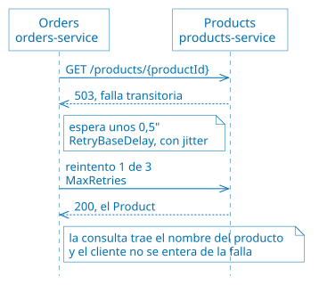

Si fallan los 3 reintentos, la consulta dice `"no disponible [error HTTP 503]"`.
Las esperas crecen: 0,5 segundos, 1 segundo y 2 segundos
-`DelayBackoffType.Exponential`-.

**Código:** la estrategia de reintento del *pipeline* de cada dependencia, en el
método `AddResilience` de la clase `Resilience`, en
[OrdersService/Resilience.cs](src/OrdersService/Resilience.cs). `ShouldHandle`
decide qué se reintenta; el `patterns.Retry` permite apagarlo en las demos:

```csharp
pipeline.AddRetry(new HttpRetryStrategyOptions
{
    ShouldHandle = args => patterns.Retry ? shouldRetry(args) : PredicateResult.False(),
    MaxRetryAttempts = MaxRetries,
    BackoffType = DelayBackoffType.Exponential,
    UseJitter = true,
    Delay = RetryBaseDelay,
    OnRetry = args => { /* registra [RETRY] en el log */ }
});
```

**Cómo verlo:** el detalle de las `Orders` de un `User` lo arma `Orders`, que le
pide a `Users` el nombre del cliente y a `Products` el nombre del producto de
cada `Order`. La demo [01 de Retry](demos/01-retry.sh) hace que `Products` falle
en el 30% de las solicitudes y consulta el detalle 8 veces con el Retry apagado
y 8 con el Retry prendido. Sin reintentos, cerca de la mitad de las respuestas
trae algún producto "no disponible"; con reintentos, casi todas traen el nombre
del producto, porque los reintentos ocultan las fallas. Las que tardan más son
las que necesitaron reintentos. Los *logs* de Docker de `orders-service`
muestran cada `[RETRY]` con su demora y su causa; el comando para verlos está en
[commands/02-availability.azcli](commands/02-availability.azcli).

> [!TIP]
>
> Consulta [Build resilient HTTP apps: Key development
> patterns](https://learn.microsoft.com/en-us/dotnet/core/resilience/http-resilience)
> para tener más información sobre cómo `AddResilienceHandler` arma el
> *pipeline* de cada `HttpClient`, y [HTTP requests with
> IHttpClientFactory](https://learn.microsoft.com/en-us/aspnet/core/fundamentals/http-requests?view=aspnetcore-10.0)
> sobre los `HttpClient` con nombre, uno por dependencia.

#### Circuit Breaker

**Problema:** si una dependencia está caída, seguir llamándola -y reintentando-
desperdicia recursos, demora las respuestas y la sobrecarga justo cuando intenta
recuperarse.

**Implementación:** un circuito por dependency, en el mismo pipeline que el
Retry. Se abre si fallan al menos la mitad de las llamadas en 10 segundos, con
un mínimo de 5 llamadas. Abierto, las llamadas fallan de inmediato durante 15
segundos; después pasa a semiabierto, deja pasar una llamada de prueba y, si
funciona, se cierra. El detalle de `Orders` no devuelve error: muestra `"no
disponible [circuito abierto]"` en lugar del nombre: lo arma el método
`GetOrdersForUser` de la clase `OrdersController`, en
[OrdersService/Controllers/OrdersController.cs](src/OrdersService/Controllers/OrdersController.cs).

El estado del circuito vive en la memoria de cada proceso: con tres *workers*,
cada uno tiene sus propios circuitos. Qué estado vive en cada réplica, y qué
hizo falta para que los componentes se puedan replicar, está en [Stateless y
estado por réplica](ARCHITECTURE.md#stateless-y-estado-por-réplica), en
ARCHITECTURE.md.

**Cómo funciona:**


Los eventos `OnOpened`, `OnHalfOpened` y `OnClosed` son los del panel "Eventos
de resiliencia", y el estado es el del panel "Estado del circuito de cada
dependencia".

**Código:** la estrategia del *pipeline* de cada dependencia, en
[OrdersService/Resilience.cs](src/OrdersService/Resilience.cs). Va dentro del
Retry, así que cada reintento cuenta como una llamada más para el circuito:

```csharp
pipeline.AddCircuitBreaker(new HttpCircuitBreakerStrategyOptions
{
    ShouldHandle = args => patterns.CircuitBreaker ? shouldBreak(args) : PredicateResult.False(),
    FailureRatio = CircuitFailureRatio,            // 0,5
    MinimumThroughput = CircuitMinimumThroughput,  // 5
    SamplingDuration = CircuitSamplingDuration,    // 10 segundos
    BreakDuration = CircuitBreakDuration,          // 15 segundos
    OnOpened = args => { /* registra [CIRCUIT BREAKER] ABIERTO */ },
    OnHalfOpened = args => { /* SEMIABIERTO */ },
    OnClosed = args => { /* CERRADO */ }
});
```

**Cómo verlo:** la demo [02 de Circuit Breaker](demos/02-circuit-breaker.sh) hace
que `Products` falle en el 100% de las solicitudes y consulta el detalle 6 veces
con todos los patrones apagados y 6 con solo el Circuit Breaker prendido. Sin el
circuito, `Products` recibe 12 llamadas, aunque falle siempre; con el circuito,
5. Sin reintentos, cada falla cuenta una vez: las dos primeras consultas dicen
`"no disponible [error HTTP 503]"`, en la tercera el circuito se abre, y desde
ahí responden con `"no disponible [circuito abierto]"` sin llamar a `Products`.
Cuando `Products` se recupera, el circuito sigue abierto hasta que pasan los 15
segundos. Los *logs* de Docker muestran las transiciones ABIERTO → SEMIABIERTO →
CERRADO. Con el Retry prendido, la primera consulta tardaría unos 3 segundos,
porque reintentaría cada llamada antes de que se abriera el circuito.

> [!TIP]
>
> Consulta [Introduction to resilient app
> development](https://learn.microsoft.com/en-us/dotnet/core/resilience/) para
> tener más información sobre las estrategias de
> [Polly](https://www.pollydocs.org/) que usa el *pipeline*, entre ellas el
> Circuit Breaker y su `CircuitBreakerManualControl`.

#### Bulkhead

**Problema:** si una dependencia se pone lenta, las llamadas pendientes se
acumulan y consumen los recursos -conexiones, memoria, hilos- que necesitan las
demás funciones.

**Implementación:** un límite de concurrencia por dependencia, en el método
`AddResilience` de la clase `Resilience`, en
[OrdersService/Resilience.cs](src/OrdersService/Resilience.cs). Las llamadas que
exceden el límite se rechazan de inmediato. Como cada dependencia tiene su
propio compartimento, la lentitud de `Products` no afecta las llamadas a
`Users`. Cada compartimento se dimensiona según su dependencia, al llamar a
`AddResilience` en [OrdersService/Program.cs](src/OrdersService/Program.cs):
`Products` tiene 5 llamadas en curso y 5 en espera; `Users`, que responde rápido
pero se llama en cada consulta, tiene 20 en curso y 5 en espera. Los
compartimentos son de cada proceso: `orders-service`, cada *worker* y cada
proyector tienen los suyos, así que `Products` puede recibir 5 llamadas a la vez
de cada uno -ver [Stateless y estado por
réplica](ARCHITECTURE.md#stateless-y-estado-por-réplica) en ARCHITECTURE.md-.

**Cómo funciona:**

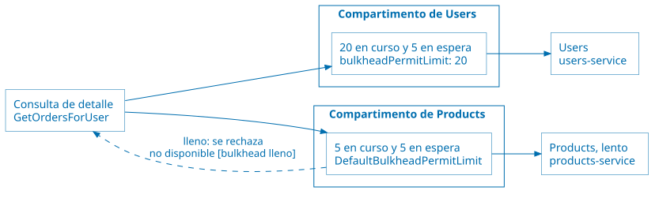

Cada llamada toma un lugar del compartimento de su dependencia. Si no hay lugar,
espera en la fila; si la fila también está llena, se rechaza. Con `Products`
lento se llena su compartimento, pero el de `Users` sigue libre.

**Código:** un `ConcurrencyLimiter` por dependencia, en el método
`AddResilience` de la clase `Resilience`, en
[OrdersService/Resilience.cs](src/OrdersService/Resilience.cs), y el tamaño de
cada compartimento, en las llamadas a `AddResilience` de
[OrdersService/Program.cs](src/OrdersService/Program.cs):

```csharp
// Resilience.cs
var bulkhead = new ConcurrencyLimiter(new ConcurrencyLimiterOptions
{
    PermitLimit = bulkheadPermitLimit,  // llamadas en curso
    QueueLimit = bulkheadQueueLimit     // llamadas en espera
});
pipeline.AddRateLimiter(new HttpRateLimiterStrategyOptions
{
    RateLimiter = args => patterns.Bulkhead
        ? bulkhead.AcquireAsync(1, args.Context.CancellationToken)
        : ValueTask.FromResult<RateLimitLease>(AcquiredLease.Instance),
    OnRejected = _ => { /* registra [BULKHEAD] en el log */ }
});

// Program.cs
builder.Services.AddHttpClient("UsersService", ...).AddResilience("users", bulkheadPermitLimit: 20);
builder.Services.AddHttpClient("ProductsService", ...).AddResilience("products");
```

**Cómo verlo:** la demo [03 de Bulkhead](demos/03-bulkhead.sh) hace que `Products`
demore 1,5 segundos y lanza 15 consultas simultáneas, primero con el Bulkhead
apagado y después prendido. Sin el Bulkhead, las 15 traen los nombres, pero
`Products` llega a atender 15 llamadas a la vez. Con el Bulkhead, nunca más de
5: 10 consultas entran al compartimento de `Products` y traen los nombres de los
productos, y las otras 5 se rechazan de inmediato con `"no disponible [bulkhead
lleno]"`. El nombre del `User` aparece en todas las respuestas.

> [!TIP]
>
> Consulta [ConcurrencyLimiter
> Class](https://learn.microsoft.com/en-us/dotnet/api/system.threading.ratelimiting.concurrencylimiter)
> para tener más información sobre el limitador que funciona como compartimento,
> con sus lugares en curso y en espera.

#### Throttling

**Problema:** un pico de carga puede saturar un servicio y degradarlo para todos
sus clientes.

**Implementación:** `Orders` atiende como máximo 20 consultas de detalle a la
vez. Las que exceden el límite reciben `503 Service Unavailable` con
`Retry-After: 2`, en lugar de encolarse. La política `throttling` se define con
`AddRateLimiter` en [OrdersService/Program.cs](src/OrdersService/Program.cs), y
se aplica con el atributo `[EnableRateLimiting("throttling")]` en el método
`GetOrdersForUser` de la clase `OrdersController`, en
[OrdersService/Controllers/OrdersController.cs](src/OrdersService/Controllers/OrdersController.cs).

El gateway también aplica Throttling, pero por cliente: cada IP puede crear como
máximo 1 `Order` por segundo, con una ráfaga de hasta 5. Lo que excede el límite
recibe `429 Too Many Requests` sin llegar a `orders-service`; las consultas no
tienen límite. Está en
[ApiGateway/nginxconf/nginx.conf](src/ApiGateway/nginxconf/nginx.conf)
-[`limit_req_zone`](https://nginx.org/en/docs/http/ngx_http_limit_req_module.html#limit_req_zone)
y
[`limit_req`](https://nginx.org/en/docs/http/ngx_http_limit_req_module.html#limit_req)-.
Es el límite que respeta el cliente de la demo de Rate Limiting.

Los dos límites están en la memoria de cada instancia: con N réplicas de
`orders-service`, el servicio atiende hasta 20 × N consultas de detalle a la
vez, y con dos gateways, un cliente puede crear el doble de `Orders` -ver
[Stateless y estado por réplica](ARCHITECTURE.md#stateless-y-estado-por-réplica) en ARCHITECTURE.md-.

**Cómo funciona:**

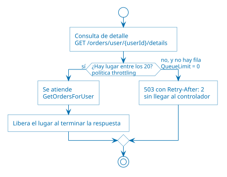

Es el mismo tipo de limitador que el [Bulkhead](#bulkhead), en la dirección
opuesta: el Bulkhead limita las llamadas que `Orders` hace; el Throttling, las
solicitudes que `Orders` recibe.

**Código:** la política, con `AddRateLimiter` en
[OrdersService/Program.cs](src/OrdersService/Program.cs), y el atributo que la
aplica, en el método `GetOrdersForUser` de la clase `OrdersController`, en
[OrdersService/Controllers/OrdersController.cs](src/OrdersService/Controllers/OrdersController.cs):

```csharp
// Program.cs
builder.Services.AddRateLimiter(options =>
{
    options.RejectionStatusCode = StatusCodes.Status503ServiceUnavailable;
    options.AddPolicy("throttling", context =>
        context.RequestServices.GetRequiredService<PatternSettings>().Throttling
            ? RateLimitPartition.GetConcurrencyLimiter("throttling", _ => new ConcurrencyLimiterOptions
            {
                PermitLimit = 20,
                QueueLimit = 0
            })
            : RateLimitPartition.GetNoLimiter("sin throttling"));
    options.OnRejected = (context, _) =>
    {
        context.HttpContext.Response.Headers.RetryAfter = "2";
        // registra [THROTTLING] en el log
        return ValueTask.CompletedTask;
    };
});

// OrdersController.cs
[HttpGet("user/{userId}/details")]
[EnableRateLimiting("throttling")]
public async Task<ActionResult<List<object>>> GetOrdersForUser(int userId)
```

**Cómo verlo:** la demo [04 de Throttling](demos/04-throttling.sh) hace que
`Orders` demore 5 segundos en cada consulta y lanza 40 simultáneas, primero con
el Throttling apagado y después prendido. Sin el Throttling, las 40 responden
200 y `Orders` llega a atender 40 a la vez. Con el Throttling, 20 responden 200
con todos los nombres y 20 se rechazan al instante con 503. La demo apaga el
Bulkhead; con el Bulkhead prendido, algunas respuestas 200 traerían un producto
"no disponible", porque las 20 consultas atendidas llaman a `Products` a la vez
y llenan su compartimento: en un sistema real, el Throttling y el Bulkhead
actúan juntos. El Throttling por cliente del gateway se ve en la demo de Rate
Limiting.

> [!TIP]
>
> Consulta [Rate limiting middleware in ASP.NET
> Core](https://learn.microsoft.com/en-us/aspnet/core/performance/rate-limit?view=aspnetcore-10.0)
> para tener más información sobre cómo está implementada la política
> `throttling` con `AddRateLimiter` y `[EnableRateLimiting]`.

#### Rate Limiting

**Problema:** un cliente que envía solicitudes más rápido de lo que acepta el
servicio al que llama recibe rechazos y tiene que reintentarlos. Las solicitudes
rechazadas no avanzan el trabajo, pero consumen capacidad del cliente, de la red
y del servicio, y los reintentos agregan esperas. Es el caso típico de un
proceso por lotes que envía muchos datos a un servicio con límite de capacidad.

**Implementación:** el cliente regula su propio ritmo para no superar el límite
del servicio. Rate Limiting y Throttling son las dos caras del mismo límite: el
servicio aplica Throttling para protegerse, y el cliente aplica Rate Limiting
para no chocar contra ese Throttling. En esta aplicación, el servicio es el
gateway, con su Throttling por cliente -1 `POST /orders/` por segundo por IP,
con una ráfaga de 5; ver [Throttling](#throttling)-, y el cliente es un proceso
por lotes que crea `Orders`:
la demo [05 de Rate Limiting](demos/05-rate-limiting.sh) y
[k6/rate-limiting.js](k6/rate-limiting.js).

> [!NOTE]
>
> **Rate limiting en [nginx](https://nginx.org/) y en Azure.** nginx llama *rate
> limiting* a `limit_req`, y muchos API gateways y proveedores de APIs usan el
> término en el mismo sentido: un límite que el **servicio** aplica a cada
> cliente. En el catálogo de patrones de Azure Architecture Center, que sigue
> este repositorio, eso es
> [Throttling](https://learn.microsoft.com/en-us/azure/architecture/patterns/throttling),
> en este caso por cliente; y [Rate
> Limiting](https://learn.microsoft.com/en-us/azure/architecture/patterns/rate-limiting-pattern)
> es un patrón del **cliente**, que regula su ritmo para no superar el
> Throttling del servicio al que llama. Por eso el gateway usa la configuración
> de *rate limiting* de nginx para implementar Throttling, y el patrón Rate
> Limiting está en el cliente de la demo.

**Cómo funciona:**

Sin Rate Limiting, el cliente envía todo de golpe y reintenta lo rechazado:

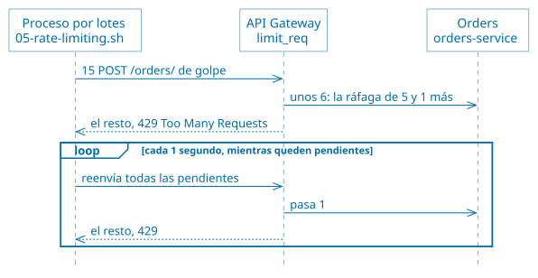

Con Rate Limiting, el cliente respeta el ritmo que acepta el gateway:

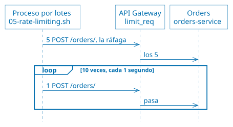

El límite del gateway es el mismo en las dos formas: 1 `POST /orders/` por
segundo por IP, con una ráfaga de 5. Lo que cambia es cómo envía el cliente.

**Cómo verlo:** la demo [05 de Rate Limiting](demos/05-rate-limiting.sh) crea 15
`Orders` de dos formas. Sin Rate Limiting, las envía todas de golpe y reintenta
las rechazadas cada 1 segundo: hacen falta unas 55 solicitudes y unas 40 reciben
429. Con Rate Limiting, respeta el límite del gateway: 15 solicitudes y ningún
429. Las dos formas demoran unos 10 segundos, porque el límite del gateway fija
el ritmo máximo.

#### Health Endpoint Monitoring

**Problema:** sin una forma de saber si un servicio funciona, una falla solo se
detecta cuando un usuario se queja.

**Implementación:** cada servicio expone `/health`, que verifica sus propias
dependencias y devuelve un [JSON](https://www.json.org/) con el resultado de
cada chequeo -200 si está sano, 503 en caso contrario-:

* `users-service`: *ping* a [MongoDB](https://www.mongodb.com/).
* `products-service`: conexión a [PostgreSQL](https://www.postgresql.org/).
* `orders-service`: conexión a [MySQL](https://www.mysql.com/) y a
  [RabbitMQ](https://www.rabbitmq.com/). Si RabbitMQ no está, queda `Degraded` y
  responde 200, porque gracias al [Transactional Outbox](#transactional-outbox)
  sigue aceptando `Orders`. `orders-worker` y `orders-projector` quedan
  `Unhealthy`, porque sin RabbitMQ no reciben nada.

`Orders` **no** chequea a `Users` ni a `Products`: si se cae una dependency,
`Orders` sigue funcionando degradado y no debe figurar como caído. El gateway
publica los tres en `/health/users`, `/health/products` y `/health/orders`.
Docker los consulta cada 5 segundos
-[`healthcheck`](https://docs.docker.com/reference/compose-file/services/#healthcheck)
en [docker-compose.yaml](docker-compose.yaml)- y los usa para no levantar un
servicio hasta que sus dependencias estén sanas -[`depends_on: condition:
service_healthy`](https://docs.docker.com/reference/compose-file/services/#depends_on)-.

**Cómo funciona:**

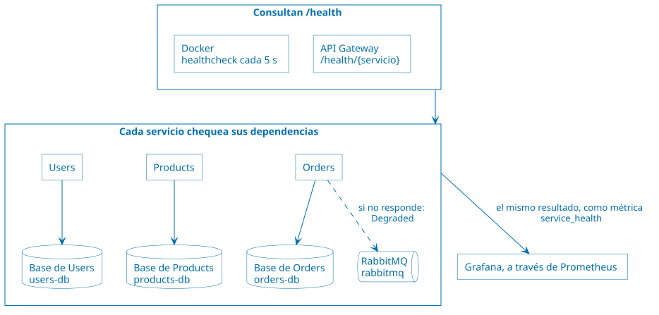

`Orders` no chequea a `Users` ni a `Products`: si se caen, sigue funcionando
degradado. [Grafana](https://grafana.com/oss/grafana/) no consulta `/health`:
cada servicio publica el resultado de sus chequeos como la métrica
`service_health`.

**Código:**

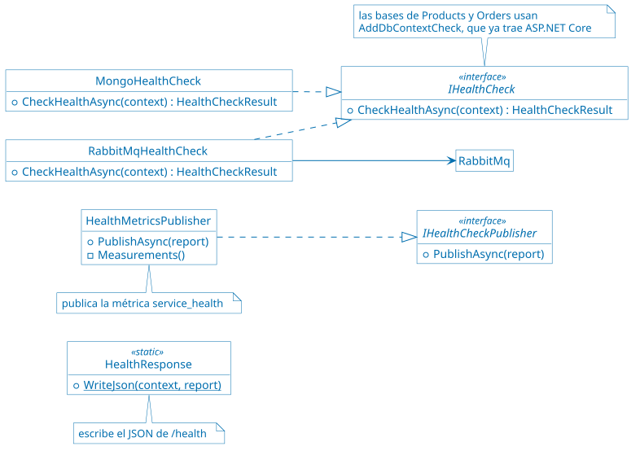

Cada chequeo es una implementación de `IHealthCheck`, registrada con
`AddHealthChecks` en el `Program.cs` de cada servicio:

* La clase `RabbitMqHealthCheck`, en
  [Common/RabbitMq.cs](src/Common/RabbitMq.cs), y la clase `MongoHealthCheck`,
  en
  [UsersService/Data/MongoHealthCheck.cs](src/UsersService/Data/MongoHealthCheck.cs),
  implementan el método `CheckHealthAsync`. `Products` y `Orders` chequean su
  base con `AddDbContextCheck`, de [EF Core](https://learn.microsoft.com/ef/core/).
* El método `WriteJson` de la clase `HealthResponse`, en
  [Common/HealthResponse.cs](src/Common/HealthResponse.cs), escribe el JSON de
  `/health`.
* El método `PublishAsync` de la clase `HealthMetricsPublisher`, en
  [Common/HealthMetrics.cs](src/Common/HealthMetrics.cs), publica la métrica.

**Cómo verlo:** la demo [06 de Health Endpoint Monitoring](demos/06-health.sh)
detiene la base de datos de `Products`. `/health/products` pasa a 503, con el
chequeo `products-db` en `Unhealthy`; `Orders` sigue sano, y a los pocos segundos Docker
marca `products-service` como `unhealthy`. Al levantar la base, todo vuelve a la
normalidad. Para verlo en vivo, corre [el monitor de
estado](demos/monitor-health.sh) en otra terminal. En Grafana, el panel "Salud
de los servicios" muestra `products-service` en rojo mientras la base está
detenida.

> [!TIP]
>
> Consulta [Health checks in ASP.NET
> Core](https://learn.microsoft.com/en-us/aspnet/core/host-and-deploy/health-checks?view=aspnetcore-10.0)
> para tener más información sobre cómo está implementado el chequeo de salud.

#### Competing Consumers para disponibilidad

**Problema:** un solo proceso que atiende una cola es un cuello de botella y un
punto único de falla.

**Implementación:** `POST /orders/` publica el evento `order.created` en el
exchange `andis.events` de RabbitMQ, a través del [Transactional
Outbox](#transactional-outbox). La cola `orders.process` está suscripta a ese
evento -ver [Publisher/Subscriber](#publishersubscriber)-. Tres réplicas de
`orders-worker` consumen la misma cola; RabbitMQ entrega cada mensaje a una sola
réplica. Cada réplica toma un mensaje a la vez -`prefetch = 1`- y lo confirma
-*ack*- recién cuando termina; si se cae antes, RabbitMQ entrega el mensaje a
otra réplica. Si `Users` o `Products` no están disponibles, el *worker* devuelve
el mensaje a la cola y lo reintenta 5 segundos después. Está en la clase
`OrderProcessingWorker`, en
[OrdersService/Messaging/OrderProcessingWorker.cs](src/OrdersService/Messaging/OrderProcessingWorker.cs):
el método `ExecuteAsync` se suscribe a la cola y confirma o devuelve cada
mensaje, y el método `ProcessAsync` procesa la `Order`.

**Cómo funciona:**


Cada mensaje lo recibe una sola réplica. Si una réplica se cae antes de
confirmarlo, RabbitMQ se lo entrega a otra. Funciona porque el *worker* es
*stateless*: la `Order` está en MySQL y el mensaje en la cola, así que cualquier
réplica puede terminar lo que otra empezó -ver [Stateless y estado por
réplica](ARCHITECTURE.md#stateless-y-estado-por-réplica) en ARCHITECTURE.md-. El recorrido completo de una
`Order`, desde el `POST` hasta su confirmación, está en [Creación de una Order:
asíncrona](ARCHITECTURE.md#creación-de-una-order-asíncrona), en ARCHITECTURE.md.

**Código:**

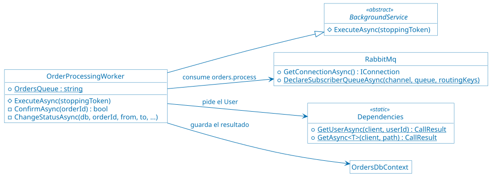

El método `ProcessAsync` de la clase `OrderProcessingWorker`, en
[OrdersService/Messaging/OrderProcessingWorker.cs](src/OrdersService/Messaging/OrderProcessingWorker.cs),
devuelve `false` cuando `Users` o `Products` no responden: el mensaje vuelve a
la cola.

Que las réplicas se repartan la cola no evita que dos procesen la misma `Order`.
El *outbox* entrega cada mensaje al menos una vez -ver [Transactional
Outbox](#transactional-outbox)-, y las dos copias de un `order.created` pueden
llegar a la vez a dos réplicas. Si el *worker* preguntara primero si la `Order`
sigue `Pending` y la cambiara después, el código sería así:

```csharp
var order = await db.Orders.FindAsync([orderId], cancellationToken);  // pregunta
if (order.Status != OrderStatus.Pending)
    return true;
// ... 2 segundos de demora, y las llamadas a Users y a Products ...
order.Status = OrderStatus.Confirmed;                                  // cambia
db.OrderEvents.Add(orderEvent);
await db.SaveChangesAsync(cancellationToken);
```

Entre la pregunta y el cambio pasan más de 2 segundos. Con las dos copias en dos
réplicas a la vez:

1. Las dos ejecutan `FindAsync` y leen la `Order` como `Pending`.
2. Las dos esperan la demora y las respuestas de `Users` y de `Products`.
3. Las dos ejecutan `SaveChangesAsync`. Quedan dos `OrderConfirmed` en el
   historial de [Event Sourcing](#event-sourcing) y dos `order.confirmed` en el
   *outbox*, que llegan dos veces a los proyectores y al ERP.

Por eso el método `ProcessAsync` junta la pregunta y el cambio en una sola
sentencia. En el código, el `Where` es la pregunta y el `SetProperty` es el
cambio:

```csharp
var changed = await db.Orders
    .Where(o => o.Id == orderId && o.Status == OrderStatus.Pending)          // pregunta
    .ExecuteUpdateAsync(s => s.SetProperty(o => o.Status, newStatus), ct);   // cambia
if (changed == 0)
{
    // Otra réplica ya la procesó: no se agrega ni el evento ni el mensaje.
    await transaction.RollbackAsync(ct);
    return true;
}
db.OrderEvents.Add(orderEvent);
db.OutboxMessages.Add(outboxMessage);
```

El método `ExecuteUpdateAsync` no carga la `Order` en memoria. EF Core lo
traduce a una sola sentencia SQL, `UPDATE orders SET status = 'Confirmed' WHERE
id = 42 AND status = 'Pending'`, y devuelve cuántas filas cambió. Con las dos
copias a la vez:

1. La primera réplica ejecuta el `UPDATE`. La `Order` está `Pending`, así que la
   cambia y `changed` vale 1. MySQL bloquea la fila hasta que termina la
   transacción.
2. La segunda réplica ejecuta el mismo `UPDATE` y espera a que se libere la
   fila. Cuando la primera confirma, la `Order` ya está `Confirmed`, el `WHERE`
   no encuentra la fila y `changed` vale 0.
3. La segunda deshace su transacción, registra `[COMPETING CONSUMERS] …
   descarta la orden` y no agrega ni el evento ni el mensaje.

La lectura del principio de `ProcessAsync` sigue estando, sin seguimiento de
cambios -`AsNoTracking`-. No decide nada: solo evita llamar a `Users` y a
`Products` cuando una copia llega después de que la `Order` ya se procesó. El
índice único de `order_events` por `Order` y tipo de evento queda como segunda
barrera. Ver [Idempotencia](ARCHITECTURE.md#idempotencia) en ARCHITECTURE.md.

**Cómo verlo:** la demo [07 de Competing
Consumers](demos/07-competing-consumers.sh) crea 9 `Orders`. Cada *worker* tarda
2 segundos por `Order`, y las 9 se procesan en unos 6 segundos, 3 por réplica.
Después crea 9 más y detiene una réplica mientras procesa: la `Order` que tenía
la termina otra réplica. Para ver la cola y sus consumidores, abre la consola de
RabbitMQ. Dos copias del mismo mensaje procesadas a la vez por dos réplicas se
ven en la demo [09 de Transactional Outbox](demos/09-transactional-outbox.sh)
-ver [Transactional Outbox](#transactional-outbox)-.

> [!TIP]
>
> Consulta [Background tasks with hosted services in ASP.NET
> Core](https://learn.microsoft.com/en-us/aspnet/core/fundamentals/host/hosted-services?view=aspnetcore-10.0)
> para tener más información sobre `BackgroundService`, la clase base de
> `OrderProcessingWorker`, `OutboxRelay` y `OrderDetailsProjector`.

#### Event Sourcing

**Problema:** si solo se guarda el estado actual, se pierde la historia de cómo
se llegó a él, y una corrupción de ese estado no tiene vuelta atrás.

**Implementación:** cada cambio de una `Order` se guarda como un evento
inmutable en la tabla `order_events`: `OrderCreated`, `OrderConfirmed` u
`OrderRejected`. La tabla `orders` es una **proyección**: el estado actual,
calculado a partir de los eventos. Cada evento es un `OrderEvent`, creado con el
método `Create` de esa clase, en
[OrdersService/Models/OrderEvent.cs](src/OrdersService/Models/OrderEvent.cs); el
método `Replay` de la clase `OrderProjection`, en
[OrdersService/Models/OrderProjection.cs](src/OrdersService/Models/OrderProjection.cs),
los reproduce para obtener el estado.

* `GET /orders/{id}/events` muestra los eventos de una `Order` y el estado que
  resulta de reproducirlos.
* `POST /orders/projections/rebuild` borra la tabla `orders` y la reconstruye a
  partir de los eventos.

**Cómo funciona:**

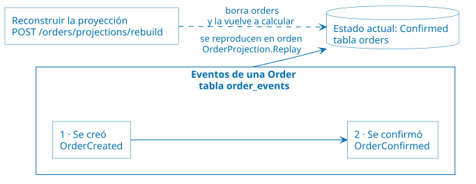

Los eventos no se modifican ni se borran: un cambio nuevo es un evento nuevo.
`orders` se puede borrar y recalcular en cualquier momento.

**Código:**

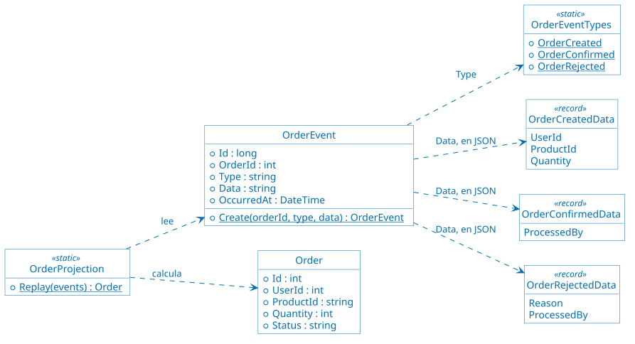

**Cómo verlo:** la demo [08 de Event Sourcing](demos/08-event-sourcing.sh) crea
una `Order`, muestra sus eventos, borra la tabla `orders` directamente en MySQL
y la reconstruye. Las `Orders` vuelven con su estado.

#### Transactional Outbox

**Problema:** un servicio que guarda un cambio en su base y después publica un
mensaje hace dos escrituras en dos sistemas distintos, sin una transacción que
las abarque. Si RabbitMQ no está o el servicio se cae entre una y otra, queda el
cambio sin el mensaje: una `Order` `Pending` que ningún *worker* va a procesar.
Si se publica primero, queda el mensaje de un cambio que tal vez no se guardó.

**Implementación:** `POST /orders/` guarda la `Order`, su evento `OrderCreated`
de Event Sourcing y el mensaje `order.created` en la tabla `outbox_messages`,
**en la misma transacción**: se guardan los tres o ninguno. El *worker* hace lo
mismo con `order.confirmed` y `order.rejected`. Ninguno de los dos publica en
RabbitMQ. Lo hacen el método `CreateOrder` de la clase `OrdersController` y el
método `ProcessAsync` de la clase `OrderProcessingWorker`, con el método
`Create` de la clase `OutboxMessage`, en
[OrdersService/Models/OutboxMessage.cs](src/OrdersService/Models/OutboxMessage.cs).

El *relay* del *outbox* -el método `PublishPendingAsync` de la clase
`OutboxRelay`, en
[OrdersService/Messaging/OutboxRelay.cs](src/OrdersService/Messaging/OutboxRelay.cs)-
corre en `orders-service`. Cada segundo toma hasta 50 mensajes pendientes, en
orden, los publica en `andis.events` y les completa la fecha de publicación.
Publica con confirmación de RabbitMQ: solo marca un mensaje cuando RabbitMQ
confirmó que lo recibió. Si RabbitMQ no está, los mensajes quedan pendientes y
se reintentan en la vuelta siguiente. Los toma con `SELECT ... FOR UPDATE SKIP
LOCKED`: con más de una instancia del *relay*, cada mensaje lo publica una sola.

La entrega es **al menos una vez**: si el *relay* se cae después de publicar y
antes de marcar, publica de nuevo el mismo mensaje. Por eso los suscriptores son
idempotentes, aunque las dos copias lleguen a la vez a réplicas distintas. El
*worker* cambia el estado con un `UPDATE` que solo afecta a las `Orders` que
siguen `Pending`, y descarta la copia si otra réplica ya la procesó -ver
[Competing Consumers para
disponibilidad](#competing-consumers-para-disponibilidad)-. Los proyectores de
la vista materializada escriben cada fila con un *upsert* -ver [Materialized
View](#materialized-view)-. Ver [Idempotencia](ARCHITECTURE.md#idempotencia) en ARCHITECTURE.md.

`Users` y `Products` publican sus eventos directamente, sin *outbox*: si
RabbitMQ no está, el cambio se guarda y el evento se pierde. `Users` usa
MongoDB sin réplicas, que no admite transacciones con varios documentos. Quedó
así a propósito, para comparar; ver [Decisiones abiertas a
discusión](ARCHITECTURE.md#decisiones-abiertas-a-discusión) en ARCHITECTURE.md.

**Cómo funciona:**

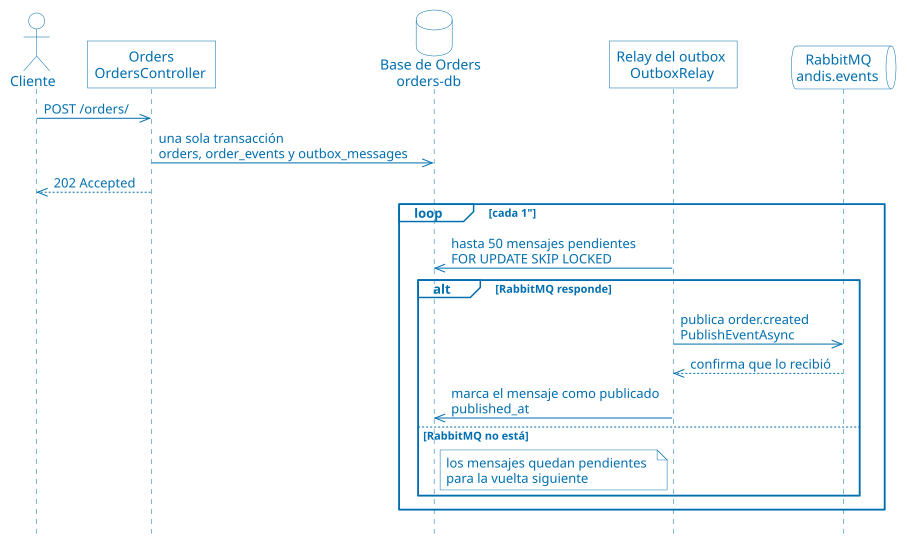

El *worker* guarda `order.confirmed` u `order.rejected` en el *outbox* de la
misma forma. El recorrido completo está en [Creación de una Order:
asíncrona](ARCHITECTURE.md#creación-de-una-order-asíncrona), en ARCHITECTURE.md.

**Código:**

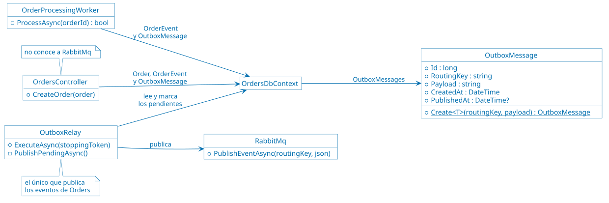

`PublishedAt` es nulo mientras el mensaje está pendiente.

**Cómo verlo:** la demo [09 de Transactional
Outbox](demos/09-transactional-outbox.sh) detiene RabbitMQ y crea 5 `Orders`.
Todas responden `202`; antes del *outbox*, `Orders` respondía `503` y la `Order`
quedaba `Pending` para siempre. `/health/orders` responde `Degraded`, y los 5
mensajes esperan en `outbox_messages`. Después duplica el mensaje
`order.created` de la última `Order`, como si el *relay* lo hubiera publicado
dos veces. Al levantar RabbitMQ, el *relay* los publica, los *workers* confirman
las `Orders` y el *outbox* queda vacío. Las dos copias del mensaje duplicado
llegan a la vez a dos *workers*: los *logs* muestran que uno confirma la `Order`
y el otro la descarta, y la `Order` tiene un solo `OrderConfirmed` en su
historial y un solo `order.confirmed` en el *outbox*. En Grafana, el panel
"Outbox de Orders" muestra los pendientes subir y volver a cero.

> [!TIP]
>
> Consulta [Transactions - EF
> Core](https://learn.microsoft.com/en-us/ef/core/saving/transactions) para
> tener más información sobre la transacción que guarda la `Order`, su evento y
> el mensaje, y [SQL Queries - EF
> Core](https://learn.microsoft.com/en-us/ef/core/querying/sql-queries) sobre
> `FromSqlRaw`, con el que el *relay* lee los mensajes pendientes.

## Demos de rendimiento y procesamiento asíncrono

**Estado: implementada en este repositorio, sobre las demos de resiliencia y
disponibilidad.**

Escenario: un pico de tráfico en una campaña. La aplicación debe mantener
latencias bajas y absorber la carga.

Qué se muestra:

* Lecturas rápidas con caché y vistas materializadas.
* Creación de `Orders` encolada, con consumidores en competencia.
* Eventos pub/sub para desacoplar los servicios.

Resultado observable: latencias de lectura estables durante el pico, *backlog*
absorbido por la cola y throughput que crece al agregar *workers*. El pico se
genera con [k6/load.js](k6/load.js) y
[k6/load-leveling.js](k6/load-leveling.js), y se compara antes y después de cada
patrón en el dashboard de [Grafana](https://grafana.com/oss/grafana/), en la
fila "Rendimiento: caché, CQRS y outbox".

### Qué agrega a las demos de disponibilidad

| Componente | Para qué |
| ---------- | -------- |
| `redis` | Caché de `Products`. |
| `orders-projector` -3 réplicas- | La misma imagen que `orders-service`, con el proyector habilitado -`PROJECTOR__ENABLED=true`-. Mantiene la vista materializada `order_details`. |
| Exchange `andis.events` | Eventos `order.created`, `order.confirmed`, `order.rejected`, `user.updated` y `product.updated`. Los contratos están en [Common/Events.cs](src/Common/Events.cs). |
| Modificación de `Users` y `Products` | Operación [SOAP](https://www.w3.org/TR/soap/) `UpdateUser` y `PUT /products/{id}`, que publican `user.updated` y `product.updated`. |
| Ajustes de la caché | `PUT /products/cache` prende o apaga la caché y agrega una demora a cada lectura de [PostgreSQL](https://www.postgresql.org/), sin reiniciar, igual que el chaos. `DELETE /products/cache` vuelve a los valores por defecto. |

```bash
# Caché apagada y cada lectura de PostgreSQL demora 200 ms
curl -X PUT http://localhost/products/cache -H "Content-Type: application/json" \
  -d '{"enabled": false, "dbDelayMs": 200}'

# Vuelve a los valores por defecto: caché prendida y sin demora
curl -X DELETE http://localhost/products/cache
```

### Patrones de rendimiento

Como en las demos de disponibilidad, cada patrón tiene un script en
[demos](demos/), del `11` al `17`. Los *logs* de
[Docker](https://www.docker.com/) muestran los eventos con una etiqueta:
`[CACHE-ASIDE]` en `products-service`; `[PUB/SUB]` en `users-service`,
`products-service` y `orders-projector`; y `[MATERIALIZED VIEW]` en
`orders-projector`.

#### Cache-Aside

**Problema:** las lecturas de datos que cambian poco van a la base cada vez, y
la base se vuelve el cuello de botella de un pico de lecturas.

**Implementación:** `Products` busca primero en [Redis](https://redis.io/). Si
el dato no está -*miss*-, lo lee de [PostgreSQL](https://www.postgresql.org/) y lo
guarda en Redis por 60 segundos; la próxima lectura sale de Redis -*hit*-. Al
crear o cambiar un `Product`, `Products` borra de Redis las claves afectadas, y
la próxima lectura trae el dato nuevo. Es la aplicación la que maneja la caché:
Redis no sabe nada de PostgreSQL. Si Redis no responde, `Products` lee PostgreSQL
directamente; la caché acelera, pero no es una dependencia, y por eso no entra
en `/health`. Está en los métodos `GetOrLoadAsync` e `InvalidateAsync` de la
clase `ProductCache`, en
[ProductsService/ProductCache.cs](src/ProductsService/ProductCache.cs), que usan
los métodos `GetProduct` y `UpdateProduct` de la clase `ProductsController`, en
[ProductsService/Controllers/ProductsController.cs](src/ProductsService/Controllers/ProductsController.cs).

Se borra la clave en lugar de escribir el valor nuevo: así la caché nunca guarda
un valor que PostgreSQL no tiene. La caché está en Redis y no en la memoria de
`Products`, así que la comparten todas las réplicas y una invalidación vale para
todas -ver [Stateless y estado por réplica](ARCHITECTURE.md#stateless-y-estado-por-réplica) en ARCHITECTURE.md-.
El TTL acota cuánto puede durar un dato desactualizado si una invalidación
falla.

**Cómo funciona:**


Si Redis no responde, `Products` lee directamente de PostgreSQL.

**Código:**


`ProductCache` no conoce a PostgreSQL: su método `GetOrLoadAsync` recibe la lectura
como una función, `load`.

**Cómo verlo:** la demo [11 de Cache-Aside](demos/11-cache-aside.sh) simula una
base que demora 200 ms y lee el mismo `Product` varias veces: la primera lectura
demora 200 ms y las siguientes, 2 o 3 ms. Después cambia su nombre: la lectura
siguiente es un *miss* y trae el nombre nuevo. Con Redis detenido, `Products`
sigue respondiendo, a la velocidad de PostgreSQL. Bajo carga,
[k6/cache-aside.js](k6/cache-aside.js) lee 50 veces por segundo con la caché
apagada y después prendida: la p95 baja de unos 100 ms a unos 3 ms.

> [!TIP]
>
> Consulta [Caching
> Guidance](https://learn.microsoft.com/en-us/azure/architecture/best-practices/caching)
> para tener más información sobre cuándo conviene una caché, cuánto tiempo
> guardar cada dato y cómo mantenerla consistente con la base.

#### Queue-Based Load Leveling

**Problema:** un pico de solicitudes que un servicio procesa en el momento lo
satura, y satura también a los servicios que llama.

**Implementación:** `POST /orders/` solo guarda la `Order` y responde; el
trabajo pesado -verificar el `User` y el `Product` con `Users` y `Products`- lo
hacen los *workers* desde la cola `orders.process`, a su propio ritmo. La cola
absorbe el pico: `Users` y `Products` reciben como máximo una llamada por
réplica del *worker*, sin importar cuántas `Orders` lleguen. Ya estaba en las
demos de disponibilidad, como base de [Competing
Consumers](#competing-consumers-para-disponibilidad); las demos de rendimiento
lo muestra bajo un pico.

**Cómo funciona:**


El pico se acumula en la cola, no en `Users` ni en `Products`. El código es el
de [Competing Consumers](#competing-consumers-para-disponibilidad).

**Cómo verlo:** la demo [12 de Queue-Based Load
Leveling](demos/12-queue-based-load-leveling.sh) crea 30 `Orders` a la vez,
directamente en `orders-service`: el Throttling por cliente del gateway
rechazaría el pico antes de que llegara a la cola. Todas responden `202` en
pocos milisegundos; la cola baja de a 3 mensajes cada 2 segundos hasta vaciarse.
[k6/load-leveling.js](k6/load-leveling.js) envía 10 `POST` por segundo durante
10 segundos: la latencia de `create order` se mantiene baja y la cola crece
durante el pico y se vacía después.

#### Competing Consumers para rendimiento

**Problema:** un solo consumidor procesa la cola a un ritmo fijo; si el pico
dura mucho, la cola crece sin límite.

**Implementación:** la misma de la [demo de
disponibilidad](#competing-consumers-para-disponibilidad). Visto como patrón de
rendimiento, el throughput crece agregando réplicas de `orders-worker`, sin
cambiar el código.

**Cómo funciona:** el mismo diagrama de la [demo de
disponibilidad](#competing-consumers-para-disponibilidad), con 6 réplicas en
lugar de 3.

**Cómo verlo:** la demo [13 de Competing Consumers para
rendimiento](demos/13-competing-consumers-scaling.sh) procesa 30 `Orders` con 3
réplicas, unos 21 segundos, y otras 30 con 6 réplicas, unos 12 segundos. Al
final vuelve a 3 réplicas.

#### Publisher/Subscriber

**Problema:** si un servicio avisa de sus cambios llamando a cada interesado,
tiene que conocerlos a todos, y cada interesado nuevo obliga a cambiarlo.

**Implementación:** `Orders`, `Users` y `Products` publican eventos en el
exchange `andis.events`, de tipo *topic*. En
[RabbitMQ](https://www.rabbitmq.com/), un exchange y una cola son piezas
distintas:

* Un **exchange** es donde se publica. No guarda mensajes: según la clave de
  ruteo de cada mensaje, por ejemplo `order.created`, pone una copia en cada
  cola enlazada con esa clave. Si ninguna cola está enlazada, el mensaje se
  descarta. En un exchange de tipo *topic*, las claves de los enlaces admiten
  comodines: `order.*` recibe `order.created`, `order.confirmed` y
  `order.rejected`.
* Una **cola** es donde los mensajes esperan hasta que un consumidor los toma.
  Cada mensaje de una cola lo procesa un solo consumidor.

Cada suscriptor tiene su propia cola y la enlaza con las claves de ruteo que le
interesan:

| Cola | Suscriptor | Claves |
| ---- | ---------- | ------ |
| `orders.process` | `orders-worker` | `order.created` |
| `orders.details-view` | `orders-projector` | `order.*`, `user.updated`, `product.updated` |

Un mismo `order.created` llega a las dos colas. `Orders` no sabe que existen los
proyectores: agregarlos no cambió el código que publica. La conexión y la
publicación están en la clase `RabbitMq`, en
[Common/RabbitMq.cs](src/Common/RabbitMq.cs): el método `PublishEventAsync`
publica un evento, y el método `DeclareSubscriberQueueAsync` declara la cola de
un suscriptor con sus claves.

El exchange y las colas corresponden a dos patrones distintos. Entre colas,
Publisher/Subscriber: cada suscriptor recibe su propia copia de cada evento.
Dentro de una cola, [Competing
Consumers](#competing-consumers-para-rendimiento): las réplicas de
`orders-worker` comparten `orders.process`, y cada mensaje lo procesa una sola.

**Cómo funciona:**


Quien publica no conoce las colas: cada suscriptor declara la suya y elige las
claves de ruteo.

**Código:**

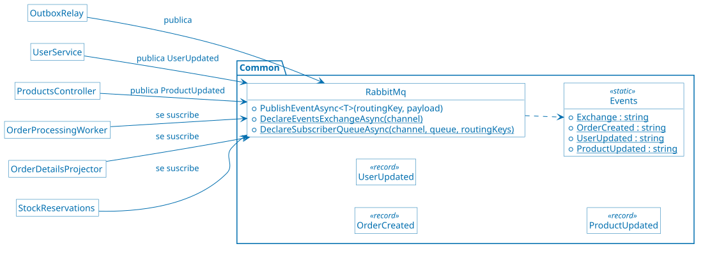

Los contratos de los eventos y la conexión a RabbitMQ están en `Common`, el
único proyecto que comparten los servicios. Los registros `OrderConfirmed` y
`OrderRejected` también están ahí; el diagrama no los muestra.

**Cómo verlo:** la demo [14 de
Publisher/Subscriber](demos/14-publisher-subscriber.sh) muestra los enlaces del
exchange, crea una `Order` y muestra los *logs* del *worker* y de los
proyectores, que la reciben los dos. Después cambia el nombre de un `Product` y
de un `User`: esos eventos solo los reciben los proyectores.

#### Asynchronous Request-Reply

**Problema:** una operación que tarda no puede tener al cliente esperando la
respuesta: el cliente agota su *timeout* o retiene una conexión que no hace
nada.

**Implementación:** `POST /orders/` responde `202 Accepted` enseguida, con
`Location: /orders/{id}/status` y `Retry-After: 2`. `GET /orders/{id}/status`
responde `200` con el estado mientras la `Order` está `Pending`, también con
`Retry-After`; cuando un *worker* la confirma o la rechaza, responde `303 See
Other` a `/orders/{id}`, y el cliente sigue la redirección para obtener el
resultado. Está en los métodos `CreateOrder` y `GetOrderStatus` de la clase
`OrdersController`, en
[OrdersService/Controllers/OrdersController.cs](src/OrdersService/Controllers/OrdersController.cs).

`POST /orders/` crea una `Order` en cada llamada. Si el cliente no recibe el
`202`, por un *timeout* o un corte de red, no sabe si la `Order` se creó, y si
reintenta se crea una segunda. Esa `Order` tiene su propio `order.created`, su
confirmación y su pedido al ERP, con otro número, así que ni el ERP puede darse
cuenta de que es la misma. Para evitarlo, `POST /orders/` acepta el encabezado
opcional `Idempotency-Key`, del [borrador de la
IETF](https://datatracker.ietf.org/doc/draft-ietf-httpapi-idempotency-key-header/):
el cliente elige una clave por `Order`, por ejemplo un
[UUID](https://datatracker.ietf.org/doc/html/rfc9562), y la repite en cada
reintento.

* **Clave nueva:** se crea la `Order` y se guarda la clave en la tabla
  `idempotency_keys`, en la misma transacción que la `Order`, su evento y el
  mensaje del *outbox*.
* **Clave conocida, con los mismos datos:** no se crea nada. Se responde lo
  mismo que la primera vez: `202` con el mismo `id`, la misma `Location` y
  `Retry-After`, más `Idempotent-Replayed: true`. Ese encabezado no está en el
  borrador; es una convención para avisar al cliente que la respuesta es una
  repetición.
* **Clave conocida, con otros datos:** `422 Unprocessable Content`, como indica
  el borrador: el cliente usó la clave para otra `Order`. Los datos se comparan
  con un *hash* SHA-256 de `userId`, `productId` y `quantity`, y no del texto
  del cuerpo, así que un reintento con otros espacios u otro orden de los campos
  es la misma `Order`.
* **Dos solicitudes a la vez con la misma clave:** la clave primaria de
  `idempotency_keys` deja guardar solo una. La segunda espera a que la primera
  confirme, choca con la clave, deshace su `Order` y responde como a un
  reintento. El borrador sugiere `409 Conflict` cuando la primera todavía está
  en proceso; acá la segunda espera y nunca la ve en proceso.

La clave es de un `User`: con [Federated Identity](#federated-identity), la del
token; si la solicitud es anónima, el `User` 0. No se guarda en la tabla
`orders` porque esa tabla es una proyección que `POST
/orders/projections/rebuild` borra y reconstruye -ver [Event
Sourcing](#event-sourcing)-. Sin el encabezado, todo sigue como antes, para que
los clientes y las demos existentes funcionen igual; cada reintento crea otra
`Order`. Las claves no vencen en la demo. En producción se borran después de un
plazo, por ejemplo 24 horas, para que la tabla no crezca sin límite, y un
reintento posterior crea otra `Order`. Ver [Idempotencia](ARCHITECTURE.md#idempotencia) en ARCHITECTURE.md.

**Cómo funciona:**


**Cómo verlo:** la demo [15 de Asynchronous
Request-Reply](demos/15-asynchronous-request-reply.sh) crea una `Order`, muestra
el `202` con sus encabezados y consulta el estado respetando `Retry-After` hasta
el `303`. Sigue la redirección y muestra la `Order` confirmada. Al final crea
otra `Order` con `Idempotency-Key` y repite el `POST` con la misma clave, como
un cliente que no recibió la respuesta: la respuesta trae el mismo `id` e
`Idempotent-Replayed: true`. Con la misma clave y otra cantidad, responde `422`.

> [!TIP]
>
> Consulta [Controller action return types in ASP.NET Core web
> API](https://learn.microsoft.com/en-us/aspnet/core/web-api/action-return-types?view=aspnetcore-10.0)
> para tener más información sobre los resultados que devuelven `CreateOrder` y
> `GetOrderStatus`, como `Accepted`.

#### CQRS

**Problema:** el modelo que conviene para escribir -tablas normalizadas, cada
dato en el servicio que es su dueño- no es el que conviene para leer. La
consulta de detalle tiene que juntar datos de tres servicios en cada lectura.

**Implementación:** los comandos y las consultas usan modelos distintos.

* **Comandos:** `POST /orders/` y el *worker* escriben `orders`, `order_events`
  y `outbox_messages`, en el método `CreateOrder` de la clase
  `OrdersController`, en
  [OrdersService/Controllers/OrdersController.cs](src/OrdersService/Controllers/OrdersController.cs),
  y en el método `ProcessAsync` de la clase `OrderProcessingWorker`, en
  [OrdersService/Messaging/OrderProcessingWorker.cs](src/OrdersService/Messaging/OrderProcessingWorker.cs).
* **Consultas:** `GET /orders/user/{userId}/details/view` lee solo la vista
  `order_details` -ver [Materialized View](#materialized-view)-, en el método
  `GetOrdersForUser` de la clase `OrdersQueriesController`, en
  [OrdersService/Controllers/OrdersQueriesController.cs](src/OrdersService/Controllers/OrdersQueriesController.cs).
  Es una consulta a [MySQL](https://www.mysql.com/), sin llamadas a `Users` ni a
  `Products`, y sin Throttling.

`GET /orders/user/{userId}/details`, la consulta síncrona de la demo de
disponibilidad, queda como está: la usan los demos de Retry, Circuit Breaker,
Bulkhead y Throttling, y sirve para comparar. El costo es la **consistencia
eventual**: el lado de las consultas se actualiza un momento después que el de
los comandos.

**Cómo funciona:**


La flecha de los eventos es la consistencia eventual: el modelo de lectura se
actualiza un momento después. El recorrido completo de una consulta desde la
vista está en [Consulta de detalle desde la vista:
eventos](ARCHITECTURE.md#consulta-de-detalle-desde-la-vista-eventos), en
ARCHITECTURE.md.

**Código:**


La separación se ve en el código: un controlador para los comandos, sobre
`Order`, y otro para las consultas, sobre `OrderDetails`.

**Cómo verlo:** la demo [16 de CQRS](demos/16-cqrs.sh) hace la misma consulta por
los dos lados. Sin fallas, la síncrona demora unos 100 ms y la vista, 3 ms. Con
`Products` demorando 300 ms, la síncrona pasa a casi 2 segundos -una llamada por
`Order`- y la vista no cambia. Después crea una `Order` y consulta enseguida: la
síncrona ya la tiene, la vista todavía no. Bajo carga, [k6/load.js](k6/load.js)
con `-e DETAILS=live` y con `-e DETAILS=view` compara las dos.

#### Materialized View

**Problema:** armar el detalle de las `Orders` en cada consulta cuesta una
llamada a `Users` y una a `Products` por `Order`, y si alguno no responde, el
detalle sale degradado.

**Implementación:** la tabla `order_details` guarda el detalle de cada `Order`
con el nombre del cliente y el nombre del producto ya copiados. La mantiene el
método `ApplyAsync` de la clase `OrderDetailsProjector`, en
[OrdersService/Messaging/OrderDetailsProjector.cs](src/OrdersService/Messaging/OrderDetailsProjector.cs),
que corre en `orders-projector` y consume la cola `orders.details-view`:

* `order.created`: el método `AddOrderAsync` busca el nombre del cliente y del
  producto **una vez**, con los mismos `HttpClient` y la misma resiliencia de la
  demo de disponibilidad, y agrega la fila. Si `Users` o `Products` no
  responden, el mensaje vuelve a la cola.
* `order.confirmed` y `order.rejected`: el método `SetStatusAsync` actualiza el
  estado.
* `user.updated` y `product.updated`: actualizan el nombre en todas las filas de
  ese `User` o `Product`.

Corre con tres réplicas, como el *worker*. Cada mensaje de la cola va a una
réplica distinta y se procesa en paralelo, así que los proyectores no pueden
suponer que los eventos de una `Order` llegan en orden, ni que una copia
repetida de un mensaje llega después de la original. Los proyectores no guardan
nada en memoria, y aun así, mientras su resultado dependía del orden de los
mensajes, solo podía haber uno: ser *stateless* no alcanza para escalar -ver
[Stateless y estado por réplica](ARCHITECTURE.md#stateless-y-estado-por-réplica) en ARCHITECTURE.md-. Con varias
réplicas, sin las soluciones que siguen pasaría esto, sin errores visibles:

* **Un estado perdido por desorden.** La réplica A recibe `order.created` de la
  `Order` 42 y llama a `Users` y a `Products`, que tardan. Mientras tanto, el
  *worker* confirma la `Order` y la réplica B recibe `order.confirmed`: no
  encuentra la fila y descarta el estado. Después A inserta la fila como
  `Pending`, y la vista muestra `Pending` para siempre, aunque la `Order` esté
  `Confirmed`.

  **Solución:** el estado solo avanza. `Pending` pasa a `Confirmed` o a
  `Rejected`, y esos dos son finales. El método `SetStatusAsync` crea la fila
  con el estado final si todavía no existe, y `AddOrderAsync` completa los datos
  y los nombres sin tocar el estado. Aplicados en cualquier orden, los eventos
  dejan el mismo resultado, sin necesidad de numerarlos.
* **Copias que pasan el chequeo.** Buscar la fila o la factura y después
  insertarla son dos pasos, y dos copias del mismo mensaje en dos réplicas pasan
  las dos el chequeo. Con `order.invoiced`, la factura queda dos veces en el
  historial; con `order.created`, la segunda inserción viola la clave primaria y
  falla.

  **Solución:** una sola sentencia atómica. La vista se escribe con un *upsert*,
  [`INSERT … ON DUPLICATE KEY
  UPDATE`](https://dev.mysql.com/doc/refman/8.4/en/insert-on-duplicate.html) de
  MySQL, que inserta la fila o la actualiza si ya existe. La factura se inserta
  directamente, y un índice único de `order_events` por `Order` y tipo de evento
  hace fallar la segunda copia. Ver [Idempotencia](ARCHITECTURE.md#idempotencia) en ARCHITECTURE.md.
* **Una réplica trabada.** Una excepción no prevista, como una falla de la base,
  dejaría el mensaje sin confirmar ni devolver. Con `prefetch = 1`, RabbitMQ no
  le entregaría más mensajes a esa réplica hasta que se cerrara su canal.

  **Solución:** cualquier excepción devuelve el mensaje a la cola, igual que
  cuando `Users` o `Products` no responden. El *worker* hace lo mismo.
* **Nombres aplicados al revés.** Dos cambios del nombre de un `User`, primero
  "Ana" y después "Ana María", llegan a réplicas distintas y el viejo se aplica
  último: la vista queda con "Ana". Cada cambio es idempotente, porque asigna un
  valor, pero no conmutativo: el resultado depende del orden.

  **Solución:** `user.updated` y `product.updated` traen la fecha del cambio en
  el campo opcional `OccurredAt`, y la vista guarda la fecha de cada nombre en
  `customer_name_at` y `product_name_at`. Un nombre más viejo que el de la fila
  no se aplica. `AddOrderAsync` usa como fecha el momento en que leyó los
  nombres.

Las soluciones tienen sus costos:

* Comparar fechas de distintos contenedores supone que sus relojes están
  sincronizados. Una alternativa más robusta, y más invasiva, es un número de
  versión que `Users` y `Products` incrementen en cada cambio.
* Un mensaje que falla siempre, un *poison message*, vuelve a la cola para
  siempre. La alternativa es una [*dead-letter
  queue*](https://www.rabbitmq.com/docs/dlx), que la demo no tiene.
* El índice único supone que cada tipo de evento ocurre a lo sumo una vez por
  `Order`, y hoy es así. Un evento que pudiera repetirse, como un cambio de
  cantidad, necesitaría otro criterio, por ejemplo un identificador por mensaje.

Hay dos alternativas que conservan el orden y no se eligieron. Particionar la
cola por `Order` escala, pero agrega infraestructura. [*Single active
consumer*](https://www.rabbitmq.com/docs/consumers#single-active-consumer) de
RabbitMQ deja una réplica activa y las demás de respaldo: da disponibilidad,
pero no rendimiento.

**Cómo funciona:**

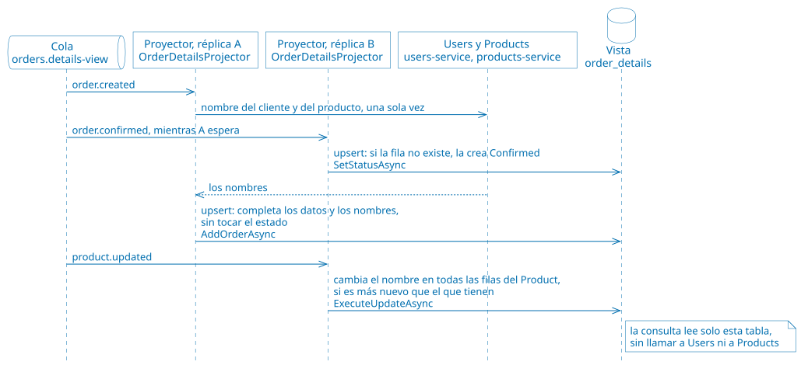

**Código:**

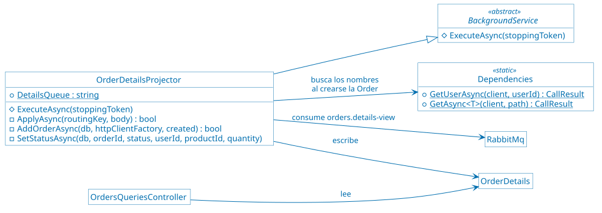

Los proyectores son los únicos que escriben la vista, y los únicos que llaman a
`Users` y a `Products`.

**Cómo verlo:** la demo [17 de Materialized View](demos/17-materialized-view.sh)
cambia el nombre de un `Product` y la vista lo refleja. Con `Products` fallando
siempre, la consulta síncrona responde "no disponible" y la vista sigue
respondiendo con los nombres. Después detiene los proyectores, hace que `Users`
demore 1,5 segundos y crea una `Order`: la `Order` se confirma, pero la vista no
la tiene y sus eventos esperan en la cola. Al levantar las tres réplicas,
`order.created` y `order.confirmed` llegan a la vez a réplicas distintas.
Mientras una espera a `Users`, la otra crea la fila con el estado final, y la
vista termina en `Confirmed`; los *logs* muestran qué hizo cada réplica. Por
último, publica dos `user.updated` del `User` 2 al revés, primero el más nuevo:
la vista se queda con el nombre más nuevo.

> [!TIP]
>
> Consulta [ExecuteUpdate and ExecuteDelete - EF
> Core](https://learn.microsoft.com/en-us/ef/core/saving/execute-insert-update-delete)
> para tener más información sobre `ExecuteUpdateAsync`, con el que los
> proyectores cambian un nombre en todas las filas de la vista con una sola
> sentencia.

## Demos de seguridad

**Estado: implementada en este repositorio, sobre las demos de rendimiento.**

Escenario: la aplicación se abre a clientes reales. Cada usuario tiene que
identificarse, ver solo lo suyo y no poder hacer más de lo que le corresponde, y
nada tiene que llegar a los servicios sin control.

Qué se muestra:

* Inicio de sesión en un proveedor de identidad externo, y decisiones tomadas
  con los claims del token.
* [TLS](https://datatracker.ietf.org/doc/html/rfc8446), validación de tokens y
  compresión en el gateway, sin código en los servicios.
* Validación y limpieza de cada solicitud antes de que llegue a un servicio, y
  servicios que solo se alcanzan a través del gateway.
* Un proxy junto a `Products` que le agrega autenticación y autorización sin
  cambiar su código.
* Acceso directo, temporal y acotado al almacenamiento de las imágenes.

Resultado observable: por la entrada
[HTTP](https://datatracker.ietf.org/doc/html/rfc9110) del gateway, cualquiera
llega a cualquier ruta, incluidas las de administración; por la entrada HTTPS,
cada solicitud necesita un token, los servicios no implementan autenticación ni
TLS, las políticas se aplican en el borde y cada acceso tiene el mínimo
privilegio necesario.

### Qué agrega a las demos de rendimiento

| Componente | Para qué |
| ---------- | -------- |
| `keycloak` | Proveedor de identidad. El realm `andis` tiene los usuarios, sus roles y el cliente `andis-cli`, la aplicación de línea de comandos de las demos; se importa al arrancar desde [Keycloak/andis-realm.json](src/Keycloak/andis-realm.json). Consola en <http://localhost:8080> -usr: `admin` pwd: `Pa55w0rd`-. |
| Entrada HTTPS del gateway | `https://localhost`, con los patrones de seguridad. La entrada [HTTP](https://datatracker.ietf.org/doc/html/rfc9110), `http://localhost`, queda como estaba, para las demos anteriores y para comparar; en producción quedaría solo la HTTPS. Está en [ApiGateway/nginxconf/nginx.conf](src/ApiGateway/nginxconf/nginx.conf). |
| `products-sidecar` | [Envoy](https://www.envoyproxy.io/), junto a `products-service` y en su mismo espacio de red. La entrada HTTPS le envía `/products/` al sidecar; la HTTP, directamente a `Products`. Está en [ProductsSidecar/envoy.yaml](src/ProductsSidecar/envoy.yaml). |
| `azurite` | El emulador de [Azure Storage](https://azure.microsoft.com/products/storage/), con las imágenes de los `Products`, en <http://localhost:10000>. |
| Imágenes de los `Products` | `PUT /products/{id}/image` sube la imagen a través de `Products`; `POST /products/{id}/image/upload-url` entrega una URL firmada para subirla directamente a [Azurite](https://github.com/Azure/Azurite); `GET /products/{id}/image` redirige a una URL firmada para bajarla. |
| [docker-compose.gatekeeper.yaml](docker-compose.gatekeeper.yaml) | Deja de publicar en el host los puertos de los servicios y de las bases: la única entrada a los servicios es el gateway. |

Los usuarios de [Keycloak](https://www.keycloak.org/), todos con la contraseña
`Pa55w0rd`:

| Usuario | Rol | `User` de la aplicación | Qué puede hacer |
| ------- | --- | ----------------------- | --------------- |
| alice | `customer` | 1 | Crear y consultar sus propias `Orders`; leer los `Products` |
| bob | `customer` | 2 | Lo mismo que alice, con sus `Orders` |
| carol | `admin` | — | Consultar las `Orders` de todos; cambiar los `Products` y sus imágenes. No es cliente: no crea `Orders` |

Ejemplo de una solicitud por la entrada HTTPS:

```bash
# El certificado del gateway es autofirmado: se copia del contenedor para que
# curl lo verifique
docker compose exec -T api-gateway cat /etc/nginx/tls/gateway.crt > gateway.crt

# alice inicia sesión en Keycloak y recibe un token
alice=$(curl -s -X POST http://localhost:8080/realms/andis/protocol/openid-connect/token \
  -d grant_type=password -d client_id=andis-cli -d scope=openid \
  -d username=alice -d password=Pa55w0rd | jq -r .access_token)

# Dirección para ver el token y verificar su firma en jwt.io. Un token real no se
# pega en un sitio de terceros: este es de una demo y vence en 15 minutos
echo "https://www.jwt.io/#token=$alice&publicKey=$(curl -sS http://localhost:8080/realms/andis/protocol/openid-connect/certs \
  | jq -r '.keys[] | select(.use == "sig") | tostring | @uri')"

# Las Orders de alice, con el token
curl --cacert gateway.crt -H "Authorization: Bearer $alice" \
  https://localhost/orders/user/665f1c2ab4e8d9a0c1f2e301/details/view
```

### Patrones de seguridad

Cada patrón tiene un script en [demos](demos/), del `18` al `22`, y un paso a
paso en [commands/04-security.azcli](commands/04-security.azcli) que compara la
misma solicitud por la entrada
[HTTP](https://datatracker.ietf.org/doc/html/rfc9110), sin el patrón, y por la
HTTPS, con él. Los *logs* de [Docker](https://www.docker.com/) muestran los
eventos con una etiqueta: `[HTTPS]` en `api-gateway`, una línea por solicitud;
`[FEDERATED IDENTITY]` en `orders-service`; `[SIDECAR]` en `products-sidecar`; y
`[VALET KEY]` en `products-service`.

Los patrones están en el orden en que se apoyan unos en otros, que no es el de
la lectura: Gateway Offloading y Gatekeeper usan los tokens de Federated
Identity.

#### Federated Identity

**Problema:** si cada aplicación autentica a sus usuarios, cada una guarda
contraseñas e implementa el inicio de sesión, la recuperación de contraseñas y
el bloqueo de cuentas, y el usuario tiene una cuenta distinta en cada una. Una
falla en cualquiera de ellas expone las contraseñas.

**Implementación:** la autenticación se delega en
[Keycloak](https://www.keycloak.org/), un proveedor de identidad que habla
[OpenID Connect](https://openid.net/developers/how-connect-works/). El usuario
inicia sesión en Keycloak, que emite un token firmado -un JWT- con sus claims:

* `preferred_username`: el nombre de usuario, por ejemplo `alice`.
* `user_id`: el `User` de la aplicación. Keycloak lo agrega a partir de un
  atributo del usuario, y así vincula la identidad externa con los datos de la
  aplicación.
* `realm_access.roles`: los roles, `customer` o `admin`.

La aplicación no guarda contraseñas: la tabla `users` tiene solo el nombre y el
correo. Confía en la firma de Keycloak y usa los claims:

* El gateway valida el token en cada solicitud por la entrada HTTPS y les pasa
  los claims a los servicios en los encabezados `X-User-Name`, `X-User-Id` y
  `X-User-Roles` -ver [Gateway Offloading](#gateway-offloading)-.
* `Orders` decide con esos claims. Un cliente crea `Orders` solo para él y
  consulta solo las suyas; un admin consulta las de todos, pero no crea
  `Orders`, porque no es cliente. Lo hace con el registro `CallerIdentity`, en
  [OrdersService/CallerIdentity.cs](src/OrdersService/CallerIdentity.cs), que
  usan los métodos `CreateOrder`, `ListOrders`, `GetOrder`, `GetOrderStatus`,
  `GetOrderEvents` y `GetOrdersForUser` de la clase `OrdersController`, y el
  método `GetOrdersForUser` de la clase `OrdersQueriesController`.
* Una solicitud sin esos encabezados, por la entrada HTTP, es anónima, y
  `Orders` se comporta como en las demos anteriores.

El cliente `andis-cli` admite dos formas de iniciar sesión. Con el flujo de
dispositivo -*device authorization grant*-, el que usan las aplicaciones de
línea de comandos y los televisores, el usuario inicia sesión en el navegador,
en la página de Keycloak, y la aplicación nunca ve la contraseña: es el que usa
el paso a paso. Con el *grant type* `password`, la aplicación recibe el usuario
y la contraseña y se los pasa a Keycloak: es más corto, y lo usan los scripts,
pero no se usaría en una aplicación real.

**Cómo funciona:**


El token dura 15 minutos. Keycloak no interviene en cada decisión: `Orders`
decide con los claims que trae el token.

**Código:**

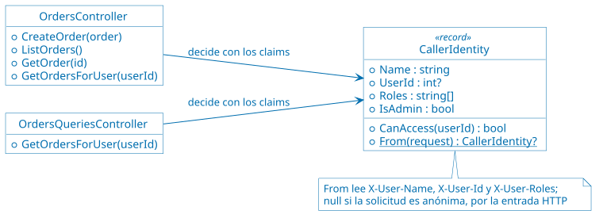

`Orders` no conoce a Keycloak ni valida tokens: lee los encabezados que arma el
gateway. Esa confianza depende del [Gatekeeper](#gatekeeper): si alguien llega a
`Orders` sin pasar por el gateway, puede mandar esos encabezados con cualquier
valor.

**Cómo verlo:** la demo [18 de Federated Identity](demos/18-federated-identity.sh)
crea una `Order` para el `User` 2 por la entrada HTTP, sin identificarse.
Después bob inicia sesión y, por la entrada HTTPS, crea una `Order` sin indicar
el `User`: es de bob; si indica el `User` 1, `Orders` responde 403. bob consulta
sus `Orders` y no las de alice, y alice, al revés; carol consulta las de los
dos, pero no puede crear. Sin token, o con el `user_id` del token cambiado por
el de alice, el gateway responde 401, porque la firma ya no corresponde a los
claims. Como en las demás demos, las `Orders` se crean solo para el `User` 2:
las del `User` 1 son la base de las demos de disponibilidad. En
[Grafana](https://grafana.com/oss/grafana/), el panel "Eventos de Keycloak por
segundo" muestra los inicios de sesión.

> [!TIP]
>
> Consulta [Securing applications with OpenID
> Connect](https://www.keycloak.org/securing-apps/oidc-layers) para tener más
> información sobre los flujos que ofrece Keycloak, y [RFC 8628, OAuth 2.0
> Device Authorization Grant](https://datatracker.ietf.org/doc/html/rfc8628)
> sobre el flujo de dispositivo.

#### Gateway Offloading

**Problema:** [TLS](https://datatracker.ietf.org/doc/html/rfc8446), la
validación de tokens y la compresión son funciones especializadas, que necesitan
configuración y certificados. Si cada servicio las implementa, cada uno lo hace
a su manera, en su lenguaje, y actualizar un certificado o una política obliga a
cambiar todos los servicios.

**Implementación:** el gateway se hace cargo de esas funciones en la entrada
HTTPS, en
[ApiGateway/nginxconf/nginx.conf](src/ApiGateway/nginxconf/nginx.conf):

* **TLS:** el gateway termina TLS con su certificado; los servicios siguen
  hablando HTTP dentro de la red de Docker, sin certificados. El certificado es
  autofirmado y se genera al construir la imagen, en
  [ApiGateway/Dockerfile](src/ApiGateway/Dockerfile), para no guardar una clave
  privada en el repositorio; en producción lo emitiría una autoridad de
  certificación.
* **Validación de tokens:** antes de reenviar cada solicitud,
  [`auth_request`](https://nginx.org/en/docs/http/ngx_http_auth_request_module.html#auth_request)
  hace una subsolicitud a `/userinfo` de Keycloak con el token. Si Keycloak
  responde 200, la solicitud sigue; si no, el gateway responde 401 y la
  solicitud no llega al servicio. Después, `identity.js`, en
  [ApiGateway/nginxconf/identity.js](src/ApiGateway/nginxconf/identity.js), lee
  los claims del token, ya validado, y el gateway se los pasa al servicio en los
  encabezados `X-User-Name`, `X-User-Id` y `X-User-Roles`.
* **Compresión:** el gateway comprime con
  [gzip](https://nginx.org/en/docs/http/ngx_http_gzip_module.html) las
  respuestas de más de 1 KB, si el cliente lo acepta.
* **Throttling por cliente:** el de la [demo de Throttling](#throttling), que el
  gateway ya aplicaba en la entrada HTTP.

El costo es que el gateway le pregunta a Keycloak por cada solicitud: si
Keycloak no responde, nadie entra. El [sidecar](#sidecar) muestra la
alternativa: verificar la firma del token con las claves públicas de Keycloak,
sin preguntarle cada vez, a cambio de no enterarse si se cerró la sesión.

**Cómo funciona:**


**Código:** la validación del token, en
[ApiGateway/nginxconf/nginx.conf](src/ApiGateway/nginxconf/nginx.conf):

```nginx
auth_request /_auth;

location = /_auth {
    internal;
    proxy_pass http://$keycloak/realms/andis/protocol/openid-connect/userinfo;
    proxy_pass_request_body off;
    proxy_set_header Content-Length "";
    proxy_set_header Authorization $http_authorization;
}

js_set $user_id identity.userId;
proxy_set_header X-User-Id $user_id;
```

**Cómo verlo:** la demo [19 de Gateway Offloading](demos/19-gateway-offloading.sh)
muestra que `Orders` no habla TLS y que el gateway sí, con su certificado. Sin
token, el gateway responde 401, y su *log* muestra que la solicitud no llegó a
ningún servicio; con token, la reenvía. La lista de `Orders` llega unas 15 veces
más chica por HTTPS que por HTTP, comprimida por el gateway. En Grafana, el
panel "Eventos de Keycloak por segundo" muestra una validación de token,
`user_info_request`, por cada solicitud HTTPS.

> [!TIP]
>
> Consulta [Authentication Based on Subrequest
> Result](https://docs.nginx.com/nginx/admin-guide/security-controls/configuring-subrequest-authentication/)
> para tener más información sobre `auth_request`, y la [documentación de
> njs](https://nginx.org/en/docs/njs/) sobre el JavaScript de
> [nginx](https://nginx.org/) que usa `identity.js`.

#### Gatekeeper

**Problema:** si los servicios reciben las solicitudes de los clientes
directamente, cada uno tiene que defenderse de todo lo que le pueda llegar:
rutas de administración, métodos inesperados, cuerpos enormes o mal formados,
encabezados falsos. Una falla en cualquiera de esas defensas deja expuesto al
servicio y a sus datos.

**Implementación:** en la entrada HTTPS, el gateway es el intermediario entre
los clientes y los servicios, y valida y sanea cada solicitud antes de
reenviarla, en
[ApiGateway/nginxconf/nginx.conf](src/ApiGateway/nginxconf/nginx.conf):

* **Rutas:** publica solo las de la aplicación. Las de administración -`/chaos`,
  `/patterns`, `/cache`, `/orders/projections/rebuild`- y cualquier otra
  responden 404 sin llegar a los servicios.
* **Ids:** el de un `Product` tiene 24 caracteres hexadecimales, y el de una
  `Order` o un `User` es un número; si no, 404.
* **Métodos:** cada ruta acepta solo los que usa la aplicación; un `DELETE`
  responde 403.
* **Cuerpo:** los `POST` y `PUT` tienen que ser [JSON](https://www.json.org/)
  -415 si no- y medir hasta 64 KB -413 si no-.
* **Encabezados de identidad:** el gateway arma `X-User-Name`, `X-User-Id` y
  `X-User-Roles` con los claims del token y reemplaza los que haya mandado el
  cliente. Un cliente no se puede hacer pasar por otro.

El gateway no tiene credenciales de las bases ni acceso a los datos: si alguien
lo compromete, no obtiene más que lo que ya podía pedir a través de él.

Para que sirva, los servicios no tienen que poder alcanzarse sin pasar por el
gateway. [docker-compose.yaml](docker-compose.yaml) publica en el host el puerto
de cada servicio y de cada base, para las demos anteriores; por ahí, cualquiera
llega a la administración o manda encabezados de identidad falsos.
[docker-compose.gatekeeper.yaml](docker-compose.gatekeeper.yaml) deja de
publicarlos: los servicios siguen hablando entre sí por la red de Docker, pero
desde afuera la única entrada es el gateway. Se aplica junto con el otro
archivo, y [Docker Compose](https://docs.docker.com/compose/) vuelve a crear
solo los contenedores que cambian:

```bash
docker compose -f docker-compose.yaml -f docker-compose.gatekeeper.yaml up -d --wait
```

**Cómo funciona:**


**Código:** las rutas de `Orders` y el saneamiento de los encabezados, en
[ApiGateway/nginxconf/nginx.conf](src/ApiGateway/nginxconf/nginx.conf):

```nginx
proxy_set_header X-User-Id    $user_id;
proxy_set_header X-User-Name  $user_name;
proxy_set_header X-User-Roles $user_roles;

client_max_body_size 64k;

location ~ ^/orders/(\d+(/status|/events)?|user/\d+/details(/view)?)?$ {
    limit_except GET POST { deny all; }
    if ($body_not_json) {
        return 415 '{"detail": "Gatekeeper: el cuerpo tiene que ser JSON"}\n';
    }
    proxy_pass http://$orders_service;
}

location / {
    return 404 '{"detail": "Gatekeeper: ruta no publicada"}\n';
}
```

**Cómo verlo:** la demo [20 de Gatekeeper](demos/20-gatekeeper.sh) compara las dos
entradas. Por HTTP, las rutas de administración responden 200, y los métodos,
los cuerpos y los ids inválidos llegan a `Orders`, que los rechaza después de
recibirlos. Por HTTPS, el gateway los rechaza sin llegar a los servicios. alice
no puede hacerse pasar por bob con encabezados falsos por HTTPS, pero sí por el
puerto 8000, sin token. Al aplicar `docker-compose.gatekeeper.yaml`, el puerto
8000 deja de responder, y la entrada HTTPS sigue funcionando. Al terminar, el
script vuelve a publicar los puertos. En Grafana, el panel "Solicitudes por
segundo, por servicio y código HTTP" muestra los rechazos de `Orders` por HTTP;
los de HTTPS no aparecen, porque no llegaron a `Orders`.

> [!TIP]
>
> Consulta [Module
> ngx_http_core_module](https://nginx.org/en/docs/http/ngx_http_core_module.html)
> para tener más información sobre `location`, `limit_except` y
> `client_max_body_size`, y [Merge Compose
> files](https://docs.docker.com/reference/compose-file/merge/) sobre cómo
> `docker-compose.gatekeeper.yaml` quita los puertos con `!reset`.

#### Sidecar

**Problema:** agregarle a un servicio funciones transversales -autenticación,
autorización, registro de accesos- obliga a cambiar su código, en su lenguaje, y
a repetirlo en cada servicio; y un servicio de terceros o legado tal vez no se
pueda cambiar. Además, el gateway protege solo lo que entra por el gateway:
dentro de la red, cualquier contenedor llama a cualquier servicio.

**Implementación:** un proxy [Envoy](https://www.envoyproxy.io/),
`products-sidecar`, corre junto a `products-service`, en su mismo espacio de red
-[`network_mode:
service:products-service`](https://docs.docker.com/reference/compose-file/services/#network_mode)
en [docker-compose.yaml](docker-compose.yaml)-. Para Envoy, `Products` es
`127.0.0.1:8000`; para los demás contenedores, el sidecar es
`products-service:9000`. Envoy es otra tecnología, escrita en C++, y se
configura con [ProductsSidecar/envoy.yaml](src/ProductsSidecar/envoy.yaml):

* **Autenticación:** el filtro
  [`jwt_authn`](https://www.envoyproxy.io/docs/envoy/latest/configuration/http/http_filters/jwt_authn_filter)
  verifica la firma del token con las claves públicas de Keycloak, que pide una
  vez cada 5 minutos, además del emisor y el vencimiento. Un token inválido
  recibe 401; sin token, la solicitud sigue como anónima.
* **Autorización:** el filtro
  [`rbac`](https://www.envoyproxy.io/docs/envoy/latest/configuration/http/http_filters/rbac_filter)
  deja leer a cualquiera -`GET`- y exige el rol `admin` para todo lo demás. Si
  no, 403.
* **Registro de accesos:** una línea `[SIDECAR]` por solicitud, con el código,
  el usuario del token y el motivo del rechazo.

`Products` no cambió: `ProductsController` no verifica roles. La entrada HTTPS
del gateway le envía `/products/` al sidecar, y la HTTP, directamente a
`Products`, para comparar. En producción, `Products` escucharía solo en
`127.0.0.1` y el sidecar sería su única entrada; acá sigue escuchando en el
puerto 8000 para las demos anteriores.

Una *service mesh*, como [Istio](https://istio.io/) o
[Linkerd](https://linkerd.io/), pone un sidecar como este junto a cada servicio,
y agrega TLS mutuo entre los sidecars; acá hay uno solo, sin TLS mutuo.

**Cómo funciona:**

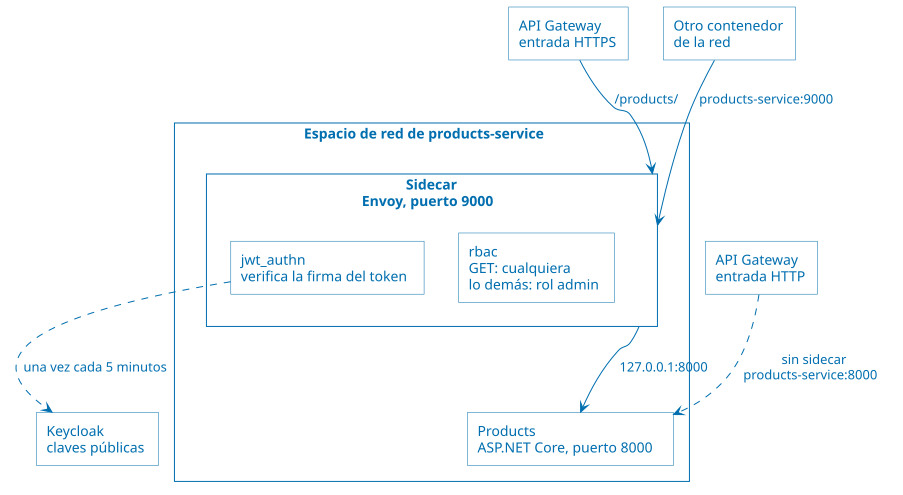

Cada solicitud pasa por los filtros de Envoy, en orden: primero `jwt_authn`, que
verifica el token y guarda sus claims; después `rbac`, que usa esos claims para
decidir si la deja pasar; y por último `router`, que la envía a `Products`. Si
un filtro la rechaza, los siguientes no se ejecutan y `Products` no se entera.
Al terminar, con cualquier resultado, Envoy escribe la línea `[SIDECAR]`.

**Código:** [ProductsSidecar/envoy.yaml](src/ProductsSidecar/envoy.yaml) no es
código, sino configuración, que Envoy lee al arrancar. Tiene tres partes:

* El *listener*: dónde escucha Envoy, en el puerto 9000.
* Los filtros: qué se hace con cada solicitud, en el orden en que aparecen.
* Los *clusters*: a quién puede llamar Envoy. Uno es `Products`, en
  `127.0.0.1:8000`, y el otro es Keycloak, para obtener sus claves públicas.

Las políticas de autorización están en el filtro `rbac`:

```yaml
policies:
  lecturas:
    permissions:
      - header: { name: ":method", string_match: { exact: GET } }
    principals:
      - any: true
  administracion:
    permissions:
      - any: true
    principals:
      - metadata:
          filter: envoy.filters.http.jwt_authn
          path: [{ key: jwt_payload }, { key: realm_access }, { key: roles }]
          value: { list_match: { one_of: { string_match: { exact: admin } } } }
```

**Cómo verlo:** la demo [21 de Sidecar](demos/21-sidecar.sh) cambia el nombre de
un `Product` por HTTP, sin identificarse. Por HTTPS, alice lo lee pero no lo
puede cambiar, y carol sí. Desde adentro de la red, `products-service:8000`
acepta cualquier cambio, y el sidecar, `products-service:9000`, lo rechaza: 403
sin token, y 401 con un token al que alice se agregó el rol `admin` sin poder
volver a firmarlo. El registro del sidecar muestra cada decisión. En Grafana, el
panel "Solicitudes en el sidecar de Products, por resultado" muestra las
permitidas y las rechazadas.

> [!TIP]
>
> Consulta [JWT
> Authentication](https://www.envoyproxy.io/docs/envoy/latest/configuration/http/http_filters/jwt_authn_filter)
> y [Role Based Access Control -RBAC-
> Filter](https://www.envoyproxy.io/docs/envoy/latest/configuration/http/http_filters/rbac_filter)
> para tener más información sobre los dos filtros de Envoy que usa el sidecar.

#### Valet Key

**Problema:** si los archivos de los clientes -imágenes, documentos- pasan por
la aplicación, la aplicación gasta red, memoria y tiempo en mover bytes, y el
gateway tiene que aceptar cuerpos grandes. Si en cambio el cliente accede
directamente al almacenamiento con las credenciales de la aplicación, puede
hacer cualquier cosa con todos los datos.

**Implementación:** las imágenes de los `Products` se guardan en
[Azurite](https://github.com/Azure/Azurite), el emulador de [Azure
Storage](https://azure.microsoft.com/products/storage/). `Products` tiene la
clave de la cuenta, pero no la entrega: le da al cliente una URL firmada -una
SAS, *Shared Access Signature*- que permite una sola operación, sobre la imagen
de un solo `Product`, durante 2 minutos como máximo. Con esa URL, el cliente
sube o baja la imagen directamente de Azurite, y los bytes no pasan por el
gateway ni por `Products`. En AWS, el equivalente de una SAS es una URL
prefirmada de [Amazon S3](https://aws.amazon.com/s3/) -*presigned URL*-, que
también permite una operación sobre un objeto durante un tiempo acotado:

* `POST /products/{id}/image/upload-url` entrega una URL para crear o reemplazar
  la imagen. No sirve para leerla, ni para la imagen de otro `Product`, ni
  después de vencer. El cliente puede pedir que venza antes, con `?seconds=N`.
* `GET /products/{id}/image` redirige, con 302, a una URL para leer la imagen.
* `PUT /products/{id}/image` es la forma sin Valet Key, para comparar:
  `Products` recibe la imagen y la sube él mismo, con su clave. Por la entrada
  HTTP, el gateway acepta hasta 20 MB en esa ruta; por la HTTPS, el
  [Gatekeeper](#gatekeeper) no deja pasar más de 64 KB.

Lo hace la clase `ProductImages`, en
[ProductsService/ProductImages.cs](src/ProductsService/ProductImages.cs): el
método `GetUploadKeyAsync` firma la URL de escritura, `GetDownloadKeyAsync` la
de lectura, y `UploadAsync` sube la imagen sin Valet Key. Los usan los métodos
`GetImageUploadUrl`, `GetImage` y `UploadImage` de la clase
`ProductsController`, en
[ProductsService/Controllers/ProductsController.cs](src/ProductsService/Controllers/ProductsController.cs).
La firma se calcula con la clave de la cuenta, sin llamar a Azurite, y no
incluye el host: `Products` llega a Azurite como `azurite:10000`, y la URL que
entrega dice `localhost:10000`, la dirección que usa el cliente. Como en
cualquier cambio del catálogo, el sidecar exige el rol `admin` para pedir una
URL de escritura.

**Cómo funciona:**


**Código:**


**Cómo verlo:** la demo [22 de Valet Key](demos/22-valet-key.sh) sube una imagen
de 5 MB a través de `Products`, por HTTP; por HTTPS, el gateway la rechaza con
413. Después carol pide una URL firmada y sube la imagen directamente a Azurite.
Con esa URL no se puede leer la imagen, ni escribir la de otro `Product`, y sin
la firma no se puede nada. Una URL que vence a los 5 segundos funciona enseguida
y no después. Para bajar la imagen, `Products` redirige a una URL de lectura. En
Grafana, el panel "Bytes de imágenes que recibe Products" muestra los 5 MB de la
subida sin Valet Key, y el panel "Claves de imágenes que entrega Products", las
URL firmadas.

> [!TIP]
>
> Consulta [Grant limited access to Azure Storage resources using shared access
> signatures](https://learn.microsoft.com/en-us/azure/storage/common/storage-sas-overview)
> para tener más información sobre las SAS, y [Create a service SAS for a blob
> with
> .NET](https://learn.microsoft.com/en-us/azure/storage/blobs/sas-service-create-dotnet)
> sobre `GenerateSasUri`, con el que `ProductImages` firma las URL.

## Demos de facilidad de modificación

**Estado: implementada en este repositorio, sobre las demos de seguridad.**

Escenario: la aplicación crece y tiene que cambiar sin detenerse. Hay que sumar
un cliente que usa datos de otros servicios sin adoptar su modelo, ajustar el
comportamiento sin redesplegar, integrarse con un sistema legado que no se puede
tocar, retirar un monolito de a poco y darle a cada cliente su propia API.

Qué se muestra:

* Una capa que traduce el modelo de otros servicios al de un cliente nuevo.
* Configuración central que se recarga sin reiniciar.
* Un puente de mensajería entre la aplicación y un ERP legado simulado.
* Migración progresiva de rutas desde un monolito.
* Un backend para la web y otro para la app móvil.

Resultado observable: un cliente nuevo que se agrega sin conocer el modelo de
`Orders` ni el [SOAP](https://www.w3.org/TR/soap/) de `Users`, cambios de
configuración sin reiniciar ningún contenedor, una `Order` que se factura en un
ERP aunque el broker del ERP haya estado caído, un monolito que se apaga sin que
el cliente lo note, y un backend que se redespliega sin que el otro cliente lo
note.

### Qué agrega a las demos de seguridad

| Componente | Para qué |
| ---------- | -------- |
| `purchases-service` | `Purchases`, con su capa anticorrupción, en [PurchasesService](src/PurchasesService/). El gateway lo publica en `/purchases/`, solo en la entrada [HTTP](https://datatracker.ietf.org/doc/html/rfc9110). |
| `consul` | El almacén de configuración, con la consola en <http://localhost:8500>. |
| `legacy-broker` | [ActiveMQ](https://activemq.apache.org/), el broker del ERP, con la consola en <http://localhost:8161/admin/> -usr: `admin` pwd: `admin`-. |
| `legacy-erp` | Un ERP simulado, en [LegacyErp/Program.cs](src/LegacyErp/Program.cs). |
| `messaging-bridge` | El puente entre [RabbitMQ](https://www.rabbitmq.com/) y ActiveMQ, en [MessagingBridge](src/MessagingBridge/). |
| `monolith` | El sistema que se reemplaza, en [Monolith/Program.cs](src/Monolith/Program.cs). |
| Fachada del gateway | `http://localhost:8090`, con la tabla de rutas en [ApiGateway/nginxconf/strangler-routes.conf](src/ApiGateway/nginxconf/strangler-routes.conf). |
| `bff-web` y `bff-mobile` | Un backend para la web y otro para la app móvil, en [BffWeb](src/BffWeb/) y [BffMobile](src/BffMobile/). El gateway los publica en `/web/` y `/mobile/`, solo en la entrada HTTP. |

### Patrones de facilidad de modificación

Cada patrón tiene un script en [demos](demos/), del `23` al `27`, y un paso a
paso en [commands/05-modifiability.azcli](commands/05-modifiability.azcli). Los
*logs* de [Docker](https://www.docker.com/) muestran los eventos con una
etiqueta: `[EXTERNAL CONFIG]` en los servicios, `[MESSAGING BRIDGE]` en
`messaging-bridge` y en `orders-projector`, `[ERP]` en `legacy-erp` y
`[STRANGLER]` en `api-gateway`.

Estas demos no se conectan a ninguna nube: corren con Docker. Cada patrón nombra
los servicios equivalentes de Azure y de AWS. Cómo verlos bajo carga está en
[Antes y después en Grafana](#antes-y-después-en-grafana), y cuánto cuesta cada
cambio, en [Tamaño del cambio](#tamaño-del-cambio).

Ningún patrón hace que una aplicación sea fácil de cambiar en general. Cada uno
apuesta a un tipo de cambio: reduce algunos costos, deja igual a otros y hasta
puede encarecer alguno. Por eso, antes de elegir un patrón hay que preguntarse
qué es probable que cambie: en un [escenario de
calidad](https://github.com/ucudal/ANDIS_Conceptos/blob/main/2_Tecnicas_y_herramientas/2_10_.Evaluacion_arquitectura/2_10_1_ATAM.md#caracterización-de-los-atributos-de-calidad),
ese cambio es el estímulo. Cada patrón indica qué cambios anticipa y cuáles no.

#### Anti-corruption Layer

**Problema:** un servicio nuevo necesita datos de otros sistemas que tienen su
propio modelo. Si usa directamente sus nombres, sus estados y su protocolo, ese
modelo se filtra por todo su código: cada cambio en el otro sistema obliga a
cambiarlo, y su propio modelo queda atado a decisiones de otro equipo.

**Escenario:** `Purchases`, un cliente nuevo, muestra para un `Product` todas
sus compras: quién lo compró, cuántas unidades y si la compra está confirmada.
Los datos están en `Orders`, que habla de `user_id`, `product_id` y estados
`Pending`, `Confirmed` y `Rejected`, y en `Users`, que habla
[SOAP](https://www.w3.org/TR/soap/).

**Implementación:** [PurchasesService](src/PurchasesService/) separa el modelo
de `Purchases` de la capa que traduce.

* **El modelo:** `Purchase`, en
  [PurchasesService/Purchase.cs](src/PurchasesService/Purchase.cs), con número,
  comprador, unidades y si está confirmada. `Purchases` depende de la interfaz
  `IPurchaseSource`, no de `Orders` ni de `Users`.
* **La capa:** la carpeta
  [PurchasesService/AntiCorruption](src/PurchasesService/AntiCorruption/).
  * La clase `OrdersTranslator` lee `GET /orders/`, filtra por `Product`, deja
    afuera las `Orders` rechazadas y traduce el estado.
  * La clase `UsersTranslator` arma el sobre SOAP y lee solo el nombre.
  * La clase `OrdersPurchaseSource` las combina, y le pregunta a `Users` una
    sola vez por comprador.
* **Lo que se descarta:** la capa lee solo los campos que usa. Si `Orders`
  agrega campos, como la fecha de creación que la demo le agrega con un flag, la
  capa no cambia.
* **El endpoint:** `GET /purchases/product/{productId}`, publicado por el
  gateway en la entrada [HTTP](https://datatracker.ietf.org/doc/html/rfc9110).

La capa puede ser parte del servicio, como acá, o un servicio aparte que
comparten varios clientes. En Azure, una capa compartida podría ser una
aplicación de [Azure Functions](https://azure.microsoft.com/products/functions/)
o una política de [Azure API
Management](https://azure.microsoft.com/products/api-management/), y en AWS, una
función de [AWS Lambda](https://aws.amazon.com/lambda/) o [Amazon API
Gateway](https://aws.amazon.com/api-gateway/).

La clase `ErpFormat` de [Messaging Bridge](#messaging-bridge) también traduce,
pero formatos de mensajes entre dos brokers. Esta capa protege el modelo de un
servicio.

**Cómo funciona:**


**Código:**


La traducción de las `Orders`, en el método `ForProductAsync` de la clase
`OrdersTranslator`:

```csharp
return orders
    .Where(o => o.ProductId == productId && o.Status != "Rejected")
    .Select(o => new TranslatedOrder(o.Id, o.UserId, o.Quantity, o.Status == "Confirmed"))
    .ToList();
```

**Cómo verlo:**
la demo [23 de Anti-corruption Layer](demos/23-anti-corruption-layer.sh) muestra,
para el mismo `Product`, la respuesta de `Orders`, la de `Users` por SOAP y la
de `Purchases`. Después cambia el modelo de `Orders`: prende un flag en
[Consul](https://developer.hashicorp.com/consul) con el que cada `Order` trae su
fecha de creación, y muestra que la respuesta de `Purchases` es idéntica a la de
antes. Crea una `Order` para el `User` 2 y la muestra como una compra de bob. Al
final, con `grep`, muestra que solo los dos traductores nombran los campos de
`Orders` y el sobre SOAP.

**Qué cambios anticipa:**

| Cambio | ¿Lo anticipa? | Qué implica |
| ------ | ------------- | ----------- |
| `Orders` cambia el nombre de un campo o de un estado | Sí | Solo `OrdersTranslator`; el modelo de `Purchases` no cambia |
| `Users` deja SOAP por [REST](https://roy.gbiv.com/pubs/dissertation/rest_arch_style.htm) | Sí | Solo `UsersTranslator` |
| `Orders` agrega campos | Sí | Nada: la capa lee solo los que usa. La demo lo muestra con la fecha de creación |
| `Purchases` necesita otro dato de `Orders` | En parte | Se agrega a la capa y al modelo de `Purchases`, sin adoptar el modelo de `Orders` |
| `Orders` deja de tener un dato que `Purchases` usa | No | La capa no puede inventarlo: hay que cambiar lo que muestra `Purchases` |
| Consultar por `Product` sin traer todas las `Orders` | No | `Orders` no tiene esa consulta: hay que agregarla en `Orders` |

**Ventajas y desventajas:**

| Alternativa | A favor | En contra |
| ----------- | ------- | ---------- |
| Capa anticorrupción | El modelo de `Purchases` queda limpio, y un cambio en `Orders` o en `Users` se absorbe en un solo lugar | Más código y una llamada más. Si la capa es un servicio aparte, también hay que operarlo y escalarlo |
| Usar directamente el modelo de `Orders` y el SOAP de `Users` | Menos código y menos latencia | Cada cambio en `Orders` o en `Users` se propaga por `Purchases`, y su modelo queda atado al de otros equipos |
| Pedirle a `Orders` una API con el modelo de `Purchases` | Sin traducción en `Purchases` | `Orders` pasa a depender de cada cliente, y su API crece con las necesidades de todos |

La capa de la demo pide todas las `Orders` y las filtra, porque `Orders` no
tiene una consulta por `Product`. Con muchas `Orders`, esa consulta se vuelve
lenta: la capa aísla el modelo, pero no resuelve lo que el otro sistema no
ofrece.

> [!TIP]
>
> Consulta [Anti-corruption Layer
> pattern](https://learn.microsoft.com/en-us/azure/architecture/patterns/anti-corruption-layer)
> para tener más información sobre el patrón, y [Anti-corruption layer
> pattern](https://docs.aws.amazon.com/prescriptive-guidance/latest/cloud-design-patterns/acl.html),
> de AWS Prescriptive Guidance, sobre cómo aplicarlo en AWS.

#### External Configuration Store

**Problema:** si las configuraciones están en la imagen o en las variables de
entorno de cada contenedor, cambiar una de ellas obliga a redesplegar, cada
réplica puede quedar con un valor distinto y nadie ve la configuración completa
en un solo lugar. Con el almacén, cada réplica lee los mismos valores; durante
los 2 segundos entre una lectura y la siguiente, dos réplicas todavía pueden
tener valores distintos -ver [Stateless y estado por
réplica](ARCHITECTURE.md#stateless-y-estado-por-réplica) en ARCHITECTURE.md-.

**Qué es Consul:** una herramienta de HashiCorp para coordinar servicios en
sistemas distribuidos. Ofrece descubrimiento de servicios, chequeos de salud, un
almacén clave-valor y una *service mesh*. Esta demo usa solo el almacén
clave-valor -KV-, con una API HTTP y una consola web en <http://localhost:8500>:

```bash
# Guarda un valor. Para la aplicación, es Orders:MaxQuantity
curl -X PUT http://localhost:8500/v1/kv/andis/Orders/MaxQuantity -d 3
```

Para la demo local se eligió Consul porque corre en un contenedor, sin cuentas
ni credenciales, y tiene consola para mostrar los valores en clase.

**Implementación:** el almacén es una fuente más de `IConfiguration`, en
[Common/ExternalConfiguration.cs](src/Common/ExternalConfiguration.cs):

* El método `AddExternalConfiguration` de la clase
  `ExternalConfigurationExtensions` agrega al almacén como la última fuente:
  gana sobre `appsettings.json` y las variables de entorno, que quedan como
  valores por defecto.
* La clase `ConsulConfigurationPoller` llama cada 2 segundos al método
  `RefreshAsync` de la clase `ConsulConfigurationProvider`.
* Si Consul no responde, se siguen usando los últimos valores. Un proceso que
  arranca con Consul caído usa sus valores por defecto.

El código que usa la configuración no sabe de dónde viene el valor, pero tiene
que leerla en cada uso, y no guardarla al arrancar. Los valores de la demo:

| Clave en Consul | Quién la usa | Para qué |
| --------------- | ------------ | -------- |
| `andis/Orders/MaxQuantity` | El método `CreateOrder` de la clase `OrdersController` | Límite: cuántas unidades de un `Product` se pueden pedir en una `Order`. Sin valor, no hay límite |
| `andis/Features/ProductPrices` | El método `GetOrdersForUser` de la clase `OrdersController` | Feature flag: si el detalle de las `Orders` de un `User` muestra el precio unitario. Sin valor, no lo muestra |
| `andis/Features/OrderDates` | El método `ListOrders` de la clase `OrdersController` | Feature flag: si la lista de `Orders` trae la fecha de creación de cada una. Lo usa la demo 23, para cambiar el modelo de `Orders` |
| `andis/Products/CacheTtlSeconds` | El método `GetOrLoadAsync` de la clase `ProductCache` | Un valor de otro servicio: cuántos segundos dura un `Product` en la caché de [Redis](https://redis.io/) |
| `andis/ProductsService/BaseUrl` | El `HttpClient` de `Products`, en [OrdersService/Program.cs](src/OrdersService/Program.cs) | Una URL: la dirección con la que `Orders` llama a `Products`. Sirve para mover una dependencia sin tocar la imagen |

**Cómo funciona:**


**Código:**


**Cómo verlo:**
la demo [24 de External Configuration Store](demos/24-external-configuration-store.sh)
cambia cada valor de la tabla en Consul y muestra el efecto: una `Order` de 10
unidades pasa de `202 Accepted` a `400 Bad Request`, el detalle gana una columna
de precio, la caché dura 5 segundos y `Orders` deja de llegar a `Products` y
vuelve. Después pausa Consul, y el límite sigue vigente. Al final muestra que
cada proceso se enteró del cambio por su cuenta y que ningún contenedor se
reinició.

**Qué cambios anticipa:**

| Cambio | ¿Lo anticipa? | Qué implica |
| ------ | ------------- | ----------- |
| Cambiar un límite, una duración o una URL que ya tiene clave | Sí | Un valor en Consul, sin reiniciar |
| Prender o apagar una *feature* cuyo código ya está | Sí | Un valor en Consul |
| Volver configurable un valor nuevo | No | Hay que cambiar el código para que lo lea, y redesplegar |
| Agregar un comportamiento que no estaba previsto | No | Es un cambio de código: el almacén elige entre lo que ya existe |
| Cambiar un valor junto con una versión del código | No | El valor y la imagen no se despliegan juntos: un valor nuevo con una imagen vieja puede romper |

**Ventajas y desventajas:**

| Decisión | Una opción | La otra |
| -------- | ---------- | ------- |
| Dónde está la configuración | Variables de entorno: sin componentes nuevos y con el valor versionado junto al despliegue, pero cambiarla exige reiniciar | Almacén central: cambios en vivo y un solo lugar, a cambio de otro componente, y de que un error se propaga enseguida a todos |
| Cómo se entera cada proceso | *Polling*: simple y fácil de seguir, con hasta 2 segundos de demora y consultas sin novedades | Notificaciones o consultas bloqueantes de Consul: enseguida y sin consultas de más, pero con conexiones abiertas y más código |

El almacén de la demo no guarda secretos: para eso están [Azure Key
Vault](https://azure.microsoft.com/products/key-vault/) y [AWS Secrets
Manager](https://aws.amazon.com/secrets-manager/), con control de acceso y
auditoría.

> [!TIP]
>
> Consulta [External Configuration Store
> pattern](https://learn.microsoft.com/en-us/azure/architecture/patterns/external-configuration-store)
> para tener más información sobre el patrón, y la [documentación de
> Consul](https://developer.hashicorp.com/consul/docs) sobre el almacén
> clave-valor.

#### Messaging Bridge

**Problema:** dos sistemas usan infraestructuras de mensajería distintas y no se
pueden cambiar. Integrarlos por HTTP obliga a modificar a los dos, los acopla en
el tiempo y hay que construir los reintentos a mano.

**Qué es [ActiveMQ](https://activemq.apache.org/):** un broker de mensajes de
código abierto de Apache Foundation, escrito en Java. Es un intermediario que
recibe mensajes, los guarda y los entrega, para que quien envía y quien recibe
no tengan que estar disponibles al mismo tiempo. Implementa
[JMS](https://jakarta.ee/specifications/messaging/), la API estándar de
mensajería de Java, y por eso es común en sistemas corporativos antiguos. Tiene
dos variantes: Classic, la que usa la demo, y Artemis, la de nueva generación.

* **Colas y tópicos:** el mensaje de una cola lo recibe un solo consumidor, y el
  de un tópico todos los suscriptores. La demo usa colas.
* **Confirmaciones:** si el consumidor no confirma un mensaje, el broker lo
  vuelve a entregar.
* **Persistencia:** los mensajes persistentes se guardan en disco y sobreviven a
  un reinicio del broker.
* **Protocolos:** el nativo es
  [OpenWire](https://activemq.apache.org/components/classic/documentation/openwire),
  y también admite [AMQP](https://www.amqp.org/),
  [STOMP](https://stomp.github.io/) y [MQTT](https://mqtt.org/).
* **Clientes:** desde [.NET](https://dotnet.microsoft.com/) se usa [Apache
  NMS](https://activemq.apache.org/components/nms/).

Un envío, en el método `SendToErpAsync` de la clase `OrdersToErpBridge`:

```csharp
var connection = await _legacyBroker.GetConnectionAsync();
using var session = await connection.CreateSessionAsync();
using var queue = await session.GetQueueAsync(LegacyBroker.OrdersQueue);
using var producer = await session.CreateProducerAsync(queue);
producer.DeliveryMode = MsgDeliveryMode.Persistent;
await producer.SendAsync(await session.CreateTextMessageAsync(record));
```

La consola, en <http://localhost:8161/admin/> -usr: `admin` pwd: `admin`-,
muestra las colas y sus mensajes.

| | [RabbitMQ](https://www.rabbitmq.com/) | ActiveMQ Classic |
| - | -------- | ---------------- |
| Ecosistema | Erlang, muchos lenguajes | Java, JMS |
| Protocolo nativo | AMQP 0-9-1 | OpenWire |
| Modelo | Se publica a un exchange, que enruta a las colas | Se publica directamente a una cola o a un tópico |
| En la demo | La mensajería de la aplicación | La mensajería del ERP |

Ninguno es mejor por sí mismo. La demo necesita dos brokers porque el patrón
existe para conectar infraestructuras incompatibles: con uno solo no habría nada
que puentear. En Azure, el lado moderno sería [Azure Service
Bus](https://azure.microsoft.com/products/service-bus/), y en AWS, [Amazon
SQS](https://aws.amazon.com/sqs/); [Amazon
MQ](https://aws.amazon.com/amazon-mq/) ofrece ActiveMQ administrado.

**El ERP simulado:** [LegacyErp/Program.cs](src/LegacyErp/Program.cs) representa
el sistema que no se puede cambiar. Simula la creación de una factura para cada
orden de compra. No conoce RabbitMQ, ni [JSON](https://www.json.org/), ni la
aplicación, y no comparte código con ella: solo sabe leer pedidos de la cola
`ERP.PEDIDOS` de ActiveMQ y escribir facturas en la cola `ERP.FACTURAS`. El
método `ExecuteAsync` de la clase `Erp` repite este ciclo:

1. Espera un mensaje en `ERP.PEDIDOS`.
2. Valida que sea un registro de orden de pedido.
3. Arma la factura con el número de orden, un número de factura y la fecha.
4. Envía la factura a `ERP.FACTURAS`.

Tres detalles del ciclo:

* **Consumidor suscripto:** no consulta la cola cada tanto. El broker le entrega
  cada mensaje en cuanto llega, y la espera de 1 segundo solo sirve para revisar
  si el servicio se está deteniendo.
* **Transacción:** el pedido se consume y la factura se envía juntos, o nada. Si
  el ERP se cae en el medio, el broker vuelve a entregar el pedido.
* **Registros inválidos:** solo se registra un aviso y el mensaje se descarta,
  sin reintentos ni cola de errores.

**Implementación:** el único componente que conoce los dos brokers es
`messaging-bridge`:

* **De RabbitMQ a ActiveMQ:** la clase `OrdersToErpBridge`, en
  [MessagingBridge/OrdersToErpBridge.cs](src/MessagingBridge/OrdersToErpBridge.cs),
  es un suscriptor más de `order.confirmed`, con su cola `bridge.erp`. `Orders`
  no sabe que existe.
* **De ActiveMQ a RabbitMQ:** la clase `ErpToOrdersBridge`, en
  [MessagingBridge/ErpToOrdersBridge.cs](src/MessagingBridge/ErpToOrdersBridge.cs),
  lee las facturas y publica `order.invoiced`. El método `ApplyAsync` de la
  clase `OrderDetailsProjector` la agrega al historial de la `Order`.
* **Entrega al menos una vez:** el puente confirma en un broker recién después
  de que el otro recibió. Si un lado no está, los mensajes esperan. Si el puente
  se cae en el medio, el mensaje se repite: el ERP emite la misma factura,
  porque su número sale del pedido, y `Orders` no la registra dos veces. Los
  proyectores insertan la factura sin preguntar antes si ya está, y un índice
  único de `order_events` por `Order` y tipo de evento rechaza la copia, aunque
  las dos lleguen a la vez a dos réplicas distintas. Ver
  [Idempotencia](ARCHITECTURE.md#idempotencia) en ARCHITECTURE.md.

`Orders` cambió en dos cosas, aunque el patrón busca no tocar los sistemas: el
evento `OrderConfirmed` suma campos opcionales con los datos de la `Order`, y
`OrderDetailsProjector` registra la factura. El ERP, en cambio, no cambió.

**Puente y traductor:** en el catálogo de Azure, el puente reenvía los mensajes
sin cambiar su contenido. Acá los sistemas además hablan formatos distintos:
JSON y registros de ancho fijo. Esa traducción es otro patrón, Message
Translator, de *Enterprise Integration Patterns*, ajeno al programa de la UT4.
Por eso está aparte, en la clase `ErpFormat`, en
[MessagingBridge/ErpFormat.cs](src/MessagingBridge/ErpFormat.cs): las clases que
reenvían no conocen los formatos.

```text
PEDIDO  0000000004665f1c2ab4e8d9a0c1f2e3020000000200001
FACTURA 0000000004F0000000004 20261105
```

**Cómo funciona:**


**Código:**

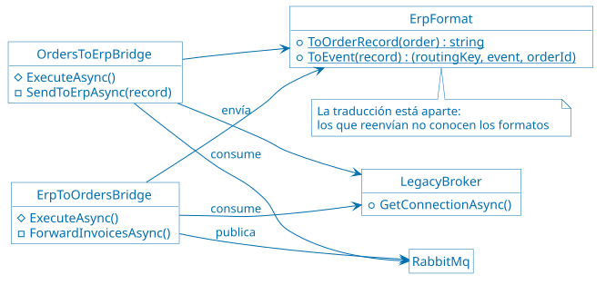

**Cómo verlo:** la demo [25 de Messaging Bridge](demos/25-messaging-bridge.sh)
crea una `Order` para el `User` 2 y muestra su historial con `OrderInvoiced`, y
el registro de ancho fijo que pasó por el puente. Después detiene ActiveMQ y
crea otra `Order`: se confirma igual, y su mensaje espera en la cola
`bridge.erp`. Cuando ActiveMQ vuelve, el mensaje se entrega y la `Order` se
factura.

**Qué cambios anticipa:**

| Cambio | ¿Lo anticipa? | Qué implica |
| ------ | ------------- | ----------- |
| Cambiar el formato de los registros del ERP | Sí | Solo la clase `ErpFormat` |
| Reemplazar ActiveMQ por otro broker | Sí | Solo `messaging-bridge`; `Orders` no se entera |
| Cambiar el flujo interno de `Orders` | Sí | El ERP no se entera, mientras `Orders` siga publicando `order.confirmed` |
| Reenviar otro evento | En parte | Otro suscriptor en el puente, sin tocar a quien lo publica, pero el ERP tiene que entenderlo |
| Enviarle al ERP un dato que el evento no trae | No | Hay que cambiar el evento y a `Orders`: ya pasó con `OrderConfirmed` |
| Necesitar una respuesta inmediata del ERP | No | El puente es asíncrono: haría falta otra integración |

**Ventajas y desventajas:**

| Alternativa | A favor | En contra |
| ----------- | ------- | ---------- |
| Puente | No cambia a los sistemas, tolera caídas y permite migrar de a poco | Un componente más, sin *features* que no existan en los dos brokers, y duplicados que hay que tolerar. El de la demo es una sola instancia |
| Integración directa por HTTP | Sin componentes nuevos, respuesta inmediata | Hay que modificar los dos sistemas, los acopla en el tiempo y los reintentos son a mano |
| Cambiar el ERP para que use RabbitMQ | Una sola infraestructura | Muchas veces es imposible, y siempre es lo más caro y riesgoso |

> [!TIP]
>
> Consulta [Messaging Bridge
> pattern](https://learn.microsoft.com/en-us/azure/architecture/patterns/messaging-bridge)
> para tener más información sobre el patrón, la [documentación de ActiveMQ
> Classic](https://activemq.apache.org/components/classic/documentation) sobre
> el broker, y [Message
> Translator](https://www.enterpriseintegrationpatterns.com/patterns/messaging/MessageTranslator.html)
> sobre la traducción.

#### Strangler Fig

**Problema:** reemplazar un monolito de una sola vez es riesgoso: el sistema
viejo sigue cambiando mientras se escribe el nuevo, todo el riesgo se concentra
en el día de la migración, y no hay valor hasta el final.

**El monolito simulado:** [Monolith/Program.cs](src/Monolith/Program.cs)
representa lo que la aplicación habría sido antes de separarse en servicios: un
solo proceso y una sola base, sin patrones. Ofrece las mismas rutas de los
microservicios que usa la demo, con los mismos contratos, para que el cliente no
note quién le responde:

| Datos | Qué se puede hacer |
| ----- | ------------------ |
| `Users` | Consultar y modificar usuarios, por SOAP, con la interfaz `IUserService` |
| `Products` | Listar, consultar uno y modificar el nombre y el precio de un producto |
| `Orders` | Listar, crear y consultar el detalle de las órdenes de pedido de un `User` |

Tres detalles que lo diferencian de los microservicios:

* **Una sola base:** un archivo [SQLite](https://www.sqlite.org/) dentro del
  contenedor, con los mismos datos iniciales que los microservicios. Al recrear
  el contenedor, vuelve a ese estado.
* **El detalle de las `Orders`:** es un JOIN entre tres tablas. Esa es la
  comodidad que se pierde al separar los datos, y por la que `Orders` llama a
  `Users` y a `Products` por HTTP en los microservicios.
* **Crear una `Order`:** se crea y se confirma en una sola transacción, sin
  colas ni *workers*.

**Implementación:** una fachada recibe todas las solicitudes y desvía cada ruta
al monolito o al servicio que la reemplaza. El nombre del patrón viene de la
higuera estranguladora, que crece alrededor de un árbol hasta reemplazarlo.

* **La fachada:** un tercer
  [`server`](https://nginx.org/en/docs/http/ngx_http_core_module.html#server) de
  [ApiGateway/nginxconf/nginx.conf](src/ApiGateway/nginxconf/nginx.conf), en el
  puerto 8090. Responde quién atendió en `X-Served-By`.
* **La tabla de rutas:**
  [ApiGateway/nginxconf/strangler-routes.conf](src/ApiGateway/nginxconf/strangler-routes.conf).
  Migrar una ruta es cambiar una línea y recargar [nginx](https://nginx.org/),
  sin cortar el servicio. Volver atrás es lo mismo.

En Azure, la fachada podría ser Azure API Management o [Azure Front
Door](https://azure.microsoft.com/products/frontdoor/), y en AWS, Amazon API
Gateway.

**Cómo funciona:**


**Código:** la tabla de rutas al principio, en
[ApiGateway/nginxconf/strangler-routes.conf](src/ApiGateway/nginxconf/strangler-routes.conf):

```nginx
set $users_route    monolith:8000;
set $products_route monolith:8000;
set $orders_route   monolith:8000;
```

**Cómo verlo:** la demo [26 de Strangler Fig](demos/26-strangler-fig.sh) hace las
mismas solicitudes mientras migra `Products`, `Users` y `Orders`, de a una, y
muestra quién atiende cada ruta. A mitad de camino cambia el nombre de un
`Product` por la fachada: lo recibe el microservicio, y el JOIN del monolito
sigue mostrando el nombre viejo. Es el costo de la convivencia. Al final apaga
el monolito, y las solicitudes siguen respondiendo. Al terminar, deja la fachada
como estaba.

**Qué cambios anticipa:**

| Cambio | ¿Lo anticipa? | Qué implica |
| ------ | ------------- | ----------- |
| Migrar una ruta completa, o volverla atrás | Sí | Una línea en la tabla de rutas |
| Apagar el monolito | Sí | Nada, cuando ya no le quedan rutas |
| Migrar solo una parte de una ruta | En parte | Una entrada nueva en la tabla y otro [`location`](https://nginx.org/en/docs/http/ngx_http_core_module.html#location) en la fachada |
| Cambiar el contrato de una ruta | No | La fachada no traduce: los clientes lo notan |
| Cambiar un dato que los dos sistemas leen | No | Los datos divergen hasta resolver la sincronización |

A diferencia de los otros tres, este patrón anticipa un solo cambio: reemplazar
el monolito. Cuando termina, la fachada y su tabla de rutas ya no hacen falta.

**Ventajas y desventajas:**

| Alternativa | A favor | En contra |
| ----------- | ------- | ---------- |
| Migración progresiva | Riesgo acotado por ruta, marcha atrás inmediata y valor desde la primera ruta | Dos sistemas conviviendo, datos que hay que sincronizar y una fachada que es un punto de falla |
| Reescritura completa | Sin convivencia ni sincronización | Todo el riesgo junto, sin valor hasta el final, y el sistema viejo sigue cambiando mientras tanto |

La demo no sincroniza los datos: los dos sistemas arrancan con los mismos, y por
eso responden igual a las consultas. Tampoco es igual todo el comportamiento: el
monolito confirma la `Order` al crearla, y `Orders` lo hace después.

**Cómo resolver la divergencia de datos:** en la demo, el nombre de un `Product`
cambia en [PostgreSQL](https://www.postgresql.org/), y el JOIN del monolito sigue
leyendo su copia en SQLite. La regla de fondo es que cada dato tenga un solo
dueño en cada momento: quien lo escribe. Las demás copias son de lectura y se
actualizan desde ese dueño. Las formas de lograrlo, de más simple a más invasiva
para el monolito:

| Solución | Cómo funciona | A favor | En contra |
| -------- | ------------- | ------- | ---------- |
| El monolito le pregunta al servicio | Al migrar `Products`, el monolito deja de leer su tabla y llama a `Products` por HTTP | No hay copia, así que no hay divergencia | Hay que cambiar el monolito, se pierde el JOIN, y depende de que `Products` responda |
| Base compartida durante la transición | El servicio nuevo usa la base del monolito, y se separa después | No hay divergencia y se migra primero el código | Acopla el servicio al esquema del monolito, y la separación queda pendiente |
| Sincronización con eventos | El monolito se suscribe a `product.updated` y actualiza su copia | Reutiliza la mensajería, y `Products` no conoce al monolito | Hay que cambiar el monolito, y la consistencia es eventual |
| Captura de cambios | Una herramienta como [Debezium](https://debezium.io/) lee el log de la base del dueño y aplica los cambios en la otra | No cambia el código del sistema de origen | Otra infraestructura que operar, y hay que traducir entre esquemas |
| Escritura doble | Cada escritura va a las dos bases | Parece lo más simple | Si falla la segunda escritura, las bases divergen sin aviso; no se recomienda sin un [Transactional Outbox](#transactional-outbox) |

Para esta aplicación, la opción con mejor relación entre costo y resultado es
sincronizar con eventos: `Products` ya publica `product.updated`, y al monolito
le alcanzaría un consumidor con su propia cola. Habría que ampliar el evento,
porque hoy trae el nombre pero no el precio.

El dato también cambia de dueño en algún momento. Una secuencia habitual:

1. Copiar los datos históricos a la base nueva.
2. Sincronizar los cambios del monolito hacia el servicio, que todavía es solo
   de lectura.
3. Comparar las respuestas de los dos: la fachada envía las lecturas a ambos, y
   solo devuelve la del monolito.
4. Pasar las escrituras al servicio, que se vuelve el dueño, e invertir la
   sincronización mientras el monolito siga leyendo ese dato.
5. Retirar la sincronización y la tabla del monolito.

Los identificadores requieren un cuidado aparte. Si `Orders` y el monolito crean
`Orders` a la vez, los dos generan el mismo id para `Orders` distintas: hay que
reservar rangos distintos o usar identificadores globales, como un
[UUID](https://datatracker.ietf.org/doc/html/rfc9562).

En producción, [Azure Database Migration
Service](https://azure.microsoft.com/products/database-migration/) y [AWS
Database Migration Service](https://aws.amazon.com/dms/) hacen la copia inicial
y la replicación continua de los cambios.

> [!TIP]
>
> Consulta [Strangler Fig
> pattern](https://learn.microsoft.com/en-us/azure/architecture/patterns/strangler-fig)
> para tener más información sobre el patrón, y [Strangler Fig
> Application](https://martinfowler.com/bliki/StranglerFigApplication.html), de
> Martin Fowler, sobre el origen del nombre, y la [documentación de
> Debezium](https://debezium.io/documentation/) sobre la captura de cambios.

#### Backends for Frontends

**Problema:** una sola API para clientes distintos termina siendo un compromiso.
La app móvil recibe más de lo que muestra, la web arma sus pantallas con varias
llamadas, y cada cambio que pide un cliente obliga a coordinar con los demás,
porque la API es de todos.

**Escenario:** la web y la app móvil muestran las `Orders` de un `User`. La web
muestra una tabla con el precio de cada `Product` y el total. La app, en una
pantalla chica y con una red que puede ser lenta, muestra solo el `Product` y el
estado.

**Implementación:** un backend por cliente, que mantiene el equipo de ese
cliente.

* **`bff-web`:** [BffWeb/Program.cs](src/BffWeb/Program.cs). Pide las `Orders` a
  `Orders`, el nombre y el precio de cada `Product` a `Products`, y calcula el
  total.
* **`bff-mobile`:** [BffMobile/Program.cs](src/BffMobile/Program.cs). Hace una
  sola consulta, el detalle por `User` de `Orders`, y devuelve solo el
  `Product`, el estado y cuántas son.
* **El gateway:** publica `/web/` y `/mobile/` en la entrada HTTP.
* **El despliegue:** cada BFF es un contenedor aparte, así que se cambia y se
  redespliega sin tocar al otro ni a los servicios.

No es lo mismo que el gateway: el gateway es uno solo para todos los clientes, y
acá hay un backend por cliente. El gateway solo enruta a cada uno.

En Azure, cada BFF podría correr en [Azure Container
Apps](https://azure.microsoft.com/products/container-apps/) y publicarse con
Azure API Management, y en AWS, correr en AWS Lambda y publicarse con Amazon API
Gateway.

**Cómo funciona:**


**Código:** la respuesta de la app, en
[BffMobile/Program.cs](src/BffMobile/Program.cs):

```csharp
return Results.Ok(new
{
    count = details.Count,
    orders = details.Select(d => new { product = d.ProductName, status = d.Status })
});
```

**Cómo verlo:**
la demo [27 de Backends for Frontends](demos/27-backends-for-frontends.sh) muestra
la respuesta de cada BFF para el `User` 1: 238 bytes para la web y 107 para la
app. Después redespliega `bff-mobile` mientras consulta a los dos clientes. La
app puede recibir algún `502 Bad Gateway`; la web sigue respondiendo `200 OK`, y
`bff-web` no se reinicia.

**Qué cambios anticipa:**

| Cambio | ¿Lo anticipa? | Qué implica |
| ------ | ------------- | ----------- |
| Cambiar lo que muestra un cliente | Sí | Solo su BFF, que se despliega sin coordinar con el otro |
| Agregar un cliente nuevo, como un reloj | Sí | Un BFF nuevo y una ruta en el gateway; los demás no cambian |
| Que un cliente use otra fuente de datos | Sí | Solo su BFF |
| Cambiar una regla de negocio de `Orders` | No | Hay que cambiar `Orders`, y cada BFF que la haya repetido |
| Cambiar el contrato de `Orders` o de `Products` | No | El patrón lo encarece: cada BFF que lo usa tiene que adaptarse |
| Algo que necesitan todos los clientes, como la autenticación | No | Se repite en cada BFF, o va al gateway |

**Ventajas y desventajas:**

| Alternativa | A favor | En contra |
| ----------- | ------- | ---------- |
| Un BFF por cliente | Cada cliente recibe lo que muestra, y su equipo cambia y despliega a su ritmo | Más servicios que operar, código parecido repetido, y la tentación de poner lógica de negocio en el BFF |
| Una API para todos | Un solo servicio, sin repetir código | Respuestas que no le sirven bien a ninguno, y cada cambio se coordina con todos los clientes |
| Que cada cliente llame a los servicios | Sin componentes nuevos | Más llamadas desde la red del cliente, y el cliente queda atado a los contratos internos |

Los BFF de la demo solo están en la entrada HTTP, sin autenticación. En
producción irían detrás de la entrada HTTPS, con los patrones de seguridad.

> [!TIP]
>
> Consulta [Backends for Frontends
> pattern](https://learn.microsoft.com/en-us/azure/architecture/patterns/backends-for-frontends)
> para tener más información sobre el patrón, y [Backends For
> Frontends](https://samnewman.io/patterns/architectural/bff/), de Sam Newman,
> sobre su origen.

### Antes y después en Grafana

El beneficio de estos patrones se ve en lo que no pasa: no hay errores, cortes
ni reinicios. Para mostrarlo,
[demos/load-modifiability.sh](demos/load-modifiability.sh) lanza un escenario de
[k6](https://k6.io/) y hace los cambios mientras corre. Cada cambio queda
marcado con una línea vertical en el dashboard, con una anotación de
[Grafana](https://grafana.com/oss/grafana/), para distinguir el antes y el
después. Los scripts del `23` al `27` también marcan sus pasos si Grafana está
levantado.

```bash
docker compose --profile observability up -d --wait
./demos/load-modifiability.sh strangler   # también: acl, config, bridge, bff
```

Los paneles están en la fila "Facilidad de modificación: antes y después". Estos
resultados son de una corrida en una sola máquina, con pocas solicitudes por
segundo: ilustran el efecto y no son una prueba de rendimiento.

| Patrón | Qué se hace | Qué mirar | Resultado |
| ------ | ----------- | --------- | --------- |
| Strangler Fig | Se migran las tres rutas y se apaga el monolito, con 15 solicitudes por segundo | "Solicitudes de la fachada, por destino" y "Respuestas de la fachada con error" | 1051 solicitudes, sin errores. El tráfico del monolito llega a cero |
| Strangler Fig | Lo mismo | "Latencia p95 del detalle, por destino" | Sube de unos 8 ms a unos 18 ms: el costo de reemplazar el JOIN por llamadas [HTTP](https://datatracker.ietf.org/doc/html/rfc9110) |
| Messaging Bridge | Se detiene [ActiveMQ](https://activemq.apache.org/) durante unos 30 segundos, con 2 `Orders` por segundo | "Cola bridge.erp" y "Orders confirmadas por segundo" | La cola llega a 89 mensajes y vuelve a cero. Las 161 `Orders` se aceptaron, y se siguieron confirmando durante la caída |
| Anti-corruption Layer | 10 solicitudes por segundo, mitad a `Orders` y mitad a `Purchases`, y 25 segundos con `Users` demorado 200 ms | "Latencia p95: Orders y `Purchases`" | Sin demora, `Purchases` tarda unos 18 a 33 ms y `Orders`, unos 11 ms: el costo de la capa. Con la demora, `Purchases` sube a unos 420 ms y `Orders` no cambia. Las 700 solicitudes respondieron `200 OK` |
| External Configuration Store | El mismo límite, por variable de entorno y en el almacén, con 22 solicitudes por segundo | "Solicitudes a Orders por resultado" | Las dos formas pasan de `202 Accepted` a `400 Bad Request`. Con la variable de entorno se perdieron 24 solicitudes de 2531, en los dos momentos en que se recreó el contenedor; con el almacén, ninguna |
| Backends for Frontends | 20 solicitudes por segundo, mitad de cada cliente, y se redespliega `bff-mobile` | "Respuestas por cliente" | La web respondió `200 OK` las 600 veces. La app recibió 11 `502 Bad Gateway` de 600, mientras se reemplazaba su contenedor |

Las métricas que dependen de quién respondió las informa k6 con el encabezado
`X-Served-By`, para no tener que instrumentar [nginx](https://nginx.org/). El
p95 que informa k6 se calcula desde que empieza la corrida: después de un pico,
baja despacio.

### Tamaño del cambio

[Grafana](https://grafana.com/oss/grafana/) muestra el efecto de un cambio en
ejecución, pero la facilidad de modificación se mide con otra pregunta: cuánto
cuesta hacer el cambio. En un escenario de calidad -UT1-, esa es la medida de
respuesta. Los números salen de
[demos/measure-change-size.sh](demos/measure-change-size.sh), que se puede
volver a ejecutar:

```bash
./demos/measure-change-size.sh
```

Se separan dos costos, porque un patrón se paga una vez y se aprovecha muchas.

**Costo de introducir cada patrón:**

| Patrón | Archivos nuevos | Líneas nuevas | Líneas en archivos existentes | Total |
| ------ | --------------- | ------------- | ----------------------------- | ----- |
| Anti-corruption Layer | 3 | 80 | 0 | 80 |
| External Configuration Store | 1 | 130 | 52 | 182 |
| Messaging Bridge | 7 | 241 | 30 | 271 |
| Strangler Fig | 1 | 3 | 24 | 27 |
| Backends for Frontends | 6 | 104 | 49 | 153 |

Cómo se calcula:

* **Línea efectiva:** una línea que no está vacía ni es un comentario, es decir,
  que no empieza con `//` o `#`. Los comentarios de este repositorio son
  extensos y distorsionarían la comparación.
* **Qué se cuenta:** código [C#](https://learn.microsoft.com/dotnet/csharp/),
  proyectos, `Dockerfile`, YAML de [Docker
  Compose](https://docs.docker.com/compose/) y configuración de
  [nginx](https://nginx.org/). No se cuentan la documentación, los diagramas,
  los scripts de `demos/`, los escenarios de `k6/`, el dashboard ni el archivo
  `.sln`: son parte de la demostración, no de la aplicación.
* **Líneas nuevas:** las líneas efectivas de los archivos que el patrón agrega.
* **Líneas en archivos existentes:** las agregadas más las borradas según un
  `diff` contra el commit `3a02c77`, el último sin estos patrones. Una línea
  modificada cuenta dos veces, como una borrada y una agregada. No cuentan los
  cambios que son solo de mayúsculas y minúsculas, como pasar las variables de
  entorno a mayúsculas.
* **Archivos compartidos:** `docker-compose.yaml` y `nginx.conf` los tocan
  varios patrones, y cada línea se le asigna al patrón al que pertenece: por el
  servicio en `docker-compose.yaml`, y por el bloque en `nginx.conf`. El script
  verifica que lo repartido, más las 51 líneas que quedan fuera de los patrones,
  sume lo que dice `git`: 145 líneas en ambos casos. Lo que agregan las [demos
  de facilidad de despliegue](#demos-de-facilidad-de-despliegue) no se cuenta:
  el servicio `users-service-v2`, el puerto 8091 y su bloque en `nginx.conf`.
  Los archivos de `Orders` y `Products` también se reparten, por su contenido.
* **Lo que queda fuera:** no se cuentan el ERP, su broker ni el monolito, porque
  representan sistemas que ya existirían, ni `Purchases`, que es el cliente
  nuevo: de Anti-corruption Layer se cuenta solo la capa. Tampoco se cuenta el
  flag de la fecha de creación en el método `ListOrders`, que simula un cambio
  de otro equipo. El control los incluye, para que la suma coincida con `git`.
* **Qué incluye de más:** el proveedor de configuración incluye su métrica para
  Grafana.

**Costo de cada cambio posterior:**

| Cambio | Líneas | Contenedores reiniciados | Demora |
| ------ | ------ | ------------------------ | ------ |
| Cambiar un límite en el almacén | 0 | 0 | 1,0 a 2,2 segundos |
| Cambiar un límite en una variable de entorno | 1 | 1 | 1,3 a 1,7 segundos |
| Migrar una ruta del monolito | 1 | 0 | 1,4 segundos |

Cómo se calcula:

* **Líneas:** las que hay que escribir para hacer el cambio.
* **Contenedores reiniciados:** se compara la hora de arranque de cada
  contenedor antes y después del cambio.
* **Demora:** desde que se aplica el cambio hasta que se observa su efecto. Para
  el límite, hasta que una `Order` de 10 unidades responde `400 Bad Request`,
  consultando cada 0,2 segundos; para la ruta, hasta que `X-Served-By` cambia.
  Es el rango de tres ejecuciones, con las imágenes ya construidas.

Cómo leerlo:

* **La demora no es la diferencia:** cambiar un límite tarda lo mismo por las
  dos vías, porque recrear este contenedor es rápido. La diferencia está en los
  reinicios: la variable de entorno corta el servicio y pierde el estado en
  memoria de `Orders`, como los interruptores de los patrones.
* **El almacén tampoco es gratis:** la variable de entorno queda versionada en
  el repositorio, y el cambio en el almacén no.
* **Una línea no es una unidad de esfuerzo:** estas medidas sirven para comparar
  alternativas en esta aplicación, no para estimar. No miden la dificultad de
  diseñar el cambio ni de probarlo, y migrar una ruta de una línea presupone el
  trabajo previo de escribir el servicio y resolver sus datos.
* **Falta una alternativa real:** no hay una aplicación equivalente sin los
  patrones con la cual comparar cada cambio. Salvo el límite, que se midió de
  las dos formas, los números describen el cambio con el patrón.
* **Solo se miden cambios anticipados:** cada fila es un cambio para el que hay
  un patrón. Los que un patrón no anticipa cuestan lo mismo que antes, o más: un
  campo nuevo de `Orders` que quieren mostrar la web y la app hay que agregarlo
  en los dos BFF.

## Demos de facilidad de despliegue

**Estado: implementada en este repositorio, sobre las demos de facilidad de
modificación.**

Escenario: `Users` tiene una versión nueva, que agrega un campo a la respuesta y
trae un experimento. Hay que ponerla en producción sin cortar el servicio, con
la posibilidad de volver atrás, exponiendo primero a pocos clientes y comparando
las dos variantes del experimento.

La versión nueva de `Users` se simula: `users-service` leyó siempre una variable
de entorno `RELEASE__VERSION` al arrancar; en las demos anteriores esa variable
de entorno falta y toma el valor predeterminado `1`. Para esas demos que
despliegan una nueva versión, los contenedores de la nueva versión configuran
`RELEASE__VERSION` en `2`.

Desplegar un servicio sin tocar los demás es una de las ventajas de una
arquitectura de microservicios: estas estrategias cambian solo `Users`, y
`Orders`, `Products` y los demás servicios no se enteran.

Qué se muestra:

* Dos versiones están en ejecución al mismo tiempo, con sus contenedores
levantados y sanos, aunque solo una reciba tráfico. Pasar de una a otra
-connmutarlas- y volver atrás es inmediato: no hay que levantar nada.
* Reemplazo de instancias por pasos, verificando su salud.
* Una fracción del tráfico derivada a la versión nueva, y la vuelta atrás cuando
  falla.
* Un experimento con dos variantes, elegidas por segmento o al azar.
* Con Kubernetes, las mismas estrategias sin pasos a mano, y la vuelta atrás
  automática cuando las métricas de la versión nueva muestran errores.

Resultado observable: la versión nueva entra y sale de producción sin errores, o
con errores solo en porcentaje de solicitudes que Canary Testing manda a la
versión nueva, el 10% o el 50% en la demo; y cada respuesta dice qué versión y
qué variante la atendió.

### Qué agrega a las demos de facilidad de modificación

| Componente | Para qué |
| ---------- | -------- |
| `users-service-v2` | La versión `v2` de `Users`: la misma imagen que `users-service`, con `RELEASE__VERSION: "2"`, y la misma base. No publica puertos, y tiene el [alias de red](https://docs.docker.com/reference/compose-file/services/#aliases) `users-pool`. Solo lo usan estas demos; `Orders`, `Purchases` y la fachada siguen llamando a `users-service`. |
| Entrada de despliegue del gateway | `http://localhost:8091`, solo para `/users/`. A qué versión va cada solicitud lo define [ApiGateway/nginxconf/deployment-routes.conf](src/ApiGateway/nginxconf/deployment-routes.conf). |
| Encabezado `X-Version` | Cada respuesta de `Users` dice qué versión la atendió. Lo agrega el método `UseReleaseHeader` de la clase `ReleaseExtensions`, en [UsersService/Release.cs](src/UsersService/Release.cs). |
| El experimento | La clase `Experiment`, en [UsersService/Experiment.cs](src/UsersService/Experiment.cs). Solo lo usa la versión `v2` de `Users`. |
| `unleash` y `unleash-db` | [Unleash](https://www.getunleash.io/) decide qué variante del experimento ve cada `User`. Están en el perfil `feature-flags` de [docker-compose.yaml](docker-compose.yaml), con la consola en `http://localhost:4242`; la demo 31 los levanta sola. |
| El clúster de [Kubernetes](https://kubernetes.io/) | Un clúster de [kind](https://kind.sigs.k8s.io/), de un nodo, para las demos 32 a 34. Lo crea [demos/k8s-up.sh](demos/k8s-up.sh) y lo borra [demos/k8s-down.sh](demos/k8s-down.sh); los manifiestos están en [k8s](k8s/). Tiene su propia base de `Users`, y no usa nada de Docker Compose. |
| Una imagen por versión de `Users` | `users-service:v1`, `users-service:v2` y `users-service:v3-bad`, construidas con los argumentos `RELEASE_VERSION` y `CHAOS_FAILURE_RATE` de [UsersService/Dockerfile](src/UsersService/Dockerfile). La `v3-bad` falla en el 30% de las solicitudes desde que arranca, porque el método `UseChaos` de la clase `ChaosExtensions`, en [Common/Chaos.cs](src/Common/Chaos.cs), toma de la configuración las fallas iniciales. |
| El *Gateway* del clúster | La entrada de los clientes en el puerto 8092: un *Gateway* de [Gateway API](https://gateway-api.sigs.k8s.io/), implementado con [NGINX Gateway Fabric](https://docs.nginx.com/nginx-gateway-fabric/), en [k8s/base/gateway.yaml](k8s/base/gateway.yaml). Cumple el papel de la entrada de despliegue del puerto 8091. |
| [Argo Rollouts](https://argoproj.github.io/rollouts/) | Despliega cada versión con una estrategia, y en las demos 33 y 34 decide si sigue o vuelve atrás con el análisis de [k8s/base/analysis-error-rate.yaml](k8s/base/analysis-error-rate.yaml), que consulta al [Prometheus](https://prometheus.io/) del clúster. Se maneja con el plugin `kubectl argo rollouts`. |

La versión `v2` de `Users` es el mismo código -la misma imagen- de la versión
`v1` con otra configuración y en otros contenedores, para simplificar las demos
28 a 31. En las demos 32 a 34, como en producción, cada versión es una imagen
distinta: un
[Deployment](https://kubernetes.io/docs/concepts/workloads/controllers/deployment/)
de Kubernetes, o un `Rollout` de Argo Rollouts, cuyos pods cambian de imagen.

### Patrones de facilidad de despliegue

Cada estrategia tiene un script en [demos](demos/), del `28` al `31`, y un paso
a paso en [commands/06-deployability.azcli](commands/06-deployability.azcli).
Blue/Green, Rolling Upgrade y Canary Testing tienen además una versión con
[Kubernetes](https://kubernetes.io/), del `32` al `34`, análoga a la demo de
[Docker Compose](https://docs.docker.com/compose/) pero automatizando el
despliegue. Necesitan el clúster, que se crea una vez con `./demos/k8s-up.sh`, y
además de Docker, [kind](https://kind.sigs.k8s.io/),
[kubectl](https://kubernetes.io/docs/reference/kubectl/) y el [plugin de Argo
Rollouts](https://argoproj.github.io/argo-rollouts/features/kubectl-plugin/)
para kubectl. Los *logs* de `api-gateway` muestran cada solicitud de la entrada
de despliegue publicada en el puerto 8091 con la etiqueta `[DEPLOY]`, la
instancia que la atendió y su versión.

Como las demos de facilidad de modificación, estas no se conectan a ninguna
nube: corren con [Docker](https://www.docker.com/). Cada estrategia nombra los
servicios equivalentes de Azure y de AWS. Cómo verlas bajo carga está en [Las
estrategias en Grafana](#las-estrategias-en-grafana).

Cambiar de estrategia de despliegue -pasar de Blue/Green a Canary, o cambiar la
configuración de Canary- es reescribir `deployment-routes.conf` en el contenedor
del gateway y recargar [nginx](https://nginx.org/), sin cortar el servicio. La
función `deploy_routes` de [demos/common.sh](demos/common.sh) lo hace en los
scripts; el archivo del repositorio no cambia.

Las cuatro estrategias de despliegue facilitan el mismo tipo de despliegue: una
versión nueva de un servicio que es compatible con la anterior. Ninguna resuelve
un cambio que rompe el contrato o el esquema de la base: mientras las dos
versiones conviven, comparten clientes y datos.

#### Blue/Green Deployment

**Problema:** desplegar una versión nueva que reemplace la que está en
producción corta el servicio mientras se reemplaza y, si la versión nueva falla,
volver atrás es otro despliegue, igual de lento y riesgoso.

**Escenario:** la nueva versión `v2` de `Users` se despliega junto con la `v1`,
se prueba la versión `v2` para determinar que quedó bien desplegada, y después
se pasa todo el tráfico de una vez a esa versión `v2` -a esto se le llama
≪conmutar≫ la versión-; si algo sale mal, se vuelve a la `v1`.

**Implementación:**

* **Dos entornos:** la versión `v1` -el azul- y la `v2` -el verde-, levantadas
  al mismo tiempo.
* **El conmutador:** los clientes mandan sus solicitudes siempre a la misma
  dirección, y detrás de ella un componente elige a cuál de los dos entornos
  llegan. Conmutar es cambiar esa elección, sin que los clientes se enteren.
* **La prueba previa:** antes de conmutar, la versión `v2` se prueba por otro
  camino, sin que reciba tráfico de los clientes.
* **La base:** las dos versiones comparten `users-db`. La versión `v2` no cambia
  el esquema: su campo nuevo no se guarda.

En caso de que haya que migrar también la base de datos, las opciones habituales
son -resumidas-:

  1. Base compartida con cambios compatibles -expand and contract-: primero se
     agrega lo nuevo sin quitar nada, se conmuta, y se quita lo viejo cuando ya
     no hay vuelta atrás. Es lo que permite la demo, porque comparten users-db.
  2. Una base por entorno, con replicación o sincronización de la azul a la
     verde: aísla las versiones, pero hay que resolver las escrituras durante la
     conmutación y la divergencia si se vuelve atrás.
  3. Migrar la base en el momento de conmutar: simple, pero con un corte, y la
     vuelta atrás necesita revertir la migración.
  4. Separar el cambio de esquema del cambio de código, en despliegues
     distintos, a veces con un feature flag que activa el uso de lo nuevo.

En Azure, [Azure Container
Apps](https://learn.microsoft.com/en-us/azure/container-apps/blue-green-deployment)
lo hace con revisiones y etiquetas, y [App
Service](https://azure.microsoft.com/products/app-service/), con [*deployment
slots*](https://learn.microsoft.com/en-us/azure/app-service/deploy-staging-slots)
que se intercambian. En AWS, [CodeDeploy](https://aws.amazon.com/codedeploy/) lo
hace con [ECS](https://aws.amazon.com/ecs/), cambiando el [grupo de
destino](https://docs.aws.amazon.com/elasticloadbalancing/latest/application/load-balancer-target-groups.html)
de un [Application Load
Balancer](https://aws.amazon.com/elasticloadbalancing/application-load-balancer/).

##### Cómo verlo con Docker

**Cómo funciona:**


**Código:** el destino, en el archivo de estrategia, después de conmutar:

```nginx
map $host $users_target {
    default users-service-v2:8000;
}
```

* **Los dos entornos:** `users-service`, la versión `v1`, y `users-service-v2`,
  la versión `v2`. Están siempre levantados y activos los dos.
* **El conmutador:** la dirección de los clientes es la entrada de despliegue,
  publicada en el puerto 8091. El componente que elige el entorno es el nginx de
  `api-gateway`, con un
  [`map`](https://nginx.org/en/docs/http/ngx_http_map_module.html#map) que tiene
  un solo destino. Conmutar `v1` con `v2` es cambiar ese destino y recargar
  nginx.
* **La prueba previa:** antes de cambiar de versión, se le pide un `User` a la
  versión `v2` directamente, desde adentro de la red de Docker, con la función
  `get_user_inside`.

La demo [28 de Blue/Green Deployment](demos/28-blue-green.sh) muestra que la versión
`v1` atiende la entrada de despliegue publicada en el puerto 8091 y prueba la
`v2` por adentro, con su campo nuevo. Después cambia de versión mientras una
sonda pide el `User` 1 cada 0.1 segundos: las respuestas pasan de la versión
`v1` a la `v2`, todas con `200 OK`. Al final vuelve atrás de la misma forma.

##### Cómo verlo con Kubernetes

Lo que la demo 28 hace a mano, con [Kubernetes](https://kubernetes.io/) lo hace
[Argo Rollouts](https://argoproj.github.io/rollouts/), con un comando por paso.
En Kubernetes, un `Rollout` es como un Deployment, pero con una estrategia de
despliegue.

* **Los dos entornos:** al cambiar la imagen, Argo levanta los pods de la
  versión `v2` al lado de los de la `v1`, y se detiene a esperar, por
  `autoPromotionEnabled: false`.
* **El conmutador:** la dirección de los clientes es el *Gateway*, publicado en
  el puerto 8092, y su ruta, en [Gateway API](https://gateway-api.sigs.k8s.io/),
  manda siempre las solicitudes al Service `users-active`. El componente que
  elige el entorno es ese Service: Argo cambia su selector para que apunte a los
  pods de una versión o de la otra. Otro Service, `users-preview`, apunta a la
  versión que todavía no recibe tráfico.
* **La prueba previa:** la versión `v2` se prueba por `users-preview`, en
  `http://preview.localhost:8092`, sin que reciba tráfico de los clientes.
* **La conmutación y la vuelta atrás:** `kubectl argo rollouts promote` apunta
  `users-active` a la versión `v2`. Los pods de la `v1` siguen vivos un minuto,
  por `scaleDownDelaySeconds`, y dentro de ese minuto `kubectl argo rollouts
  undo` vuelve a ellos enseguida, por `rollbackWindow`.

| Qué | Dónde |
| --- | ----- |
| El `Rollout` y su estrategia | [k8s/blue-green/rollout.yaml](k8s/blue-green/rollout.yaml) |
| `users-active` y `users-preview` | [k8s/blue-green/services.yaml](k8s/blue-green/services.yaml) |
| Las rutas de los clientes y de la prueba previa | [k8s/blue-green/httproute.yaml](k8s/blue-green/httproute.yaml) |

```yaml
strategy:
  blueGreen:
    activeService: users-active
    previewService: users-preview
    autoPromotionEnabled: false
    scaleDownDelaySeconds: 60
```

La demo [32 de Blue/Green Deployment con Kubernetes](demos/32-argo-blue-green.sh) sigue los
mismos pasos que la demo 28, y en cada uno muestra el estado del `Rollout` como
lo muestra Argo: cada versión con sus pods y su papel, `stable`, `active` o
`preview`. La conmutación y la vuelta atrás, con una sonda pidiendo el `User` 1
cada 0,1 segundos, responden todas `200 OK`.

En Azure, se hace igual en [Azure Kubernetes
Service](https://azure.microsoft.com/products/kubernetes-service/) con Argo
Rollouts; en AWS, en [Amazon EKS](https://aws.amazon.com/eks/).

##### Evaluación

**Qué facilita en el despliegue:**

| Situación | ¿La facilita? | Cómo |
| --------- | ------------- | ---- |
| Desplegar una versión compatible con la base y con los clientes | Sí | Se despliega al lado, se prueba y se conmuta de una vez |
| Volver atrás si la versión nueva falla después de conmutar | Sí | Se conmuta de nuevo, en segundos, sin desplegar nada |
| Desplegar un cambio de esquema que la versión anterior no entiende | No | Después de conmutar, la vuelta atrás rompe: hay que migrar la base en pasos compatibles con las dos versiones |
| Exponer la versión nueva a una parte de los clientes | No | La conmutación es todo o nada: para eso está [Canary Testing](#canary-testing) |

**Ventajas y desventajas:**

| Alternativa | A favor | En contra |
| ----------- | ------- | ---------- |
| Blue/Green | Conmutación y vuelta atrás inmediatas, y la versión nueva se prueba en su entorno real antes de recibir tráfico | Dos entornos completos al mismo tiempo, y todos los clientes pasan a la versión nueva a la vez |
| Reemplazar en el lugar | Un solo entorno | Corte durante el reemplazo, y volver atrás es otro despliegue |

> [!TIP]
>
> Consulta [Blue/Green
> Deployment](https://martinfowler.com/bliki/BlueGreenDeployment.html), de
> Martin Fowler, sobre el origen de la técnica, y [Blue/Green Deployments on
> AWS](https://docs.aws.amazon.com/whitepapers/latest/blue-green-deployments/welcome.html)
> sobre cómo aplicarla en AWS.

#### Rolling Upgrade

**Problema:** con varias instancias de un servicio, tener un segundo entorno
completo para Blue/Green duplica el costo. Reemplazar todas esas instancias a la
vez corta el servicio.

**Escenario:** `Users` corre en tres instancias de la versión `v1`, que se
reemplazan de a una por instancias de la `v2`, sin cortar el servicio -se asume
que Users ya corre en tres instancias, por disponibilidad o por carga, y Rolling
Upgrade no las agrega-.

**Implementación:**

* **El grupo[^1]:** los clientes mandan sus solicitudes siempre a la misma
  dirección, y detrás de ella un balanceador de carga las reparte entre varias
  instancias de `Users`: ese conjunto es el grupo. Una instancia está en el
  grupo por tener una marca, así que puede ser de cualquier versión. Desplegar
  es cambiar quién está en el grupo: entran instancias de la `v2` y salen de la
  `v1`. A diferencia de Blue/Green, hay un solo grupo, y durante el reemplazo
  tiene las dos versiones.
* **Cada paso:** se suma una instancia de la versión `v2`, se espera a que esté
  sana y recién entonces se detiene una de la `v1`.
* **Las instancias que se van:** las solicitudes que el balanceador todavía les
  manda no se pierden: se reintentan en otra instancia, o dejan de llegarles
  antes de que se detengan.

[^1]: El concepto de ≪grupo≫ viene de cómo llaman a esto las nubes: *backend
    pool* en Azure Load Balancer y *target group* en un Application Load
    Balancer de AWS.

Es la estrategia por defecto de un Deployment de
[Kubernetes](https://kubernetes.io/), de Azure Container Apps y de los
[servicios de
ECS](https://docs.aws.amazon.com/AmazonECS/latest/developerguide/deployment-type-ecs.html).
En Kubernetes, cuántas instancias se reemplazan a la vez lo dicen `maxSurge` y
`maxUnavailable`: la demo 33 lo muestra, más abajo.

<!-- markdownlint-disable-next-line MD024 -->
##### Cómo verlo con Docker

**Cómo funciona:**


**Código:** un paso, en la función `pool_replace` de
[demos/common.sh](demos/common.sh):

```bash
docker compose up -d --no-deps --scale users-service-v2="$1" --wait users-service-v2
docker stop "users-v1-$1"
```

* **El grupo:** la dirección de los clientes es la entrada de despliegue,
  publicada en el puerto 8091, que manda el tráfico a `users-pool`. La marca del
  grupo es ese nombre, un [alias de
  red](https://docs.docker.com/reference/compose-file/services/#aliases): el
  [DNS de Docker](https://docs.docker.com/engine/network/#dns-services) devuelve
  la IP de cada contenedor que tiene el alias `users-pool`, y nginx actúa como
  balanceador de carga y reparte las solicitudes entre ellos. Cada 5 segundos
  vuelve a resolver el nombre, por el
  [resolver](https://nginx.org/en/docs/http/ngx_http_core_module.html#resolver)
  de nginx.conf, y así se entera de las instancias que entran y salen.
* **La versión `v1`:** `users-service` publica el puerto 8002 y lo usan las
  demás demos, así que no entra en el grupo. El script crea tres instancias a
  partir de su definición, con [`docker compose
  run`](https://docs.docker.com/reference/cli/docker/compose/run/), y les agrega
  el alias `users-pool`.
* **La versión `v2`:** son réplicas de `users-service-v2`, que ya tiene el alias
  `users-pool` en su definición: cada réplica nueva entra sola en el grupo.
* **Cada paso**, en la función `pool_replace`: suma una réplica de la versión
  `v2`, espera a que su
  [*healthcheck*](https://docs.docker.com/reference/compose-file/services/#healthcheck)
  diga que está sana y recién entonces detiene una instancia de la `v1`.
* **Las instancias que se van:** si nginx todavía tiene la IP de una instancia
  detenida, la conexión falla en menos de un segundo y reintenta en otra, con
  [`proxy_next_upstream`](https://nginx.org/en/docs/http/ngx_http_proxy_module.html#proxy_next_upstream).
  Como la solicitud no llegó a enviarse, se reintenta aunque sea un POST: con
  [SOAP](https://www.w3.org/TR/soap/), hasta `GetUser`, que es una lectura, es
  un POST, y nginx no reintenta un POST que ya envió.

La demo [29 de Rolling Upgrade](demos/29-rolling-upgrade.sh) arma el grupo
con tres instancias de la versión `v1` y las reemplaza en tres pasos. Después de
cada paso muestra qué instancias tiene el grupo y cuántas respuestas dio cada
versión. Durante todo el reemplazo, una sonda pide el `User` 1 cada 0.1
segundos: todas las respuestas son `200 OK`, de las dos versiones.

<!-- markdownlint-disable-next-line MD024 -->
##### Cómo verlo con Kubernetes

En dos partes, para comparar lo que trae Kubernetes con lo que agrega [Argo
Rollouts](https://argoproj.github.io/rollouts/).

* **El grupo:** la dirección de los clientes es el *Gateway*, publicado en el
  puerto 8092, que manda las solicitudes al Service `users`. La marca del grupo
  es la etiqueta `app: users`: el Service reparte entre todos los pods que la
  tienen, de cualquier versión, y el Deployment y el `Rollout` se la ponen a
  todos sus pods.
* **Con un Deployment:** Kubernetes reemplaza los pods de a uno, como la función
  `pool_replace` de la demo 29: con `maxSurge: 1` levanta un pod de más, y con
  `maxUnavailable: 0` no detiene uno viejo hasta que el nuevo esté listo, según
  su `readinessProbe`. Pero solo sabe si un pod está listo: la versión `v3-bad`
  responde `/health` y falla en el 30% de las solicitudes, y Kubernetes la
  despliega igual en los tres pods. Las fallas siguen hasta que alguien hace
  `kubectl rollout undo`.
* **Con Argo Rollouts:** el mismo reemplazo, pero después de cada paso Argo mide
  los errores de los pods nuevos en [Prometheus](https://prometheus.io/), con un
  `AnalysisTemplate`. Con la versión `v3-bad`, el análisis falla con el primer
  pod nuevo, y Argo vuelve solo a la versión `v2`.
* **El análisis:** la fracción de solicitudes `POST` de los pods nuevos que
  respondieron `5xx`, medida 3 veces, cada 10 segundos. Con una sola medida de
  5% o más, falla. Prometheus distingue los pods de cada versión por la etiqueta
  `rollouts_pod_template_hash` que Argo les pone.
* **Los pods que se van:** cada pod espera 5 segundos antes de detenerse, con un
  `preStop`, para que el *Gateway* deje de mandarle solicitudes antes. Es lo que
  en la demo 29 resuelve `proxy_next_upstream`.

| Qué | Dónde |
| --- | ----- |
| El Deployment | [k8s/rolling-upgrade/deployment.yaml](k8s/rolling-upgrade/deployment.yaml) |
| El `Rollout`, con los pasos y el análisis | [k8s/rolling-upgrade/rollout.yaml](k8s/rolling-upgrade/rollout.yaml) |
| El Service y la ruta, para los dos | [k8s/rolling-upgrade/service.yaml](k8s/rolling-upgrade/service.yaml) |
| El análisis, que comparten las demos 33 y 34 | [k8s/base/analysis-error-rate.yaml](k8s/base/analysis-error-rate.yaml) |
| Prometheus del clúster | [k8s/base/prometheus.yaml](k8s/base/prometheus.yaml) |

Los pasos del `Rollout`: sin un router que reparta el tráfico, `setWeight` es la
fracción de los pods con la versión nueva: de 3 pods, 33 es 1 y 66 son 2.

```yaml
steps:
  - setWeight: 33
  - analysis:
      templates:
        - templateName: error-rate
      args:
        - name: pod-hash
          valueFrom:
            podTemplateHashValue: Latest
  - setWeight: 66
  - analysis: ...
```

La demo [33 de Rolling Upgrade con Kubernetes](demos/33-k8s-rolling-upgrade.sh)
muestra primero el Deployment: la versión `v2` reemplaza a la `v1` sin errores,
y la `v3-bad` llega a los tres pods y falla hasta el `undo`. Después cambia el
Deployment por el `Rollout` y despliega la `v3-bad`: llega a un solo pod, el
análisis mide alrededor del 30% de errores, y Argo vuelve a la `v2` en menos de
un minuto, sin que nadie intervenga.

En Azure, Argo Rollouts funciona igual en [Azure Kubernetes
Service](https://azure.microsoft.com/products/kubernetes-service/); en AWS, en
[Amazon EKS](https://aws.amazon.com/eks/). CodeDeploy, en ECS, también vuelve
atrás solo cuando una alarma de [Amazon
CloudWatch](https://aws.amazon.com/cloudwatch/) se dispara durante el
despliegue.

<!-- markdownlint-disable-next-line MD024 -->
##### Evaluación

**Qué facilita en el despliegue:**

| Situación | ¿La facilita? | Cómo |
| --------- | ------------- | ---- |
| Desplegar una versión compatible con la anterior | Sí | Se reemplazan las instancias de a una, sin cortar el servicio y sin un segundo entorno |
| Detenerse si una instancia nueva no arranca sana | Sí | El paso se detiene antes de sacar una instancia vieja |
| Desplegar dos versiones que no pueden convivir | No | Durante el reemplazo responden las dos: un cliente puede recibir una respuesta de cada una |
| Volver atrás rápido | No | Es otro Rolling Upgrade, hacia la versión anterior |
| Detener una versión que arranca sana pero falla con las solicitudes | Solo con un análisis | Con el Deployment de Kubernetes, no; con Argo Rollouts, el análisis la detecta en el primer pod y vuelve atrás solo |

**Ventajas y desventajas:**

| Alternativa | A favor | En contra |
| ----------- | ------- | ---------- |
| Rolling Upgrade | Sin un segundo entorno, y sin corte | Las dos versiones conviven durante el reemplazo, y volver atrás lleva tanto como desplegar |
| Blue/Green | Conmutación y vuelta atrás inmediatas | Dos entornos completos |

> [!TIP]
>
> Consulta [Performing a Rolling
> Update](https://kubernetes.io/docs/tutorials/kubernetes-basics/update/update-intro/),
> de la documentación de Kubernetes, y [Safe deployment
> practices](https://learn.microsoft.com/en-us/azure/well-architected/operational-excellence/safe-deployments),
> de Azure Well-Architected Framework, sobre cómo desplegar por etapas.

#### Canary Testing

**Problema:** una versión nueva puede fallar con tráfico real aunque haya pasado
las pruebas. Con Blue/Green o con Rolling Upgrade, la falla llega a todos los
clientes antes de detectarla.

**Escenario:** la versión `v2` de `Users` recibe primero el 10% de las
solicitudes, después el 50% y después todas. Después, la versión `v2` empieza a
fallar, simulado con fallas inyectadas: con el 10%, se detecta y se vuelve
atrás.

**Implementación:**

* **El reparto:** los clientes mandan sus solicitudes siempre a la misma
  dirección, y detrás de ella un componente manda a la versión `v2` un
  porcentaje de ellas. Cambiar el porcentaje no es desplegar, y los clientes no
  se enteran.
* **La métrica por versión:** para decidir si se avanza o se vuelve atrás, se
  miden las respuestas y los errores de cada versión por separado.
* **La falla:** una versión `v2` que falla con tráfico real, para ver que se
  detecta cuando todavía le llegan pocas solicitudes.

En Azure, Azure Container Apps [reparte el
tráfico](https://learn.microsoft.com/en-us/azure/container-apps/traffic-splitting)
entre revisiones por porcentaje. En AWS, CodeDeploy hace despliegues *canary* en
ECS y en [AWS Lambda](https://aws.amazon.com/lambda/), y un Application Load
Balancer reparte por pesos entre grupos de destino.

<!-- markdownlint-disable-next-line MD024 -->
##### Cómo verlo con Docker

**Cómo funciona:**


**Código:** el reparto, en el archivo de estrategia:

```nginx
split_clients "${request_id}" $users_target {
    10% users-service-v2:8000;
    *   users-service:8000;
}
```

* **El reparto:** la dirección de los clientes es la entrada de despliegue,
  publicada en el puerto 8091. El componente que reparte es el nginx de
  `api-gateway`, con
  [`split_clients`](https://nginx.org/en/docs/http/ngx_http_split_clients_module.html),
  que elige el destino según un hash de `$request_id`, distinto en cada
  solicitud. Cambiar el porcentaje es cambiar una línea y recargar nginx, con la
  función `deploy_canary`.
* **La métrica por versión:** con `X-Version`, cada respuesta dice qué versión
  la atendió. La demo y [k6](https://k6.io/) cuentan las respuestas y los
  errores de cada una.
* **La falla:** el `/users/chaos` de la versión `v2`, por adentro de la red de
  Docker: esa versión responde `503 Service Unavailable` a todo.

El reparto es por solicitud: el mismo cliente puede recibir una versión y
después la otra. Para que cada cliente vea siempre la misma, el hash puede usar
una cookie o el `User`.

La demo [30 de Canary Testing](demos/30-canary.sh) manda a la versión `v2` el 10%,
el 50% y el 100% de las solicitudes, y con cada porcentaje cuenta cuántas
respuestas dio cada versión. Después vuelve al 10% con una versión `v2` que
falla: fallan solo sus respuestas, cerca del 10%. Al final vuelve todo a la
versión `v1`.

<!-- markdownlint-disable-next-line MD024 -->
##### Cómo verlo con Kubernetes

Lo que la demo 30 hace a mano -cambiar el porcentaje, mirar los errores,
decidir- lo hace [Argo Rollouts](https://argoproj.github.io/rollouts/), con un
análisis después de cada paso.

* **El reparto:** la dirección de los clientes es el *Gateway*, publicado en el
  puerto 8092. El componente que reparte es el mismo *Gateway*, implementado con
  [NGINX Gateway Fabric](https://docs.nginx.com/nginx-gateway-fabric/): su ruta
  tiene dos destinos, `users-stable` y `users-canary`, cada uno con un peso, y
  reparte las solicitudes según esos pesos. Es el `split_clients` de la demo 30,
  en [Gateway API](https://gateway-api.sigs.k8s.io/). Argo cambia los pesos con
  su [plugin de Gateway
  API](https://rollouts-plugin-trafficrouter-gatewayapi.readthedocs.io/en/latest/).
* **Los pasos:** 10% a la versión nueva, análisis, 50%, análisis, y 100%. Cada
  análisis es el mismo de la demo 33: los errores de los pods nuevos en
  [Prometheus](https://prometheus.io/).
* **La falla:** la versión `v3-bad`, que falla desde que arranca. A diferencia
  de la demo 30, no se le inyectan fallas después: es una versión con un error.
* **Sin datos no hay decisión:** el análisis espera 30 segundos antes de medir.
  Si la versión nueva no recibió solicitudes, la consulta da 0/0, que no es ni
  éxito ni falla, y Argo detiene el despliegue para que decida una persona.

| Qué | Dónde |
| --- | ----- |
| El `Rollout`, con los pasos y el análisis | [k8s/canary/rollout.yaml](k8s/canary/rollout.yaml) |
| `users-stable` y `users-canary` | [k8s/canary/services.yaml](k8s/canary/services.yaml) |
| La ruta con los pesos | [k8s/canary/httproute.yaml](k8s/canary/httproute.yaml) |
| El permiso del plugin para cambiar la ruta | [k8s/base/argo-rollouts-gateway-api.yaml](k8s/base/argo-rollouts-gateway-api.yaml) |

```yaml
strategy:
  canary:
    stableService: users-stable
    canaryService: users-canary
    trafficRouting:
      plugins:
        argoproj-labs/gatewayAPI:
          httpRoute: users
          namespace: andis
    steps:
      - setWeight: 10
      - analysis: ...
      - setWeight: 50
      - analysis: ...
```

La demo [34 de Canary Testing con Kubernetes](demos/34-argo-canary.sh) despliega la versión
`v2`, que avanza sola del 10% al 100% en un minuto y medio, sin errores. Después
despliega la `v3-bad`: con el 10%, el análisis mide alrededor del 30% de
errores, y Argo vuelve todo a la `v2` en medio minuto. En cada cambio muestra
los pesos de la ruta, y al final, lo que midió el análisis.

En Azure, Argo Rollouts funciona igual en [Azure Kubernetes
Service](https://azure.microsoft.com/products/kubernetes-service/); en AWS, en
[Amazon EKS](https://aws.amazon.com/eks/).

<!-- markdownlint-disable-next-line MD024 -->
##### Evaluación

**Qué facilita en el despliegue:**

| Situación | ¿La facilita? | Cómo |
| --------- | ------------- | ---- |
| Desplegar una versión que puede fallar con tráfico real | Sí | La falla la ve solo el porcentaje de solicitudes que va a la versión nueva, y se vuelve atrás bajando el porcentaje a cero |
| Aumentar la exposición de a poco | Sí | Una línea por paso |
| Detectar una falla que no se ve en las métricas que se miran | No | El canario avanza igual: hay que elegir bien qué métricas deciden |
| Que un cliente vea siempre la misma versión | No | Con `$request_id`, cada solicitud se reparte por separado |
| Avanzar o volver atrás sin que nadie mire | Solo con un análisis | En la demo 30 decide una persona; en la 34, Argo Rollouts, con las métricas de la versión nueva |

**Ventajas y desventajas:**

| Alternativa | A favor | En contra |
| ----------- | ------- | ---------- |
| Canary Testing | La falla llega a pocos clientes, y la decisión se toma con tráfico real | Dos versiones a la vez, y hacen falta métricas por versión para decidir |
| Blue/Green | Simple: todo o nada | La falla llega a todos hasta que se vuelve atrás |

> [!TIP]
>
> Consulta [Canary Release](https://martinfowler.com/bliki/CanaryRelease.html),
> de Martin Fowler, y [Traffic splitting in Azure Container
> Apps](https://learn.microsoft.com/en-us/azure/container-apps/traffic-splitting)
> sobre cómo repartir el tráfico en Azure.

#### A/B Testing

**Problema:** para elegir entre dos formas de una funcionalidad hay que medir
cuál funciona mejor con clientes reales. Si cada cliente ve una variante
distinta en cada consulta, no se puede atribuir el efecto a ninguna.

**Escenario:** la versión `v2` de `Users` muestra el nombre de cada `User` en
una de dos variantes: la A, solo el nombre, y la B, el nombre y el email.
Algunos `Users` se anotaron para probar lo nuevo y ven siempre la B.

**Implementación:** el experimento está en la versión `v2`, en la clase
`Experiment`, que usa el método `GetUser` de la clase `UserService`. Qué
variante ve cada `User` no lo decide ese código: lo decide
[Unleash](https://www.getunleash.io/), un servicio de *feature flags* de código
abierto, en el flag `users-display-name`. `Users` se lo pregunta a
[OpenFeature](https://openfeature.dev/), el estándar abierto de *feature flags*
de la [CNCF](https://www.cncf.io/).

* **Por segmento:** la primera estrategia del flag tiene una restricción: si la
  solicitud trae `X-Segment: beta`, la variante es la B.
* **Por porcentaje:** si no, la segunda estrategia reparte los `Users` entre A y
  B, la mitad en cada una. Unleash calcula un hash del id del `User`: el reparto
  es aleatorio entre los `Users`, pero el mismo `User` cae siempre en la misma
  variante, y todas las réplicas eligen la misma, sin guardar nada en memoria
  -ver [Stateless y estado por réplica](ARCHITECTURE.md#stateless-y-estado-por-réplica) en ARCHITECTURE.md-.
* **El cambio del reparto:** se hace en Unleash, con la consola o con su API,
  sin desplegar. `Users` vuelve a leer el flag cada 2 segundos.
* **Si Unleash no responde:** `Users` sigue con la última configuración que
  leyó. Si nunca la leyó, OpenFeature devuelve la variante A, el valor por
  omisión. Unleash no está en el camino de cada solicitud: la variante se
  calcula en `Users`.
* **La respuesta:** el campo `DisplayName` con la variante, y el encabezado
  `X-Variant`.
* **La medida:** la métrica `users_experiment_total`, por variante y por
  segmento.

A diferencia de Canary Testing, el reparto no está en el gateway, sino en un
servicio de *feature flags* que consulta la versión que trae el experimento.
Canary decide qué versión atiende; A/B, qué variante ve cada `User` dentro de
una versión.

Es también un ejemplo de facilidad de modificación: la clase `Experiment` solo
depende de OpenFeature. El único lugar que sabe de Unleash es
[UsersService/Program.cs](src/UsersService/Program.cs), que registra el
proveedor. Cambiar Unleash por otro servicio de *feature flags* es cambiar ese
registro y el paquete del proveedor, sin tocar `Experiment`.

En Azure, [Azure App
Configuration](https://azure.microsoft.com/products/app-configuration/) asigna
variantes con [*feature
flags*](https://learn.microsoft.com/en-us/azure/azure-app-configuration/concept-experimentation).
En AWS, [AWS
AppConfig](https://aws.amazon.com/systems-manager/features/appconfig/) tiene
[*feature flags* con
variantes](https://docs.aws.amazon.com/appconfig/latest/userguide/appconfig-creating-multi-variant-feature-flags.html).

Unleash se parece a [Consul](https://developer.hashicorp.com/consul) en la demo
de [External Configuration Store](#external-configuration-store): con los dos se
cambia el comportamiento sin desplegar, y si se caen, los servicios siguen con
la última configuración que leyeron. La diferencia está en qué guarda cada uno:

* **Consul es un almacén de configuración:** guarda valores, como
  `andis/Features/ProductPrices` en `true` o `andis/Orders/MaxQuantity` en `3`.
  El servicio lee el valor y lo aplica igual a todas las solicitudes. Un *flag*
  ahí es un valor más, prendido o apagado para todos: Consul no sabe quién
  pregunta.
* **Unleash es un servicio de *feature flags*:** guarda reglas. En cada
  solicitud, `Users` le pasa a OpenFeature un contexto, con el id del `User` y
  el segmento, y la regla responde según quién pregunta. Unleash no evalúa la
  regla en cada solicitud: el cliente que corre en `Users` la descarga y la
  evalúa localmente. Además, trae lo que necesita un experimento: variantes,
  porcentajes, restricciones y una consola para cambiarlos.

Consul responde "¿cuál es el valor?", lo mismo para todos; Unleash responde
"¿qué le toca a este `User`?". Los *flags* de External Configuration Store para
los que usamos Consul no son lo mismo que los *feature flags* configurados en
Unleash. La misma distinción existe en Azure, entre la configuración y los
*feature flags* de Azure App Configuration, y en AWS, entre [AWS Systems Manager
Parameter
Store](https://docs.aws.amazon.com/systems-manager/latest/userguide/systems-manager-parameter-store.html)
y los *feature flags* de AWS AppConfig.

**Cómo funciona:**


**Código:** la elección de la variante, en el método `ApplyAsync` de la clase
`Experiment`. El contexto de la evaluación lleva el id del `User`, que fija la
variante, y el segmento, que usa la restricción del flag:

```csharp
var evaluation = EvaluationContext.Builder().SetTargetingKey(user.Id.ToString());
if (!string.IsNullOrEmpty(segment))
    evaluation.Set("segment", segment);
var variant = await _flags.GetStringValueAsync(Flag, "A", evaluation.Build());

user.DisplayName = variant == "B" ? $"{user.Name} <{user.Email}>" : user.Name;
```

El registro del proveedor, en
[UsersService/Program.cs](src/UsersService/Program.cs). Solo se registra si está
configurado `Unleash:Url`, como en la versión `v2`:

```csharp
await Api.Instance.SetProviderAsync(new UnleashProvider(new UnleashSettings
{
    AppName = "users-service",
    UnleashApi = new Uri(unleashUrl),
    CustomHttpHeaders = new() { ["Authorization"] = builder.Configuration["Unleash:Token"]! },
    FetchTogglesInterval = TimeSpan.FromSeconds(2),
}));
```

El feature flag y sus estrategias los crean las funciones `experiment_start` y
`experiment_split` de [demos/common.sh](demos/common.sh), con la API de
administración de Unleash.

**Cómo verlo:** la demo [31 de A/B Testing](demos/31-ab-testing.sh) levanta
Unleash, muestra que la versión `v1` no tiene experimento y despliega la `v2`
con Blue/Green. Pide los dos `Users`: 'alice' cae en la B y 'bob' en la A. Pide
a 'bob' tres veces, y siempre recibe la A; con `X-Segment: beta`, recibe la B.
Después cambia el reparto en Unleash para que todos vean la B, y los dos `Users`
la reciben sin desplegar nada. Detiene Unleash, y `Users` sigue respondiendo con
la B. Al final vuelve el reparto a la mitad y muestra cuántas veces se mostró
cada variante, según las métricas de `Users`.

**Qué facilita en el despliegue:**

| Situación | ¿La facilita? | Cómo |
| --------- | ------------- | ---- |
| Desplegar dos formas de una funcionalidad y compararlas | Sí | Cada `User` ve siempre la misma variante, y se cuenta cuántas veces se mostró cada una |
| Mostrarle una variante a un segmento | Sí | Una restricción en el flag, sobre un campo del contexto de la evaluación |
| Cambiar el reparto o terminar el experimento | Sí | Un cambio en Unleash, sin desplegar |
| Agregar una tercera variante | En parte | La variante se agrega en Unleash, pero mostrarla es un cambio en la clase `Experiment` y una versión nueva |
| Saber qué variante funciona mejor | No | La demo cuenta cuántas veces se mostró cada una; falta medir qué hizo cada `User` después |

**Ventajas y desventajas:**

| Decisión | Una opción | La otra |
| -------- | ---------- | ------- |
| Dónde se elige la variante | En un servicio de *feature flags*, como acá: se cambia sin desplegar, a cambio de otro componente que levantar y operar | En el código: no hay otro componente, pero cambiar el experimento es desplegar |
| Cómo se consulta | Con OpenFeature, como acá: el código no depende del servicio de *feature flags* | Con el SDK del servicio: puede usar todo lo que ofrece, pero cambiar de servicio es cambiar el código |
| Cómo se elige | Por segmento: se elige a quién, pero el grupo no es representativo | Por porcentaje: los grupos son comparables, pero nadie elige quién ve qué |

> [!TIP]
>
> Consulta [Feature
> Toggles](https://martinfowler.com/articles/feature-toggles.html), de Martin
> Fowler, sobre los *flags* de experimentos, y [Experimentation in Azure App
> Configuration](https://learn.microsoft.com/en-us/azure/azure-app-configuration/concept-experimentation)
> sobre cómo hacerlos en Azure.

### Las estrategias en Grafana

La demo [despliegue con carga](demos/load-deployment.sh) lanza un escenario de
[k6](https://k6.io/) y despliega la versión `v2` mientras corre. Cada paso queda
marcado con una línea vertical en el dashboard, con la etiqueta `despliegue`.
Los scripts del `28` al `31` también marcan sus pasos si
[Grafana](https://grafana.com/oss/grafana/) está levantado.

```bash
docker compose --profile observability up -d --wait
./demos/load-deployment.sh bluegreen   # también: rolling, canary, ab
```

Los paneles están en la fila "Facilidad de despliegue". Como en las demos
anteriores, son resultados de una corrida en una sola máquina, con 20
solicitudes por segundo: ilustran el efecto y no son una prueba de rendimiento.

| Estrategia | Qué se hace | Qué mirar | Resultado |
| ---------- | ----------- | --------- | --------- |
| Blue/Green | Se conmuta a la versión `v2` y, 20 segundos después, se vuelve a la `v1` | "Solicitudes por versión" y "Respuestas con error, por versión" | El tráfico pasa de una versión a la otra de una vez, en cada conmutación. Las 1201 solicitudes respondieron `200 OK` |
| Rolling Upgrade | Se reemplazan tres instancias de la versión `v1` en tres pasos | Lo mismo | La versión `v2` sube en escalones, un tercio por paso, y cada paso tarda unos 4 segundos. Las 2398 solicitudes respondieron `200 OK` |
| Canary Testing | 10% y 50% a la versión `v2`, que después falla, y vuelta atrás | Lo mismo | La versión `v2` sigue al porcentaje. Durante la falla, 164 solicitudes de 1801 respondieron `503 Service Unavailable`, todas de la versión `v2`; la versión `v1` no tuvo errores |
| A/B Testing | Los dos `Users` consultan a la versión `v2`, y la mitad de las consultas de bob traen `X-Segment: beta` | "Respuestas por variante" | alice recibió la B las 601 veces; bob, la A 300 veces y la B las 300 en que trajo el segmento |

Las métricas por versión las informa k6 con el encabezado `X-Version`, para no
tener que instrumentar [nginx](https://nginx.org/). Las del experimento son de
`Users`.

Las demos 32 a 34 tienen sus propios escenarios, con el clúster de
[Kubernetes](https://kubernetes.io/) creado. No necesitan el resto de Docker
Compose, solo el perfil `observability`:

```bash
./demos/load-deployment.sh k8s-bluegreen   # también: k8s-rolling, k8s-canary
```

k6 corre en Docker Compose y llega al *Gateway* del clúster por la red de
Docker: el script suma el nodo de [kind](https://kind.sigs.k8s.io/) a esa red.
Sus métricas van al mismo Prometheus, así que se ven en los mismos paneles. El
panel "Errores de cada versión, según Users" lee el Prometheus del clúster:
muestra lo que mide el análisis de [Argo
Rollouts](https://argoproj.github.io/rollouts/), con una línea roja en el 5%.

| Estrategia | Qué se hace | Qué mirar | Resultado |
| ---------- | ----------- | --------- | --------- |
| Blue/Green, demo 32 | La versión `v2` en *preview*, `promote` y, 20 segundos después, `undo` | "Solicitudes por versión" y "Respuestas con error, por versión" | El tráfico pasa de una versión a la otra de una vez. Las 1201 solicitudes respondieron `200 OK` |
| Rolling Upgrade, demo 33 | Con el Deployment: la versión `v2`, después la `v3-bad`, y `undo` a mano | Lo mismo | Cada reemplazo tarda unos 7 segundos. La versión `v3` respondió `503 Service Unavailable` 195 veces, hasta el `undo` |
| Canary Testing, demo 34 | La versión `v2` hasta el 100%, y después la `v3-bad` | Lo mismo, y "Errores de cada versión, según Users" | La versión `v2` sigue a los pesos del 10% y el 50%, sin errores. La `v3` supera la línea del 5%, y Argo vuelve atrás: 17 respuestas `503` de 3999, todas de la `v3` |

Además de los `503` de la versión `v3`, hubo unas pocas solicitudes sin
respuesta: 6 de 2400 en Rolling Upgrade y 1 de 3999 en Canary. Coinciden con los
cambios de pods: NGINX Gateway Fabric recarga nginx cada vez que cambian los
pods detrás de un Service, y una recarga puede cortar alguna conexión que k6
tenía abierta para reutilizar. En la demo 29, el gateway de Docker Compose no se
recarga: encuentra las instancias nuevas por DNS.
