# Demos de la UT4: patrones de arquitectura sobre una misma aplicación

* [Aplicación base](#aplicación-base)
* [Demos de disponibilidad](#demos-de-disponibilidad)
  * [Qué agrega a la aplicación base](#qué-agrega-a-la-aplicación-base)
  * [Patrones de disponibilidad](#patrones-de-disponibilidad)
    * [Retry](#retry)
    * [Circuit Breaker](#circuit-breaker)
    * [Bulkhead](#bulkhead)
    * [Throttling](#throttling)
    * [Rate Limiting](#rate-limiting)
    * [Health Endpoint Monitoring](#health-endpoint-monitoring)
    * [Competing Consumers para disponibilidad](#competing-consumers-para-disponibilidad)
    * [Event Sourcing](#event-sourcing)
    * [Transactional Outbox](#transactional-outbox)
* [Demos de rendimiento y procesamiento asíncrono](#demos-de-rendimiento-y-procesamiento-asíncrono)
  * [Qué agrega a las demos de disponibilidad](#qué-agrega-a-las-demos-de-disponibilidad)
  * [Patrones de rendimiento](#patrones-de-rendimiento)
    * [Cache-Aside](#cache-aside)
    * [Queue-Based Load Leveling](#queue-based-load-leveling)
    * [Competing Consumers para rendimiento](#competing-consumers-para-rendimiento)
    * [Publisher/Subscriber](#publishersubscriber)
    * [Asynchronous Request-Reply](#asynchronous-request-reply)
    * [CQRS](#cqrs)
    * [Materialized View](#materialized-view)
* [Demos de seguridad](#demos-de-seguridad)
  * [Qué agrega a las demos de rendimiento](#qué-agrega-a-las-demos-de-rendimiento)
  * [Patrones de seguridad](#patrones-de-seguridad)
    * [Federated Identity](#federated-identity)
    * [Gateway Offloading](#gateway-offloading)
    * [Gatekeeper](#gatekeeper)
    * [Sidecar](#sidecar)
    * [Valet Key](#valet-key)
* [Demos de facilidad de modificación](#demos-de-facilidad-de-modificación)
  * [Qué agrega a las demos de seguridad](#qué-agrega-a-las-demos-de-seguridad)
  * [Patrones de facilidad de modificación](#patrones-de-facilidad-de-modificación)
    * [Deployment Stamps](#deployment-stamps)
    * [External Configuration Store](#external-configuration-store)
    * [Messaging Bridge](#messaging-bridge)
    * [Strangler Fig](#strangler-fig)
  * [Antes y después en Grafana](#antes-y-después-en-grafana)
  * [Tamaño del cambio](#tamaño-del-cambio)
* [Demos de facilidad de despliegue](#demos-de-facilidad-de-despliegue)
* [Cobertura](#cobertura)

## Aplicación base

Todas las demos parten de la misma aplicación de microservicios, que es la de
este repositorio:

| Servicio | Responsabilidad | Base de datos |
| -------- | --------------- | ------------- |
| `users-service` | Alta y consulta de [`Users`](src/UsersService/Models/Users.cs) | PostgreSQL |
| `products-service` | Catálogo de [`Products`](src/ProductsService/Models/Product.cs) | MongoDB |
| `orders-service` | Alta y consulta de [`Orders`](src/OrdersService/Models/Order.cs); arma el detalle de las `Orders` de un `User` consultando a `Users` y `Products` por HTTP | MySQL |
| `api-gateway` | Punto de entrada único -nginx- que enruta `/users/`, `/products/` y `/orders/` | — |

La funcionalidad base no cambia entre demos: dar de alta `Users` y `Products`,
crear `Orders` y consultar el detalle de las `Orders` de un `User`. Cada demo
agrega patrones sobre esta base, así se puede comparar el comportamiento sin
cambiar la experiencia de uso.

<!-- TODO: Revisar lo siguiente una vez implementadas las demos -->
Algunos patrones necesitan infraestructura que hoy no está -un broker de
mensajes, una caché, un proveedor de identidad, un almacenamiento de archivos-.
Se agregan como contenedores en el `docker-compose.yaml` de la demo que los use.
No se agregan servicios de dominio nuevos.

<!-- TODO: Revisar lo siguiente una vez implementadas las demos -->
La dependencia que más se aprovecha es la de `GET
/orders/user/{userId}/details`: `Orders` llama de forma sincrónica a `Users` y a
`Products`. Es el punto natural para mostrar fallas en cascada, cachés y vistas
materializadas.

## Demos de disponibilidad

Escenario: [`Users`](src/UsersService) o [`Products`](src/ProductsService) fallan o
responden lento de forma intermitente. [`Orders`](src/OrdersService) debe seguir
funcionando y el resto del sistema no debe caerse.

Qué se muestra:

* Aislamiento de recursos para que la lentitud de un servicio no agote los
  recursos que usan los demás.
* Degradación controlada del detalle de `Orders` cuando `Products` o `Users` no
  responden.
* Protección contra el exceso de solicitudes, tanto en el borde como en el
  servicio.
* Monitoreo activo de la salud de cada servicio.
* Procesamiento de `Orders` en segundo plano, repartido entre varias réplicas.
* Historial inmutable de eventos de cada `Order`.
* Mensajes que no se pierden aunque RabbitMQ no esté disponible.

Resultado observable: si `Products` se cae, el circuito se abre, `Orders` deja
de esperar *timeouts* y el detalle devuelve las `Orders` con "no disponible
-circuito abierto-" en lugar de un error. `Users` y `Products` siguen atendiendo
sus propias rutas.

### Qué agrega a la aplicación base

| Componente | Para qué |
| ---------- | -------- |
| `rabbitmq` | Exchange `andis.events`, donde se publican los eventos, y cola `orders.process` con las `Orders` pendientes de procesar. Consola en <http://localhost:15672> -usr: `guest` pwd: `guest`-. |
| `orders-worker` -3 réplicas- | La misma imagen que `orders-service`, con el *worker* habilitado -`Worker__Enabled=true`-. Consume la cola y confirma o rechaza cada `Order`. |
| Estado de la [`Order`](src/OrdersService/Models/Order.cs) | `POST /orders/` guarda la `Order` como `Pending`. Un *worker* verifica que el `User` y el `Product` existan y la pasa a `Confirmed` o `Rejected`. |
| Inyección de fallas | `PUT /users/chaos`, `PUT /products/chaos` y `PUT /orders/chaos` hacen que el servicio falle o demore a propósito, sin reiniciarlo. Así se provocan las situaciones que activan cada patrón. Está en el método `UseChaos` de la clase `ChaosExtensions`, en [Common/Chaos.cs](src/Common/Chaos.cs). |
| Interruptores de los patrones | `PUT /orders/patterns` prende y apaga el Retry, el Circuit Breaker, el Bulkhead y el Throttling de `Orders`, sin reiniciarlo; `DELETE /orders/patterns` los vuelve a prender. Cada demo deja prendido solo su patrón, para que no intervengan los demás. Está en la clase `PatternSettings` y en el método `MapPatterns` de la clase `PatternExtensions`, en [OrdersService/Patterns.cs](src/OrdersService/Patterns.cs). |
| Observabilidad y carga -opcional- | Perfil `observability` de Docker Compose con Prometheus y un dashboard de Grafana ya configurado, y escenarios de carga con k6 en [k6/](k6). Muestra los patrones bajo carga y a lo largo del tiempo. Cómo usarlos está en el [README](README.md#observabilidad-y-pruebas-de-carga). |

Ejemplo de inyección de fallas:

```bash
# Products falla en el 50 % de las solicitudes y demora 1 segundo en todas
curl -X PUT http://localhost/products/chaos -H "Content-Type: application/json" \
  -d '{"failureRate": 0.5, "delayMs": 1000}'

# Vuelve a la normalidad
curl -X DELETE http://localhost/products/chaos
```

> [!TIP]
>
> Consulta [Write custom ASP.NET Core middleware](https://learn.microsoft.com/en-us/aspnet/core/fundamentals/middleware/write?view=aspnetcore-10.0)
> para tener más información sobre cómo está implementada la inyección de
> fallas: el método `UseChaos` agrega un *middleware* que atiende `/chaos` y
> hace fallar o demorar las demás solicitudes.

### Patrones de disponibilidad

Cada patrón tiene un script en [demos/](demos) que provoca la situación y
muestra el resultado. Los de Retry, Circuit Breaker, Bulkhead y Throttling
dejan prendido solo su patrón, para que se vea el efecto de cada uno por
separado. Cómo ejecutarlos está en el
[README](README.md#cómo-probar-los-patrones). Los eventos de cada patrón también
aparecen en los *logs* de Docker de `orders-service`, con una etiqueta: `[RETRY]`,
`[CIRCUIT BREAKER]`, `[BULKHEAD]`, `[THROTTLING]` y `[OUTBOX]`. Los patrones que dependen de
la carga -Circuit Breaker, Bulkhead, Throttling, Rate Limiting y Competing
Consumers- tienen además un escenario de k6 para verlos en el dashboard.

#### Retry

**Problema:** una falla transitoria -un error puntual de red, un servicio que se
reinicia- hace fallar una operación que habría funcionado un momento después.

**Implementación:** los `HttpClient` de `Orders` hacia `Users` y `Products`
reintentan hasta 3 veces con retroceso exponencial -0,5 s, 1 s, 2 s, con
*jitter*-. Solo se reintentan los errores transitorios: 5xx, 408, 429, errores
de red y *timeouts*; un 404 no se reintenta. Está en el método
`AddResilience` de la clase `Resilience`, en
[OrdersService/Resilience.cs](src/OrdersService/Resilience.cs), con
`Microsoft.Extensions.Http.Resilience`.

**Cómo funciona:**


Si fallan los 3 reintentos, la consulta dice `"no disponible [error HTTP 503]"`.
Las esperas crecen: 0,5 s, 1 s y 2 s -`DelayBackoffType.Exponential`-.

**Código:** la estrategia de reintento del *pipeline* de cada dependencia, en
el método `AddResilience` de la clase `Resilience`, en
[OrdersService/Resilience.cs](src/OrdersService/Resilience.cs). `ShouldHandle` decide qué se
reintenta; el `patterns.Retry` permite apagarlo en las demos:

```csharp
pipeline.AddRetry(new HttpRetryStrategyOptions
{
    ShouldHandle = args => patterns.Retry ? shouldRetry(args) : PredicateResult.False(),
    MaxRetryAttempts = MaxRetries,
    BackoffType = DelayBackoffType.Exponential,
    UseJitter = true,
    Delay = RetryBaseDelay,
    OnRetry = args => { /* registra [RETRY] en el log */ }
});
```

**Cómo verlo:** el detalle de las `Orders` de un `User` lo arma `Orders`, que le
pide a `Users` el nombre del cliente y a `Products` el nombre del producto de
cada `Order`. [demos/01-retry.sh](demos/01-retry.sh) hace que `Products` falle
en el 30 % de las solicitudes y consulta el detalle 8 veces con el Retry
apagado y 8 con el Retry prendido. Sin reintentos, cerca de la mitad de las
respuestas trae algún producto "no disponible"; con reintentos, casi todas
traen el nombre del producto, porque los reintentos ocultan las fallas. Las que
tardan más son las que necesitaron reintentos. Los *logs* de
Docker de `orders-service` muestran cada `[RETRY]` con su demora y su causa; el comando
para verlos está en
[commands/02-availability.azcli](commands/02-availability.azcli).

> [!TIP]
>
> Consulta [Build resilient HTTP apps: Key development
> patterns](https://learn.microsoft.com/en-us/dotnet/core/resilience/http-resilience) para tener más
> información sobre cómo `AddResilienceHandler` arma el *pipeline* de cada
> `HttpClient`, y [HTTP requests with IHttpClientFactory](https://learn.microsoft.com/en-us/aspnet/core/fundamentals/http-requests?view=aspnetcore-10.0)
> sobre los `HttpClient` con nombre, uno por dependencia.

#### Circuit Breaker

**Problema:** si una dependencia está caída, seguir llamándola -y reintentando-
desperdicia recursos, demora las respuestas y la sobrecarga justo cuando intenta
recuperarse.

**Implementación:** un circuito por dependency, en el mismo pipeline que el
Retry. Se abre si fallan al menos la mitad de las llamadas en 10 segundos, con
un mínimo de 5 llamadas. Abierto, las llamadas fallan de inmediato durante 15
segundos; después pasa a semiabierto, deja pasar una llamada de prueba y, si
funciona, se cierra. El detalle de `Orders` no devuelve error: muestra `"no
disponible [circuito abierto]"` en lugar del nombre: lo arma el método
`GetOrdersForUser` de la clase `OrdersController`, en
[OrdersService/Controllers/OrdersController.cs](src/OrdersService/Controllers/OrdersController.cs).

**Cómo funciona:**

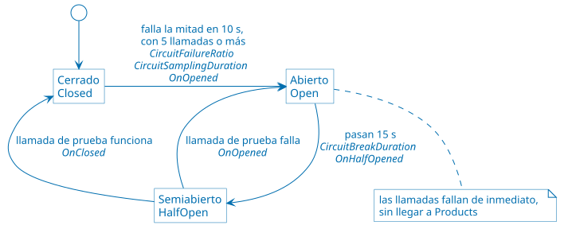

Los eventos `OnOpened`, `OnHalfOpened` y `OnClosed` son los del panel "Eventos
de resiliencia", y el estado es el del panel "Estado del circuito de cada
dependencia".

**Código:** la estrategia del *pipeline* de cada dependencia, en
[OrdersService/Resilience.cs](src/OrdersService/Resilience.cs). Va dentro del Retry, así que cada
reintento cuenta como una llamada más para el circuito:

```csharp
pipeline.AddCircuitBreaker(new HttpCircuitBreakerStrategyOptions
{
    ShouldHandle = args => patterns.CircuitBreaker ? shouldBreak(args) : PredicateResult.False(),
    FailureRatio = CircuitFailureRatio,            // 0,5
    MinimumThroughput = CircuitMinimumThroughput,  // 5
    SamplingDuration = CircuitSamplingDuration,    // 10 s
    BreakDuration = CircuitBreakDuration,          // 15 s
    OnOpened = args => { /* registra [CIRCUIT BREAKER] ABIERTO */ },
    OnHalfOpened = args => { /* SEMIABIERTO */ },
    OnClosed = args => { /* CERRADO */ }
});
```

**Cómo verlo:** [demos/02-circuit-breaker.sh](demos/02-circuit-breaker.sh) hace
que `Products` falle en el 100 % de las solicitudes y consulta el detalle 6
veces con todos los patrones apagados y 6 con solo el Circuit Breaker prendido.
Sin el circuito, `Products` recibe 12 llamadas, aunque falle siempre; con el
circuito, 5. Sin reintentos, cada falla cuenta una vez: las dos primeras consultas dicen `"no
disponible [error HTTP 503]"`, en la tercera el circuito se abre, y desde ahí
responden con `"no disponible [circuito abierto]"` sin llamar a `Products`. Cuando
`Products` se recupera, el circuito sigue abierto hasta que pasan los 15
segundos. Los *logs* de Docker muestran las transiciones ABIERTO → SEMIABIERTO →
CERRADO. Con el Retry prendido, la primera consulta tardaría unos 3 segundos,
porque reintentaría cada llamada antes de que se abriera el circuito.

> [!TIP]
>
> Consulta [Introduction to resilient app development](https://learn.microsoft.com/en-us/dotnet/core/resilience/)
> para tener más información sobre las estrategias de Polly que usa el
> *pipeline*, entre ellas el Circuit Breaker y su `CircuitBreakerManualControl`.

#### Bulkhead

**Problema:** si una dependencia se pone lenta, las llamadas pendientes se
acumulan y consumen los recursos -conexiones, memoria, hilos- que necesitan las
demás funciones.

**Implementación:** un límite de concurrencia por dependencia, en el método
`AddResilience` de la clase `Resilience`, en
[OrdersService/Resilience.cs](src/OrdersService/Resilience.cs). Las llamadas que
exceden el límite se rechazan de inmediato. Como cada dependencia tiene su
propio compartimento, la lentitud de `Products` no afecta las llamadas a
`Users`. Cada compartimento se dimensiona según su dependencia, al llamar a
`AddResilience` en [OrdersService/Program.cs](src/OrdersService/Program.cs): `Products` tiene 5
llamadas en curso y 5 en espera; `Users`, que responde rápido pero se llama en
cada consulta, tiene 20 en curso y 5 en espera.

**Cómo funciona:**


Cada llamada toma un lugar del compartimento de su dependencia. Si no hay lugar,
espera en la fila; si la fila también está llena, se rechaza. Con `Products`
lento se llena su compartimento, pero el de `Users` sigue libre.

**Código:** un `ConcurrencyLimiter` por dependencia, en el método
`AddResilience` de la clase `Resilience`, en
[OrdersService/Resilience.cs](src/OrdersService/Resilience.cs), y el tamaño de cada compartimento,
en las llamadas a `AddResilience` de [OrdersService/Program.cs](src/OrdersService/Program.cs):

```csharp
// Resilience.cs
var bulkhead = new ConcurrencyLimiter(new ConcurrencyLimiterOptions
{
    PermitLimit = bulkheadPermitLimit,  // llamadas en curso
    QueueLimit = bulkheadQueueLimit     // llamadas en espera
});
pipeline.AddRateLimiter(new HttpRateLimiterStrategyOptions
{
    RateLimiter = args => patterns.Bulkhead
        ? bulkhead.AcquireAsync(1, args.Context.CancellationToken)
        : ValueTask.FromResult<RateLimitLease>(AcquiredLease.Instance),
    OnRejected = _ => { /* registra [BULKHEAD] en el log */ }
});

// Program.cs
builder.Services.AddHttpClient("UsersService", ...).AddResilience("users", bulkheadPermitLimit: 20);
builder.Services.AddHttpClient("ProductsService", ...).AddResilience("products");
```

**Cómo verlo:** [demos/03-bulkhead.sh](demos/03-bulkhead.sh) hace que `Products`
demore 1,5 segundos y lanza 15 consultas simultáneas, primero con el Bulkhead
apagado y después prendido. Sin el Bulkhead, las 15 traen los nombres, pero
`Products` llega a atender 15 llamadas a la vez. Con el Bulkhead, nunca más de
5: 10 consultas entran al compartimento de `Products` y traen los nombres de los
productos, y las otras 5 se rechazan de inmediato con `"no disponible [bulkhead
lleno]"`. El nombre del `User` aparece en todas las respuestas.

> [!TIP]
>
> Consulta [ConcurrencyLimiter Class](https://learn.microsoft.com/en-us/dotnet/api/system.threading.ratelimiting.concurrencylimiter)
> para tener más información sobre el limitador que funciona como
> compartimento, con sus lugares en curso y en espera.

#### Throttling

**Problema:** un pico de carga puede saturar un servicio y degradarlo para todos
sus clientes.

**Implementación:** `Orders` atiende como máximo 20 consultas de detalle a la
vez. Las que exceden el límite reciben `503 Service Unavailable` con
`Retry-After: 2`, en lugar de encolarse. La política `throttling` se define
con `AddRateLimiter` en [OrdersService/Program.cs](src/OrdersService/Program.cs), y
se aplica con el atributo `[EnableRateLimiting("throttling")]` en el método
`GetOrdersForUser` de la clase `OrdersController`, en
[OrdersService/Controllers/OrdersController.cs](src/OrdersService/Controllers/OrdersController.cs).

El gateway también aplica Throttling, pero por cliente: cada IP puede crear como
máximo 1 `Order` por segundo, con una ráfaga de hasta 5. Lo que excede el límite
recibe `429 Too Many Requests` sin llegar a `orders-service`; las consultas no
tienen límite. Está en
[ApiGateway/nginxconf/nginx.conf](src/ApiGateway/nginxconf/nginx.conf)
-`limit_req_zone` y `limit_req`-. Es el límite que respeta el cliente de la
demo de Rate Limiting.

**Cómo funciona:**


Es el mismo tipo de limitador que el [Bulkhead](#bulkhead), en la dirección
opuesta: el Bulkhead limita las llamadas que `Orders` hace; el Throttling, las
solicitudes que `Orders` recibe.

**Código:** la política, con `AddRateLimiter` en
[OrdersService/Program.cs](src/OrdersService/Program.cs), y el atributo que la
aplica, en el método `GetOrdersForUser` de la clase `OrdersController`, en
[OrdersService/Controllers/OrdersController.cs](src/OrdersService/Controllers/OrdersController.cs):

```csharp
// Program.cs
builder.Services.AddRateLimiter(options =>
{
    options.RejectionStatusCode = StatusCodes.Status503ServiceUnavailable;
    options.AddPolicy("throttling", context =>
        context.RequestServices.GetRequiredService<PatternSettings>().Throttling
            ? RateLimitPartition.GetConcurrencyLimiter("throttling", _ => new ConcurrencyLimiterOptions
            {
                PermitLimit = 20,
                QueueLimit = 0
            })
            : RateLimitPartition.GetNoLimiter("sin throttling"));
    options.OnRejected = (context, _) =>
    {
        context.HttpContext.Response.Headers.RetryAfter = "2";
        // registra [THROTTLING] en el log
        return ValueTask.CompletedTask;
    };
});

// OrdersController.cs
[HttpGet("user/{userId}/details")]
[EnableRateLimiting("throttling")]
public async Task<ActionResult<List<object>>> GetOrdersForUser(int userId)
```

**Cómo verlo:** [demos/04-throttling.sh](demos/04-throttling.sh) hace que
`Orders` demore 5 segundos en cada consulta y lanza 40 simultáneas, primero con
el Throttling apagado y después prendido. Sin el Throttling, las 40 responden
200 y `Orders` llega a atender 40 a la vez. Con el Throttling, 20 responden 200
con todos los nombres y 20 se rechazan al instante con 503. La demo apaga
el Bulkhead; con el Bulkhead prendido, algunas respuestas 200 traerían un
producto "no disponible", porque las 20 consultas atendidas llaman a `Products`
a la vez y llenan su compartimento: en un sistema real, el Throttling y el
Bulkhead actúan juntos. El Throttling por cliente del gateway se ve en la demo
de Rate Limiting.

> [!TIP]
>
> Consulta [Rate limiting middleware in ASP.NET Core](https://learn.microsoft.com/en-us/aspnet/core/performance/rate-limit?view=aspnetcore-10.0)
> para tener más información sobre cómo está implementada la política
> `throttling` con `AddRateLimiter` y `[EnableRateLimiting]`.

#### Rate Limiting

**Problema:** un cliente que envía solicitudes más rápido de lo que acepta el
servicio al que llama recibe rechazos y tiene que reintentarlos. Las solicitudes
rechazadas no avanzan el trabajo, pero consumen capacidad del cliente, de la red
y del servicio, y los reintentos agregan esperas. Es el caso típico de un
proceso por lotes que envía muchos datos a un servicio con límite de capacidad.

**Implementación:** el cliente regula su propio ritmo para no superar el límite
del servicio. Rate Limiting y Throttling son las dos caras del mismo límite: el
servicio aplica Throttling para protegerse, y el cliente aplica Rate Limiting
para no chocar contra ese Throttling. En esta aplicación, el servicio es el
gateway, con su Throttling por cliente -1 `POST /orders/` por segundo por IP,
con una ráfaga de 5; ver [Throttling](#throttling)-, y el cliente es un proceso
por lotes que crea `Orders`: [demos/05-rate-limiting.sh](demos/05-rate-limiting.sh)
y [k6/rate-limiting.js](k6/rate-limiting.js).

> [!NOTE]
>
> **Rate limiting en nginx y en Azure.** nginx llama *rate limiting* a
> `limit_req`, y muchos API gateways y proveedores de APIs usan el término en el
> mismo sentido: un límite que el **servicio** aplica a cada cliente. En el
> catálogo de patrones de Azure Architecture Center, que sigue este repositorio,
> eso es [Throttling](https://learn.microsoft.com/en-us/azure/architecture/patterns/throttling),
> en este caso por cliente; y
> [Rate Limiting](https://learn.microsoft.com/en-us/azure/architecture/patterns/rate-limiting-pattern)
> es un patrón del **cliente**, que regula su ritmo para no superar el
> Throttling del servicio al que llama. Por eso el gateway usa la
> configuración de *rate limiting* de nginx para implementar Throttling, y el
> patrón Rate Limiting está en el cliente de la demo.

**Cómo funciona:**

Sin Rate Limiting, el cliente envía todo de golpe y reintenta lo rechazado:


Con Rate Limiting, el cliente respeta el ritmo que acepta el gateway:


El límite del gateway es el mismo en las dos formas: 1 `POST /orders/` por
segundo por IP, con una ráfaga de 5. Lo que cambia es cómo envía el cliente.

**Cómo verlo:** [demos/05-rate-limiting.sh](demos/05-rate-limiting.sh) crea 15
`Orders` de dos formas. Sin Rate Limiting, las envía todas de golpe y reintenta
las rechazadas cada 1 segundo: hacen falta unas 55 solicitudes y unas 40
reciben 429. Con Rate Limiting, respeta el límite del gateway: 15 solicitudes y
ningún 429. Las dos formas demoran unos 10 segundos, porque el límite del
gateway fija el ritmo máximo.

#### Health Endpoint Monitoring

**Problema:** sin una forma de saber si un servicio funciona, una falla solo se
detecta cuando un usuario se queja.

**Implementación:** cada servicio expone `/health`, que verifica sus propias
dependencias y devuelve un JSON con el resultado de cada chequeo -200 si está
sano, 503 en caso contrario-:

* `users-service`: conexión a PostgreSQL.
* `products-service`: *ping* a MongoDB.
* `orders-service`: conexión a MySQL y a RabbitMQ. Si RabbitMQ no está, queda
  `Degraded` y responde 200, porque gracias al [Transactional
  Outbox](#transactional-outbox) sigue aceptando `Orders`. `orders-worker` y
  `orders-projector` quedan `Unhealthy`, porque sin RabbitMQ no reciben nada.

`Orders` **no** chequea a `Users` ni a `Products`: si se cae una dependency,
`Orders` sigue funcionando degradado y no debe figurar como caído. El gateway
publica los tres en `/health/users`, `/health/products` y `/health/orders`.
Docker los consulta cada 5 segundos -`healthcheck` en
[docker-compose.yaml](docker-compose.yaml)- y los usa para no levantar un
servicio hasta que sus dependencias estén sanas -`depends_on: condition:
service_healthy`-.

**Cómo funciona:**


`Orders` no chequea a `Users` ni a `Products`: si se caen, sigue funcionando
degradado. Grafana no consulta `/health`: cada servicio publica el resultado de
sus chequeos como la métrica `service_health`.

**Código:**


Cada chequeo es una implementación de `IHealthCheck`, registrada con
`AddHealthChecks` en el `Program.cs` de cada servicio:

* La clase `RabbitMqHealthCheck`, en [Common/RabbitMq.cs](src/Common/RabbitMq.cs),
  y la clase `MongoHealthCheck`, en
  [ProductsService/MongoHealthCheck.cs](src/ProductsService/MongoHealthCheck.cs),
  implementan el método `CheckHealthAsync`.
* El método `WriteJson` de la clase `HealthResponse`, en
  [Common/HealthResponse.cs](src/Common/HealthResponse.cs), escribe el JSON de
  `/health`.
* El método `PublishAsync` de la clase `HealthMetricsPublisher`, en
  [Common/HealthMetrics.cs](src/Common/HealthMetrics.cs), publica la métrica.

**Cómo verlo:** [demos/06-health.sh](demos/06-health.sh) detiene la base de
datos de `Products`. `/health/products` pasa a 503 con `"MongoDB no responde"`,
`Orders` sigue sano, y a los pocos segundos Docker marca `products-service` como
`unhealthy`. Al levantar la base, todo vuelve a la normalidad. Para verlo en
vivo, corre [demos/monitor-health.sh](demos/monitor-health.sh) en otra terminal.
En Grafana, el panel "Salud de los servicios" muestra `products-service` en rojo
mientras la base está detenida.

> [!TIP]
>
> Consulta [Health checks in ASP.NET
> Core](https://learn.microsoft.com/en-us/aspnet/core/host-and-deploy/health-checks?view=aspnetcore-10.0)
> para tener más información sobre cómo está implementado el chequeo de salud.

#### Competing Consumers para disponibilidad

**Problema:** un solo proceso que atiende una cola es un cuello de botella y un
punto único de falla.

**Implementación:** `POST /orders/` publica el evento `order.created` en el
exchange `andis.events` de RabbitMQ, a través del [Transactional
Outbox](#transactional-outbox). La cola `orders.process` está suscripta a ese
evento -ver [Publisher/Subscriber](#publishersubscriber)-. Tres réplicas de `orders-worker` consumen la misma
cola; RabbitMQ entrega cada mensaje a una sola réplica. Cada réplica toma un
mensaje a la vez -`prefetch = 1`- y lo confirma -*ack*- recién cuando termina;
si se cae antes, RabbitMQ entrega el mensaje a otra. Si `Users` o `Products` no
están disponibles, el *worker* devuelve el mensaje a la cola y lo reintenta 5
segundos después. Está en la clase `OrderProcessingWorker`, en
[OrdersService/Messaging/OrderProcessingWorker.cs](src/OrdersService/Messaging/OrderProcessingWorker.cs):
el método `ExecuteAsync` se suscribe a la cola y confirma o devuelve cada
mensaje, y el método `ProcessAsync` procesa la `Order`.

**Cómo funciona:**

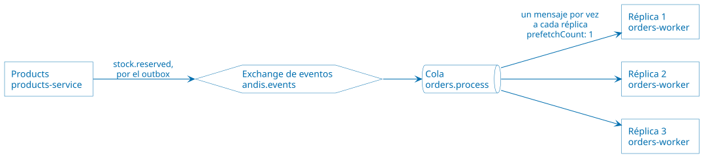

Cada mensaje lo recibe una sola réplica. Si una réplica se cae antes de
confirmarlo, RabbitMQ se lo entrega a otra. El recorrido completo de una
`Order`, desde el `POST` hasta su confirmación, está en
[ARCHITECTURE.md](ARCHITECTURE.md#creación-de-una-order-asíncrona).

**Código:**


`ProcessAsync` devuelve `false` cuando `Users` o `Products` no responden: el
mensaje vuelve a la cola.

**Cómo verlo:**
[demos/07-competing-consumers.sh](demos/07-competing-consumers.sh) crea 9
`Orders`. Cada *worker* tarda 2 segundos por `Order`, y las 9 se procesan en
unos 6 segundos, 3 por réplica. Después crea 9 más y detiene una réplica
mientras procesa: la `Order` que tenía la termina otra réplica. Para ver la cola
y sus consumidores, abre la consola de RabbitMQ.

> [!TIP]
>
> Consulta [Background tasks with hosted services in ASP.NET Core](https://learn.microsoft.com/en-us/aspnet/core/fundamentals/host/hosted-services?view=aspnetcore-10.0)
> para tener más información sobre `BackgroundService`, la clase base de
> `OrderProcessingWorker`, `OutboxRelay` y `OrderDetailsProjector`.

#### Event Sourcing

**Problema:** si solo se guarda el estado actual, se pierde la historia de cómo
se llegó a él, y una corrupción de ese estado no tiene vuelta atrás.

**Implementación:** cada cambio de una `Order` se guarda como un evento
inmutable en la tabla `order_events`: `OrderCreated`, `OrderConfirmed` u
`OrderRejected`. La tabla `orders` es una **proyección**: el estado actual,
calculado a partir de los eventos. Cada evento es un `OrderEvent`, creado con
el método `Create` de esa clase, en
[OrdersService/Models/OrderEvent.cs](src/OrdersService/Models/OrderEvent.cs); el
método `Replay` de la clase `OrderProjection`, en
[OrdersService/Models/OrderProjection.cs](src/OrdersService/Models/OrderProjection.cs),
los reproduce para obtener el estado.

* `GET /orders/{id}/events` muestra los eventos de una `Order` y el estado que
  resulta de reproducirlos.
* `POST /orders/projections/rebuild` borra la tabla `orders` y la reconstruye a
  partir de los eventos.

**Cómo funciona:**


Los eventos no se modifican ni se borran: un cambio nuevo es un evento nuevo.
`orders` se puede borrar y recalcular en cualquier momento.

**Código:**


**Cómo verlo:** [demos/08-event-sourcing.sh](demos/08-event-sourcing.sh) crea
una `Order`, muestra sus eventos, borra la tabla `orders` directamente en MySQL
y la reconstruye. Las `Orders` vuelven con su estado.

#### Transactional Outbox

Este patrón no está en la lista de la lectura de patrones de disponibilidad; se
agrega porque las [demos de rendimiento y procesamiento
asíncrono](#demos-de-rendimiento-y-procesamiento-asíncrono) dependen de él. Con
eventos que alimentan una vista materializada, un evento perdido deja esa vista
desactualizada para siempre.

**Problema:** un servicio que guarda un cambio en su base y después publica un
mensaje hace dos escrituras en dos sistemas distintos, sin una transacción que
las abarque. Si RabbitMQ no está o el servicio se cae entre una y otra, queda
el cambio sin el mensaje: una `Order` `Pending` que ningún *worker* va a
procesar. Si se publica primero, queda el mensaje de un cambio que tal vez no se
guardó.

**Implementación:** `POST /orders/` guarda la `Order`, su evento `OrderCreated`
de Event Sourcing y el mensaje `order.created` en la tabla `outbox_messages`,
**en la misma transacción**: se guardan los tres o ninguno. El *worker* hace lo
mismo con `order.confirmed` y `order.rejected`. Ninguno de los dos publica en
RabbitMQ. Lo hacen el método `CreateOrder` de la clase `OrdersController` y el
método `ProcessAsync` de la clase `OrderProcessingWorker`, con el método
`Create` de la clase `OutboxMessage`, en
[OrdersService/Models/OutboxMessage.cs](src/OrdersService/Models/OutboxMessage.cs).

El *relay* del *outbox* -el método `PublishPendingAsync` de la clase
`OutboxRelay`, en
[OrdersService/Messaging/OutboxRelay.cs](src/OrdersService/Messaging/OutboxRelay.cs)-
corre en `orders-service`. Cada segundo toma hasta 50 mensajes pendientes, en
orden, los publica en `andis.events` y les completa la fecha de publicación.
Publica con confirmación de RabbitMQ: solo marca un mensaje cuando RabbitMQ
confirmó que lo recibió. Si RabbitMQ no está, los mensajes quedan pendientes y
se reintentan en la vuelta siguiente. Los toma con `SELECT ... FOR UPDATE SKIP
LOCKED`: con más de una instancia del *relay*, cada mensaje lo publica una sola.

La entrega es **al menos una vez**: si el *relay* se cae después de publicar y
antes de marcar, publica de nuevo el mismo mensaje. Por eso los suscriptores son
idempotentes: el *worker* ignora las `Orders` que ya no están `Pending`, y el
proyector de la vista materializada actualiza la fila si ya existe.

`Users` y `Products` publican sus eventos directamente, sin *outbox*: si
RabbitMQ no está, el cambio se guarda y el evento se pierde. `Products` usa
MongoDB sin réplicas, que no admite transacciones con varios documentos. Quedó
así a propósito, para comparar; ver las decisiones abiertas en
[ARCHITECTURE.md](ARCHITECTURE.md#decisiones-abiertas-a-discusión).

**Cómo funciona:**


El *worker* guarda `order.confirmed` u `order.rejected` en el *outbox* de la
misma forma. El recorrido completo está en
[ARCHITECTURE.md](ARCHITECTURE.md#creación-de-una-order-asíncrona).

**Código:**


`PublishedAt` es nulo mientras el mensaje está pendiente.

**Cómo verlo:** [demos/09-transactional-outbox.sh](demos/09-transactional-outbox.sh)
detiene RabbitMQ y crea 5 `Orders`. Todas responden `202`; antes del *outbox*,
`Orders` respondía `503` y la `Order` quedaba `Pending` para siempre.
`/health/orders` responde `Degraded`, y los 5 mensajes esperan en
`outbox_messages`. Al levantar RabbitMQ, el *relay* los publica, los *workers*
confirman las `Orders` y el *outbox* queda vacío. En Grafana, el panel "Outbox
de Orders" muestra los pendientes subir y volver a cero.

> [!TIP]
>
> Consulta [Transactions - EF Core](https://learn.microsoft.com/en-us/ef/core/saving/transactions)
> para tener más información sobre la transacción que guarda la `Order`, su
> evento y el mensaje, y [SQL Queries - EF Core](https://learn.microsoft.com/en-us/ef/core/querying/sql-queries)
> sobre `FromSqlRaw`, con el que el *relay* lee los mensajes pendientes.

## Demos de rendimiento y procesamiento asíncrono

**Estado: implementada en este repositorio, sobre las demos de resiliencia y
disponibilidad.**

Escenario: un pico de tráfico en una campaña. La aplicación debe mantener
latencias bajas y absorber la carga.

Qué se muestra:

* Lecturas rápidas con caché y vistas materializadas.
* Creación de `Orders` encolada, con consumidores en competencia.
* Eventos pub/sub para desacoplar los servicios.

Resultado observable: latencias de lectura estables durante el pico, *backlog*
absorbido por la cola y throughput que crece al agregar *workers*. El pico se
genera con [k6/load.js](k6/load.js) y [k6/load-leveling.js](k6/load-leveling.js),
y se compara antes y después de cada patrón en el dashboard de Grafana, en la
fila "Rendimiento: caché, CQRS y outbox".

### Qué agrega a las demos de disponibilidad

| Componente | Para qué |
| ---------- | -------- |
| `redis` | Caché de `Products`. |
| `orders-projector` | La misma imagen que `orders-service`, con el proyector habilitado -`Projector__Enabled=true`-. Mantiene la vista materializada `order_details`. |
| Exchange `andis.events` | Eventos `order.created`, `order.confirmed`, `order.rejected`, `user.updated` y `product.updated`. Los contratos están en [Common/Events.cs](src/Common/Events.cs). |
| Modificación de `Users` y `Products` | Operación SOAP `UpdateUser` y `PUT /products/{id}`, que publican `user.updated` y `product.updated`. |
| Ajustes de la caché | `PUT /products/cache` prende o apaga la caché y agrega una demora a cada lectura de MongoDB, sin reiniciar, igual que el chaos. `DELETE /products/cache` vuelve a los valores por defecto. |

```bash
# Caché apagada y cada lectura de MongoDB demora 200 ms
curl -X PUT http://localhost/products/cache -H "Content-Type: application/json" \
  -d '{"enabled": false, "dbDelayMs": 200}'

# Vuelve a los valores por defecto: caché prendida y sin demora
curl -X DELETE http://localhost/products/cache
```

### Patrones de rendimiento

Como en las demos de disponibilidad, cada patrón tiene un script en
[demos/](demos), del `10` al `16`. Los *logs* de Docker muestran los eventos con
una etiqueta: `[CACHE-ASIDE]` en `products-service`; `[PUB/SUB]` en
`users-service`, `products-service` y `orders-projector`; y `[MATERIALIZED
VIEW]` en `orders-projector`.

#### Cache-Aside

**Problema:** las lecturas de datos que cambian poco van a la base cada vez, y
la base se vuelve el cuello de botella de un pico de lecturas.

**Implementación:** `Products` busca primero en Redis. Si el dato no está
-*miss*-, lo lee de MongoDB y lo guarda en Redis por 60 segundos; la próxima
lectura sale de Redis -*hit*-. Al crear o cambiar un `Product`, `Products`
borra de Redis las claves afectadas, y la próxima lectura trae el dato nuevo.
Es la aplicación la que maneja la caché: Redis no sabe nada de MongoDB. Si Redis
no responde, `Products` lee MongoDB directamente; la caché acelera, pero no es
una dependencia, y por eso no entra en `/health`. Está en los métodos
`GetOrLoadAsync` e `InvalidateAsync` de la clase `ProductCache`, en
[ProductsService/ProductCache.cs](src/ProductsService/ProductCache.cs), que usan los
métodos `GetProduct` y `UpdateProduct` de la clase `ProductsController`, en
[ProductsService/Controllers/ProductsController.cs](src/ProductsService/Controllers/ProductsController.cs).

Se borra la clave en lugar de escribir el valor nuevo: así la caché nunca guarda
un valor que MongoDB no tiene. El TTL acota cuánto puede durar un dato
desactualizado si una invalidación falla.

**Cómo funciona:**

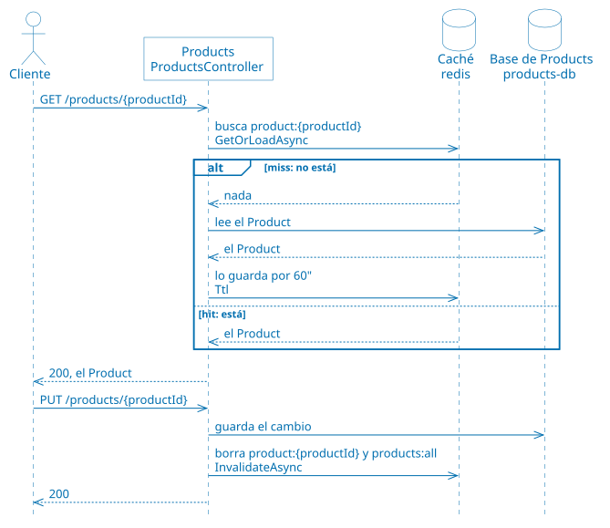

Si Redis no responde, `Products` lee directamente de MongoDB.

**Código:**

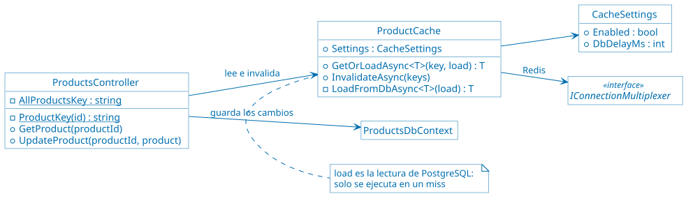

`ProductCache` no conoce a MongoDB: su método `GetOrLoadAsync` recibe la
lectura como una función, `load`.

**Cómo verlo:** [demos/10-cache-aside.sh](demos/10-cache-aside.sh) simula una
base que demora 200 ms y lee el mismo `Product` varias veces: la primera lectura
demora 200 ms y las siguientes, 2 o 3 ms. Después cambia su nombre: la lectura
siguiente es un *miss* y trae el nombre nuevo. Con Redis detenido, `Products`
sigue respondiendo, a la velocidad de MongoDB. Bajo carga,
[k6/cache-aside.js](k6/cache-aside.js) lee 50 veces por segundo con la caché
apagada y después prendida: la p95 baja de unos 100 ms a unos 3 ms.

> [!TIP]
>
> Consulta [Caching Guidance](https://learn.microsoft.com/en-us/azure/architecture/best-practices/caching)
> para tener más información sobre cuándo conviene una caché, cuánto tiempo
> guardar cada dato y cómo mantenerla consistente con la base.

#### Queue-Based Load Leveling

**Problema:** un pico de solicitudes que un servicio procesa en el momento lo
satura, y satura también a los servicios que llama.

**Implementación:** `POST /orders/` solo guarda la `Order` y responde; el
trabajo pesado -verificar el `User` y el `Product` con `Users` y `Products`- lo
hacen los *workers* desde la cola `orders.process`, a su propio ritmo. La cola
absorbe el pico: `Users` y `Products` reciben como máximo una llamada por
réplica del *worker*, sin importar cuántas `Orders` lleguen. Ya estaba en las
demos de disponibilidad, como base de [Competing
Consumers](#competing-consumers-para-disponibilidad); las demos de rendimiento lo
muestra bajo un pico.

**Cómo funciona:**

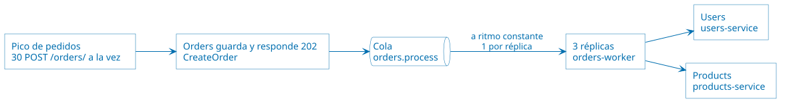

El pico se acumula en la cola, no en `Users` ni en `Products`. El código es el
de [Competing Consumers](#competing-consumers-para-disponibilidad).

**Cómo verlo:** [demos/11-queue-based-load-leveling.sh](demos/11-queue-based-load-leveling.sh)
crea 30 `Orders` a la vez, directamente en `orders-service`: el Throttling por
cliente del gateway rechazaría el pico antes de que llegara a la cola. Todas
responden `202` en pocos milisegundos; la cola baja de a 3 mensajes cada 2
segundos hasta vaciarse. [k6/load-leveling.js](k6/load-leveling.js) envía 10
`POST` por segundo durante 10 segundos: la latencia de `create order` se
mantiene baja y la cola crece durante el pico y se vacía después.

#### Competing Consumers para rendimiento

**Problema:** un solo consumidor procesa la cola a un ritmo fijo; si el pico
dura mucho, la cola crece sin límite.

**Implementación:** la misma de la [demo de
disponibilidad](#competing-consumers-para-disponibilidad). Visto como patrón de
rendimiento, el throughput crece agregando réplicas de `orders-worker`, sin
cambiar el código.

**Cómo funciona:** el mismo diagrama de la [demo de
disponibilidad](#competing-consumers-para-disponibilidad), con 6 réplicas en
lugar de 3.

**Cómo verlo:**
[demos/12-competing-consumers-scaling.sh](demos/12-competing-consumers-scaling.sh)
procesa 30 `Orders` con 3 réplicas, unos 21 segundos, y otras 30 con 6 réplicas,
unos 12 segundos. Al final vuelve a 3 réplicas.

#### Publisher/Subscriber

**Problema:** si un servicio avisa de sus cambios llamando a cada interesado,
tiene que conocerlos a todos, y cada interesado nuevo obliga a cambiarlo.

**Implementación:** `Orders`, `Users` y `Products` publican eventos en el
exchange `andis.events`, de tipo *topic*. En RabbitMQ, un exchange y una cola
son piezas distintas:

* Un **exchange** es donde se publica. No guarda mensajes: según la clave de
  ruteo de cada mensaje, por ejemplo `order.created`, pone una copia en cada
  cola enlazada con esa clave. Si ninguna cola está enlazada, el mensaje se
  descarta. En un exchange de tipo *topic*, las claves de los enlaces admiten
  comodines: `order.*` recibe `order.created`, `order.confirmed` y
  `order.rejected`.
* Una **cola** es donde los mensajes esperan hasta que un consumidor los toma.
  Cada mensaje de una cola lo procesa un solo consumidor.

Cada suscriptor tiene su propia cola y la enlaza con las claves de ruteo que le
interesan:

| Cola | Suscriptor | Claves |
| ---- | ---------- | ------ |
| `orders.process` | `orders-worker` | `order.created` |
| `orders.details-view` | `orders-projector` | `order.*`, `user.updated`, `product.updated` |

Un mismo `order.created` llega a las dos colas. `Orders` no sabe que existe el
proyector: agregarlo no cambió el código que publica. La conexión y la
publicación están en la clase `RabbitMq`, en [Common/RabbitMq.cs](src/Common/RabbitMq.cs):
el método `PublishEventAsync` publica un evento, y el método
`DeclareSubscriberQueueAsync` declara la cola de un suscriptor con sus claves.

El exchange y las colas corresponden a dos patrones distintos. Entre colas,
Publisher/Subscriber: cada suscriptor recibe su propia copia de cada evento.
Dentro de una cola, [Competing
Consumers](#competing-consumers-para-rendimiento): las réplicas de
`orders-worker` comparten `orders.process`, y cada mensaje lo procesa una sola.

**Cómo funciona:**


Quien publica no conoce las colas: cada suscriptor declara la suya y elige las
claves de ruteo.

**Código:**

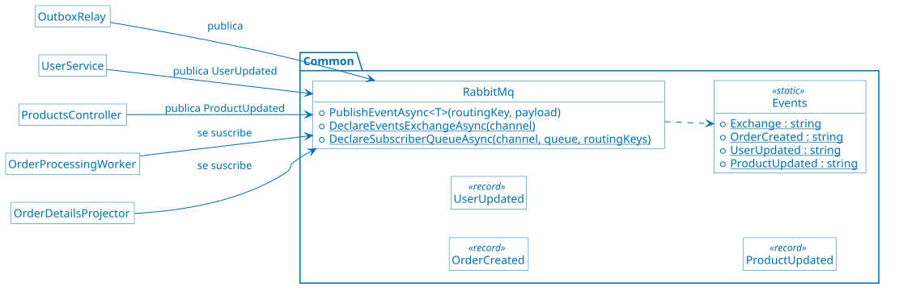

Los contratos de los eventos y la conexión a RabbitMQ están en `Common`, el
único proyecto que comparten los servicios. Los registros `OrderConfirmed` y
`OrderRejected` también están ahí; el diagrama no los muestra.

**Cómo verlo:**
[demos/13-publisher-subscriber.sh](demos/13-publisher-subscriber.sh) muestra los
enlaces del exchange, crea una `Order` y muestra los *logs* del *worker* y del
proyector, que la reciben los dos. Después cambia el nombre de un `Product` y de
un `User`: esos eventos solo los recibe el proyector.

#### Asynchronous Request-Reply

**Problema:** una operación que tarda no puede tener al cliente esperando la
respuesta: el cliente agota su *timeout* o retiene una conexión que no hace
nada.

**Implementación:** `POST /orders/` responde `202 Accepted` enseguida, con
`Location: /orders/{id}/status` y `Retry-After: 2`. `GET /orders/{id}/status`
responde `200` con el estado mientras la `Order` está `Pending`, también con
`Retry-After`; cuando un *worker* la confirma o la rechaza, responde `303 See
Other` a `/orders/{id}`, y el cliente sigue la redirección para obtener el
resultado. Está en los métodos `CreateOrder` y `GetOrderStatus` de la clase
`OrdersController`, en
[OrdersService/Controllers/OrdersController.cs](src/OrdersService/Controllers/OrdersController.cs).

**Cómo funciona:**

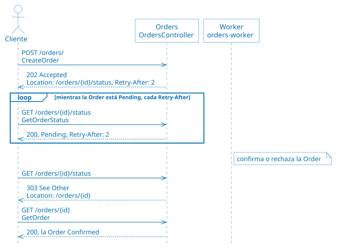

**Cómo verlo:** [demos/14-asynchronous-request-reply.sh](demos/14-asynchronous-request-reply.sh)
crea una `Order`, muestra el `202` con sus encabezados y consulta el estado
respetando `Retry-After` hasta el `303`. Al final sigue la redirección y muestra
la `Order` confirmada.

> [!TIP]
>
> Consulta [Controller action return types in ASP.NET Core web API](https://learn.microsoft.com/en-us/aspnet/core/web-api/action-return-types?view=aspnetcore-10.0)
> para tener más información sobre los resultados que devuelven `CreateOrder`
> y `GetOrderStatus`, como `Accepted`.

#### CQRS

**Problema:** el modelo que conviene para escribir -tablas normalizadas, cada
dato en el servicio que es su dueño- no es el que conviene para leer. La
consulta de detalle tiene que juntar datos de tres servicios en cada lectura.

**Implementación:** los comandos y las consultas usan modelos distintos.

* **Comandos:** `POST /orders/` y el *worker* escriben `orders`, `order_events`
  y `outbox_messages`, en el método `CreateOrder` de la clase
  `OrdersController`, en
  [OrdersService/Controllers/OrdersController.cs](src/OrdersService/Controllers/OrdersController.cs),
  y en el método `ProcessAsync` de la clase `OrderProcessingWorker`, en
  [OrdersService/Messaging/OrderProcessingWorker.cs](src/OrdersService/Messaging/OrderProcessingWorker.cs).
* **Consultas:** `GET /orders/user/{userId}/details/view` lee solo la vista
  `order_details` -ver [Materialized View](#materialized-view)-, en el método
  `GetOrdersForUser` de la clase `OrdersQueriesController`, en
  [OrdersService/Controllers/OrdersQueriesController.cs](src/OrdersService/Controllers/OrdersQueriesController.cs).
  Es una consulta a MySQL, sin llamadas a `Users` ni a `Products`, y sin
  Throttling.

`GET /orders/user/{userId}/details`, la consulta síncrona de la demo de
disponibilidad, queda como está: la usan los demos de Retry, Circuit Breaker,
Bulkhead y Throttling, y sirve para comparar. El costo es la **consistencia
eventual**: el lado de las consultas se actualiza un momento después que el de
los comandos.

**Cómo funciona:**

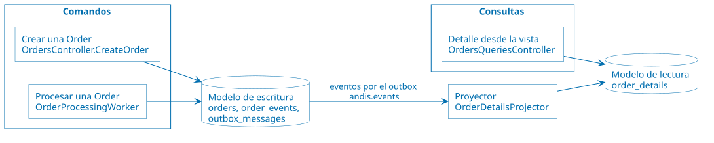

La flecha de los eventos es la consistencia eventual: el modelo de lectura se
actualiza un momento después. El recorrido completo de una consulta desde la
vista está en
[ARCHITECTURE.md](ARCHITECTURE.md#consulta-de-detalle-desde-la-vista-eventos).

**Código:**

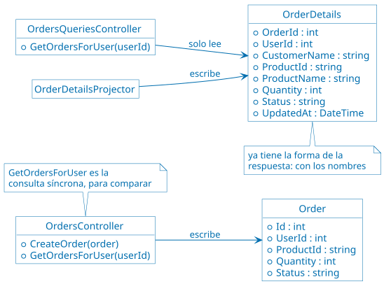

La separación se ve en el código: un controlador para los comandos, sobre
`Order`, y otro para las consultas, sobre `OrderDetails`.

**Cómo verlo:** [demos/15-cqrs.sh](demos/15-cqrs.sh) hace la misma consulta por
los dos lados. Sin fallas, la síncrona demora unos 100 ms y la vista, 3 ms. Con
`Products` demorando 300 ms, la síncrona pasa a casi 2 segundos -una llamada por
`Order`- y la vista no cambia. Después crea una `Order` y consulta enseguida: la
síncrona ya la tiene, la vista todavía no. Bajo carga, [k6/load.js](k6/load.js)
con `-e DETAILS=live` y con `-e DETAILS=view` compara las dos.

#### Materialized View

**Problema:** armar el detalle de las `Orders` en cada consulta cuesta una
llamada a `Users` y una a `Products` por `Order`, y si alguno no responde, el
detalle sale degradado.

**Implementación:** la tabla `order_details` guarda el detalle de cada `Order`
con el nombre del cliente y el nombre del producto ya copiados. La mantiene el
método `ApplyAsync` de la clase `OrderDetailsProjector`, en
[OrdersService/Messaging/OrderDetailsProjector.cs](src/OrdersService/Messaging/OrderDetailsProjector.cs),
que corre en `orders-projector` y consume la cola `orders.details-view`:

* `order.created`: el método `AddOrderAsync` busca el nombre del cliente y del
  producto **una vez**, con los mismos `HttpClient` y la misma resiliencia de la
  demo de disponibilidad, y agrega la fila. Si `Users` o `Products` no
  responden, el mensaje vuelve a la cola.
* `order.confirmed` y `order.rejected`: el método `SetStatusAsync` actualiza el
  estado.
* `user.updated` y `product.updated`: actualizan el nombre en todas las filas
  de ese `User` o `Product`.

Corre con una sola réplica, para que los eventos de una misma `Order` se
apliquen en orden.

**Cómo funciona:**

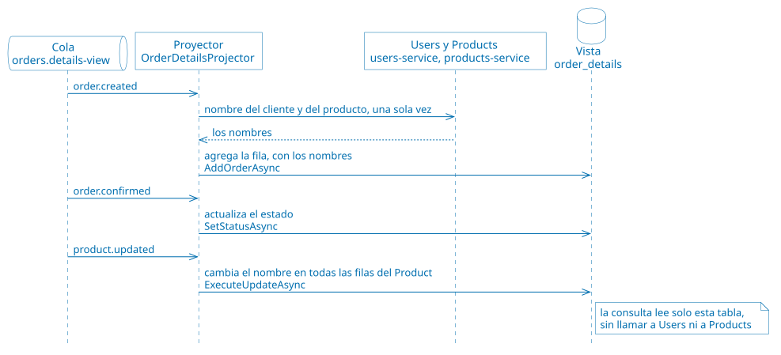

**Código:**

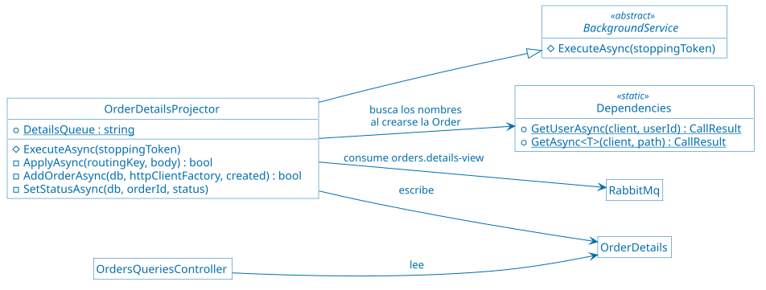

El proyector es el único que escribe la vista, y el único que llama a `Users` y
a `Products`.

**Cómo verlo:** [demos/16-materialized-view.sh](demos/16-materialized-view.sh)
cambia el nombre de un `Product` y la vista lo refleja. Con `Products` fallando
siempre, la consulta síncrona responde "no disponible" y la vista sigue
respondiendo con los nombres. Por último, detiene el proyector y crea una
`Order`: la `Order` se confirma, pero la vista no la tiene y sus eventos esperan
en la cola. Al levantar el proyector, la vista se pone al día.

> [!TIP]
>
> Consulta [ExecuteUpdate and ExecuteDelete - EF Core](https://learn.microsoft.com/en-us/ef/core/saving/execute-insert-update-delete)
> para tener más información sobre `ExecuteUpdateAsync`, con el que el
> proyector cambia un nombre en todas las filas de la vista con una sola
> sentencia.

## Demos de seguridad

**Estado: implementada en este repositorio, sobre las demos de rendimiento.**

Escenario: la aplicación se abre a clientes reales. Cada usuario tiene que
identificarse, ver solo lo suyo y no poder hacer más de lo que le corresponde,
y nada tiene que llegar a los servicios sin control.

Qué se muestra:

* Inicio de sesión en un proveedor de identidad externo, y decisiones tomadas
  con los claims del token.
* TLS, validación de tokens y compresión en el gateway, sin código en los
  servicios.
* Validación y limpieza de cada solicitud antes de que llegue a un servicio,
  y servicios que solo se alcanzan a través del gateway.
* Un proxy junto a `Products` que le agrega autenticación y autorización sin
  cambiar su código.
* Acceso directo, temporal y acotado al almacenamiento de las imágenes.

Resultado observable: por la entrada HTTP del gateway, cualquiera llega a
cualquier ruta, incluidas las de administración; por la entrada HTTPS, cada
solicitud necesita un token, los servicios no implementan autenticación ni TLS,
las políticas se aplican en el borde y cada acceso tiene el mínimo privilegio
necesario.

### Qué agrega a las demos de rendimiento

| Componente | Para qué |
| ---------- | -------- |
| `keycloak` | Proveedor de identidad. El realm `andis` tiene los usuarios, sus roles y el cliente `andis-cli`, la aplicación de línea de comandos de las demos; se importa al arrancar desde [Keycloak/andis-realm.json](src/Keycloak/andis-realm.json). Consola en <http://localhost:8080> -usr: `admin` pwd: `Pa55w0rd`-. |
| Entrada HTTPS del gateway | `https://localhost`, con los patrones de seguridad. La entrada HTTP, `http://localhost`, queda como estaba, para las demos anteriores y para comparar; en producción quedaría solo la HTTPS. Está en [ApiGateway/nginxconf/nginx.conf](src/ApiGateway/nginxconf/nginx.conf). |
| `products-sidecar` | Envoy, junto a `products-service` y en su mismo espacio de red. La entrada HTTPS le envía `/products/` al sidecar; la HTTP, directamente a `Products`. Está en [ProductsSidecar/envoy.yaml](src/ProductsSidecar/envoy.yaml). |
| `azurite` | El emulador de Azure Storage, con las imágenes de los `Products`, en <http://localhost:10000>. |
| Imágenes de los `Products` | `PUT /products/{id}/image` sube la imagen a través de `Products`; `POST /products/{id}/image/upload-url` entrega una URL firmada para subirla directamente a Azurite; `GET /products/{id}/image` redirige a una URL firmada para bajarla. |
| [docker-compose.gatekeeper.yaml](docker-compose.gatekeeper.yaml) | Deja de publicar en el host los puertos de los servicios y de las bases: la única entrada a los servicios es el gateway. |

Los usuarios de Keycloak, todos con la contraseña `Pa55w0rd`:

| Usuario | Rol | `User` de la aplicación | Qué puede hacer |
| ------- | --- | ----------------------- | --------------- |
| alice | `customer` | 1 | Crear y consultar sus propias `Orders`; leer los `Products` |
| bob | `customer` | 2 | Lo mismo que alice, con sus `Orders` |
| carol | `admin` | — | Consultar las `Orders` de todos; cambiar los `Products` y sus imágenes. No es cliente: no crea `Orders` |

Ejemplo de una solicitud por la entrada HTTPS:

```bash
# El certificado del gateway es autofirmado: se copia del contenedor para que
# curl lo verifique
docker compose exec -T api-gateway cat /etc/nginx/tls/gateway.crt > gateway.crt

# alice inicia sesión en Keycloak y recibe un token
alice=$(curl -s -X POST http://localhost:8080/realms/andis/protocol/openid-connect/token \
  -d grant_type=password -d client_id=andis-cli -d scope=openid \
  -d username=alice -d password=Pa55w0rd | jq -r .access_token)

# Dirección para ver el token y verificar su firma en jwt.io. Un token real no se
# pega en un sitio de terceros: este es de una demo y vence en 15 minutos
echo "https://www.jwt.io/#token=$alice&publicKey=$(curl -sS http://localhost:8080/realms/andis/protocol/openid-connect/certs \
  | jq -r '.keys[] | select(.use == "sig") | tostring | @uri')"

# Las Orders de alice, con el token
curl --cacert gateway.crt -H "Authorization: Bearer $alice" \
  https://localhost/orders/user/1/details/view
```

### Patrones de seguridad

Cada patrón tiene un script en [demos/](demos), del `17` al `21`, y un paso a
paso en [commands/04-security.azcli](commands/04-security.azcli) que compara la
misma solicitud por la entrada HTTP, sin el patrón, y por la HTTPS, con él. Los
*logs* de Docker muestran los eventos con una etiqueta: `[HTTPS]` en
`api-gateway`, una línea por solicitud; `[FEDERATED IDENTITY]` en
`orders-service`; `[SIDECAR]` en `products-sidecar`; y `[VALET KEY]` en
`products-service`.

Los patrones están en el orden en que se apoyan unos en otros, que no es el de
la lectura: Gateway Offloading y Gatekeeper usan los tokens de Federated
Identity.

#### Federated Identity

**Problema:** si cada aplicación autentica a sus usuarios, cada una guarda
contraseñas e implementa el inicio de sesión, la recuperación de contraseñas y
el bloqueo de cuentas, y el usuario tiene una cuenta distinta en cada una. Una
falla en cualquiera de ellas expone las contraseñas.

**Implementación:** la autenticación se delega en Keycloak, un proveedor de
identidad que habla OpenID Connect. El usuario inicia sesión en Keycloak, que
emite un token firmado -un JWT- con sus claims:

* `preferred_username`: el nombre de usuario, por ejemplo `alice`.
* `user_id`: el `User` de la aplicación. Keycloak lo agrega a partir de un
  atributo del usuario, y así vincula la identidad externa con los datos de la
  aplicación.
* `realm_access.roles`: los roles, `customer` o `admin`.

La aplicación no guarda contraseñas: la tabla `users` tiene solo el nombre y el
correo. Confía en la firma de Keycloak y usa los claims:

* El gateway valida el token en cada solicitud por la entrada HTTPS y les pasa
  los claims a los servicios en los encabezados `X-User-Name`, `X-User-Id` y
  `X-User-Roles` -ver [Gateway Offloading](#gateway-offloading)-.
* `Orders` decide con esos claims. Un cliente crea `Orders` solo para él y
  consulta solo las suyas; un admin consulta las de todos, pero no crea
  `Orders`, porque no es cliente. Lo hace con el registro `CallerIdentity`, en
  [OrdersService/CallerIdentity.cs](src/OrdersService/CallerIdentity.cs), que
  usan los métodos `CreateOrder`, `ListOrders`, `GetOrder`, `GetOrderStatus`,
  `GetOrderEvents` y `GetOrdersForUser` de la clase `OrdersController`, y el
  método `GetOrdersForUser` de la clase `OrdersQueriesController`.
* Una solicitud sin esos encabezados, por la entrada HTTP, es anónima, y
  `Orders` se comporta como en las demos anteriores.

El cliente `andis-cli` admite dos formas de iniciar sesión. Con el flujo de
dispositivo -*device authorization grant*-, el que usan las aplicaciones de
línea de comandos y los televisores, el usuario inicia sesión en el navegador,
en la página de Keycloak, y la aplicación nunca ve la contraseña: es el que usa
el paso a paso. Con el *grant type* `password`, la aplicación recibe el usuario
y la contraseña y se los pasa a Keycloak: es más corto, y lo usan los scripts,
pero no se usaría en una aplicación real.

**Cómo funciona:**


El token dura 15 minutos. Keycloak no interviene en cada decisión: `Orders`
decide con los claims que trae el token.

**Código:**


`Orders` no conoce a Keycloak ni valida tokens: lee los encabezados que arma el
gateway. Esa confianza depende del [Gatekeeper](#gatekeeper): si alguien llega
a `Orders` sin pasar por el gateway, puede mandar esos encabezados con
cualquier valor.

**Cómo verlo:**
[demos/17-federated-identity.sh](demos/17-federated-identity.sh) crea una
`Order` para el `User` 2 por la entrada HTTP, sin identificarse. Después bob
inicia sesión y, por la entrada HTTPS, crea una `Order` sin indicar el `User`:
es de bob; si indica el `User` 1, `Orders` responde 403. bob consulta sus
`Orders` y no las de alice, y alice, al revés; carol consulta las de los dos,
pero no puede crear. Sin token, o con el `user_id` del token cambiado por el de
alice, el gateway responde 401, porque la firma ya no corresponde a los claims.
Como en las demás demos, las `Orders` se crean solo para el `User` 2: las del
`User` 1 son la base de las demos de disponibilidad. En Grafana, el panel
"Eventos de Keycloak por segundo" muestra los inicios de sesión.

> [!TIP]
>
> Consulta [Securing applications with OpenID
> Connect](https://www.keycloak.org/securing-apps/oidc-layers) para tener más
> información sobre los flujos que ofrece Keycloak, y [RFC 8628, OAuth 2.0
> Device Authorization Grant](https://datatracker.ietf.org/doc/html/rfc8628)
> sobre el flujo de dispositivo.

#### Gateway Offloading

**Problema:** TLS, la validación de tokens y la compresión son funciones
especializadas, que necesitan configuración y certificados. Si cada servicio
las implementa, cada uno lo hace a su manera, en su lenguaje, y actualizar un
certificado o una política obliga a cambiar todos los servicios.

**Implementación:** el gateway se hace cargo de esas funciones en la entrada
HTTPS, en [ApiGateway/nginxconf/nginx.conf](src/ApiGateway/nginxconf/nginx.conf):

* **TLS:** el gateway termina TLS con su certificado; los servicios siguen
  hablando HTTP dentro de la red de Docker, sin certificados. El certificado es
  autofirmado y se genera al construir la imagen, en
  [ApiGateway/Dockerfile](src/ApiGateway/Dockerfile), para no guardar una clave
  privada en el repositorio; en producción lo emitiría una autoridad de
  certificación.
* **Validación de tokens:** antes de reenviar cada solicitud, `auth_request`
  hace una subsolicitud a `/userinfo` de Keycloak con el token. Si Keycloak
  responde 200, la solicitud sigue; si no, el gateway responde 401 y la
  solicitud no llega al servicio. Después, `identity.js`, en
  [ApiGateway/nginxconf/identity.js](src/ApiGateway/nginxconf/identity.js), lee
  los claims del token, ya validado, y el gateway se los pasa al servicio en los
  encabezados `X-User-Name`, `X-User-Id` y `X-User-Roles`.
* **Compresión:** el gateway comprime con gzip las respuestas de más de 1 KB,
  si el cliente lo acepta.
* **Throttling por cliente:** el de la [demo de Throttling](#throttling), que
  el gateway ya aplicaba en la entrada HTTP.

El costo es que el gateway le pregunta a Keycloak por cada solicitud: si
Keycloak no responde, nadie entra. El [sidecar](#sidecar) muestra la
alternativa: verificar la firma del token con las claves públicas de Keycloak,
sin preguntarle cada vez, a cambio de no enterarse si se cerró la sesión.

**Cómo funciona:**


**Código:** la validación del token, en
[ApiGateway/nginxconf/nginx.conf](src/ApiGateway/nginxconf/nginx.conf):

```nginx
auth_request /_auth;

location = /_auth {
    internal;
    proxy_pass http://$keycloak/realms/andis/protocol/openid-connect/userinfo;
    proxy_pass_request_body off;
    proxy_set_header Content-Length "";
    proxy_set_header Authorization $http_authorization;
}

js_set $user_id identity.userId;
proxy_set_header X-User-Id $user_id;
```

**Cómo verlo:**
[demos/18-gateway-offloading.sh](demos/18-gateway-offloading.sh) muestra que
`Orders` no habla TLS y que el gateway sí, con su certificado. Sin token, el
gateway responde 401, y su *log* muestra que la solicitud no llegó a ningún
servicio; con token, la reenvía. La lista de `Orders` llega unas 15 veces más
chica por HTTPS que por HTTP, comprimida por el gateway. En Grafana, el panel
"Eventos de Keycloak por segundo" muestra una validación de token,
`user_info_request`, por cada solicitud HTTPS.

> [!TIP]
>
> Consulta [Authentication Based on Subrequest
> Result](https://docs.nginx.com/nginx/admin-guide/security-controls/configuring-subrequest-authentication/)
> para tener más información sobre `auth_request`, y la [documentación de
> njs](https://nginx.org/en/docs/njs/) sobre el JavaScript de nginx que usa
> `identity.js`.

#### Gatekeeper

**Problema:** si los servicios reciben las solicitudes de los clientes
directamente, cada uno tiene que defenderse de todo lo que le pueda llegar:
rutas de administración, métodos inesperados, cuerpos enormes o mal formados,
encabezados falsos. Una falla en cualquiera de esas defensas deja expuesto al
servicio y a sus datos.

**Implementación:** en la entrada HTTPS, el gateway es el intermediario entre
los clientes y los servicios, y valida y sanea cada solicitud antes de
reenviarla, en [ApiGateway/nginxconf/nginx.conf](src/ApiGateway/nginxconf/nginx.conf):

* **Rutas:** publica solo las de la aplicación. Las de administración
  -`/chaos`, `/patterns`, `/cache`, `/orders/projections/rebuild`- y cualquier
  otra responden 404 sin llegar a los servicios.
* **Ids:** el de un `Product` tiene 24 caracteres hexadecimales, y el de una
  `Order` o un `User` es un número; si no, 404.
* **Métodos:** cada ruta acepta solo los que usa la aplicación; un `DELETE`
  responde 403.
* **Cuerpo:** los `POST` y `PUT` tienen que ser JSON -415 si no- y medir hasta
  64 KB -413 si no-.
* **Encabezados de identidad:** el gateway arma `X-User-Name`, `X-User-Id` y
  `X-User-Roles` con los claims del token y reemplaza los que haya mandado el
  cliente. Un cliente no se puede hacer pasar por otro.

El gateway no tiene credenciales de las bases ni acceso a los datos: si alguien
lo compromete, no obtiene más que lo que ya podía pedir a través de él.

Para que sirva, los servicios no tienen que poder alcanzarse sin pasar por el
gateway. [docker-compose.yaml](docker-compose.yaml) publica en el host el
puerto de cada servicio y de cada base, para las demos anteriores; por ahí,
cualquiera llega a la administración o manda encabezados de identidad falsos.
[docker-compose.gatekeeper.yaml](docker-compose.gatekeeper.yaml) deja de
publicarlos: los servicios siguen hablando entre sí por la red de Docker, pero
desde afuera la única entrada es el gateway. Se aplica junto con el otro
archivo, y Docker Compose vuelve a crear solo los contenedores que cambian:

```bash
docker compose -f docker-compose.yaml -f docker-compose.gatekeeper.yaml up -d --wait
```

**Cómo funciona:**


**Código:** las rutas de `Orders` y el saneamiento de los encabezados, en
[ApiGateway/nginxconf/nginx.conf](src/ApiGateway/nginxconf/nginx.conf):

```nginx
proxy_set_header X-User-Id    $user_id;
proxy_set_header X-User-Name  $user_name;
proxy_set_header X-User-Roles $user_roles;

client_max_body_size 64k;

location ~ ^/orders/(\d+(/status|/events)?|user/\d+/details(/view)?)?$ {
    limit_except GET POST { deny all; }
    if ($body_not_json) {
        return 415 '{"detail": "Gatekeeper: el cuerpo tiene que ser JSON"}\n';
    }
    proxy_pass http://$orders_service;
}

location / {
    return 404 '{"detail": "Gatekeeper: ruta no publicada"}\n';
}
```

**Cómo verlo:** [demos/19-gatekeeper.sh](demos/19-gatekeeper.sh) compara las
dos entradas. Por HTTP, las rutas de administración responden 200, y los
métodos, los cuerpos y los ids inválidos llegan a `Orders`, que los rechaza
después de recibirlos. Por HTTPS, el gateway los rechaza sin llegar a los
servicios. alice no puede hacerse pasar por bob con encabezados falsos por
HTTPS, pero sí por el puerto 8000, sin token. Al aplicar
`docker-compose.gatekeeper.yaml`, el puerto 8000 deja de responder, y la
entrada HTTPS sigue funcionando. Al terminar, el script vuelve a publicar los
puertos. En Grafana, el panel "Solicitudes por segundo, por servicio y código
HTTP" muestra los rechazos de `Orders` por HTTP; los de HTTPS no aparecen,
porque no llegaron a `Orders`.

> [!TIP]
>
> Consulta [Module ngx_http_core_module](https://nginx.org/en/docs/http/ngx_http_core_module.html)
> para tener más información sobre `location`, `limit_except` y
> `client_max_body_size`, y [Merge Compose
> files](https://docs.docker.com/reference/compose-file/merge/) sobre cómo
> `docker-compose.gatekeeper.yaml` quita los puertos con `!reset`.

#### Sidecar

**Problema:** agregarle a un servicio funciones transversales -autenticación,
autorización, registro de accesos- obliga a cambiar su código, en su lenguaje,
y a repetirlo en cada servicio; y un servicio de terceros o legado tal vez no
se pueda cambiar. Además, el gateway protege solo lo que entra por el gateway:
dentro de la red, cualquier contenedor llama a cualquier servicio.

**Implementación:** un proxy Envoy, `products-sidecar`, corre junto a
`products-service`, en su mismo espacio de red -`network_mode:
service:products-service` en [docker-compose.yaml](docker-compose.yaml)-. Para
Envoy, `Products` es `127.0.0.1:8000`; para los demás contenedores, el sidecar
es `products-service:9000`. Envoy es otra tecnología, escrita en C++, y se
configura con [ProductsSidecar/envoy.yaml](src/ProductsSidecar/envoy.yaml):

* **Autenticación:** el filtro `jwt_authn` verifica la firma del token con las
  claves públicas de Keycloak, que pide una vez cada 5 minutos, además del
  emisor y el vencimiento. Un token inválido recibe 401; sin token, la
  solicitud sigue como anónima.
* **Autorización:** el filtro `rbac` deja leer a cualquiera -`GET`- y exige el
  rol `admin` para todo lo demás. Si no, 403.
* **Registro de accesos:** una línea `[SIDECAR]` por solicitud, con el código,
  el usuario del token y el motivo del rechazo.

`Products` no cambió: `ProductsController` no verifica roles. La entrada HTTPS
del gateway le envía `/products/` al sidecar, y la HTTP, directamente a
`Products`, para comparar. En producción, `Products` escucharía solo en
`127.0.0.1` y el sidecar sería su única entrada; acá sigue escuchando en el
puerto 8000 para las demos anteriores.

Una *service mesh*, como Istio o Linkerd, pone un sidecar como este junto a
cada servicio, y agrega TLS mutuo entre los sidecars; acá hay uno solo, sin TLS
mutuo.

**Cómo funciona:**


Cada solicitud pasa por los filtros de Envoy, en orden: primero `jwt_authn`, que
verifica el token y guarda sus claims; después `rbac`, que usa esos claims para
decidir si la deja pasar; y por último `router`, que la envía a `Products`. Si
un filtro la rechaza, los siguientes no se ejecutan y `Products` no se entera.
Al terminar, con cualquier resultado, Envoy escribe la línea `[SIDECAR]`.

**Código:** [ProductsSidecar/envoy.yaml](src/ProductsSidecar/envoy.yaml) no es
código, sino configuración, que Envoy lee al arrancar. Tiene tres partes:

* El *listener*: dónde escucha Envoy, en el puerto 9000.
* Los filtros: qué se hace con cada solicitud, en el orden en que aparecen.
* Los *clusters*: a quién puede llamar Envoy. Uno es `Products`, en
  `127.0.0.1:8000`, y el otro es Keycloak, para obtener sus claves públicas.

Las políticas de autorización están en el filtro `rbac`:

```yaml
policies:
  lecturas:
    permissions:
      - header: { name: ":method", string_match: { exact: GET } }
    principals:
      - any: true
  administracion:
    permissions:
      - any: true
    principals:
      - metadata:
          filter: envoy.filters.http.jwt_authn
          path: [{ key: jwt_payload }, { key: realm_access }, { key: roles }]
          value: { list_match: { one_of: { string_match: { exact: admin } } } }
```

**Cómo verlo:** [demos/20-sidecar.sh](demos/20-sidecar.sh) cambia el nombre de
un `Product` por HTTP, sin identificarse. Por HTTPS, alice lo lee pero no lo
puede cambiar, y carol sí. Desde adentro de la red, `products-service:8000`
acepta cualquier cambio, y el sidecar, `products-service:9000`, lo rechaza: 403
sin token, y 401 con un token al que alice se agregó el rol `admin` sin poder
volver a firmarlo. El registro del sidecar muestra cada decisión. En Grafana,
el panel "Solicitudes en el sidecar de Products, por resultado" muestra las
permitidas y las rechazadas.

> [!TIP]
>
> Consulta [JWT Authentication](https://www.envoyproxy.io/docs/envoy/latest/configuration/http/http_filters/jwt_authn_filter)
> y [Role Based Access Control
> -RBAC- Filter](https://www.envoyproxy.io/docs/envoy/latest/configuration/http/http_filters/rbac_filter)
> para tener más información sobre los dos filtros de Envoy que usa el sidecar.

#### Valet Key

**Problema:** si los archivos de los clientes -imágenes, documentos- pasan por
la aplicación, la aplicación gasta red, memoria y tiempo en mover bytes, y el
gateway tiene que aceptar cuerpos grandes. Si en cambio el cliente accede
directamente al almacenamiento con las credenciales de la aplicación, puede
hacer cualquier cosa con todos los datos.

**Implementación:** las imágenes de los `Products` se guardan en Azurite, el
emulador de Azure Storage. `Products` tiene la clave de la cuenta, pero no la
entrega: le da al cliente una URL firmada -una SAS, *Shared Access
Signature*- que permite una sola operación, sobre la imagen de un solo
`Product`, durante 2 minutos como máximo. Con esa URL, el cliente sube o baja
la imagen directamente de Azurite, y los bytes no pasan por el gateway ni por
`Products`. En AWS, el equivalente de una SAS es una URL prefirmada de Amazon
S3 -*presigned URL*-, que también permite una operación sobre un objeto
durante un tiempo acotado:

* `POST /products/{id}/image/upload-url` entrega una URL para crear o reemplazar
  la imagen. No sirve para leerla, ni para la imagen de otro `Product`, ni
  después de vencer. El cliente puede pedir que venza antes, con `?seconds=N`.
* `GET /products/{id}/image` redirige, con 302, a una URL para leer la imagen.
* `PUT /products/{id}/image` es la forma sin Valet Key, para comparar:
  `Products` recibe la imagen y la sube él mismo, con su clave. Por la entrada
  HTTP, el gateway acepta hasta 20 MB en esa ruta; por la HTTPS, el
  [Gatekeeper](#gatekeeper) no deja pasar más de 64 KB.

Lo hace la clase `ProductImages`, en
[ProductsService/ProductImages.cs](src/ProductsService/ProductImages.cs): el
método `GetUploadKeyAsync` firma la URL de escritura, `GetDownloadKeyAsync` la
de lectura, y `UploadAsync` sube la imagen sin Valet Key. Los usan los métodos
`GetImageUploadUrl`, `GetImage` y `UploadImage` de la clase
`ProductsController`, en
[ProductsService/Controllers/ProductsController.cs](src/ProductsService/Controllers/ProductsController.cs).
La firma se calcula con la clave de la cuenta, sin llamar a Azurite, y no
incluye el host: `Products` llega a Azurite como `azurite:10000`, y la URL que
entrega dice `localhost:10000`, la dirección que usa el cliente. Como en
cualquier cambio del catálogo, el sidecar exige el rol `admin` para pedir una
URL de escritura.

**Cómo funciona:**

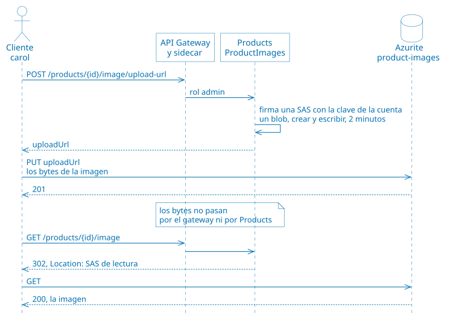

**Código:**

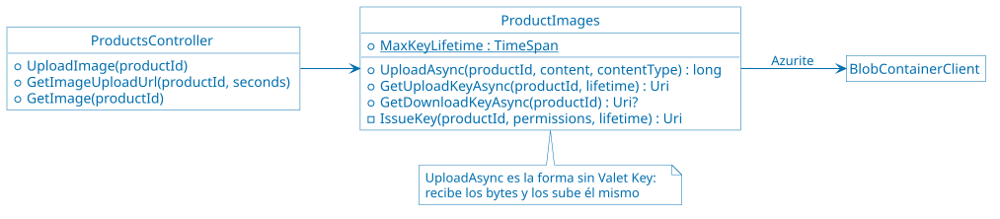

**Cómo verlo:** [demos/21-valet-key.sh](demos/21-valet-key.sh) sube una imagen
de 5 MB a través de `Products`, por HTTP; por HTTPS, el gateway la rechaza con
413. Después carol pide una URL firmada y sube la imagen directamente a
Azurite. Con esa URL no se puede leer la imagen, ni escribir la de otro
`Product`, y sin la firma no se puede nada. Una URL que vence a los 5 segundos
funciona enseguida y no después. Para bajar la imagen, `Products` redirige a
una URL de lectura. En Grafana, el panel "Bytes de imágenes que recibe
Products" muestra los 5 MB de la subida sin Valet Key, y el panel "Claves de
imágenes que entrega Products", las URL firmadas.

> [!TIP]
>
> Consulta [Grant limited access to Azure Storage resources using shared access
> signatures](https://learn.microsoft.com/en-us/azure/storage/common/storage-sas-overview)
> para tener más información sobre las SAS, y [Create a service SAS for a blob
> with .NET](https://learn.microsoft.com/en-us/azure/storage/blobs/sas-service-create-dotnet)
> sobre `GenerateSasUri`, con el que `ProductImages` firma las URL.

## Demos de facilidad de modificación

**Estado: implementada en este repositorio, sobre las demos de seguridad.**

Escenario: la aplicación crece y tiene que cambiar sin detenerse. Hay que operar
en otra región, ajustar su comportamiento sin redesplegar, integrarse con un
sistema legado que no se puede tocar y retirar un monolito de a poco.

Qué se muestra:

* Una copia completa de la aplicación por región, con enrutamiento dirigido.
* Configuración central que se recarga sin reiniciar.
* Un puente de mensajería entre la aplicación y un ERP legado simulado.
* Migración progresiva de rutas desde un monolito.

Resultado observable: una segunda copia que no comparte datos ni fallas con la
primera, cambios de configuración sin reiniciar ningún contenedor, una `Order`
que se factura en un ERP aunque el broker del ERP haya estado caído, y un monolito
que se apaga sin que el cliente lo note.

### Qué agrega a las demos de seguridad

| Componente | Para qué |
| ---------- | -------- |
| [docker-compose.stamps.yaml](docker-compose.stamps.yaml) | Una segunda copia de la aplicación, con los mismos servicios y sus propias bases, RabbitMQ, Redis y Azurite. Se levanta solo para la demo 22. |
| Encabezado `X-Region` | El gateway envía `br` a la segunda copia, y cualquier otro valor a la primera. Responde cuál atendió en `X-Stamp`. Solo en la entrada HTTP. |
| `consul` | El almacén de configuración, con la consola en <http://localhost:8500>. |
| `legacy-broker` | ActiveMQ, el broker del ERP, con la consola en <http://localhost:8161/admin/> -usr: `admin` pwd: `admin`-. |
| `legacy-erp` | Un ERP simulado, en [LegacyErp/Program.cs](src/LegacyErp/Program.cs). |
| `messaging-bridge` | El puente entre RabbitMQ y ActiveMQ, en [MessagingBridge/](src/MessagingBridge). |
| `monolith` | El sistema que se reemplaza, en [Monolith/Program.cs](src/Monolith/Program.cs). |
| Fachada del gateway | `http://localhost:8090`, con la tabla de rutas en [ApiGateway/nginxconf/strangler-routes.conf](src/ApiGateway/nginxconf/strangler-routes.conf). |

### Patrones de facilidad de modificación

Cada patrón tiene un script en [demos/](demos), del `22` al `25`, y un paso a
paso en [commands/05-modifiability.azcli](commands/05-modifiability.azcli). Los
*logs* de Docker muestran los eventos con una etiqueta: `[EXTERNAL CONFIG]` en
los servicios, `[MESSAGING BRIDGE]` en `messaging-bridge` y en
`orders-projector`, `[ERP]` en `legacy-erp` y `[STRANGLER]` en `api-gateway`.

Estas demos no se conectan a ninguna nube: corren con Docker. Cada patrón nombra
los servicios equivalentes de Azure y de AWS. Cómo verlos bajo carga está en
[Antes y después en Grafana](#antes-y-después-en-grafana), y cuánto cuesta cada
cambio, en [Tamaño del cambio](#tamaño-del-cambio).

Ningún patrón hace que una aplicación sea fácil de cambiar en general. Cada uno
apuesta a un tipo de cambio: reduce algunos costos, deja igual a otros y hasta
puede encarecer alguno. Por eso, antes de elegir un patrón hay que preguntarse
qué es probable que cambie: en un escenario de calidad -UT1-, ese cambio es el
estímulo. Cada patrón indica qué cambios anticipa y cuáles no.

#### Deployment Stamps

**Contexto:** una aplicación de software como servicio —SaaS— atiende a muchos
clientes -*tenants*- con la misma aplicación, y al principio un solo despliegue
alcanza para todos. Con el tiempo, esos clientes dejan de ser iguales: están en
otros países, consumen mucho más que el resto o exigen no compartir
infraestructura. Entonces conviene repartirlos entre varias copias de la
aplicación, de modo que cada copia atienda solo a una parte de ellos. Azure
llama a cada copia *stamp* o *scale unit*, y AWS, *cell*. El reparto puede
seguir distintos criterios; esta demo usa la geografía: la aplicación empieza a
operar en Brasil, y esos clientes se atienden en una copia propia, en esa
región. La demo no modela clientes: enruta por región.

**Problema:** en una aplicación SaaS desplegada una sola vez una falla o un mal
despliegue afecta a todos los clientes. Además, cada recurso tiene un límite de
escala, y los datos de un cliente pueden tener que quedar en su región.

**Implementación:** la aplicación se despliega varias veces a partir de la misma
plantilla. Cada copia -un *stamp*- es independiente, con sus propios datos, y un
componente global elige a cuál va cada solicitud.

* **La plantilla:** cada servicio de
  [docker-compose.stamps.yaml](docker-compose.stamps.yaml) extiende al de
  [docker-compose.yaml](docker-compose.yaml) con `extends`. Son las mismas
  imágenes y la misma configuración; solo cambian los nombres con los que las
  piezas de la copia se encuentran.
* **El enrutamiento:** dos tablas `map` de
  [ApiGateway/nginxconf/nginx.conf](src/ApiGateway/nginxconf/nginx.conf) traducen
  `X-Region` al prefijo de los contenedores. Agregar una región es agregar una
  línea a esas tablas y desplegar otra copia.
* **Lo que queda fuera:** el gateway, Keycloak y Consul son globales.
* **Azurite:** cada copia tiene el suyo. El de la segunda copia es el único
  componente con un puerto publicado, el 10001, porque con
  [Valet Key](#valet-key) los clientes le hablan directamente.

En Azure, el enrutamiento global lo haría Azure Front Door, y en AWS, Amazon
CloudFront o Amazon Route 53. La plantilla sería Bicep o AWS CloudFormation.

No es lo mismo que [Geode](https://learn.microsoft.com/en-us/azure/architecture/patterns/geodes):
ahí cualquier copia atiende a cualquier usuario, y acá cada *stamp* atiende solo a
los suyos.

**Cómo funciona:**


**Código:** el enrutamiento, en
[ApiGateway/nginxconf/nginx.conf](src/ApiGateway/nginxconf/nginx.conf):

```nginx
map $http_x_region $stamp_prefix {
    default "";
    br      "stamp-b-";
}

set $orders_service ${stamp_prefix}orders-service:8000;
```

**Cómo verlo:**
[demos/22-deployment-stamps.sh](demos/22-deployment-stamps.sh) despliega la
segunda copia y hace la misma solicitud a cada región. Crea una `Order` en la
región `br`, que solo aparece en esa copia y que procesa su propio *worker*. Sube
una imagen a la región `br`: esa región responde `302 Found` y la otra,
`404 Not Found`. Después hace fallar a `Products` en la región `br`, y la otra
sigue respondiendo. Al terminar, elimina la copia con sus datos.

**Qué cambios anticipa:**

| Cambio | ¿Lo anticipa? | Qué implica |
| ------ | ------------- | ----------- |
| Agregar una región o un grupo de clientes | Sí | Dos líneas en `nginx.conf` y otra copia de la plantilla |
| Dedicarle una copia a un cliente | En parte | La plantilla sirve, pero la demo enruta por región: faltaría la tabla de cliente a *stamp* |
| Mover un cliente a otro *stamp* | No | Hay que migrar sus datos sin cortar el servicio |
| Cambiar la lógica o el esquema de un servicio | No | El patrón lo encarece: hay que aplicarlo en cada copia |
| Agregar una consulta que cruce regiones | No | Los datos de una copia no se ven desde otra: hay que consultar cada una y reunir los resultados |
| Cambiar el gateway, Keycloak o Consul | No | Son globales: el cambio alcanza a todas las copias a la vez |

**Ventajas y desventajas:**

| Decisión | Una opción | La otra |
| -------- | ---------- | ------- |
| Cómo se despliega | Una sola vez, escalando: más simple y barato, pero con mayor radio de explosión y sujeto a los límites de cada recurso | *Stamps*: fallas acotadas, escala por unidades y residencia de datos, a cambio de más costo y operación, y consultas globales difíciles |
| Dónde va cada recurso | Global: una sola fuente de verdad y menos costo, pero es un punto de falla común | Por *stamp*: aislamiento, a cambio de más piezas y de datos que no se ven entre copias |
| Qué pasa con cada cliente | Asignación fija: simple, pero un *stamp* puede quedar desbalanceado | Se lo puede mover de *stamp*: mejor balance, pero hay que migrar sus datos sin cortar el servicio |

En esta demo, el gateway global es el punto débil: si se cae, se caen todas las
copias. En producción, ese componente es un servicio con alta disponibilidad
propia.

**Multi-tenancy:** cómo compartir la aplicación entre *tenants* es una decisión
distinta, aunque relacionada: dentro de un *stamp* puede haber un cliente o miles.
No se implementa en la demo y no es parte del programa de la UT4, pero es la
pregunta que aparece enseguida al elegir cómo aislar los datos. Los modelos, de
menor a mayor aislamiento:

| Modelo | Aislamiento | Costo por cliente | Se usa cuando |
| ------ | ----------- | ----------------- | -------------- |
| Base compartida, con una columna de cliente | Lógico: un filtro olvidado expone datos de otro cliente; se mitiga con seguridad a nivel de fila | El más bajo | Muchos clientes chicos |
| Un esquema por cliente | Medio: hay que aplicar cada migración en todos los esquemas | Bajo | Clientes medianos, en cantidad acotada |
| Una base por cliente | Alto: respaldo y restauración por cliente | Medio | Hay requisitos de aislamiento o de cumplimiento |
| Un *stamp* por cliente | Total: tampoco hay vecino ruidoso | El más alto | Clientes grandes o regulados |
| Mixto | *Stamps* compartidos para la mayoría y dedicados para algunos | Variable | Es lo más frecuente en SaaS; el enrutador necesita una tabla de cliente a *stamp* |

La demo enruta por región, pero por cliente sería igual: el gateway buscaría el
*stamp* en esa tabla, a partir de un claim del token o del subdominio.

> [!TIP]
>
> Consulta [Deployment Stamps
> pattern](https://learn.microsoft.com/en-us/azure/architecture/patterns/deployment-stamp)
> para tener más información sobre el patrón, [Architect multitenant solutions on
> Azure](https://learn.microsoft.com/en-us/azure/architecture/guide/multitenant/overview)
> y [Tenancy models for a multitenant
> solution](https://learn.microsoft.com/en-us/azure/architecture/guide/multitenant/considerations/tenancy-models)
> sobre multi-tenancy, y [Architectural approaches for governance and compliance in
> multitenant solutions](https://learn.microsoft.com/en-us/azure/architecture/guide/multitenant/approaches/governance-compliance)
> sobre la residencia de datos. En AWS, consulta [Reducing the Scope of Impact with
> Cell-Based Architecture](https://docs.aws.amazon.com/wellarchitected/latest/reducing-scope-of-impact-with-cell-based-architecture/reducing-scope-of-impact-with-cell-based-architecture.html)
> para el patrón equivalente, y [Guidance for Multi-Tenant Architectures on
> AWS](https://docs.aws.amazon.com/solutions/multi-tenant-architectures-on-aws/)
> sobre multi-tenancy.

#### External Configuration Store

**Problema:** si la configuración está en la imagen o en las variables de entorno
de cada contenedor, cambiar un límite obliga a redesplegar, cada réplica puede
quedar con un valor distinto y nadie ve la configuración completa en un solo lugar.

**Qué es Consul:** una herramienta de HashiCorp para coordinar servicios en
sistemas distribuidos. Ofrece descubrimiento de servicios, chequeos de salud, un
almacén clave-valor y una *service mesh*. Esta demo usa solo el almacén clave-valor
-KV-, con una API HTTP y una consola web en <http://localhost:8500>:

```bash
# Guarda un valor. Para la aplicación, es Orders:MaxQuantity
curl -X PUT http://localhost:8500/v1/kv/andis/Orders/MaxQuantity -d 3
```

Para la demo local se eligió Consul porque corre en un contenedor, sin cuentas
ni credenciales, y tiene consola para mostrar los valores en clase.

**Implementación:** el almacén es una fuente más de `IConfiguration`, en
[Common/ExternalConfiguration.cs](src/Common/ExternalConfiguration.cs):

* El método `AddExternalConfiguration` de la clase
  `ExternalConfigurationExtensions` agrega al almacén como la última fuente:
  gana sobre `appsettings.json` y las variables de entorno, que quedan como
  valores por defecto.
* La clase `ConsulConfigurationPoller` llama cada 2 segundos al método
  `RefreshAsync` de la clase `ConsulConfigurationProvider`.
* Si Consul no responde, se siguen usando los últimos valores. Un proceso que
  arranca con Consul caído usa sus valores por defecto.

El código que usa la configuración no sabe de dónde viene el valor, pero tiene
que leerla en cada uso, y no guardarla al arrancar. Los valores de la demo:

| Clave en Consul | Quién la usa | Para qué |
| --------------- | ------------ | -------- |
| `andis/Orders/MaxQuantity` | El método `CreateOrder` de la clase `OrdersController` | Límite: cuántas unidades de un `Product` se pueden pedir en una `Order`. Sin valor, no hay límite |
| `andis/Features/ProductPrices` | El método `GetOrdersForUser` de la clase `OrdersController` | Feature flag: si el detalle de las `Orders` de un `User` muestra el precio unitario. Sin valor, no lo muestra |
| `andis/Products/CacheTtlSeconds` | El método `GetOrLoadAsync` de la clase `ProductCache` | Un valor de otro servicio: cuántos segundos dura un `Product` en la caché de Redis |
| `andis/ProductsService/BaseUrl` | El `HttpClient` de `Products`, en [OrdersService/Program.cs](src/OrdersService/Program.cs) | Una URL: la dirección con la que `Orders` llama a `Products`. Sirve para mover una dependencia sin tocar la imagen |

**Cómo funciona:**


**Código:**


**Cómo verlo:**
[demos/23-external-configuration-store.sh](demos/23-external-configuration-store.sh)
cambia cada valor de la tabla en Consul y muestra el efecto: una `Order` de 10
unidades pasa de `202 Accepted` a `400 Bad Request`, el detalle gana una columna de
precio, la caché dura 5 segundos y `Orders` deja de llegar a `Products` y vuelve.
Después pausa Consul, y el límite sigue vigente. Al final muestra que cada proceso
se enteró del cambio por su cuenta y que ningún contenedor se reinició.

**Qué cambios anticipa:**

| Cambio | ¿Lo anticipa? | Qué implica |
| ------ | ------------- | ----------- |
| Cambiar un límite, una duración o una URL que ya tiene clave | Sí | Un valor en Consul, sin reiniciar |
| Prender o apagar una *feature* cuyo código ya está | Sí | Un valor en Consul |
| Volver configurable un valor nuevo | No | Hay que cambiar el código para que lo lea, y redesplegar |
| Agregar un comportamiento que no estaba previsto | No | Es un cambio de código: el almacén elige entre lo que ya existe |
| Cambiar un valor junto con una versión del código | No | El valor y la imagen no se despliegan juntos: un valor nuevo con una imagen vieja puede romper |

**Ventajas y desventajas:**

| Decisión | Una opción | La otra |
| -------- | ---------- | ------- |
| Dónde está la configuración | Variables de entorno: sin componentes nuevos y con el valor versionado junto al despliegue, pero cambiarla exige reiniciar | Almacén central: cambios en vivo y un solo lugar, a cambio de otro componente, y de que un error se propaga enseguida a todos |
| Cómo se entera cada proceso | *Polling*: simple y fácil de seguir, con hasta 2 segundos de demora y consultas sin novedades | Notificaciones o consultas bloqueantes de Consul: enseguida y sin consultas de más, pero con conexiones abiertas y más código |

El almacén de la demo no guarda secretos: para eso están Azure Key Vault y AWS
Secrets Manager, con control de acceso y auditoría.

> [!TIP]
>
> Consulta [External Configuration Store
> pattern](https://learn.microsoft.com/en-us/azure/architecture/patterns/external-configuration-store)
> para tener más información sobre el patrón, y la [documentación de
> Consul](https://developer.hashicorp.com/consul/docs) sobre el almacén
> clave-valor.

#### Messaging Bridge

**Problema:** dos sistemas usan infraestructuras de mensajería distintas y no se
pueden cambiar. Integrarlos por HTTP obliga a modificar a los dos, los acopla en
el tiempo y hay que construir los reintentos a mano.

**Qué es ActiveMQ:** un broker de mensajes de código abierto de Apache
Foundation, escrito en Java. Es un intermediario que recibe mensajes, los guarda
y los entrega, para que quien envía y quien recibe no tengan que estar
disponibles al mismo tiempo. Implementa JMS, la API estándar de mensajería de
Java, y por eso es común en sistemas corporativos antiguos. Tiene dos variantes:
Classic, la que usa la demo, y Artemis, la de nueva generación.

* **Colas y tópicos:** el mensaje de una cola lo recibe un solo consumidor, y el
  de un tópico todos los suscriptores. La demo usa colas.
* **Confirmaciones:** si el consumidor no confirma un mensaje, el broker lo
  vuelve a entregar.
* **Persistencia:** los mensajes persistentes se guardan en disco y sobreviven a
  un reinicio del broker.
* **Protocolos:** el nativo es OpenWire, y también admite AMQP, STOMP y MQTT.
* **Clientes:** desde .NET se usa Apache NMS.

Un envío, en el método `SendToErpAsync` de la clase `OrdersToErpBridge`:

```csharp
var connection = await _legacyBroker.GetConnectionAsync();
using var session = await connection.CreateSessionAsync();
using var queue = await session.GetQueueAsync(LegacyBroker.OrdersQueue);
using var producer = await session.CreateProducerAsync(queue);
producer.DeliveryMode = MsgDeliveryMode.Persistent;
await producer.SendAsync(await session.CreateTextMessageAsync(record));
```

La consola, en <http://localhost:8161/admin/> -usr: `admin` pwd: `admin`-,
muestra las colas y sus mensajes.

| | RabbitMQ | ActiveMQ Classic |
| - | -------- | ---------------- |
| Ecosistema | Erlang, muchos lenguajes | Java, JMS |
| Protocolo nativo | AMQP 0-9-1 | OpenWire |
| Modelo | Se publica a un exchange, que enruta a las colas | Se publica directamente a una cola o a un tópico |
| En la demo | La mensajería de la aplicación | La mensajería del ERP |

Ninguno es mejor por sí mismo. La demo necesita dos brokers porque el patrón
existe para conectar infraestructuras incompatibles: con uno solo no habría nada
que puentear. En Azure, el lado moderno sería Azure Service Bus, y en AWS,
Amazon SQS; Amazon MQ ofrece ActiveMQ administrado.

**El ERP simulado:** [LegacyErp/Program.cs](src/LegacyErp/Program.cs) representa
el sistema que no se puede cambiar. Simula la creación de una factura para cada
orden de compra. No conoce RabbitMQ, ni JSON, ni la aplicación, y no comparte
código con ella: solo sabe leer pedidos de la cola `ERP.PEDIDOS` de ActiveMQ y
escribir facturas en la cola `ERP.FACTURAS`. El método `ExecuteAsync` de la
clase `Erp` repite este ciclo:

1. Espera un mensaje en `ERP.PEDIDOS`.
2. Valida que sea un registro de orden de pedido.
3. Arma la factura con el número de orden, un número de factura y la fecha.
4. Envía la factura a `ERP.FACTURAS`.

Tres detalles del ciclo:

* **Consumidor suscripto:** no consulta la cola cada tanto. El broker le entrega
  cada mensaje en cuanto llega, y la espera de 1 segundo solo sirve para revisar
  si el servicio se está deteniendo.
* **Transacción:** el pedido se consume y la factura se envía juntos, o nada. Si
  el ERP se cae en el medio, el broker vuelve a entregar el pedido.
* **Registros inválidos:** solo se registra un aviso y el mensaje se descarta,
  sin reintentos ni cola de errores.

**Implementación:** el único componente que conoce los dos brokers es
`messaging-bridge`:

* **De RabbitMQ a ActiveMQ:** la clase `OrdersToErpBridge`, en
  [MessagingBridge/OrdersToErpBridge.cs](src/MessagingBridge/OrdersToErpBridge.cs),
  es un suscriptor más de `order.confirmed`, con su cola `bridge.erp`. `Orders` no
  sabe que existe.
* **De ActiveMQ a RabbitMQ:** la clase `ErpToOrdersBridge`, en
  [MessagingBridge/ErpToOrdersBridge.cs](src/MessagingBridge/ErpToOrdersBridge.cs),
  lee las facturas y publica `order.invoiced`. El método `ApplyAsync` de la clase
  `OrderDetailsProjector` la agrega al historial de la `Order`.
* **Entrega al menos una vez:** el puente confirma en un broker recién después de
  que el otro recibió. Si un lado no está, los mensajes esperan. Si el puente se cae
  en el medio, el mensaje se repite: el ERP emite la misma factura, porque su número
  sale del pedido, y `Orders` no la registra dos veces.

`Orders` cambió en dos cosas, aunque el patrón busca no tocar los sistemas: el
evento `OrderConfirmed` suma campos opcionales con los datos de la `Order`, y
`OrderDetailsProjector` registra la factura. El ERP, en cambio, no cambió.

**Puente y traductor:** en el catálogo de Azure, el puente reenvía los mensajes sin
cambiar su contenido. Acá los sistemas además hablan formatos distintos: JSON y
registros de ancho fijo. Esa traducción es otro patrón, Message Translator, de
*Enterprise Integration Patterns*, ajeno al programa de la UT4. Por eso está
aparte, en la clase `ErpFormat`, en
[MessagingBridge/ErpFormat.cs](src/MessagingBridge/ErpFormat.cs): las clases que
reenvían no conocen los formatos.

```text
PEDIDO  00000000040000000260f7c2b5e1d3c2a1b8e4d12400001
FACTURA 0000000004F0000000004 20261105
```

**Cómo funciona:**


**Código:**

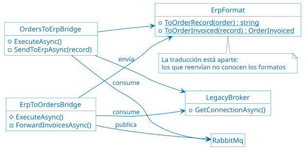

**Cómo verlo:**
[demos/24-messaging-bridge.sh](demos/24-messaging-bridge.sh) crea una `Order` para
el `User` 2 y muestra su historial con `OrderInvoiced`, y el registro de ancho fijo
que pasó por el puente. Después detiene ActiveMQ y crea otra `Order`: se confirma
igual, y su mensaje espera en la cola `bridge.erp`. Cuando ActiveMQ vuelve, el
mensaje se entrega y la `Order` se factura.

**Qué cambios anticipa:**

| Cambio | ¿Lo anticipa? | Qué implica |
| ------ | ------------- | ----------- |
| Cambiar el formato de los registros del ERP | Sí | Solo la clase `ErpFormat` |
| Reemplazar ActiveMQ por otro broker | Sí | Solo `messaging-bridge`; `Orders` no se entera |
| Cambiar el flujo interno de `Orders` | Sí | El ERP no se entera, mientras `Orders` siga publicando `order.confirmed` |
| Reenviar otro evento | En parte | Otro suscriptor en el puente, sin tocar a quien lo publica, pero el ERP tiene que entenderlo |
| Enviarle al ERP un dato que el evento no trae | No | Hay que cambiar el evento y a `Orders`: ya pasó con `OrderConfirmed` |
| Necesitar una respuesta inmediata del ERP | No | El puente es asíncrono: haría falta otra integración |

**Ventajas y desventajas:**

| Alternativa | A favor | En contra |
| ----------- | ------- | ---------- |
| Puente | No cambia a los sistemas, tolera caídas y permite migrar de a poco | Un componente más, sin *features* que no existan en los dos brokers, y duplicados que hay que tolerar. El de la demo es una sola instancia |
| Integración directa por HTTP | Sin componentes nuevos, respuesta inmediata | Hay que modificar los dos sistemas, los acopla en el tiempo y los reintentos son a mano |
| Cambiar el ERP para que use RabbitMQ | Una sola infraestructura | Muchas veces es imposible, y siempre es lo más caro y riesgoso |

> [!TIP]
>
> Consulta [Messaging Bridge
> pattern](https://learn.microsoft.com/en-us/azure/architecture/patterns/messaging-bridge)
> para tener más información sobre el patrón, la [documentación de ActiveMQ
> Classic](https://activemq.apache.org/components/classic/documentation) sobre el
> broker, y [Message
> Translator](https://www.enterpriseintegrationpatterns.com/patterns/messaging/MessageTranslator.html)
> sobre la traducción.

#### Strangler Fig

**Problema:** reemplazar un monolito de una sola vez es riesgoso: el sistema
viejo sigue cambiando mientras se escribe el nuevo, todo el riesgo se concentra
en el día de la migración, y no hay valor hasta el final.

**El monolito simulado:** [Monolith/Program.cs](src/Monolith/Program.cs)
representa lo que la aplicación habría sido antes de separarse en servicios: un
solo proceso y una sola base, sin patrones. Ofrece las mismas rutas de los
microservicios que usa la demo, con los mismos contratos, para que el cliente no
note quién le responde:

| Datos | Qué se puede hacer |
| ----- | ------------------ |
| `Users` | Consultar y modificar usuarios, por SOAP, con la interfaz `IUserService` |
| `Products` | Listar, consultar uno y modificar el nombre y el precio de un producto |
| `Orders` | Listar, crear y consultar el detalle de las órdenes de pedido de un `User` |

Tres detalles que lo diferencian de los microservicios:

* **Una sola base:** un archivo SQLite dentro del contenedor, con los mismos
  datos iniciales que los microservicios. Al recrear el contenedor, vuelve a ese
  estado.
* **El detalle de las `Orders`:** es un JOIN entre tres tablas. Esa es la
  comodidad que se pierde al separar los datos, y por la que `Orders` llama a
  `Users` y a `Products` por HTTP en los microservicios.
* **Crear una `Order`:** se crea y se confirma en una sola transacción, sin
  colas ni *workers*.

**Implementación:** una fachada recibe todas las solicitudes y desvía cada ruta
al monolito o al servicio que la reemplaza. El nombre del patrón viene de la
higuera estranguladora, que crece alrededor de un árbol hasta reemplazarlo.

* **La fachada:** un tercer `server` de
  [ApiGateway/nginxconf/nginx.conf](src/ApiGateway/nginxconf/nginx.conf), en el
  puerto 8090. Responde quién atendió en `X-Served-By`.
* **La tabla de rutas:**
  [ApiGateway/nginxconf/strangler-routes.conf](src/ApiGateway/nginxconf/strangler-routes.conf).
  Migrar una ruta es cambiar una línea y recargar nginx, sin cortar el servicio.
  Volver atrás es lo mismo.

En Azure, la fachada podría ser Azure API Management o Azure Front Door, y en
AWS, Amazon API Gateway.

**Cómo funciona:**


**Código:** la tabla de rutas al principio, en
[ApiGateway/nginxconf/strangler-routes.conf](src/ApiGateway/nginxconf/strangler-routes.conf):

```nginx
set $users_route    monolith:8000;
set $products_route monolith:8000;
set $orders_route   monolith:8000;
```

**Cómo verlo:** [demos/25-strangler-fig.sh](demos/25-strangler-fig.sh) hace las
mismas solicitudes mientras migra `Products`, `Users` y `Orders`, de a una, y
muestra quién atiende cada ruta. A mitad de camino cambia el nombre de un `Product`
por la fachada: lo recibe el microservicio, y el JOIN del monolito sigue mostrando
el nombre viejo. Es el costo de la convivencia. Al final apaga el monolito, y las
solicitudes siguen respondiendo. Al terminar, deja la fachada como estaba.

**Qué cambios anticipa:**

| Cambio | ¿Lo anticipa? | Qué implica |
| ------ | ------------- | ----------- |
| Migrar una ruta completa, o volverla atrás | Sí | Una línea en la tabla de rutas |
| Apagar el monolito | Sí | Nada, cuando ya no le quedan rutas |
| Migrar solo una parte de una ruta | En parte | Una entrada nueva en la tabla y otro `location` en la fachada |
| Cambiar el contrato de una ruta | No | La fachada no traduce: los clientes lo notan |
| Cambiar un dato que los dos sistemas leen | No | Los datos divergen hasta resolver la sincronización |

A diferencia de los otros tres, este patrón anticipa un solo cambio: reemplazar el
monolito. Cuando termina, la fachada y su tabla de rutas ya no hacen falta.

**Ventajas y desventajas:**

| Alternativa | A favor | En contra |
| ----------- | ------- | ---------- |
| Migración progresiva | Riesgo acotado por ruta, marcha atrás inmediata y valor desde la primera ruta | Dos sistemas conviviendo, datos que hay que sincronizar y una fachada que es un punto de falla |
| Reescritura completa | Sin convivencia ni sincronización | Todo el riesgo junto, sin valor hasta el final, y el sistema viejo sigue cambiando mientras tanto |

La demo no sincroniza los datos: los dos sistemas arrancan con los mismos, y por eso
responden igual a las consultas. Tampoco es igual todo el comportamiento: el
monolito confirma la `Order` al crearla, y `Orders` lo hace después.

**Cómo resolver la divergencia de datos:** en la demo, el nombre de un `Product`
cambia en MongoDB, y el JOIN del monolito sigue leyendo su copia en SQLite. La
regla de fondo es que cada dato tenga un solo dueño en cada momento: quien lo
escribe. Las demás copias son de lectura y se actualizan desde ese dueño. Las
formas de lograrlo, de más simple a más invasiva para el monolito:

| Solución | Cómo funciona | A favor | En contra |
| -------- | ------------- | ------- | ---------- |
| El monolito le pregunta al servicio | Al migrar `Products`, el monolito deja de leer su tabla y llama a `Products` por HTTP | No hay copia, así que no hay divergencia | Hay que cambiar el monolito, se pierde el JOIN, y depende de que `Products` responda |
| Base compartida durante la transición | El servicio nuevo usa la base del monolito, y se separa después | No hay divergencia y se migra primero el código | Acopla el servicio al esquema del monolito, y la separación queda pendiente |
| Sincronización con eventos | El monolito se suscribe a `product.updated` y actualiza su copia | Reutiliza la mensajería, y `Products` no conoce al monolito | Hay que cambiar el monolito, y la consistencia es eventual |
| Captura de cambios | Una herramienta como Debezium lee el log de la base del dueño y aplica los cambios en la otra | No cambia el código del sistema de origen | Otra infraestructura que operar, y hay que traducir entre esquemas |
| Escritura doble | Cada escritura va a las dos bases | Parece lo más simple | Si falla la segunda escritura, las bases divergen sin aviso; no se recomienda sin un [Transactional Outbox](#transactional-outbox) |

Para esta aplicación, la opción con mejor relación entre costo y resultado es
sincronizar con eventos: `Products` ya publica `product.updated`, y al monolito le
alcanzaría un consumidor con su propia cola. Habría que ampliar el evento, porque
hoy trae el nombre pero no el precio.

El dato también cambia de dueño en algún momento. Una secuencia habitual:

1. Copiar los datos históricos a la base nueva.
2. Sincronizar los cambios del monolito hacia el servicio, que todavía es solo de
   lectura.
3. Comparar las respuestas de los dos: la fachada envía las lecturas a ambos, y
   solo devuelve la del monolito.
4. Pasar las escrituras al servicio, que se vuelve el dueño, e invertir la
   sincronización mientras el monolito siga leyendo ese dato.
5. Retirar la sincronización y la tabla del monolito.

Los identificadores requieren un cuidado aparte. Si `Orders` y el monolito crean
`Orders` a la vez, los dos generan el mismo id para `Orders` distintas: hay que
reservar rangos distintos o usar identificadores globales, como un UUID.

En producción, Azure Database Migration Service y AWS Database Migration Service
hacen la copia inicial y la replicación continua de los cambios.

> [!TIP]
>
> Consulta [Strangler Fig
> pattern](https://learn.microsoft.com/en-us/azure/architecture/patterns/strangler-fig)
> para tener más información sobre el patrón, y [Strangler Fig
> Application](https://martinfowler.com/bliki/StranglerFigApplication.html), de
> Martin Fowler, sobre el origen del nombre, y la [documentación de
> Debezium](https://debezium.io/documentation/) sobre la captura de cambios.

### Antes y después en Grafana

El beneficio de estos patrones se ve en lo que no pasa: no hay errores, cortes ni
reinicios. Para mostrarlo, [demos/load-modifiability.sh](demos/load-modifiability.sh)
lanza un escenario de k6 y hace los cambios mientras corre. Cada cambio queda
marcado con una línea vertical en el dashboard, con una anotación de Grafana,
para distinguir el antes y el después. Los scripts del `22` al `25` también marcan
sus pasos si Grafana está levantado.

```bash
docker compose --profile observability up -d --wait
./demos/load-modifiability.sh strangler   # también: config, bridge, stamps
```

Los paneles están en la fila "Facilidad de modificación: antes y después". Estos
resultados son de una corrida en una sola máquina, con pocas solicitudes por
segundo: ilustran el efecto y no son una prueba de rendimiento.

| Patrón | Qué se hace | Qué mirar | Resultado |
| ------ | ----------- | --------- | --------- |
| Strangler Fig | Se migran las tres rutas y se apaga el monolito, con 15 solicitudes por segundo | "Solicitudes de la fachada, por destino" y "Respuestas de la fachada con error" | 1051 solicitudes, sin errores. El tráfico del monolito llega a cero |
| Strangler Fig | Lo mismo | "Latencia p95 del detalle, por destino" | Sube de unos 8 ms a unos 18 ms: el costo de reemplazar el JOIN por llamadas HTTP |
| Messaging Bridge | Se detiene ActiveMQ durante unos 30 segundos, con 2 `Orders` por segundo | "Cola bridge.erp" y "Orders confirmadas por segundo" | La cola llega a 89 mensajes y vuelve a cero. Las 161 `Orders` se aceptaron, y se siguieron confirmando durante la caída |
| Deployment Stamps | `Products` falla con un despliegue, y después con dos copias | "Respuestas por grupo de clientes" | Con un despliegue, fallan los dos grupos. Con dos copias, solo el de esa copia: el grupo `br` no recibe ningún `503 Service Unavailable` |
| External Configuration Store | El mismo límite, por variable de entorno y en el almacén, con 22 solicitudes por segundo | "Solicitudes a Orders por resultado" | Las dos formas pasan de `202 Accepted` a `400 Bad Request`. Con la variable de entorno se perdieron 24 solicitudes de 2531, en los dos momentos en que se recreó el contenedor; con el almacén, ninguna |

Las métricas que dependen de quién respondió las informa k6 con los encabezados
`X-Served-By` y `X-Stamp`, para no tener que instrumentar nginx ni recolectar
métricas de la segunda copia.

### Tamaño del cambio

Grafana muestra el efecto de un cambio en ejecución, pero la facilidad de
modificación se mide con otra pregunta: cuánto cuesta hacer el cambio. En un
escenario de calidad -UT1-, esa es la medida de respuesta. Los números salen de
[demos/measure-change-size.sh](demos/measure-change-size.sh), que se puede volver a
ejecutar:

```bash
./demos/measure-change-size.sh
```

Se separan dos costos, porque un patrón se paga una vez y se aprovecha muchas.

**Costo de introducir cada patrón:**

| Patrón | Archivos nuevos | Líneas nuevas | Líneas en archivos existentes | Total |
| ------ | --------------- | ------------- | ----------------------------- | ----- |
| Deployment Stamps | 1 | 99 | 15 | 114 |
| External Configuration Store | 1 | 130 | 52 | 182 |
| Messaging Bridge | 10 | 310 | 50 | 360 |
| Strangler Fig | 4 | 140 | 29 | 169 |

Cómo se calcula:

* **Línea efectiva:** una línea que no está vacía ni es un comentario, es decir, que
  no empieza con `//` o `#`. Los comentarios de este repositorio son extensos y
  distorsionarían la comparación.
* **Qué se cuenta:** código C#, proyectos, `Dockerfile`, YAML de Docker Compose y
  configuración de nginx. No se cuentan la documentación, los diagramas, los
  scripts de `demos/`, los escenarios de `k6/`, el dashboard ni el archivo `.sln`:
  son parte de la demostración, no de la aplicación.
* **Líneas nuevas:** las líneas efectivas de los archivos que el patrón agrega.
* **Líneas en archivos existentes:** las agregadas más las borradas según `git diff`
  contra el commit `3a02c77`, el último sin estos patrones. Una línea modificada
  cuenta dos veces, como una borrada y una agregada.
* **Archivos compartidos:** `docker-compose.yaml` y `nginx.conf` los tocan varios
  patrones, y cada línea se le asigna al patrón al que pertenece: por el servicio
  en `docker-compose.yaml`, y por el bloque en `nginx.conf`. El script verifica que
  lo repartido sume lo que dice `git`: 85 líneas en ambos casos. Los archivos de
  `Orders` y `Products` también se reparten, por su contenido.
* **Qué incluye de más:** el proveedor de configuración incluye su métrica para Grafana. El
  ERP simulado y el monolito cuentan aunque representan sistemas que ya existirían:
  en un caso real, el costo del puente sería solo el de `MessagingBridge`.

**Costo de cada cambio posterior:**

| Cambio | Líneas | Contenedores reiniciados | Demora |
| ------ | ------ | ------------------------ | ------ |
| Cambiar un límite en el almacén | 0 | 0 | 1,0 a 2,2 s |
| Cambiar un límite en una variable de entorno | 1 | 1 | 1,3 a 1,7 s |
| Migrar una ruta del monolito | 1 | 0 | 1,4 s |
| Agregar una región | 101 | 0, y 11 contenedores nuevos | 16,8 a 21,7 s |

Cómo se calcula:

* **Líneas:** las que hay que escribir para hacer el cambio. Agregar una región son
  las 2 líneas de las tablas de `nginx.conf` más una copia de
  `docker-compose.stamps.yaml` con otro prefijo: 99 líneas repetidas de una
  plantilla, que una herramienta generaría.
* **Contenedores reiniciados:** se compara la hora de arranque de cada contenedor
  antes y después del cambio.
* **Demora:** desde que se aplica el cambio hasta que se observa su efecto. Para el
  límite, hasta que una `Order` de 10 unidades responde `400 Bad Request`,
  consultando cada 0,2 segundos; para la ruta, hasta que `X-Served-By` cambia; para
  la región, hasta que `docker compose up --wait` termina. Es el rango de tres ejecuciones, con las
  imágenes ya construidas.

Cómo leerlo:

* **La demora no es la diferencia:** cambiar un límite tarda lo mismo por las dos
  vías, porque recrear este contenedor es rápido. La diferencia está en los
  reinicios: la variable de entorno corta el servicio y pierde el estado en memoria
  de `Orders`, como los interruptores de los patrones.
* **El almacén tampoco es gratis:** la variable de entorno queda versionada en el
  repositorio, y el cambio en el almacén no.
* **Una línea no es una unidad de esfuerzo:** estas medidas sirven para comparar
  alternativas en esta aplicación, no para estimar. No miden la dificultad de
  diseñar el cambio ni de probarlo, y migrar una ruta de una línea presupone el
  trabajo previo de escribir el servicio y resolver sus datos.
* **Falta una alternativa real:** no hay una aplicación equivalente sin los patrones
  con la cual comparar cada cambio. Salvo el límite, que se midió de las dos
  formas, los números describen el cambio con el patrón.
* **Solo se miden cambios anticipados:** cada fila es un cambio para el que hay un
  patrón. Los que un patrón no anticipa cuestan lo mismo que antes, o más: una
  regla nueva en `Orders`, con dos *stamps*, hay que desplegarla dos veces.

## Demos de facilidad de despliegue

Escenario: publicar una nueva versión de un servicio, por ejemplo `Products`,
con riesgo controlado y medir su impacto.

Qué se muestra:

* Dos entornos vivos y conmutación inmediata.
* Reemplazo de instancias por lotes.
* Una fracción del tráfico derivada a la versión nueva.
* Experimentos por segmento de usuarios.

Patrones y estrategias cubiertos:

* **Arquitectura de microservicios**: el estilo común sobre el que se apoyan
  todas las demos.
* **Blue/Green Deployment**: dos versiones de `Products` detrás del gateway, con
  cambio y *rollback* inmediatos.
* **Rolling Upgrade**: varias réplicas que se reemplazan por lotes, verificando
  su salud.
* **Canary Testing**: entre 1 % y 10 % del tráfico a la versión nueva, por
  ejemplo con `split_clients` de nginx.
* **A/B Testing**: segmentos por usuario, con cookie o encabezado, y comparación
  de métricas.

Resultado observable: despliegues frecuentes con impacto acotado y decisiones
basadas en métricas.

## Cobertura

| Categoría | Patrones | Demo |
| --------- | -------- | ---- |
| Disponibilidad | Bulkhead, Circuit Breaker, Competing Consumers, Event Sourcing, Health Endpoint Monitoring, Rate Limiting, Retry, Throttling, Transactional Outbox | 1 |
| Rendimiento | Cache-Aside, Queue-Based Load Leveling, Competing Consumers, Publisher/Subscriber, Asynchronous Request-Reply, CQRS, Materialized View | 2 |
| Seguridad | Gatekeeper, Federated Identity, Gateway Offloading, Sidecar, Valet Key | 3 |
| Modificabilidad y despliegue | Deployment Stamps, External Configuration Store, Messaging Bridge, Strangler Fig | 4 |
| Modificabilidad y despliegue: estrategias de lanzamiento | Arquitectura de microservicios, Blue/Green, Rolling Upgrade, Canary Testing, A/B Testing | 5 |
