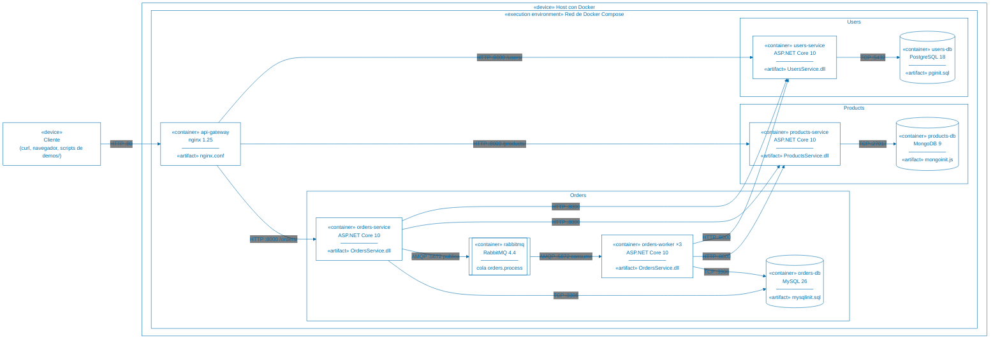

<!-- markdownlint-disable-next-line MD033 MD041 -->


# Universidad Católica del Uruguay

## Análisis y diseño de aplicaciones II

# Demo de patrones de arquitectura en una arquitectura de microservicios

Esta demo es la aplicación base de la UT4, una pequeña aplicación de comercio
electrónico, con los patrones de resiliencia y disponibilidad de la Demo 1
implementados.

También es la demo de la [arquitectura de microservicios](ARCHITECTURE.md) en la
UT5.

El panorama de las cinco demos y la explicación de cada patrón de esta demo
están en [PATTERNS.md](PATTERNS.md).

## Descripción

La aplicación tiene tres servicios de dominio, cada uno con su propia base de
datos, detrás de un API Gateway. Las `Orders` se procesan en segundo plano por
varias réplicas de un *worker* que consumen una cola de RabbitMQ.

| Componente | Responsabilidad | Tecnología | Puerto en el host |
| ---------- | --------------- | ---------- | ----------------- |
| `api-gateway` | Punto de entrada único; enruta `/users/`, `/products/` y `/orders/` a cada servicio; aplica Throttling por cliente a `POST /orders/` | nginx 1.25 | 80 |
| `users-service` | Alta y consulta de [`Users`](UsersService/Models/Users.cs) | ASP.NET Core 10 + EF Core | 8002 |
| `products-service` | Catálogo de [`Products`](ProductsService/Models/Product.cs) | ASP.NET Core 10 + MongoDB Driver | 8001 |
| `orders-service` | Alta y consulta de [`Orders`](OrdersService/Models/Order.cs); arma el detalle de las `Orders` de un `User` consultando a `Users` y `Products` por HTTP; publica las `Orders` nuevas en la cola | ASP.NET Core 10 + EF Core | 8000 |
| `orders-worker` ×3 | Consume la cola y confirma o rechaza cada `Order`; es la misma imagen que `orders-service` con el *worker* habilitado | ASP.NET Core 10 + RabbitMQ.Client | — |
| `rabbitmq` | Cola `orders.process` | RabbitMQ 4.4 | 5672, 15672 consola |
| `users-db` | Datos de `Users` | PostgreSQL 18 | 5432 |
| `products-db` | Datos de `Products` | MongoDB 9 | 27017 |
| `orders-db` | `Orders` y sus eventos | MySQL 26 | 3306 |

Endpoints disponibles a través del gateway, en `http://localhost`:

| Método | Ruta | Descripción |
| ------ | ---- | ----------- |
| `GET` | `/users/` | Lista los `Users` |
| `GET` | `/users/{id}` | Obtiene un [`User`](UsersService/Models/Users.cs) |
| `POST` | `/users/` | Crea un `User` |
| `GET` | `/products/` | Lista los `Products` |
| `GET` | `/products/{id}` | Obtiene un [`Product`](ProductsService/Models/Product.cs) |
| `POST` | `/products/` | Crea un `Product` |
| `GET` | `/orders/` | Lista las `Orders` con su estado |
| `GET` | `/orders/{id}` | Obtiene una [`Order`](OrdersService/Models/Order.cs) |
| `POST` | `/orders/` | Crea una `Order` en estado `Pending` y la encola para procesarla |
| `GET` | `/orders/user/{userId}/details` | `Orders` de un `User` con el nombre del `User` y de cada `Product` |
| `GET` | `/orders/{id}/events` | Eventos de una `Order` y el estado que resulta de reproducirlos |
| `POST` | `/orders/projections/rebuild` | Reconstruye la tabla de `Orders` a partir de los eventos |
| `GET` | `/health/users`, `/health/products`, `/health/orders` | Salud de cada servicio |
| `PUT`, `DELETE` | `/users/chaos`, `/products/chaos`, `/orders/chaos` | Inyección de fallas para las pruebas: ver [PATTERNS.md](PATTERNS.md#qué-agrega-a-la-aplicación-base) |

`orders-service` llama a `users-service` y a `products-service` al armar el
detalle de las `Orders` de un `User`, y `orders-worker` los llama al procesar
cada `Order`. Esas llamadas son las que protegen los patrones de resiliencia.

### Requisitos

| Herramienta | Para qué | macOS | Windows |
| ----------- | -------- | ----- | ------- |
| Docker | Levantar la aplicación | Docker Desktop[^docker] | Docker Desktop[^docker] |
| `bash` y `curl` | Los comandos de [commands.azcli](commands.azcli) y los scripts de [demos/](demos/) | Incluidos | Git Bash[^gitbash] o WSL[^wsl]; PowerShell y `cmd` no sirven, porque los comandos usan sintaxis de `bash` |
| `jq`[^jq] | Formatear las respuestas JSON y convertirlas en tablas con la función `table` de `commands.azcli` | Incluido | En WSL, `sudo apt install jq`; en Git Bash, `winget install jqlang.jq` y volver a abrir la terminal |
| `column` | Alinear las columnas de esas tablas | Incluido | En WSL, incluido en la mayoría de las distribuciones; si falta, `sudo apt install bsdextrautils`; ver la nota sobre Git Bash |
| Visual Studio Code[^vscode] con la extensión Azure CLI Tools[^azcli] | Opcional: abrir [commands.azcli](commands.azcli) con resaltado de sintaxis y ejecutar cada comando en la terminal | Instalar Visual Studio Code y, dentro de él, la extensión | Igual que en macOS |

[^docker]: Docker Desktop: <https://www.docker.com/products/docker-desktop/>
[^gitbash]: Git Bash, incluido en Git para Windows: <https://git-scm.com/downloads/win>
[^wsl]: WSL: <https://learn.microsoft.com/windows/wsl/install>
[^jq]: `jq`: <https://jqlang.org/download/>
[^vscode]: Visual Studio Code: <https://code.visualstudio.com/download>
[^azcli]: Azure CLI Tools para Visual Studio Code: <https://marketplace.visualstudio.com/items?itemName=ms-vscode.azurecli>

`jq` y `column` solo hacen falta para ver las respuestas como tabla. Los
scripts de `demos/` también los usan, pero si falta alguno muestran el JSON tal
cual; las excepciones son `03-bulkhead.sh`, `04-throttling.sh` y
`05-rate-limiting.sh`, que necesitan `jq` para armar su tabla.

En Windows conviene usar WSL, porque se comporta igual que Linux y macOS. Si Git Bash
no tiene `column`, la función `table` falla con `column: command not found`.
En ese caso hay dos opciones:

- Quitar `| column -t -s $'\t'` de la función: se ven los mismos datos, con las
  columnas separadas por tabuladores pero sin alinear.
- Usar `jq .` en lugar de `table`, que muestra el JSON formateado y con colores.

### Cómo ejecutarla

Los comandos están en [commands.azcli](commands.azcli). En resumen:

```bash
docker compose up -d --build --wait
curl http://localhost/orders/user/1/details
```

`--wait` espera a que todos los contenedores estén sanos según su `healthcheck`.

Las bases de datos se crean con datos de ejemplo la primera vez que se levantan
los contenedores, con los scripts de `*/mysqlinit`, `*/mongoinit` y `*/pginit`.
Para volver a empezar desde cero hay que borrar las carpetas `mysqldata`,
`mongodbdata` y `pgdata`; los comandos están al final de `commands.azcli`.

## Diagrama de despliegue



Cada nodo `«container»` es un contenedor definido en
[docker-compose.yaml](docker-compose.yaml). Los servicios escuchan en el puerto
8000 dentro de la red de Docker; en el host se publican en 8000, 8001 y 8002,
para probarlos sin pasar por el gateway. Las réplicas de `orders-worker` no se
publican en el host.

## Patrones implementados

| Patrón | Dónde |
| ------ | ----- |
| Retry | [OrdersService/Resilience.cs](OrdersService/Resilience.cs): `AddRetry` en el pipeline de los `HttpClient` hacia `Users` y `Products` |
| Circuit Breaker | [OrdersService/Resilience.cs](OrdersService/Resilience.cs): `AddCircuitBreaker`; la degradación está en `GetOrdersForUser`, en [OrdersController.cs](OrdersService/Controllers/OrdersController.cs) |
| Bulkhead | [OrdersService/Resilience.cs](OrdersService/Resilience.cs): `AddRateLimiter` con un `ConcurrencyLimiter` por dependencia |
| Throttling | [OrdersService/Program.cs](OrdersService/Program.cs): `AddRateLimiter`, política `throttling`, aplicada en `GetOrdersForUser`; por cliente, en [ApiGateway/nginxconf/nginx.conf](ApiGateway/nginxconf/nginx.conf): `limit_req_zone` y `limit_req` para `POST /orders/` |
| Rate Limiting | Del lado del cliente: [demos/05-rate-limiting.sh](demos/05-rate-limiting.sh) y [k6/rate-limiting.js](k6/rate-limiting.js) crean `Orders` sin superar el límite del gateway |
| Health Endpoint Monitoring | `AddHealthChecks` y `MapHealthChecks` en el `Program.cs` de cada servicio; `healthcheck` en [docker-compose.yaml](docker-compose.yaml); rutas `/health/*` en `nginx.conf` |
| Competing Consumers | [OrdersService/Messaging/](OrdersService/Messaging/): `RabbitMq.cs` publica, `OrderProcessingWorker.cs` consume; servicio `orders-worker` con 3 réplicas en `docker-compose.yaml` |
| Event Sourcing | [OrdersService/Models/OrderEvent.cs](OrdersService/Models/OrderEvent.cs) y [OrderProjection.cs](OrdersService/Models/OrderProjection.cs); tabla `order_events` en [mysqlinit.sql](OrdersService/mysqlinit/mysqlinit.sql) |

Qué problema resuelve cada patrón, cómo se implementó y qué muestra cada prueba
está en la sección Demo 1 de [PATTERNS.md](PATTERNS.md#demo-1-resiliencia-y-disponibilidad).

## Cómo probar los patrones

Cada patrón tiene un script en [demos/](./demos/) que provoca la situación que
lo activa, como un servicio que falla, que está lento o que recibe demasiadas
solicitudes, y muestra el resultado.

Las instrucciones para ejecutar estos scripts y la explicación de lo que sucede
en cada uno está en [commands.azcli](commands.azcli).

Mientras corren las pruebas, también se puede mirar:

- La salud de los servicios en vivo, en otra terminal: `./demos/monitor-health.sh`.
- Los eventos de los patrones en los logs de Docker de `Orders`:
  `docker compose logs -f orders-service orders-worker`.
- La cola y sus consumidores en la consola de RabbitMQ: <http://localhost:15672>,
  usuario y contraseña `guest`.

## Observabilidad y pruebas de carga

Los scripts de [demos/](./demos/) muestran cada patrón paso a paso, con pocas
solicitudes; la evidencia en los logs de Docker se ve con los comandos de
[commands.azcli](commands.azcli). Para ver cómo se comportan los patrones
bajo carga y a lo largo del tiempo, la aplicación tiene además un perfil
opcional de observabilidad y escenarios de carga con [k6](https://k6.io).

| Componente | Responsabilidad | Tecnología | Puerto en el host |
| ---------- | --------------- | ---------- | ----------------- |
| `prometheus` | Consulta cada 5 s el endpoint `/metrics` de los servicios, de cada réplica de `orders-worker` y de RabbitMQ; recibe las métricas de k6 | Prometheus 3.15 | 9090 |
| `grafana` | Dashboard con todo lo anterior, ya configurado y sin login | Grafana 13.2 | 3000 |
| `k6` | Genera la carga de cada escenario; no queda corriendo | k6 2.3 | — |

```bash
# Levanta la aplicación junto con Prometheus y Grafana
docker compose --profile observability up -d --build --wait

# Ejecuta un escenario de carga
docker compose run --rm k6 run /scripts/bulkhead.js
```

El dashboard está en <http://localhost:3000>. Sin el perfil
`observability` la aplicación funciona igual y k6 también, solo que los
resultados se ven únicamente en la terminal.

### Métricas

Los servicios exponen sus métricas en `GET /metrics`, con OpenTelemetry y el
exporter de Prometheus, configurado en
[Common/Observability.cs](Common/Observability.cs). Casi todas las métricas ya
las publican las bibliotecas que usa la aplicación; no hubo que instrumentar el
código a mano:

| Métrica | Quién la publica | Qué muestra |
| ------- | ---------------- | ----------- |
| `http_server_request_duration_seconds` | ASP.NET Core | Solicitudes recibidas, latencia y código HTTP, por ruta |
| `aspnetcore_rate_limiting_*` | ASP.NET Core | Throttling: consultas en curso, aceptadas y rechazadas |
| `resilience_polly_strategy_events_total` | Polly | Retry, Circuit Breaker, Bulkhead y timeouts: cada evento, por dependencia |
| `resilience_polly_pipeline_duration_milliseconds` | Polly | Duración de cada llamada a `Users` y `Products`, con los reintentos incluidos |
| `rabbitmq_detailed_queue_*` | RabbitMQ | Mensajes esperando y en proceso en la cola, y consumidores conectados |
| `orders_processed_total` | [OrderProcessingWorker.cs](OrdersService/Messaging/OrderProcessingWorker.cs) | `Orders` procesadas por cada réplica, con su resultado |
| `chaos_failure_rate`, `chaos_delay_seconds` | [Common/Chaos.cs](Common/Chaos.cs) | Las fallas inyectadas, para ver en qué momento empezaron y terminaron |
| `k6_*` | k6 | La carga generada y lo que ve el cliente: solicitudes por segundo por código HTTP, latencia por endpoint |

### Escenarios de carga

Los escenarios están en [k6/](k6/). Cada uno inyecta las fallas que necesita y
las quita al terminar. Al principio de cada archivo se explica qué mirar en el
dashboard.

| Escenario | Qué hace | Qué hay que observar en Grafana |
| --------- | -------- | ------------------------------- |
| `circuit-breaker.js` | 5 consultas de detalle por segundo durante 80 s; `Products` falla siempre entre los 15 s y los 50 s | La latencia sube por los reintentos y vuelve a bajar cuando el circuito se abre; las respuestas siguen siendo 200, degradadas; el circuito se cierra después de la recuperación |
| `bulkhead.js` | `Products` demora 1,5 s; 6 consultas de detalle por segundo durante 45 s | Rechazos del bulkhead solo en `Products`; `Users` sin rechazos |
| `throttling.js` | `Orders` demora 1 s; los usuarios virtuales suben de 0 a 40 | Las consultas en curso se estabilizan en 20 y el excedente recibe 503 |
| `rate-limiting.js` | 5 `POST /orders/` por segundo durante 30 s, sin Rate Limiting; después, 1 por segundo durante 30 s, con Rate Limiting; 5 `GET /orders/` por segundo todo el tiempo | En la primera fase pasa un POST por segundo y el resto recibe 429; en la segunda no hay 429; los GET siempre responden 200 |
| `competing-consumers.js` | Crea 60 `Orders` de golpe | La cola crece y se vacía a unas 1,5 `Orders` por segundo, repartidas entre las 3 réplicas |
| `load.js` | Carga base para las demos de rendimiento: lecturas mezcladas a una tasa configurable | Throughput y latencia por servicio; k6 termina con error si no se cumple el objetivo de p95 menor a 500 ms con menos de 1 % de errores |

`load.js` acepta la tasa y la duración como parámetros:

```bash
docker compose run --rm k6 run -e RATE=50 -e DURATION=2m /scripts/load.js
```

Para que la escala de tiempo del dashboard sea legible, conviene esperar unos
segundos entre un escenario y el siguiente.
